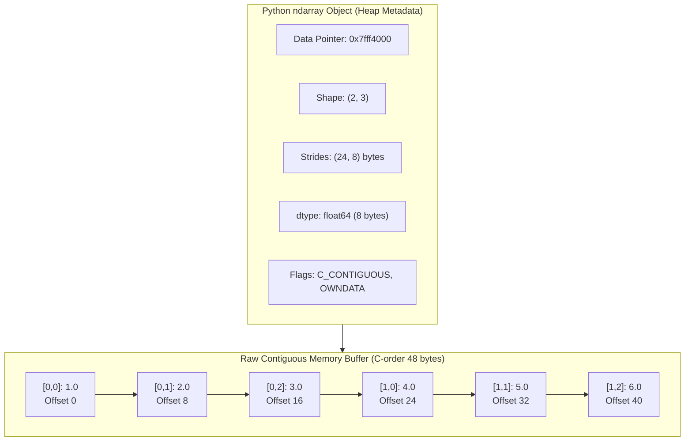
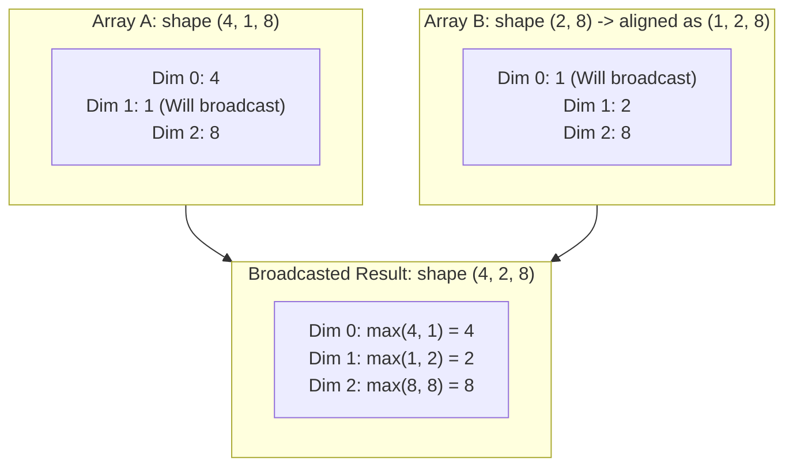
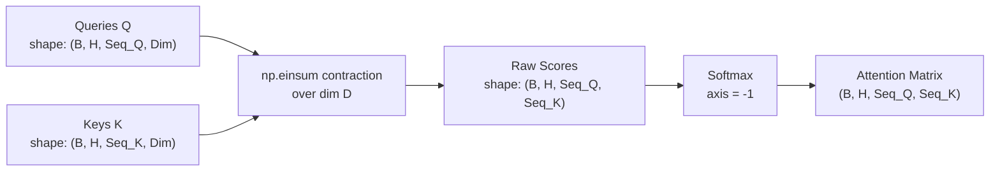

# NumPy in Depth: Memory Architecture, Strides, Broadcasting & Tensor Contractions

Welcome to **NumPy in Depth**. NumPy is the foundational computational substrate of modern AI. Whether you work with PyTorch, TensorFlow, JAX, or Hugging Face, all tensor abstractions and deep learning engines inherit their memory layout, stride conventions, and broadcasting rules directly from NumPy.

In this hands-on lab, we deconstruct NumPy from the raw byte buffer up to multi-dimensional tensor contractions.

---

## 1. Prerequisites & Quickstart

Ensure you have your environment active:

```bash
# Using uv (recommended)
uv pip install numpy scipy matplotlib

# Or classic pip
pip install numpy scipy matplotlib
```

Verify your NumPy version (NumPy 2.0+ recommended):
```python
import numpy as np
print("NumPy Version:", np.__version__)
```

---

## 2. What is an `ndarray` Really? (Memory Architecture)

A Python `list` is an array of pointers to boxed heap objects (`PyObject*`). Each integer element carries 28 bytes of overhead plus pointer indirection.

A NumPy `ndarray`, by contrast, is a lightweight C struct (`PyArrayObject`) that points to a **single contiguous block of raw memory bytes**:



### The Anatomy of an Array

Every `ndarray` consists of:
1. **Raw Data Buffer**: Contiguous memory storing the raw binary values.
2. **`shape`**: A tuple defining dimensions (e.g., `(2, 3)`).
3. **`strides`**: A tuple of byte steps required to jump to the next item along each axis.
4. **`dtype`**: Data descriptor (e.g., `int32`, `float64`, `complex128`).
5. **`flags`**: Metadata detailing memory layout (`C_CONTIGUOUS`, `F_CONTIGUOUS`, `OWNDATA`, `WRITEABLE`).

### The Byte-Offset Formula
To locate element `(i, j)` in a 2D array, NumPy never iterates. It computes the direct memory address with a single arithmetic step:

$$\text{Memory Address} = \text{Data Pointer} + (i \times \text{strides}[0]) + (j \times \text{strides}[1])$$

#### Code Walkthrough: Inspecting Strides & Memory
```python
import numpy as np

# Create a 2D float64 array (each float64 = 8 bytes)
arr = np.array([[1.0, 2.0, 3.0], 
                [4.0, 5.0, 6.0]], dtype=np.float64)

print("Shape:", arr.shape)          # (2, 3)
print("Dtype:", arr.dtype)          # float64
print("Itemsize:", arr.itemsize)    # 8 bytes
print("Strides:", arr.strides)      # (24, 8) -> 3 columns * 8 bytes = 24 bytes per row
print("Memory address:", arr.ctypes.data)
```

---

## 3. Zero-Copy Views vs. Deep Copies

Understanding views vs copies is the difference between an algorithm that runs in $O(1)$ constant time with zero extra RAM, versus one that triggers out-of-memory errors on production datasets.

- **View**: A new `PyArrayObject` header pointing to the **same underlying memory buffer** with modified `strides`, `shape`, or `offset`.
- **Copy**: Allocates an entirely new memory block and duplicates the bytes.

```python
import numpy as np

base = np.arange(10, dtype=np.int32)

# Slicing creates a zero-copy VIEW
view = base[::2]

# Fancy indexing creates a COPY
copy = base[[0, 2, 4]]

print("View shares memory with base?", np.shares_memory(base, view))  # True
print("Copy shares memory with base?", np.shares_memory(base, copy))  # False
print("View base pointer:", view.base is base)                        # True

# Mutating view affects base!
view[0] = 999
print("Mutated base:", base)  # base[0] is now 999!
```

> [!WARNING]
> **Basic Slicing vs Fancy Indexing**:
> Basic slices like `arr[1:5]`, `arr[::-1]`, or `arr.T` (transpose) are **always zero-copy views**.
> Integer array indexing (`arr[[1, 3]]`) and boolean masks (`arr[arr > 0]`) **always allocate a new copy**.

---

## 4. The SIMD Execution Engine (Why Vectorization is 100x Faster)

In pure Python, computing `a + b` for a list of 10,000,000 numbers requires:
1. Dynamically inspecting the type of every element.
2. Unwrapping `PyObject` headers.
3. Adding numbers in CPU registers.
4. Allocating a new `PyObject` for the result.
5. Incurring CPU L1/L2 cache misses due to fragmented pointer chains.

NumPy delegates execution directly to hardware **SIMD** (Single Instruction, Multiple Data) vector units (AVX-512, AVX2, or ARM Neon) and optimized C/Fortran libraries (**OpenBLAS**, **Intel MKL**, or **Apple Accelerate**).

### Benchmark: Python Loops vs. NumPy Vectorization

```python
import numpy as np
import time

N = 10_000_000
py_list_a = list(range(N))
py_list_b = list(range(N))

np_arr_a = np.arange(N, dtype=np.float64)
np_arr_b = np.arange(N, dtype=np.float64)

# 1. Pure Python Loop
t0 = time.perf_counter()
py_result = [a + b for a, b in zip(py_list_a, py_list_b)]
t_py = time.perf_counter() - t0

# 2. Vectorized NumPy SIMD
t0 = time.perf_counter()
np_result = np_arr_a + np_arr_b
t_np = time.perf_counter() - t0

print(f"Python list loop:  {t_py:.4f} seconds")
print(f"NumPy vectorized:  {t_np:.4f} seconds")
print(f"Speedup Factor:    {t_py / t_np:.1f}x faster!")
```

*Expected output: NumPy is typically **30x to 120x faster** while using 75% less RAM.*

---

## 5. Broadcasting Algebra & The Zero-Stride Trick

Broadcasting allows arithmetic operations on arrays of different shapes without copying data.



### The Two Golden Rules of Broadcasting
When operating on two arrays, NumPy compares their shapes element-wise, **starting from the trailing (rightmost) dimensions** and working backwards:
1. **Equality**: The dimensions are equal, OR
2. **Singular**: One of the dimensions is exactly `1`.

If neither condition is met, a `ValueError: operands could not be broadcast together` is raised.

### The Stride = 0 Optimization
How does NumPy broadcast an array of shape `(1, 5)` across 1,000 rows without duplicating memory?
**By setting the row stride to 0!**
When stride is 0, moving to the next row increments the memory pointer by `0 bytes`, reading the exact same memory row repeatedly at hardware speed without allocating a single extra byte.

#### Example: Vectorized Pairwise Euclidean Distance
Compute pairwise distances between $M$ query vectors and $N$ database vectors without a single Python `for` loop:

```python
import numpy as np

# M queries of dimension D=64
M, N, D = 100, 500, 64
queries = np.random.randn(M, D)       # shape: (100, 64)
database = np.random.randn(N, D)      # shape: (500, 64)

# Reshape queries to (M, 1, D) and database to (1, N, D)
# Broadcasting produces difference tensor of shape (M, N, D)
diff = queries[:, np.newaxis, :] - database[np.newaxis, :, :]

# Compute L2 distances
distances = np.sqrt(np.sum(diff ** 2, axis=-1))

print("Distance matrix shape:", distances.shape)  # (100, 500)
```

---

## 6. Einstein Summation (`np.einsum`): The LLM Builder's Weapon

`np.einsum` evaluates multi-dimensional tensor contractions using the classical Einstein summation convention. It replaces combinations of `transpose`, `reshape`, `sum`, and `matmul` with a single, highly readable signature.



### Reading the Einsum Notation
`np.einsum('ij,jk->ik', A, B)`
- Input indices before `->` (`ij` for A, `jk` for B).
- Output indices after `->` (`ik`).
- Any index present in the inputs but omitted from the output (`j`) is **summed over** (contracted).

### Essential Einsum Patterns

| Operation | Mathematical Form | Traditional NumPy | `np.einsum` Equivalent |
| :--- | :--- | :--- | :--- |
| **Vector Dot Product** | $c = \sum_i a_i b_i$ | `np.dot(a, b)` | `np.einsum('i,i->', a, b)` |
| **Matrix Multiply** | $C_{ik} = \sum_j A_{ij} B_{jk}$ | `A @ B` | `np.einsum('ij,jk->ik', A, B)` |
| **Batch Matrix Multiply** | $C_{bij} = \sum_k A_{bik} B_{bkj}$ | `np.matmul(A, B)` | `np.einsum('bik,bkj->bij', A, B)` |
| **Trace (Diagonal Sum)** | $t = \sum_i A_{ii}$ | `np.trace(A)` | `np.einsum('ii->', A)` |
| **Tensor Transpose** | $T_{kji} = A_{ijk}$ | `np.transpose(A, (2, 1, 0))` | `np.einsum('ijk->kji', A)` |
| **Outer Product** | $C_{ij} = a_i b_j$ | `np.outer(a, b)` | `np.einsum('i,j->ij', a, b)` |

---

## 7. Hands-On Exercise: Implement Scaled Dot-Product Attention in Pure NumPy

In modern Large Language Models (LLMs like Llama, DeepSeek, and GPT-4), the heart of every transformer block is **Scaled Dot-Product Attention**:

$$\text{Attention}(Q, K, V) = \text{softmax}\left(\frac{Q K^T}{\sqrt{d_k}}\right) V$$

Let's implement this complete mathematical operation in 15 lines of pure NumPy using `np.einsum`:

```python
import numpy as np

def scaled_dot_product_attention(Q, K, V, mask=None):
    """
    Computes Multi-Head Attention in pure NumPy.
    
    Arguments:
        Q: Queries tensor of shape (batch, heads, seq_len_q, dim)
        K: Keys tensor of shape (batch, heads, seq_len_k, dim)
        V: Values tensor of shape (batch, heads, seq_len_v, dim)
        mask: Optional boolean mask of shape (seq_len_q, seq_len_k)
        
    Returns:
        output: Contextualized representations of shape (batch, heads, seq_len_q, dim)
        attention_weights: Normalized attention weights (batch, heads, seq_len_q, seq_len_k)
    """
    d_k = Q.shape[-1]
    
    # 1. Compute raw attention scores via einsum (contracts dimension 'd')
    # (b, h, q, d) x (b, h, k, d) -> (b, h, q, k)
    scores = np.einsum('bhqd,bhkd->bhqk', Q, K) / np.sqrt(d_k)
    
    # 2. Apply causal mask (if provided) for autoregressive decoding
    if mask is not None:
        scores = np.where(mask == 0, -1e9, scores)
        
    # 3. Stable Softmax across the keys dimension (axis=-1)
    # Subtract max for numerical stability against floating point overflow
    max_scores = np.max(scores, axis=-1, keepdims=True)
    exp_scores = np.exp(scores - max_scores)
    attention_weights = exp_scores / np.sum(exp_scores, axis=-1, keepdims=True)
    
    # 4. Multiply attention weights by values
    # (b, h, q, k) x (b, h, k, d) -> (b, h, q, d)
    output = np.einsum('bhqk,bhkd->bhqd', attention_weights, V)
    
    return output, attention_weights

# --- Verification & Test ---
batch_size = 2
num_heads = 4
seq_len = 8
head_dim = 64

Q = np.random.randn(batch_size, num_heads, seq_len, head_dim)
K = np.random.randn(batch_size, num_heads, seq_len, head_dim)
V = np.random.randn(batch_size, num_heads, seq_len, head_dim)

# Create causal lower-triangular mask
causal_mask = np.tril(np.ones((seq_len, seq_len)))

output, weights = scaled_dot_product_attention(Q, K, V, mask=causal_mask)

print("Attention Output Shape:", output.shape)    # (2, 4, 8, 64)
print("Attention Weights Shape:", weights.shape)  # (2, 4, 8, 8)
print("Row Sums (Softmax Check):", np.allclose(weights.sum(axis=-1), 1.0))  # True
```

---

## 8. NumPy 2.0 & Zero-Copy Interoperability with PyTorch

Released in 2024, **NumPy 2.0** represents the first major ABI overhaul in 18 years.

### DLPack Protocol (Zero-Copy GPU/CPU Bridge)
NumPy 2.0 standardizes **DLPack**, allowing PyTorch, JAX, and CuPy to share the exact same underlying memory buffers without CPU-to-GPU copying:

```python
import numpy as np

# NumPy array
np_arr = np.ones((4, 4), dtype=np.float32)

# If PyTorch is installed:
try:
    import torch
    # Zero-copy bridge using DLPack standard
    torch_tensor = torch.from_dlpack(np_arr.__dlpack__())
    print("Zero-copy PyTorch tensor acquired successfully!")
except ImportError:
    pass
```

---

## 9. Summary & Key Takeaways

1. **Memory is 1D**: Every multi-dimensional array is an illusion managed by `shape` and `strides` on a 1D contiguous byte buffer.
2. **Views Over Copies**: Slices (`a[::2]`, `a.T`) share memory; fancy indexing (`a[[0, 1]]`) duplicates memory.
3. **Broadcasting is Zero-Cost**: Broadcasting expands dimensions virtually by setting strides to `0`, requiring no additional memory.
4. **`np.einsum` is Universal**: Master einsum notation for clean, vectorized multi-dimensional matrix and tensor operations.
