# Complete NumPy Tutorial: Beginner to Advanced with Python Labs

**Learn NumPy with simple Python examples, practical exercises, and modern 2.x APIs.**

This self-contained learning guide is a comprehensive tutorial covering NumPy arrays, indexing, slicing, broadcasting, random distributions, linear algebra, memory performance, and attention math — enhanced with interactive visual architecture diagrams.

## Table of Contents

- [Lesson 1: Install NumPy and create arrays](#lesson-1)
- [Lesson 2: Indexing, slicing and filtering](#lesson-2)
- [Lesson 3: Shapes, axes and broadcasting](#lesson-3)
- [Lesson 4: Dtypes, copies and views](#lesson-4)
- [Lesson 5: Array operations](#lesson-5)
- [Lesson 6: Statistics and random numbers](#lesson-6)
- [Lesson 7: Linear algebra](#lesson-7)
- [Lesson 8: Memory and performance](#lesson-8)
- [Lesson 9: NumPy for AI](#lesson-9)
- [Lesson 10: Hands-on labs](#lesson-10)
- [NumPy Cheat Sheet](#numpy-cheat-sheet)
- [Frequently Asked Questions](#frequently-asked-questions)

## Quick Start

```bash
python -m pip install "numpy>=2,<3"
```

```python
import numpy as np
a = np.array([10, 20, 30])
print(a * 2)  # [20 40 60]
```

---

<a id="lesson-1"></a>
## Lesson 1: Install NumPy and create arrays

**In this lesson:** Learn what NumPy is, how to install it, and how to create your first arrays.

### What is NumPy?

NumPy is a Python library for numerical computing. Its main data type is the **N-dimensional array**, or `ndarray`. Unlike a typical Python list, a standard NumPy array has one element data type (`dtype`) and supports vectorized operations.

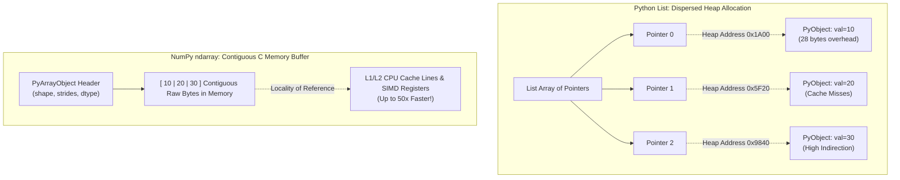

### Install NumPy

```bash
python -m pip install numpy
```

```python
import numpy as np
print(np.__version__)
```

To follow this repository, install the root `requirements.txt` instead.

### Create your first array

```python
import numpy as np

numbers = np.array([10, 20, 30])
print(numbers)             # [10 20 30]
print(type(numbers))       # <class 'numpy.ndarray'>
print(numbers + 5)         # [15 25 35]
```

A Python list repeats itself with `list * 2`; a NumPy array multiplies its numbers with `array * 2`.

### Common ways to build arrays

```python
np.array([1, 2, 3])       # From Python values
np.zeros(3)               # [0. 0. 0.]
np.ones((2, 3))           # 2 rows, 3 columns
np.full((2, 2), 7)        # Fill with 7
np.arange(0, 10, 2)       # [0 2 4 6 8]
np.linspace(0, 1, 5)      # Five evenly spaced numbers, includes 1
```

### Dimensions, shape and size

```python
scalar = np.array(42)                        # 0D, shape ()
vector = np.array([1, 2, 3])                # 1D, shape (3,)
matrix = np.array([[1, 2, 3], [4, 5, 6]])  # 2D, shape (2, 3)
cube = np.zeros((2, 3, 4))                  # 3D, shape (2, 3, 4)

print(matrix.ndim)    # 2: number of axes
print(matrix.shape)   # (2, 3): length of each axis
print(matrix.size)    # 6: total elements
print(matrix.dtype)   # Depends on platform and constructor inputs
```

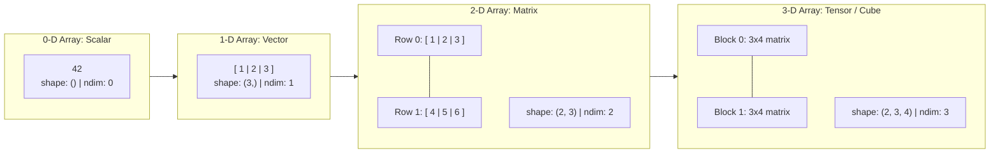

### Important vocabulary

| Term | Plain English | Example |
| --- | --- | --- |
| `ndarray` | NumPy array object | `np.array([1, 2])` |
| `ndim` | Number of axes | `2` |
| `shape` | Length of each axis | `(2, 3)` |
| `size` | Total number of values | `6` |
| `dtype` | Type of stored elements | `float64` |

**Practice:** Create a `3 × 4` array of zeros, then print its `shape`, `ndim`, and `size`.

---

<a id="lesson-2"></a>
## Lesson 2: Indexing, slicing and filtering

**In this lesson:** Select elements, rows, columns, ranges, and matching values.

### Indexing starts at zero

```python
import numpy as np

a = np.array([10, 20, 30, 40])
print(a[0])    # 10: first
print(a[2])    # 30: third
print(a[-1])   # 40: last
```

### Index two-dimensional arrays

Use `a[row, column]`.

```python
matrix = np.array([[1, 2, 3],
                   [4, 5, 6]])

print(matrix[1, 2])   # 6: second row, third column
print(matrix[0])      # [1 2 3]: first row
print(matrix[:, 1])   # [2 5]: second column
```

For 3D arrays, use three indices: `array[block, row, column]`.

### Slicing: start, stop, step

```python
a = np.array([0, 10, 20, 30, 40, 50])
print(a[1:4])     # [10 20 30]
print(a[:3])      # [ 0 10 20]
print(a[::2])     # [ 0 20 40]
print(a[::-1])    # [50 40 30 20 10  0]
```

The `stop` index is **not included**.

### Slicing rows and columns

```python
m = np.array([[1, 2, 3],
              [4, 5, 6],
              [7, 8, 9]])
print(m[:2, 1:])  # [[2 3], [5 6]]
```

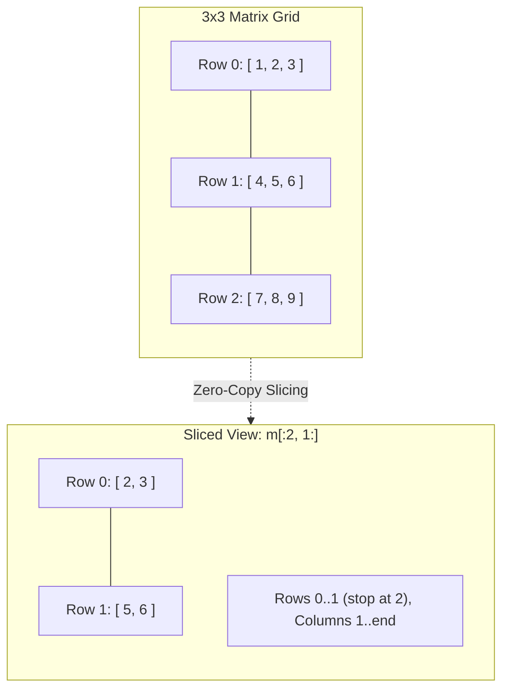

### Boolean filtering

```python
scores = np.array([48, 78, 91, 63, 85])
passing = scores >= 70
print(passing)          # [False  True  True False  True]
print(scores[passing])  # [78 91 85]
print(scores[(scores >= 60) & (scores < 90)])  # [78 63 85]
```

Use `&` for element-wise AND, `|` for OR, and parentheses around each comparison. Do not use Python's `and` or `or` between full NumPy masks.

### Searching for values

```python
a = np.array([4, 7, 4, 9])
print(np.where(a == 4)[0])       # [0 2]
print(np.flatnonzero(a == 4))    # [0 2]
```

**Pitfall:** `a[1:3]` is typically a **view**; `a[[1, 2]]` (integer-array indexing) returns a **copy**. See copies and views.

**Practice:** Given `np.arange(12).reshape(3, 4)`, select the last two columns, then only values divisible by 3.

---

<a id="lesson-3"></a>
## Lesson 3: Shapes, axes and broadcasting

**In this lesson:** Change an array's shape and combine compatible shapes without manually duplicating values.

### Reshape without changing the number of elements

```python
import numpy as np

a = np.arange(12)
m = a.reshape(3, 4)
print(m.shape)                 # (3, 4)
print(m.reshape(2, 3, 2).shape) # (2, 3, 2)
print(m.reshape(-1).shape)    # (12,)
```

The product of the new dimensions must equal `a.size`. Only one dimension may be `-1` (inferred).

**Important:** `reshape` creates a view **when possible**, but can create a copy if the memory layout requires it.

### What does `axis` mean?

Think of `axis` as the dimension that an operation reduces or follows.

```python
m = np.array([[1, 2, 3],
              [4, 5, 6]])

print(m.sum())         # 21: all cells
print(m.sum(axis=0))   # [5 7 9]: reduce rows, one result per column
print(m.sum(axis=1))   # [ 6 15]: reduce columns, one result per row
```

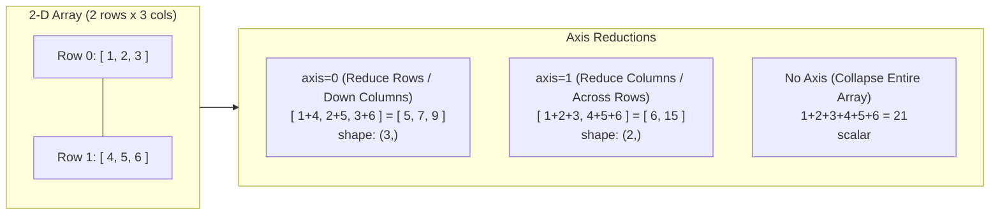

### Broadcasting: the two simple rules

Compare shapes from **right to left**. Dimensions are compatible when they are equal **or** either dimension is `1`. Missing leading dimensions behave like `1`.

```python
prices = np.array([[100, 200, 300],
                   [400, 500, 600]])    # shape (2, 3)
rebates = np.array([10, 20, 30])       # shape (3,)
print(prices - rebates)                # shape (2, 3)
```

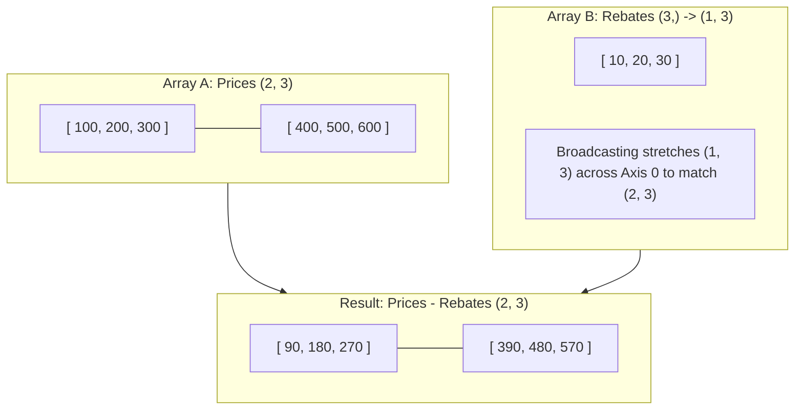

More examples:

| Shape A | Shape B | Result |
| --- | --- | --- |
| `(4, 3)` | `(3,)` | `(4, 3)` |
| `(4, 1)` | `(1, 3)` | `(4, 3)` |
| `(2, 1, 5)` | `(3, 5)` | `(2, 3, 5)` |
| `(2, 3)` | `(2,)` | **Error** |

### Add a dimension

```python
x = np.array([1, 2, 3])
print(x[:, None].shape)  # (3, 1): column
print(x[None, :].shape)  # (1, 3): row
```

Broadcasting generally avoids copying the *input* array, but **the result and temporary calculations can still allocate memory**. Large broadcasted intermediates may be expensive.

### Broadcasting as a real task: normalize rows

```python
data = np.array([[10.0, 20.0, 30.0],
                 [ 2.0,  4.0,  6.0]])
row_totals = data.sum(axis=1, keepdims=True)  # (2, 1)
fractions = data / row_totals
print(fractions.sum(axis=1))  # [1. 1.]
```

**Practice:** Create a `(4, 3)` matrix and subtract each column's mean using `mean(axis=0)`.

---

<a id="lesson-4"></a>
## Lesson 4: Dtypes, copies and views

**In this lesson:** Learn how arrays store values and when two arrays share memory.

### Data types (`dtype`)

```python
import numpy as np

ints = np.array([1, 2, 3], dtype=np.int32)
floats = np.array([1.5, 2.5], dtype=np.float64)
flags = np.array([True, False], dtype=np.bool_)
print(ints.dtype)          # int32
print(floats.itemsize)     # 8 bytes per element
```

Common types: `int32`, `int64`, `uint8`, `float32`, `float64`, `bool`, `complex128`, and string/Unicode types. Use explicit dtypes when storage size or interoperability matters. Default integer widths can vary by environment.

### Convert an array

```python
values = np.array([1.9, 2.2, -3.8])
converted = values.astype(np.int32)
print(converted)  # [ 1  2 -3]
```

Converting floating-point values to integers truncates toward zero and can lose information. Avoid out-of-range conversions.

### Copy versus view

A **copy** owns an independent buffer; a **view** shares memory with another array.

```python
a = np.array([10, 20, 30, 40])
view = a[1:3]              # basic slice: view
copy = a[[1, 2]]          # integer-array indexing: copy
view[0] = 999
print(a)                   # [ 10 999  30  40]
print(copy)                # [20 30]
print(np.shares_memory(a, view)) # True
print(np.shares_memory(a, copy)) # False
```

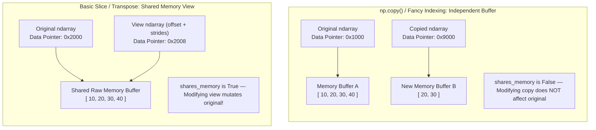

`array.base` can help investigate ownership, but it is **not** a complete test for whether two specific arrays share memory. Prefer `np.shares_memory(x, y)` for that question.

### Memory layout and reshaping

```python
a = np.arange(12).reshape(3, 4)
print(a.strides)             # byte steps between elements on each axis
print(a.flags.c_contiguous) # True for a normal C-order array

b = a.T                     # transpose is typically a view
print(np.shares_memory(a, b)) # True
```

Most normal arrays are contiguous, but slices and transposes may not be. `reshape` may return a view or a copy depending on layout; do not rely on either without checking.

**Practice:** Compare `a[::2]`, `a[[0, 2]]`, and `a.copy()` using `np.shares_memory()`.

---

<a id="lesson-5"></a>
## Lesson 5: Array operations

**In this lesson:** Replace repetitive loops with clear array operations.

### Math and universal functions (ufuncs)

```python
import numpy as np

a = np.array([10, 20, 30])
b = np.array([2, 4, 5])

print(a + b)             # [12 24 35]
print(np.multiply(a, b)) # [ 20  80 150]
print(a / b)             # [ 5.  5.  6.]
print(np.sqrt(b))        # element-wise square root
```

NumPy ufuncs include `np.add`, `np.subtract`, `np.multiply`, `np.divide`, `np.power`, `np.abs`, `np.exp`, and `np.log`. They apply operations element by element, often using optimized compiled implementations.

#### Rounding and trigonometry

```python
x = np.array([-1.7, 2.4])
print(np.floor(x)) # [-2.  2.]
print(np.ceil(x))  # [-1.  3.]
print(np.trunc(x)) # [-1.  2.]
print(np.round(x)) # [-2.  2.]
print(np.sin(np.deg2rad([0, 90]))) # approximately [0. 1.]
```

Rounding ties follows NumPy's defined semantics (typically to the nearest even value); use the appropriate function for your requirements.

#### Logs, powers and number theory

```python
print(np.log([1, np.e]))   # approximately [0. 1.]
print(np.log10([1, 10]))   # [0. 1.]
print(np.power([2, 3], 2)) # [4 9]
print(np.gcd(12, 18))      # 6
print(np.lcm(4, 6))        # 12
```

#### Hyperbolic functions

`np.sinh`, `np.cosh`, `np.tanh` and their inverse functions act element-wise. For numerical inputs, keep function domain restrictions in mind (`arccosh(x)` requires `x >= 1` for real results).

### Join and stack arrays

```python
x = np.array([1, 2, 3])
y = np.array([4, 5, 6])

print(np.concatenate([x, y]).shape) # (6,)
print(np.stack([x, y]).shape)       # (2, 3): new axis
print(np.column_stack([x, y]).shape)  # (3, 2)
print(np.hstack([x, y]).shape)      # (6,) for 1D inputs
print(np.vstack([x, y]).shape)      # (2, 3)
print(np.dstack([x, y]).shape)      # (1, 3, 2)
```

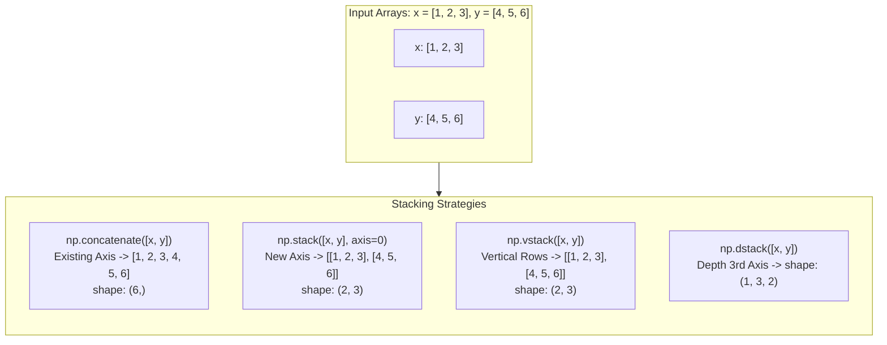

**Remember:** `concatenate` combines along an existing axis, while `stack` creates a new axis. `hstack`/`vstack` behavior depends on input dimensionality, so `concatenate` and `stack` with explicit axes are often clearer.

### Split arrays

```python
a = np.arange(7)
parts = np.array_split(a, 3)
print([p.tolist() for p in parts])  # [[0, 1, 2], [3, 4, 5], [6]]
```

`np.split` needs equal divisions; `np.array_split` can handle uneven sizes. For matrices, use `axis=0` for rows and `axis=1` for columns.

### Sort, search and filter

```python
a = np.array([9, 2, 7, 2])
print(np.sort(a))               # [2 2 7 9], original unchanged
print(np.argsort(a))            # indices in sorted order
print(np.flatnonzero(a == 2))   # [1 3]
print(a[a > 5])                 # [9 7]
```

`np.searchsorted` returns insertion points **in a sorted array**:

```python
sorted_a = np.array([2, 5, 8])
print(np.searchsorted(sorted_a, 6))  # 2
```

### Set operations

```python
a = np.array([1, 2, 3])
b = np.array([3, 4, 5])
print(np.union1d(a, b))       # [1 2 3 4 5]
print(np.intersect1d(a, b))   # [3]
print(np.setdiff1d(a, b))     # [1 2]
print(np.setxor1d(a, b))      # [1 2 4 5]
```

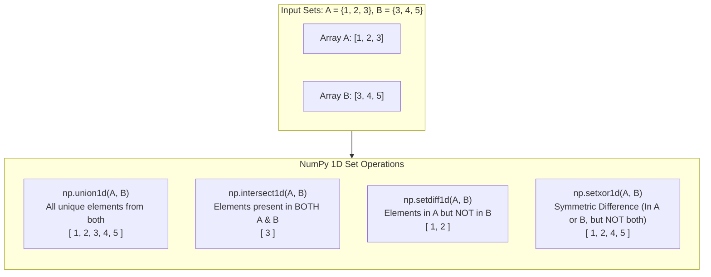

These 1D set operations generally return sorted unique values, not the original order or duplicate counts.

### Iterate only when appropriate

```python
matrix = np.array([[1, 2], [3, 4]])
for idx, value in np.ndenumerate(matrix):
    print(idx, value)   # (0, 0) 1; ...

for value in np.nditer(matrix):
    print(value)
```

Array-wide operations often work better for numeric computations, but iteration is useful for I/O, irregular control flow, and debugging. `np.vectorize()` is mainly a convenience wrapper; it **does not make a Python function magically fast**.

**Practice:** Combine two arrays, remove duplicate values, sort descending, and keep only numbers greater than 5.

---

<a id="lesson-6"></a>
## Lesson 6: Statistics and random numbers

**In this lesson:** Summarize data and generate reproducible samples with modern NumPy.

### Statistics in a few lines

```python
import numpy as np

sales = np.array([[10, 20, 30],
                  [20, 30, 40]])
print(sales.mean())         # 25.0
print(np.median(sales))     # 25.0
print(sales.std())          # population standard deviation (ddof=0)
print(sales.sum(axis=0))    # [30 50 70]
print(sales.max(axis=1))    # [30 40]
print(np.percentile(sales, 75))
```

`axis=0` reduces down rows (producing column summaries); `axis=1` reduces across columns (producing row summaries).

#### Cumulative operations

```python
print(np.cumsum([1, 2, 3]))       # [1 3 6]
print(np.prod([2, 3, 4]))         # 24
print(np.cumprod([2, 3, 4]))      # [ 2  6 24]
print(np.diff([4, 9, 12]))        # [5 3]
```

### Random numbers: use `default_rng()`

```python
rng = np.random.default_rng(42)  # reproducible sequence
print(rng.integers(1, 7, size=5))  # five die rolls in [1, 6]
print(rng.random(3))               # uniform floats in [0, 1)
print(rng.normal(0, 1, size=3))    # Gaussian samples
print(rng.choice(['A', 'B', 'C'], size=2, replace=False))
```

Using the same seed and same sequence of calls produces reproducible results for a given implementation/environment. Random values are **not** appropriate for secrets, passwords, or cryptographic keys.

#### Shuffle versus permutation

```python
cards = np.arange(5)
rng.shuffle(cards)             # changes cards in place
new_order = rng.permutation(cards) # shuffled copy
```

### Choose a distribution

These methods all belong to `rng` created using `np.random.default_rng()`.

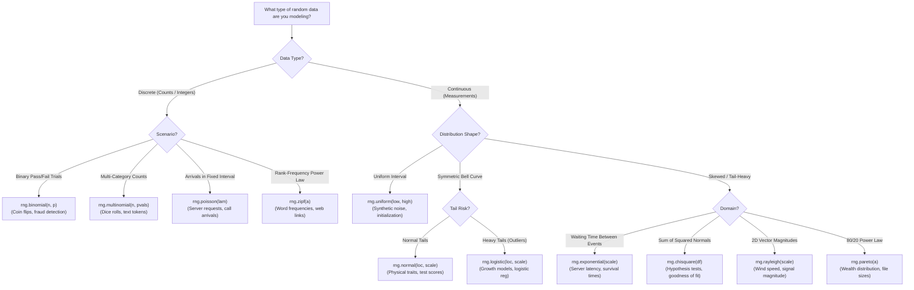

| Distribution | Typical question | Example |
| --- | --- | --- |
| Uniform | Any value in an interval equally likely? | `rng.uniform(0, 1, 100)` |
| Normal | Data clustered around an average? | `rng.normal(0, 1, 100)` |
| Binomial | How many successes in fixed trials? | `rng.binomial(10, 0.5, 100)` |
| Poisson | How many events in an interval? | `rng.poisson(3, 100)` |
| Exponential | Time between Poisson events? | `rng.exponential(2, 100)` |
| Multinomial | Counts across multiple categories? | `rng.multinomial(10, [0.2, 0.8])` |
| Logistic | Bell-shaped distribution with heavier tails than normal? | `rng.logistic(0, 1, 100)` |
| Chi-square | Sum of squares of independent standard normals? | `rng.chisquare(3, 100)` |
| Rayleigh | Magnitude of two independent zero-mean Gaussian components? | `rng.rayleigh(1, 100)` |
| Pareto | Heavy-tailed positive values? | `rng.pareto(2, 100)` |
| Zipf | Power-law integer rank frequencies? | `rng.zipf(2, 100)` |

**Important:** `rng.pareto(a)` uses NumPy's shifted/Pareto-II-like convention, with values starting at zero. Add 1 if you want the conventional Pareto-I shape with minimum 1.

### Mini-example: estimate probability

```python
rng = np.random.default_rng(7)
rolls = rng.integers(1, 7, size=20_000)
print(np.mean(rolls == 6))  # typically near 1/6
```

This is a simulation estimate, not an exact probability, and changes by seed and sample size.

### Missing data

```python
readings = np.array([2.0, np.nan, 4.0])
print(np.mean(readings))     # nan
print(np.nanmean(readings))  # 3.0
```

**Practice:** Simulate 10,000 die rolls. Compute the sample mean, frequency of sixes, and cumulative sum of the first ten rolls.

---

<a id="lesson-7"></a>
## Lesson 7: Linear algebra

**In this lesson:** Use NumPy to multiply matrices and solve small mathematical problems.

### Dot products and matrix multiplication

```python
import numpy as np

x = np.array([1, 2, 3])
y = np.array([4, 5, 6])
print(np.dot(x, y))    # 32

A = np.array([[1, 2], [3, 4]])
B = np.array([[2, 0], [1, 2]])
print(A @ B)           # [[ 4  4], [10  8]]
print(A * B)           # element-wise, NOT matrix multiplication
```

`@` means matrix multiplication for 2D arrays. Use it instead of the ordinary `*` operator when you mean matrix algebra.

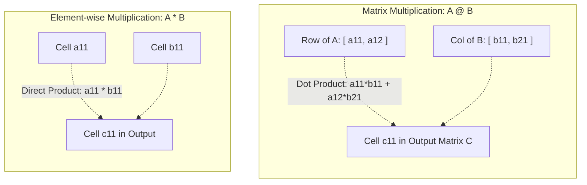

### Solve a system of equations

Given `2x + y = 5` and `x - y = 1`:

```python
A = np.array([[2.0, 1.0], [1.0, -1.0]])
b = np.array([5.0, 1.0])
solution = np.linalg.solve(A, b)
print(solution)  # [2. 1.]
```

Prefer `np.linalg.solve(A, b)` to explicitly computing `np.linalg.inv(A) @ b` when solving `Ax = b`.

### Norms, determinants and eigendecomposition

```python
v = np.array([3.0, 4.0])
print(np.linalg.norm(v))  # 5.0
print(np.linalg.det(np.eye(3))) # 1.0

symmetric = np.array([[2.0, 1.0], [1.0, 2.0]])
values, vectors = np.linalg.eigh(symmetric)
print(values)  # [1. 3.]
```

`np.linalg.eigh()` is suitable for real symmetric or complex Hermitian matrices; `np.linalg.eig()` covers general square matrices.

### Singular value decomposition (SVD)

```python
M = np.array([[3.0, 0.0], [0.0, 2.0]])
U, s, Vt = np.linalg.svd(M, full_matrices=False)
print(s)  # [3. 2.]
```

SVD is useful in dimensionality reduction, numerical analysis, and matrix approximations.

### The `einsum` bridge

```python
print(np.einsum('ij,jk->ik', A, A))  # same as A @ A
```

Use `@` for readable matrix multiplication; choose `einsum` for more complex tensor index patterns. Neither is automatically fastest in every situation.

**Practice:** Solve `x + y = 7`, `2x - y = 2` using `np.linalg.solve()`.

---

<a id="lesson-8"></a>
## Lesson 8: Memory and performance

**In this lesson:** Understand how array memory and compiled operations can improve performance.

### Python lists vs NumPy arrays

A Python list stores references to Python objects. A standard numeric NumPy array stores same-type elements in an efficient data buffer plus metadata such as `shape`, `strides`, and `dtype`.

NumPy arrays **can** be noncontiguous (for example, sliced or transposed views). So it is incorrect to say every NumPy array is physically contiguous.

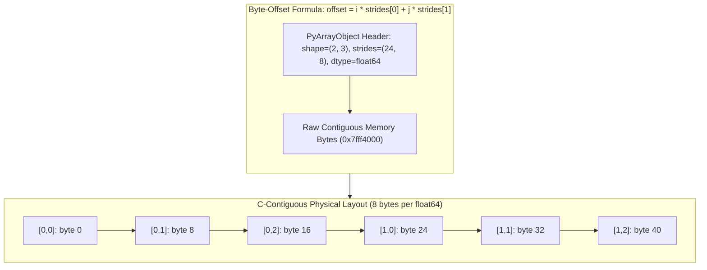

### Inspect memory layout

```python
import numpy as np

matrix = np.array([[1.0, 2.0, 3.0],
                   [4.0, 5.0, 6.0]])
print(matrix.shape)    # (2, 3)
print(matrix.dtype)    # float64
print(matrix.strides)  # (24, 8) for a typical C-contiguous float64 array
print(matrix.nbytes)   # 48 bytes for the data elements
print(matrix.flags.c_contiguous)  # True

transposed = matrix.T
print(transposed.strides)   # different byte steps
print(np.shares_memory(matrix, transposed)) # True
```

For a two-dimensional array, the byte offset of `(i, j)` is `i * strides[0] + j * strides[1]` relative to the array's data pointer.

### Benchmark the right way

```python
import timeit
import numpy as np

N = 100_000
py_data = list(range(N))
np_data = np.arange(N)

python_time = timeit.timeit(lambda: [x * 2 for x in py_data], number=20)
numpy_time = timeit.timeit(lambda: np_data * 2, number=20)
print(f"Python: {python_time:.4f}s | NumPy: {numpy_time:.4f}s")
```

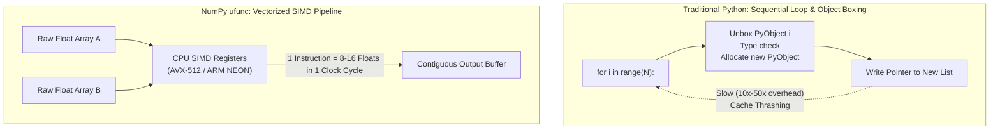

Actual results vary with CPU, input size, data type, caching, memory allocations, and how the measurement is made. Avoid promises such as “always 50× faster.” Also avoid timing data preparation on only one side of a comparison.

### Broadcasting can save input copies but create intermediates

```python
rng = np.random.default_rng(0)
queries = rng.normal(size=(10, 8))
items = rng.normal(size=(20, 8))

difference = queries[:, None, :] - items[None, :, :]
print(difference.shape) # (10, 20, 8)
distance = np.sqrt(np.sum(difference**2, axis=-1))
print(distance.shape)   # (10, 20)
```

The *broadcasted input views* do not need a full repeated array, but `difference` and `difference**2` allocate outputs. For very large datasets, use chunking or algebraic reformulations to reduce memory use.

### Performance checklist

- Prefer built-in NumPy operations to manually looping over each element.
- Check `dtype`; using `float32` when suitable can reduce memory use compared with `float64`.
- Check array sizes and intermediate allocations.
- Use `np.shares_memory()` when editing slices or transposes.
- Profile actual workloads: a pure Python loop can still win for tiny arrays or special logic.

**Practice:** Compare memory usage of `np.ones(1_000_000, dtype=np.float32)` and `dtype=np.float64` using `nbytes`.

---

<a id="lesson-9"></a>
## Lesson 9: NumPy for AI

**In this lesson:** See how NumPy relates to the matrix calculations used by machine-learning models. You need to be comfortable with shapes and broadcasting first.

### Understand `np.einsum`

`einsum` describes how input indices combine to create an output:

```python
import numpy as np

a = np.array([1, 2, 3])
b = np.array([4, 5, 6])
print(np.einsum('i,i->', a, b))  # 32: dot product

A = np.arange(6).reshape(2, 3)
B = np.arange(12).reshape(3, 4)
print(np.einsum('ij,jk->ik', A, B).shape)  # (2, 4)
```

| Pattern | Meaning |
| --- | --- |
| `i,i->` | dot product |
| `ij,jk->ik` | matrix multiplication |
| `ij->ji` | transpose |
| `ii->` | sum of diagonal |
| `bi,bi->b` | batch of dot products |

For ordinary matrix multiplication, `A @ B` is usually clearer; profile before assuming an `einsum` rewrite is faster.

### Stable softmax

Softmax converts scores into nonnegative weights that sum to one.

```python
def softmax(scores, axis=-1):
    shifted = scores - np.max(scores, axis=axis, keepdims=True)
    e = np.exp(shifted)
    return e / np.sum(e, axis=axis, keepdims=True)

print(softmax(np.array([1.0, 2.0, 3.0])))
```

Subtracting the largest score improves numerical stability.

### Attention in one equation

$$
\operatorname{Attention}(Q,K,V) = \operatorname{softmax}\left(\frac{QK^T}{\sqrt{d_k}}\right)V
$$

- **Q** = queries, **K** = keys, **V** = values.
- `d_k` = key-vector width.
- Each query assigns attention weights to keys, then uses the weights to combine values.

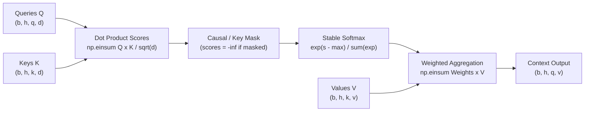

### Runnable multi-head attention lab

See `labs/lab04_attention.py` for a complete version with test assertions.

```python
import numpy as np

def attention(q, k, v, mask=None):
    # q: (batch, heads, queries, key_dim)
    # k: (batch, heads, keys, key_dim)
    # v: (batch, heads, keys, value_dim)
    scores = np.einsum('bhqd,bhkd->bhqk', q, k) / np.sqrt(q.shape[-1])
    if mask is not None:
        # True means allowed; every query must allow at least one key.
        scores = np.where(mask, scores, -np.inf)
    shifted = scores - scores.max(axis=-1, keepdims=True)
    weights = np.exp(shifted)
    weights /= weights.sum(axis=-1, keepdims=True)
    output = np.einsum('bhqk,bhkv->bhqv', weights, v)
    return output, weights

rng = np.random.default_rng(12)
q = rng.normal(size=(1, 2, 4, 8))
k = rng.normal(size=(1, 2, 4, 8))
v = rng.normal(size=(1, 2, 4, 6))
causal = np.tril(np.ones((4, 4), dtype=bool))
output, weights = attention(q, k, v, causal)
print(output.shape)                   # (1, 2, 4, 6)
print(np.allclose(weights.sum(-1), 1)) # True
```

A query with no allowed key would create an all-`-inf` row and undefined softmax; validate or handle such masks before production use. This is an educational implementation, not a high-performance attention kernel.

### NumPy and PyTorch interoperability (optional)

NumPy generally provides CPU array storage; sharing memory with a CPU PyTorch tensor can be possible with supported compatible dtypes/layouts:

```python
# Requires separately installing PyTorch.
# import torch
# arr = np.ones(4, dtype=np.float32)
# tensor = torch.from_numpy(arr)  # shares CPU memory when supported
```

DLPack provides a protocol for sharing compatible array buffers between libraries and devices. It does **not** automatically move a CPU NumPy array into GPU memory without copying.

**Practice:** Change the attention lab to use a different value dimension. Verify weights sum to 1 for every query and masked future positions receive zero weight.

---

<a id="lesson-10"></a>
## Lesson 10: Hands-on labs

Each project contains runnable Python and a small extension exercise. Work from the project root.

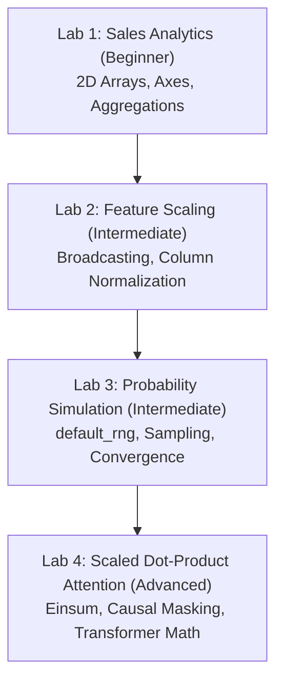

### Run the labs

```bash
python -m pip install -r requirements.txt
python labs/lab01_sales_analysis.py
python labs/lab02_feature_scaling.py
python labs/lab03_random_simulation.py
python labs/lab04_attention.py
python -m pip install -r requirements-dev.txt
pytest -q
```

### Lab 1 — Sales analytics (beginner)

**Goal:** Use 2D arrays, `axis`, sums, and boolean filters to find high-performing products.

**Input:** Three products with sales across four weeks.

**You will compute:** Product totals, week totals, total revenue, and products above an average-sales threshold.

**Challenge:** Add a fourth product and calculate the best-selling week.

Lab 1 source is included in the downloadable ZIP.

### Lab 2 — Standardize features (beginner/intermediate)

**Goal:** Use broadcasting to turn raw feature values into zero-mean, unit-variance columns.

**You will compute:** Column means, standard deviations, and standardized features.

**Challenge:** Add a constant-valued column and decide how to handle zero standard deviation.

Lab 2 source is included in the downloadable ZIP.

### Lab 3 — Probability simulation (intermediate)

**Goal:** Generate 20,000 simulated die rolls with `default_rng`.

**You will compute:** Mean roll, estimated probability of rolling six, and outcome counts.

**Challenge:** Repeat with a different seed; compare the empirical distribution to the uniform theoretical distribution.

Lab 3 source is included in the downloadable ZIP.

### Lab 4 — Attention from scratch (advanced)

**Goal:** Implement a stable, causally masked, multi-head scaled dot-product attention function.

**You will compute:** Attention scores, weights, outputs, and shape checks.

**Challenge:** Try different lengths for queries and keys; construct a valid mask of shape `(queries, keys)`.

Lab 4 source is included in the downloadable ZIP.

### Learning checklist

- [ ] Explain `ndim`, `shape`, and `dtype` without looking them up.
- [ ] Use `a[row, column]` and boolean indexing.
- [ ] Reshape an array and explain `axis=0` versus `axis=1`.
- [ ] Predict whether two shapes can broadcast.
- [ ] Recognize a copy and a view.
- [ ] Generate reproducible random samples.
- [ ] Use `@` for matrix multiplication.
- [ ] Explain the shapes of query, key, value, and attention-weight arrays.

---

## NumPy Cheat Sheet

```python
import numpy as np
rng = np.random.default_rng(42)
```

| Task | Code | Reminder |
| --- | --- | --- |
| Create array | `np.array([1, 2, 3])` | `ndarray` |
| Sequence | `np.arange(0, 10, 2)` | End excluded |
| Even spacing | `np.linspace(0, 1, 5)` | End included by default |
| Zeros | `np.zeros((2, 3))` | Rows × columns |
| Data type | `a.dtype` | Per-element type |
| Size | `a.size` | Total elements |
| Shape | `a.shape` | Dimensions as tuple |
| Reshape | `a.reshape(2, 3)` | Must preserve `size` |
| Flatten copy | `a.flatten()` | Always makes copy |
| Flatten when possible | `a.ravel()` | May be view or copy |
| First row | `a[0, :]` | 2D arrays |
| Last column | `a[:, -1]` | 2D arrays |
| Boolean filter | `a[a > 5]` | Select matching values |
| Sort | `np.sort(a)` | New sorted array |
| Find indexes | `np.flatnonzero(a > 0)` | Flat positions |
| Column sums | `a.sum(axis=0)` | Reduce rows |
| Row means | `a.mean(axis=1)` | Reduce columns |
| Standard deviation | `np.std(a)` | Default `ddof=0` |
| Cumulative sum | `np.cumsum(a)` | Prefix totals |
| Matrix multiplication | `A @ B` | Not `A * B` |
| Solve linear system | `np.linalg.solve(A, b)` | For appropriate square systems |
| Random integers | `rng.integers(1, 7, 10)` | High is excluded |
| Normal samples | `rng.normal(0, 1, 100)` | Mean, std, sample count |
| Copy | `a.copy()` | Independent storage |
| Shared memory | `np.shares_memory(a, b)` | Test overlap |

#### Shape rule to remember

> Compare dimensions from the right. Two lengths match when they are equal, or one is 1.

#### Easy mistakes

- `a[1:3]` and `a[[1, 2]]` differ: a basic slice is a view, integer-array indexing is a copy.
- `a * b` is elementwise multiplication, `a @ b` is matrix multiplication.
- `np.random.default_rng()` is the preferred modern starting point for random sampling.
- `np.vectorize()` is convenience syntax, not a general performance accelerator.
- Large broadcasted results can still use a lot of RAM.

---

## Frequently Asked Questions

### What is NumPy used for?

NumPy helps Python programs handle numerical arrays, statistics, scientific calculations, signal processing, matrix algebra, and the mathematical building blocks of machine learning.

### How do I install NumPy?

Run `python -m pip install numpy`, then `import numpy as np`. For a project, pin and test an appropriate version in your dependency management.

### What is a NumPy array?

An `ndarray` represents a homogeneous N-dimensional array: values have one element data type, a shape, and memory layout information.

### What is the difference between Python lists and NumPy arrays?

Lists can hold mixed Python objects and are excellent for general programming. Numeric NumPy arrays typically store same-type values compactly and support vectorized calculations.

### What does `shape=(2, 3)` mean?

Two rows, three columns, and six total elements in a 2D array.

### What is the difference between `ndim` and `shape`?

`ndim` counts axes; `shape` gives the size of every axis. A `(2, 3)` array has `ndim == 2`.

### How does NumPy slicing work?

`a[start:stop:step]` includes the start and excludes the stop. A typical basic slice shares memory with the original array.

### What does `axis=0` mean?

For a 2D reduction such as `sum`, `axis=0` collapses rows to produce one answer per column; `axis=1` collapses columns to produce one answer per row.

### What is broadcasting in NumPy?

It is NumPy's rule for combining arrays with different but compatible shapes. Working right to left, corresponding dimensions must match or one must equal 1.

### Is NumPy always faster than Python?

No. For large numeric operations it often is, but tiny inputs and unusual operations may favor pure Python. Benchmark representative data rather than assuming a speedup.

### What is the difference between a view and a copy?

Views share underlying data; copies have independent storage. Basic slicing usually gives a view; advanced integer and boolean indexing produces copies.

### What random-number function should I use?

For new projects use `rng = np.random.default_rng(seed)` followed by `rng.integers`, `rng.random`, `rng.normal`, or other `Generator` methods.

### Is NumPy good for beginners in machine learning?

Yes. Understanding shapes, broadcasting, normalization, and matrix multiplication is useful before learning larger ML frameworks.

### Is `np.matrix` or `numpy.mat` the recommended matrix type?

No. Prefer normal 2D `ndarray` objects and functions such as `np.linalg.solve` or `@`. Some old matrix APIs were deprecated or removed in NumPy 2.x.

---

## Sources

- [NumPy Official Beginner Guide](https://numpy.org/doc/stable/user/absolute_beginners.html)
- [NumPy Broadcasting](https://numpy.org/doc/stable/user/basics.broadcasting.html)
- [NumPy Random Generator](https://numpy.org/doc/stable/reference/random/generator.html)
- [NumPy Copies and Views](https://numpy.org/doc/stable/user/basics.copies.html)

Original raw notes are archived in `Before You Start/02-numpy-raw-notes.md` for complete reference.
