# NumPy

## NumPy :-
- NumPy is a Python library.
- NumPy is used for working with arrays.
- NumPy is short for "Numerical Python".
- It has functions for working in the domain of linear algebra, Fourier transform, and matrices.

## Why Use NumPy :-
- NumPy provides a powerful array object called `ndarray`, which is much faster (up to 50x) than Python lists. It's essential for data science due to its speed, efficiency, and built-in functions for easy array manipulation.

## Why NumPy is Faster than Lists?
- NumPy arrays use contiguous memory, enabling faster access (locality of reference) and are optimized for modern CPUs, making them much faster than Python lists.

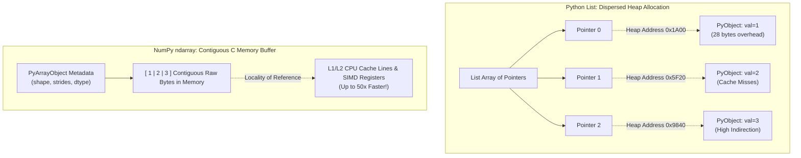

## Which Language is NumPy Written In?
- NumPy is mostly written in C & C++ for performance, with a Python interface for ease of use.

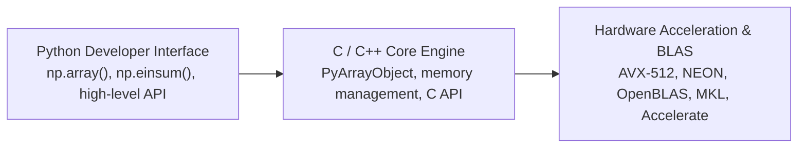

## Installation of NumPy :-
* `pip install numpy`
* `import numpy as np`
* `np.__version__` $\rightarrow$ *(To check version of numpy)* 

```python
# Quick verification in Python
import numpy as np

print("NumPy Version:", np.__version__)
```

## Create a NumPy `ndarray` Object :-
- NumPy is used to work with arrays & this array object is called `ndarray`!
- It is created by using the `array()` function.

**Example :-**
```python
import numpy as np

arr = np.array([1, 2, 3, 4, 5])
print(arr)
print(type(arr))
```

- **`type()` :-** This built-in function tells us the type of the object passed to it, like `arr` is `numpy.ndarray` type.

- To create an `ndarray`, we can pass a list, tuple, or any array-like object into the `array()` method, and it will be converted into an `ndarray`.

**Example :-**
```python
import numpy as np

arr = np.array((1, 2, 3, 4, 5))  # Here tuple is passed
print(arr)
```

## Dimensions in Arrays :-
- A dimension in arrays is one level of array depth (nested arrays).

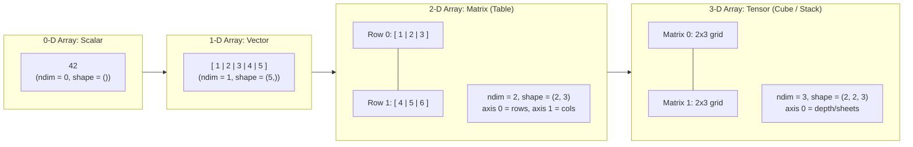

### 0-D Arrays :-
- 0-D arrays, or Scalars, are the elements in an array. Each value in an array is a 0-D array.

**Example :-**
**Q.** Create a 0-D array with value 42 *(or 45)*
```python
import numpy as np

arr = np.array(45)
print(arr)
```
**ans \(\rightarrow\)** `45` *(After compiling the code)*

---

### 1-D Arrays :-
- An array that has 0-D arrays as its elements is called a uni-dimensional or 1-D array.
- These are the most common and basic arrays.

**Example :-**
**Q.** Create a 1-D array containing the values 1, 2, 3, 4, 5.
```python
import numpy as np

arr = np.array([1, 2, 3, 4, 5])
print(arr)
```
**ans \(\rightarrow\)** `[1 2 3 4 5]` *(After compilation)*

---

### 2-D Arrays :-
- An array that has 1-D arrays as its elements is called a 2-D array.
- These are often used to represent a matrix or $2^{\text{nd}}$ order tensor.
- NumPy has a whole module dedicated towards matrix operations called `numpy.mat`.

**Example :-**
**Q.** Create a 2-D array containing two arrays with the values 1, 2, 3 & 4, 5, 6.
```python
import numpy as np

arr = np.array([[1, 2, 3], [4, 5, 6]])
print(arr)
```
**ans \(\rightarrow\)** *(After compilation)*
```text
[[1 2 3]
 [4 5 6]]
```

---

### 3-D Arrays :-
**Q.** An array that has 2-D arrays, both containing two arrays with the values 1, 2, 3 & 4, 5, 6. Create such a 3-D array containing this.
```python
import numpy as np

arr = np.array([[[1, 2, 3], [4, 5, 6]], [[1, 2, 3], [4, 5, 6]]])
print(arr)
```
**ans \(\rightarrow\)** *(Ans after compilation)*
```text
[[[1 2 3]
  [4 5 6]]

 [[1 2 3]
  [4 5 6]]]
```
- An array that has 2-D arrays (matrices) as its elements is called a 3-D array.
- These are often used to represent a \(3^{\text{rd}}\) order tensor.

---

## Check Number of Dimensions :-
- NumPy arrays provide the `ndim` attribute that returns an integer that tells us how many dimensions the array has.

**Example :-**
**Q.** Check how many dimensions the arrays have.
```python
import numpy as np

a = np.array(42)
b = np.array([1, 2, 3, 4, 5])
c = np.array([[1, 2, 3], [4, 5, 6]])

print(a.ndim)
print(b.ndim)
print(c.ndim)
```
**ans \(\rightarrow\)** *(Ans. after compilation)*
```text
0
1
2
```

---

## Higher Dimensional Arrays :-
- An array can have any number of dimensions. When the array is created, you can define the number of dimensions by using the `ndmin` argument.

**Example :-**
**Q.** Create an array with 5 dimensions & verify that it has 5 dimensions.
```python
import numpy as np

arr = np.array([1, 2, 3, 4], ndmin=5)
print(arr)
print('number of dimensions :', arr.ndim)
```
**ans \(\rightarrow\)** *(Ans. after comp)*
```text
[[[[[1 2 3 4]]]]]
number of dimensions : 5
```
- In this array the innermost dimension (\(5^{\text{th}}\) dim) has 4 elements, the \(4^{\text{th}}\) dim has 1 element that is the vector, the \(3^{\text{rd}}\) dim has 1 element that is the matrix with the vector, the \(2^{\text{nd}}\) dim has 1 element that is a 3D array, and the \(1^{\text{st}}\) dim has 1 element that is a 4D array.

---

## NumPy Array Indexing :-

### Access Array Elements :-
- Array indexing is the same as accessing an array element.
- You can access an array element by referring to its index number.
- The indexes in NumPy arrays start with `0`, meaning that the first element has index `0`, and the second has index `1`, etc.

**Example :-**
**Q1.** Get the \(1^{\text{st}}\) element of the following array :-
```python
import numpy as np

arr = np.array([1, 2, 3, 4])
print(arr[0])
```
**ans \(\rightarrow\)** `1` *(Ans. after comp)*

**Q2.** Get the \(3^{\text{rd}}\) & \(4^{\text{th}}\) element from the following array & add them.
```python
import numpy as np

arr = np.array([1, 2, 3, 4])
print(arr[2] + arr[3])
```
**ans \(\rightarrow\)** `7` *(Ans. after comp)*

---

### Accessing 2-D Arrays :-
- In a 2-D array, use `array[dimension, index]` to get an element.
- Think of it like a table :-
  - `Dimension` = row number
  - `Index` = column number
  - For example, `array[1, 2]` means: \(2^{\text{nd}}\) row (dimension 1), \(3^{\text{rd}}\) column (index 2).

**Example :-**
**Q.** Access the element on \(2^{\text{nd}}\) row, \(5^{\text{th}}\) column.
```python
import numpy as np

arr = np.array([[1, 2, 3, 4, 5], [6, 7, 8, 9, 10]])
print('5th element on 2nd row:', arr[1, 4])
```
**ans \(\rightarrow\)** `5th element on 2nd row: 10`

---

### Access 3-D Arrays :-
- To access an element in a 3-D array, use `array[dim1, dim2, index]`.
- Think of it like a stack of tables:
  - `dim1` = which table (depth)
  - `dim2` = row in that table
  - `index` = column in that row
  - e.g., `array[0, 1, 2]` means: \(1^{\text{st}}\) table \(\rightarrow\) \(2^{\text{nd}}\) row \(\rightarrow\) \(3^{\text{rd}}\) column.

**Example :-**
**Q.** Access the third element of the second array of the first array.
```python
import numpy as np

arr = np.array([[[1, 2, 3], [4, 5, 6]], [[7, 8, 9], [10, 11, 12]]])
print(arr[0, 1, 2])
```
**ans \(\rightarrow\)** `6` *(After comp)*

---

## Negative Indexing :-
- Use negative indexing to access an array from the end.

**Example :-**
**Q.** Print the last element from \(2^{\text{nd}}\) dim.
```python
import numpy as np

arr = np.array([[1, 2, 3, 4, 5], [6, 7, 8, 9, 10]])
print('Last element from 2nd dim:', arr[1, -1])
```
**ans \(\rightarrow\)** `Last element from 2nd dim: 10` *(Ans after comp)*

---

## NumPy Array Slicing :-
- Slicing in Python means taking elements from one given index to another given index.
- We pass slice instead of index like this: `[start:end]`.
- We can also define the step, like this: `[start:end:step]`.
- If we don't pass `start`, it's considered `0`.
- If we don't pass `end`, it's considered the length of the array in that dimension.
- If we don't pass `step`, it's considered `1`.

**Example :-**
**Q1.** Slice the elements from index 1 to index 5 from the following array.
```python
import numpy as np

arr = np.array([1, 2, 3, 4, 5, 6, 7])
print(arr[1:5])
```
**ans \(\rightarrow\)** `[2 3 4 5]` *(Ans. after comp)*

**Q2.** Slice the elements from index 4 to the end of the array.
```python
# * same array *
print(arr[4:])
```
**ans \(\rightarrow\)** `[5 6 7]` *(Ans. after comp.)*

**Q3.** Slice elements from the beginning to index 4 (not included).
```python
# * same array *
print(arr[:4])
```
**ans \(\rightarrow\)** `[1 2 3 4]` *(Ans. after comp.)*

---

### Negative Slicing :-
- Use the minus operator to refer to an index from the end.

**Example :-**
**Q1.** Slice from the index 3 from the end to index 1 from the end.
```python
import numpy as np

arr = np.array([1, 2, 3, 4, 5, 6, 7])
print(arr[-3:-1])
```
**ans \(\rightarrow\)** `[5 6]` *(Ans. after comp)*

---

### Step :-
- Use the `step` value to determine the step of the slicing.

**Example :-**
**Q1.** Return every other element from index 1 to index 5.
```python
import numpy as np

arr = np.array([1, 2, 3, 4, 5, 6, 7])
print(arr[1:5:2])
```
**ans \(\rightarrow\)** `[2 4]` *(Ans. after comp.)*

**Q2.** Return every other element from the entire array:
```python
# * same array * (arr = np.array([1, 2, 3, 4, 5, 6, 7]))
print(arr[::2])
```
**ans \(\rightarrow\)** `[1 3 5 7]` *(Ans. after comp.)*

---

### Slicing 2-D Arrays :-

**Q1.** From the second element, slice elements from index 1 to index 4 (not included).
```python
import numpy as np

arr = np.array([[1, 2, 3, 4, 5], [6, 7, 8, 9, 10]])
print(arr[1, 1:4])
```
**ans \(\rightarrow\)** `[7 8 9]` *(Ans. after comp.)*

**Q2.** From both elements, return index 2:
```python
# * same array *
print(arr[0:2, 2])
```
**ans \(\rightarrow\)** `[3 8]` *(Ans. after comp.)*

**Q3.** From both elements, slice index 1 to index 4 (not included); this will return a 2-D array.
```python
# * same array *
print(arr[0:2, 1:4])
```
**ans \(\rightarrow\)** *(Ans. after comp)*
```text
[[2 3 4]
 [7 8 9]]
```

---

## NumPy Data Types :-
- Below is a list of all data types in NumPy and the characters used to represent them:
  - `i` - integer
  - `b` - boolean
  - `u` - unsigned integer
  - `f` - float
  - `c` - complex float
  - `m` - timedelta
  - `M` - datetime
  - `O` - object
  - `S` - string
  - `U` - unicode string
  - `V` - fixed chunk of memory for other type (void)

**Example :-**
**Q1.** Get the data type of an array object.
```python
import numpy as np

arr = np.array([1, 2, 3, 4])
print(arr.dtype)
```
**ans \(\rightarrow\)** `int64` *(Ans. after comp)*

---

### Creating Arrays with a Defined Data Type :-

**Q1.** Create an array with data type string.
```python
import numpy as np

arr = np.array([1, 2, 3, 4], dtype='S')
print(arr)
print(arr.dtype)
```
**ans \(\rightarrow\)** *(Ans. after comp)*
```text
[b'1' b'2' b'3' b'4']
|S1
```
- Each number becomes a string & is stored as bytes `b'1'`, `b'2'`, etc.
- `dtype` becomes `|S1`, which means:
  - `S` = string (byte string)
  - `1` = length of each string is 1 character.
- For `i`, `u`, `f`, `S`, & `U` we can define size as well.

**Q2.** Create an array with data type 4 bytes integer.
```python
import numpy as np

arr = np.array([1, 2, 3, 4], dtype='i4')
print(arr)
print(arr.dtype)
```
**ans \(\rightarrow\)** *(Ans. after comp)*
```text
[1 2 3 4]
int32
```

---

## Converting Data Type on Existing Arrays :-
- Use the `.astype()` method to create a copy of an array with a new data type.
- You can specify the type as:
  - A string: `'f'` (float), `'i'` (int), etc.
  - A type: `float`, `int`, etc.

**Example :-**
**Q1.** Change data type from float to integer by using `'i'` as parameter.
```python
import numpy as np

arr = np.array([1.1, 2.1, 3.1])
newarr = arr.astype('i')
print(newarr)
print(newarr.dtype)
```
**ans \(\rightarrow\)** *(Ans. after comp)*
```text
[1 2 3]
int32
```

**Q2.** Do the above Q same, but use `int` instead of `'i'`.
```python
import numpy as np

arr = np.array([1.1, 2.1, 3.1])
newarr = arr.astype(int)
print(newarr)
print(newarr.dtype)
```
**ans \(\rightarrow\)**
```text
[1 2 3]
int64
```

**Q3.** Change data type from integer to boolean.
```python
import numpy as np

arr = np.array([1, 0, 3])
newarr = arr.astype(bool)
print(newarr)
print(newarr.dtype)
```
**ans \(\rightarrow\)** *(Ans. after comp)*
```text
[ True False  True]
bool
```

---

## NumPy Array Copy vs View :-

**Copy :-**
- Creates a new array with its own data.
- Changes in the copy do not affect the original array, and vice versa.

**View :-**
- Creates a linked view of the original array.
- Changes in the view do affect the original array, and vice versa.

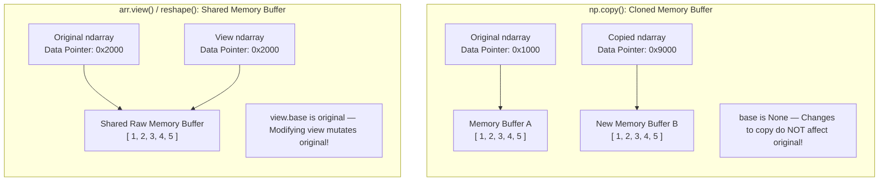

**Example :-**
**Q1.** Make a copy, change the original array & display both arrays.
```python
import numpy as np

arr = np.array([1, 2, 3, 4, 5])
x = arr.copy()
arr[0] = 42

print(arr)
print(x)
```
**ans \(\rightarrow\)** *(Ans. after comp.)*
```text
[42  2  3  4  5]
[1 2 3 4 5]
```

**Q2.** Make a view, change the original array, and display both arrays.
```python
import numpy as np

arr = np.array([1, 2, 3, 4, 5])
x = arr.view()
arr[0] = 42

print(arr)
print(x)
```
**ans \(\rightarrow\)** *(Ans. after comp)*
```text
[42  2  3  4  5]
[42  2  3  4  5]
```

---

### Check if Array Owns its Data :-
- Use the `.base` attribute :-
  - If `.base` is `None`, the array owns its data (i.e., it's a copy).
  - If `.base` is not `None`, it's a view of another array.

**Example :-**
**Q1.** Print the value of the `base` attribute to check if an array owns its data or not.
```python
import numpy as np

arr = np.array([1, 2, 3, 4, 5])

x = arr.copy()
y = arr.view()

print(x.base)
print(y.base)
```
**ans \(\rightarrow\)** *(Ans. after comp)*
```text
None
[1 2 3 4 5]
```

---

## NumPy Array Shape :-
- The shape of an array is the number of elements in each dimension.
- Use the `.shape` attribute to get the dimensions of a NumPy array.
- It returns a tuple showing the size along each dimension.

**Example :-**
```python
import numpy as np

arr = np.array([[1, 2, 3, 4], [5, 6, 7, 8]])
print(arr.shape)
```
**ans \(\rightarrow\)** `(2, 4)`
- Which means that the array has 2 dimensions, where the \(1^{\text{st}}\) dimension has 2 elements & the \(2^{\text{nd}}\) has 4 elements.

**Q2.** Create an array with 5 dimensions using `ndmin` using a vector with values 1, 2, 3, 4 & verify that the last dimension has value 4.
```python
import numpy as np

arr = np.array([1, 2, 3, 4], ndmin=5)
print(arr)
print('shape of array:', arr.shape)
```
**ans \(\rightarrow\)**
```text
[[[[[1 2 3 4]]]]]
shape of array: (1, 1, 1, 1, 4)
```

---

## What Does the Shape Tuple Represent?
- The shape tuple shows how many elements exist along each dimension of the array.
- For `shape = (1, 1, 1, 1, 4)`:
  - \(1^{\text{st}}\) dimension \(\rightarrow\) 1 element
  - \(2^{\text{nd}}\) dimension \(\rightarrow\) 1 element
  - \(3^{\text{rd}}\) dimension \(\rightarrow\) 1 element
  - \(4^{\text{th}}\) dimension \(\rightarrow\) 1 element
  - \(5^{\text{th}}\) dimension \(\rightarrow\) 4 elements
- **So**, the value `4` at index 4 in the shape tuple tells us that the \(5^{\text{th}}\) dimension has 4 elements.
- **Summary:** Each index in `.shape` corresponds to a dimension, and its value tells how many elements exist along that dimension.

---

## NumPy Array Reshaping :-
- Reshaping means changing the structure of an array — its dimensions and how elements are arranged.
- The shape defines how many elements are in each dimension.
- With reshaping, you can:
  - Add or remove dimensions.
  - Change the number of elements per dimension *(total elements must stay the same)*.

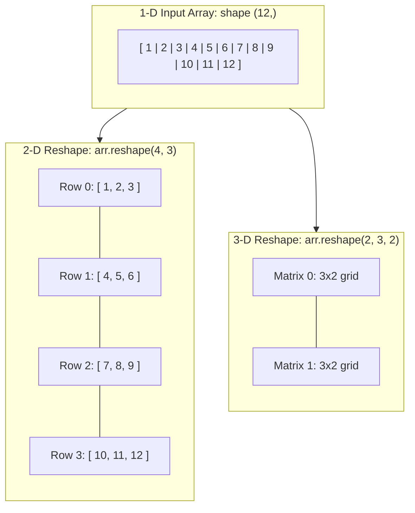

**Example :-**
**Q1.** Convert the following 1-D array with 12 elements into a 2-D array. The outermost dimension will have 4 arrays, each with 3 elements:
```python
import numpy as np

arr = np.array([1, 2, 3, 4, 5, 6, 7, 8, 9, 10, 11, 12])
newarr = arr.reshape(4, 3)
print(newarr)
```
**ans \(\rightarrow\)** *(Ans. after comp)*
```text
[[ 1  2  3]
 [ 4  5  6]
 [ 7  8  9]
 [10 11 12]]
```

**Q2.** Convert the following 1-D array with 12 elements into a 3-D array. The outermost dimension will have 2 arrays that contain 3 arrays, each with 2 elements.
```python
import numpy as np

arr = np.array([1, 2, 3, 4, 5, 6, 7, 8, 9, 10, 11, 12])
newarr = arr.reshape(2, 3, 2)
print(newarr)
```
**ans \(\rightarrow\)** *(Ans. after comp)*
```text
[[[ 1  2]
  [ 3  4]
  [ 5  6]]

 [[ 7  8]
  [ 9 10]
  [11 12]]]
```

---

## Can We Reshape Into Any Shape?
- **Yes** — but only if the total number of elements stays the same.
- **For Example :-**
  - A 1-D array with 8 elements can be reshaped to `(2, 4)` or `(4, 2)`.
  - It cannot be reshaped to `(3, 3)` because that needs 9 elements.
- **Rule :-**
  - `Original size = New shape size`
  - (`np.reshape()` will throw an error if the sizes don't match).

---

### Returns Copy or View :-

**Q1.** Check if the returned array is a copy or a view.
```python
import numpy as np

arr = np.array([1, 2, 3, 4, 5, 6, 7, 8])
print(arr.reshape(2, 4).base)
```
**ans \(\rightarrow\)** `[1 2 3 4 5 6 7 8]` *(Ans. after comp)*
- The example above returns the original array, so it's a view.

---

### Unknown Dimension :-
- You can let NumPy automatically calculate one dimension by using `-1`.
- This is useful when you are unsure of the exact size, but know the total number of elements.

**Example :-**
**Q1.** Convert 1-D array with 8 elements to 3D array with \(2 \times 2\) elements.
```python
import numpy as np

arr = np.array([1, 2, 3, 4, 5, 6, 7, 8])
newarr = arr.reshape(2, 2, -1)
print(newarr)
```
**ans \(\rightarrow\)** *(Ans. after comp)*
```text
[[[1 2]
  [3 4]]

 [[5 6]
  [7 8]]]
```
- We cannot pass `-1` to more than one dimension.

---

### Flattening the Arrays :-
- Flattening the array means converting a multidimensional array into a 1D array.
- We can use `reshape(-1)` to do this.

**Example :-**
**Q1.** Convert the array into a 1D array.
```python
import numpy as np

arr = np.array([[1, 2, 3], [4, 5, 6]])
newarr = arr.reshape(-1)
print(newarr)
```
**ans \(\rightarrow\)** `[1 2 3 4 5 6]` *(Ans. after comp)*

**Note :-**
- NumPy offers many functions for changing array shapes & rearranging elements:
  - **Shape-changing :-**
    - `flatten()`, `ravel()` — convert arrays to 1-D.
  - **Rearranging elements :-**
    - `rot90()` — rotate array \(90^\circ\) (degrees).
    - `flip()`, `fliplr()`, `flipud()` — flips arrays in various directions.
- These are part of intermediate to advanced NumPy operations.

---

## Iterating Arrays :-
- Iteration means accessing elements one by one.
- For 1-D arrays, a simple Python `for` loop will go through each element in sequence.

**Example :-**
**Q1.** Iterate on the elements of the following 1-D array.
```python
import numpy as np

arr = np.array([1, 2, 3])
for x in arr:
    print(x)
```
**ans \(\rightarrow\)** *(Ans. after comp)*
```text
1
2
3
```

**Q2.** Iterate on the elements of the following 2-D array.
```python
import numpy as np

arr = np.array([[1, 2, 3], [4, 5, 6]])
for x in arr:
    print(x)
```
**ans \(\rightarrow\)** *(Ans. after comp)*
```text
[1 2 3]
[4 5 6]
```
- **Note:** If we iterate on an \(n\)-D array, it will go through the \((n-1)^{\text{th}}\) dimension one by one.
- To return the actual values, the scalars, we have to iterate the arrays in each dimension.

**Q3.** Iterate on each scalar element of the 2-D array.
```python
import numpy as np

arr = np.array([[1, 2, 3], [4, 5, 6]])
for x in arr:
    for y in x:
        print(y)
```
**ans \(\rightarrow\)** *(Ans. after comp)*
```text
1
2
3
4
5
6
```

**Q4.** Iterate on the elements of the following 3-D array.
```python
import numpy as np

arr = np.array([[[1, 2, 3], [4, 5, 6]], [[7, 8, 9], [10, 11, 12]]])
for x in arr:
    print(x)
```
- To return the actual values, the scalars, we have to iterate the arrays in each dimension.

**Q5.** Iterate down to the scalars:
```python
import numpy as np

arr = np.array([[[1, 2, 3], [4, 5, 6]], [[7, 8, 9], [10, 11, 12]]])
for x in arr:
    for y in x:
        for z in y:
            print(z)
```
**ans \(\rightarrow\)** *(Ans. after comp)*
```text
1
2
3
4
...
12
```

---

### Iterating Arrays Using `nditer()` :-
- `nditer()` is a NumPy helper function for simple to advanced iteration.
- It allows you to loop through each scalar element of an array without writing multiple nested loops — very useful for high-dimensional arrays.

**Example :-**
**Q1.** Iterate through the following 3-D array.
```python
import numpy as np

arr = np.array([[[1, 2], [3, 4]], [[5, 6], [7, 8]]])
for x in np.nditer(arr):
    print(x)
```
**ans \(\rightarrow\)** *(Ans. after comp)*
```text
1
2
...
8
```

---

### Iterating Array with Different Data Types :-
- When using `nditer()`, you can change the datatype of elements during iteration by using the `op_dtypes` argument.
- Since NumPy doesn't change the data type in-place, it uses a temporary buffer for the conversion. To enable this, pass `flags=['buffered']`.

**Q1.** Iterate through the array as a string:
```python
import numpy as np

arr = np.array([1, 2, 3])
for x in np.nditer(arr, flags=['buffered'], op_dtypes=['S']):
    print(x)
```
**ans \(\rightarrow\)** *(Ans. after comp)*
```text
b'1'
b'2'
b'3'
```
- We can use filtering and follow it by iteration.

---

### Iterating with Different Step Size :-

**Q1.** Iterate through every scalar element of the 2D array skipping 1 element.
```python
import numpy as np

arr = np.array([[1, 2, 3, 4], [5, 6, 7, 8]])
for x in np.nditer(arr[:, ::2]):
    print(x)
```
**ans \(\rightarrow\)** *(Ans. after comp)*
```text
1
3
5
7
```

---

### Enumerated Iteration Using `ndenumerate()` :-
- Enumeration means iterating with the index of each element.
- `ndenumerate()` lets you loop through an array and get both:
  * The index (as a tuple for multi-dimensional arrays)
  * The value at that index

**Q1.** Enumerate on the following 1-D array's elements:
```python
import numpy as np

arr = np.array([1, 2, 3])
for idx, x in np.ndenumerate(arr):
    print(idx, x)
```
**ans \(\rightarrow\)** *(Ans. after comp)*
```text
(0,) 1
(1,) 2
(2,) 3
```

**Q2.** Enumerate on the following 2D array's elements:
```python
import numpy as np

arr = np.array([[1, 2, 3, 4], [5, 6, 7, 8]])
for idx, x in np.ndenumerate(arr):
    print(idx, x)
```
**ans \(\rightarrow\)**
```text
(0, 0) 1
(0, 1) 2
(0, 2) 3
(0, 3) 4
(1, 0) 5
(1, 1) 6
(1, 2) 7
(1, 3) 8
```

---

## NumPy Joining Array :-
- Joining means combining two or more arrays into a single array.
- Unlike SQL (where joins are based on keys), NumPy joins arrays along an axis.
- Use `np.concatenate()`:
  - Pass the arrays as a sequence (list or tuple).
  - Specify the axis (default is `0`).

**Example :-**
**Q1.** Join two arrays.
```python
import numpy as np

arr1 = np.array([1, 2, 3])
arr2 = np.array([4, 5, 6])
arr = np.concatenate((arr1, arr2))
print(arr)
```
**ans \(\rightarrow\)** `[1 2 3 4 5 6]` *(Ans. after comp)*

**Q2.** Join two 2-D arrays along rows (`axis=1`):
```python
import numpy as np

arr1 = np.array([[1, 2], [3, 4]])
arr2 = np.array([[5, 6], [7, 8]])
arr = np.concatenate((arr1, arr2), axis=1)
print(arr)
```
**ans \(\rightarrow\)** *(Ans. after comp)*
```text
[[1 2 5 6]
 [3 4 7 8]]
```

---

### Joining Arrays Using Stack Functions :-
- Stacking is like concatenation, but it adds a new axis.
- This means two 1-D arrays can be combined along a new dimension — placing them on top of each other or side by side.
- Use `np.stack()`:
  - Pass the arrays as a sequence.
  - Specify `axis` (default = `0` \(\rightarrow\) stack vertically).

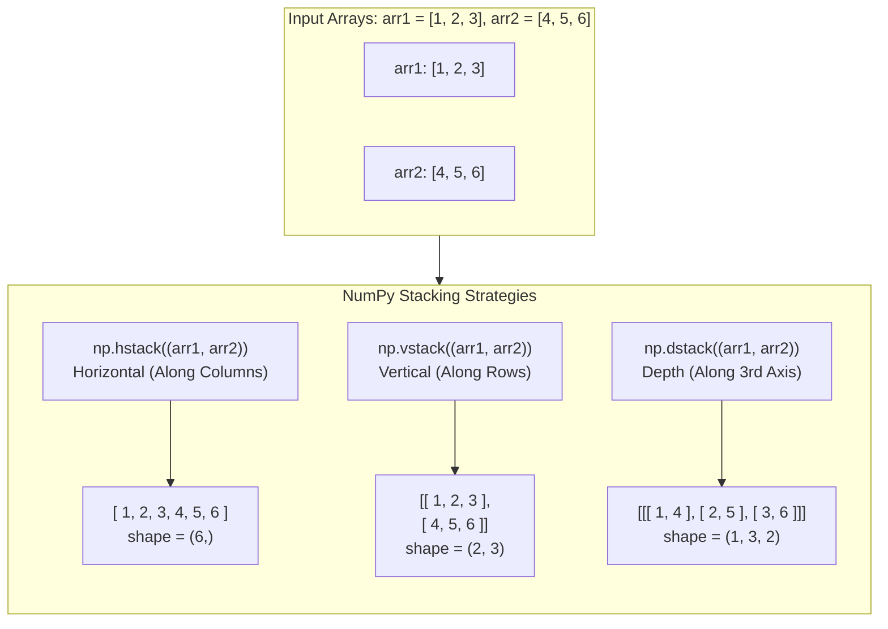

**Example :-**
```python
import numpy as np

arr1 = np.array([1, 2, 3])
arr2 = np.array([4, 5, 6])
arr = np.stack((arr1, arr2), axis=1)
print(arr)
```
**ans \(\rightarrow\)** *(Ans. after comp)*
```text
[[1 4]
 [2 5]
 [3 6]]
```

---

### Stacking Along Rows :-
- NumPy provides a helper function: `hstack()` to stack along rows.

**Example :-**
```python
import numpy as np

arr1 = np.array([1, 2, 3])
arr2 = np.array([4, 5, 6])
arr = np.hstack((arr1, arr2))
print(arr)
```
**ans \(\rightarrow\)** `[1 2 3 4 5 6]` *(Ans. after comp)*

---

### Stacking Along Columns :-
- NumPy provides a helper function: `vstack()` to stack along columns.

**Example :-**
```python
import numpy as np

arr1 = np.array([1, 2, 3])
arr2 = np.array([4, 5, 6])
arr = np.vstack((arr1, arr2))
print(arr)
```
**ans \(\rightarrow\)** *(Ans. after comp)*
```text
[[1 2 3]
 [4 5 6]]
```

---

### Stacking Along Height (Depth) :-
- NumPy provides a helper function: `dstack()` to stack along height, which is the same as depth.

**Example :-**
```python
import numpy as np

arr1 = np.array([1, 2, 3])
arr2 = np.array([4, 5, 6])
arr = np.dstack((arr1, arr2))
print(arr)
```
**ans \(\rightarrow\)** *(Ans. after comp)*
```text
[[[1 4]
  [2 5]
  [3 6]]]
```

---

## NumPy Splitting Array :-
- Splitting in NumPy is the opposite of joining.
- Instead of combining arrays, it divides one array into multiple parts.
- The function `np.array_split()` is used for this, where you provide the array and how many parts you want.

**Example :-**
```python
import numpy as np

arr = np.array([1, 2, 3, 4, 5, 6])
newarr = np.array_split(arr, 3)
print(newarr)
```
**ans \(\rightarrow\)** `[array([1, 2]), array([3, 4]), array([5, 6])]`
- **Note:** The return value is a list containing three arrays.
- **Note:** If the array has fewer elements than required, it will adjust from the end accordingly.

**Example :-**
**Q1.** Split the array in 4 parts.
```python
import numpy as np

arr = np.array([1, 2, 3, 4, 5, 6])
newarr = np.array_split(arr, 4)
print(newarr)
```
**ans \(\rightarrow\)** `[array([1, 2]), array([3, 4]), array([5]), array([6])]`
- **Note:** `split()` requires the array to be evenly divisible into parts, while `array_split()` can handle uneven splits by adjusting element distribution.

---

### Split Into Arrays :-
- The `array_split()` method returns a list of NumPy arrays.
- If you split into 3 parts, you can access each part by index, e.g., `result[0]`, `result[1]`, `result[2]`.

**Q1.** Access the splitted arrays.
```python
import numpy as np

arr = np.array([1, 2, 3, 4, 5, 6])
newarr = np.array_split(arr, 3)

print(newarr[0])
print(newarr[1])
print(newarr[2])
```
**ans \(\rightarrow\)** *(Ans. after comp)*
```text
[1 2]
[3 4]
[5 6]
```

---

### Splitting 2-D Arrays :-
- It works the same way as a 1-D array — use `array_split(array, num_splits)` to divide it into the desired number of subarrays.

**Example :-**
**Q1.** Split the 2-D array into three 2-D arrays.
```python
import numpy as np

arr = np.array([[1, 2], [3, 4], [5, 6], [7, 8], [9, 10], [11, 12]])
newarr = np.array_split(arr, 3)
print(newarr)
```
**ans \(\rightarrow\)**
```text
[array([[1, 2],
       [3, 4]]), array([[5, 6],
       [7, 8]]), array([[ 9, 10],
       [11, 12]])]
```
- **Note:** The example above returns three 2-D arrays.
- **Note:** In addition, you can specify which axis you want to do the split around.
- **Note:** The example below also returns three 2-D arrays, but they are split along the column (`axis=1`).

**Example :-**
**Q1.** Split the 2-D array into three 2-D arrays along columns.
```python
import numpy as np

arr = np.array([[1, 2, 3], [4, 5, 6], [7, 8, 9], [10, 11, 12], [13, 14, 15], [16, 17, 18]])
newarr = np.array_split(arr, 3, axis=1)
print(newarr)
```
**ans \(\rightarrow\)**
```text
[array([[ 1],
       [ 4],
       [ 7],
       [10],
       [13],
       [16]]), array([[ 2],
       [ 5],
       [ 8],
       [11],
       [14],
       [17]]), array([[ 3],
       [ 6],
       [ 9],
       [12],
       [15],
       [18]])]
```
- **Note:** An alternate solution is using `hsplit()`, the opposite of `hstack()`, & similar functions also exist:
  1. `np.hsplit(arr, 3)` — (along columns)
  2. `vsplit()` — (split vertically along rows)
  3. `dsplit()` — (split along depth (3-D arrays))

---

## NumPy Searching Arrays :-
- In NumPy, you can use `where()` to find the indexes of elements that match a condition.
- Works on any array (sorted or unsorted).
- Returns the indices (tuple of arrays) of elements that satisfy a condition.

**Example :-**
```python
import numpy as np

arr = np.array([4, 7, 4, 9, 4, 10])

# find all positions where value is 4
idx = np.where(arr == 4)
idx1 = np.where(arr % 2 == 0)
idx2 = np.where(arr % 2 == 1)

print(idx)       # (array([0, 2, 4]),)
print(arr[idx])  # [4 4 4]
print(idx1)      # (array([0, 2, 4, 5]),)
print(idx2)      # (array([1, 3]),)
```

---

### `np.searchsorted()` \(\rightarrow\) Find Insert Position
- Works **only** on sorted arrays.
- Returns the index where a value should be inserted to keep the array sorted.
- Can insert left or right of duplicate.

**Example :-**
```python
import numpy as np

arr = np.array([4, 7, 9, 12])  # must be sorted

x = np.searchsorted(arr, 7)
pos_left = np.searchsorted(arr, 7, side='left')
pos_right = np.searchsorted(arr, 7, side='right')

print(x)          # 1 -> before 7 (default)
print(pos_left)   # 1 -> before 7
print(pos_right)  # 2 -> after 7
```

---

## NumPy Array Sorting :-
- **Purpose \(\rightarrow\)** Sorts elements in ascending order, either numerically or alphabetically, depending on the array's data type.
- **Function used \(\rightarrow\)** `np.sort()` — returns a sorted copy, leaving the original array unchanged.
- **Works with \(\rightarrow\)**
  - **1D arrays** — sorts all elements.
  - **2D arrays** — sorts each row independently (default axis).

**Example \(\rightarrow\)**
```python
import numpy as np

arr1d = np.array([3, 2, 0, 1])
print(np.sort(arr1d))  # [0 1 2 3]

arr2d = np.array([[3, 2, 4], [5, 0, 1]])
print(np.sort(arr2d))
# [[2 3 4]
#  [0 1 5]]
```

---

## Filtering NumPy Arrays :-
- Filtering means extracting specific elements from an array based on a condition.
- In NumPy, this is done using **boolean indexing** — supplying a boolean array (`True`/`False` values) to select elements.

**Example :-**
```python
import numpy as np

arr = np.array([41, 42, 43, 44])
filter_arr = [True, False, True, False]
newarr = arr[filter_arr]

print(newarr)  # output : [41 43]
```
- **Note:** Only the elements at indices where the filter is `True` are included.

---

### Building Filter Dynamically — Based on Condition :-
```python
import numpy as np

arr = np.array([41, 42, 43, 44])
filter_arr = [x > 42 for x in arr]  # [False, False, True, True]
newarr = arr[filter_arr]

print(newarr)  # output : [43 44]
```
- **Note:** You can generate the boolean filter using any logic.

---

### Even Simpler — Direct Boolean Masking :-
```python
import numpy as np

arr = np.array([1, 2, 3, 4, 5, 6, 7])
newarr = arr[arr % 2 == 0]

print(newarr)  # output : [2 4 6]
```
- Here, `arr % 2 == 0` creates a boolean mask directly, without needing an explicit list.

#### Key Takeaways :-

| Concept | Description |
| :--- | :--- |
| **Boolean indexing** | Use a `True`/`False` mask array to select elements from a NumPy array. |
| **Manual mask list** | Build a list of `True`/`False` and apply it to the array. |
| **Conditional mask shortcut** | Use expressions like `arr > value`, `arr % 2 == 0`, etc., to create the mask. |

---

## Random Numbers in NumPy :-
```python
from numpy import random
```

- **Random Integers :-**
  - **Single :-** `random.randint(100)` \(\rightarrow\) `int` between (`0–99`)
  - **Array :-** `random.randint(100, size=(3, 5))`

- **Random Floats :-**
  - **Single :-** `random.rand()` \(\rightarrow\) `float` between `0–1`
  - **Array :-** `random.rand(3, 5)`

- **Random Choice from List :-**
  - **Single :-** `random.choice([3, 5, 7, 9])`
  - **Array :-** `random.choice([3, 5, 7, 9], size=(3, 5))`

---

## NumPy Random Distribution :-
- **Data Distribution \(\rightarrow\)** Shows all possible values + how often they occur.
- **Random Distribution in NumPy \(\rightarrow\)** Generates random samples following a given probability.

### Choosing the Right Probability Distribution :-

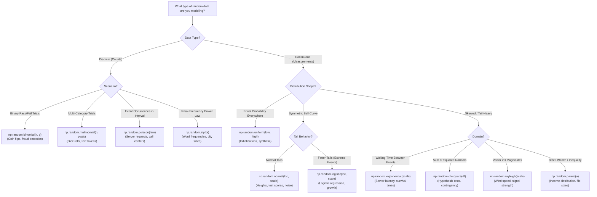

### `random.choice()`
- Picks random values from a given list/array.
- Can assign probabilities with `p` parameter.
- Can create 1D or multi-dimensional arrays using `size`.

**Example :-**
```python
from numpy import random

x = random.choice([3, 5, 7, 9], p=[0.1, 0.3, 0.6, 0.0], size=100)
# for 1D: 100 random values

y = random.choice([3, 5, 7, 9], p=[0.1, 0.3, 0.6, 0.0], size=(3, 5))
```
Here, for all elements in the array:
- `3` \(\rightarrow\) \(10\%\) chance
- `5` \(\rightarrow\) \(30\%\) chance
- `7` \(\rightarrow\) \(60\%\) chance
- `9` \(\rightarrow\) \(0\%\) chance *(won't appear)*

---

## NumPy Random Permutations (`shuffle()` & `permutation()`) :-
- **Permutation** = any rearrangement of elements (e.g., `[3, 2, 1]` is a permutation of `[1, 2, 3]`).
- NumPy's `random` module offers two main tools :-
  - **`shuffle()` :-** Randomly shuffles an array in-place, modifying the original array.
  - **`permutation()` :-** Returns a shuffled copy of the array, leaving the original unchanged.

**Examples (Short & Sweet) :-**
```python
from numpy import random
import numpy as np

arr = np.array([1, 2, 3, 4, 5])
random.shuffle(arr)  # shuffles arr in-place
print(arr)
# -> [2 4 1 5 3] (Ans after comp)

print(random.permutation(arr))  # returns a shuffled copy
# -> [3 2 1 5 4] (Ans after comp)
```

---

## NumPy Normal Distribution :-
- **Normal (Gaussian) Distribution** = bell curve.
- Centered around a mean (average), spread controlled by standard deviation (`std`).
- Used to model natural variations (e.g., heights, test scores, measurement errors).

### Function :-
```python
random.normal(loc=0.0, scale=1.0, size=None)
```
- `loc` \(\rightarrow\) Mean (centre of curve)
- `scale` \(\rightarrow\) Standard Deviation (spread of values)
- `size` \(\rightarrow\) Shape of output array

**Examples :-**
```python
from numpy import random

# single random value (mean=0, std=1)
x = random.normal()

# 2x3 array with default mean=0, std=1
x = random.normal(size=(2, 3))

# 2x3 array with mean=1, std=2
x = random.normal(loc=1, scale=2, size=(2, 3))
```

### Visualization :-
```python
import matplotlib.pyplot as plt
import seaborn as sns
from numpy import random

data = random.normal(loc=0, scale=1, size=1000)
sns.displot(data, kind="kde")  # bell curve
plt.show()
```

#### Key Points :-
- **`mean` (`loc`) \(\rightarrow\)** Shifts curve left/right.
- **`std Dev` (`scale`) \(\rightarrow\)** Controls curve width.
- **`size` \(\rightarrow\)** Controls how many values are generated.

---

## NumPy Binomial Distribution :-
- A discrete probability distribution modeling the number of successes in repeated independent trials (each trial has a binary outcome, e.g., success/failure).
- **Example :-** Coin flips, pass/fail tests.

### Function Syntax :-
```python
random.binomial(n, p, size=None)
```
- `n` = Number of trials (integer)
- `p` = Probability of success in each trial (\(0 \leq p \leq 1\))
- `size` = Shape of the output (e.g., integer for 1D array, tuple for multi-D)

### Examples :-
**Q1.** Generate a 1-D array of 10 samples: 10 trials, \(50\%\) success rate each.
```python
from numpy import random

x = random.binomial(n=10, p=0.5, size=10)
print(x)
# output: array([5, 6, 4, 5, 7, 3, 4, 6, 5, 5])
```

### Visualization Example :-
```python
from numpy import random
import matplotlib.pyplot as plt
import seaborn as sns

sns.displot(random.binomial(n=10, p=0.5, size=1000))
plt.show()
```
- Plots a histogram (or density) of the binomial sample distribution.

### Why Use It Instead of Normal Distribution?
- **Binomial** is discrete; good for counts of successes.
- **Normal** is continuous and may resemble binomial in shape when parameters are large.

#### Quick Feature Table :-

| Feature | Details |
| :--- | :--- |
| **Distribution Type** | Discrete (counts of successes) |
| **Parameters** | `n` (trials), `p` (success probability) |
| **Output** | Scalar or array (depending on `size`) |
| **Use Cases** | Coin flips, quality checks, surveys |
| **Visualization** | Histogram via `sns.displot` or `plt.hist` |

---

## NumPy Poisson Distribution :-
- Poisson Distribution is a discrete probability distribution that models how many times an event occurs within a fixed interval (e.g., calls per hour, arrivals per day) when events happen at a known constant average rate.

### Function Syntax :-
```python
random.poisson(lam=1.0, size=None)
```
- `lam` \(\rightarrow\) Expected rate (\(\lambda\)), the average number of event occurrences in the interval.
- `size` \(\rightarrow\) Shape of the output (e.g., integer for 1D array, tuple for multidimensional).

**Example :-**
**Q.** 1D array of 10 samples, with an average of 2 events per interval.
```python
from numpy import random

x = random.poisson(lam=2, size=10)
print(x)
```

### Visualization :-
```python
from numpy import random
import matplotlib.pyplot as plt
import seaborn as sns

sns.displot(random.poisson(lam=2, size=1000))
plt.show()
```
- Generates a histogram-like plot showing the distribution of occurrences.

### Distribution Theory Insight :-
- Like the Binomial distribution with a very large number of trials (\(n\)) and very low success probability (\(p\)), the Poisson distribution approximates it when \(n \times p \approx \lambda\).
- Poisson is discrete, while Normal is continuous, though for a sufficiently large \(\lambda\), the Poisson distribution begins to resemble the Normal distribution.

#### Quick Comparison Table :-

| Feature | Details |
| :--- | :--- |
| **Distribution Type** | Discrete count of events in fixed intervals. |
| **Parameters** | `lam` (average rate \(\lambda\)), `size` (output shape). |
| **Use Cases** | Modeling event counts per interval (calls, arrivals, defects). |
| **Similarity to Binomial** | For large \(n\) and low \(p\), behaves similarly when \(n \times p \approx \lambda\). |
| **Behavior vs. Normal** | Still discrete — but approximates Normal for large \(\lambda\). |

---

## NumPy Uniform Distribution :-
- The Uniform Distribution generates random numbers where every value in a specified range is equally likely.
- It's a continuous distribution, not discrete — you get floats evenly spread across the interval.

### Function Syntax :-
```python
random.uniform(low=0.0, high=1.0, size=None)
```
- `low` — Lower bound (inclusive), defaults to `0.0`.
- `high` — Upper bound (exclusive), defaults to `1.0`.
- `size` — Shape of output array (scalar for single value or tuple for arrays).
- Samples are drawn from the half-open interval \([\text{low}, \text{high})\) — meaning `low` can appear, `high` usually not, though rounding may occasionally include it.

### Examples :-
```python
from numpy import random
```

**Q1.** Single random float between `0.0` and `1.0`:
```python
x = random.uniform()
print(x)
```

**Q2.** \(2 \times 3\) array of random floats between `0.0` & `1.0`:
```python
arr = random.uniform(size=(2, 3))
print(arr)
```

**Q3.** 1D array of 5 random numbers between `3` (inclusive) & `5` (exclusive):
```python
arr = random.uniform(low=3, high=5, size=5)
print(arr)
```

**Q4.** \(2 \times 3\) array between numbers `10` (inclusive) & `20` (exclusive):
```python
arr = random.uniform(low=10, high=20, size=(2, 3))
print(arr)
```

### Visualization :-
```python
from numpy import random
import matplotlib.pyplot as plt
import seaborn as sns

data = random.uniform(size=1000)
sns.histplot(data, bins=30, kde=True)
plt.show()
```

#### Quick Comparison :-

| Feature | Details |
| :--- | :--- |
| **Distribution Type** | Continuous, uniform across `[low, high]` |
| **Parameter** | `low`, `high`, `size` |
| **Default** | `low=0.0`, `high=1.0`, `size=None` |
| **Range Behavior** | Inclusive of `low`, usually exclusive of `high`. |
| **Use Cases** | Synthetic data, random initializations. |

#### Summary :-
- Uniform distribution is perfect for scenarios where every numeric outcome between two bounds should be equally probable.
- **Key parameters :-** `low`, `high` & `size` to customize the range & shape of generated data.
- **Visualization :-** Histogram or KDE reveals a flat shape — confirming uniformity.

---

## Logistic Distribution :-
- A continuous distribution similar to Normal, but with heavier tails (higher chance of extreme values).
- Common in machine learning (e.g., logistic regression), growth models, and statistics.

### Syntax :-
```python
random.logistic(loc=0.0, scale=1.0, size=None)
```
- `loc` \(\rightarrow\) Mean (center of the distribution) \(\rightarrow\) default `0`
- `scale` \(\rightarrow\) Spread / flatness (like standard deviation) \(\rightarrow\) default `1`
- `size` \(\rightarrow\) Shape of output array (e.g., `(2, 3)`)

### Examples :-
**Q1.** Single random value (`mean=0`, `scale=1`):
```python
from numpy import random

print(random.logistic())
```

**Q2.** \(2 \times 3\) array with `mean=1` & `scale=2`:
```python
from numpy import random

arr = random.logistic(loc=1, scale=2, size=(2, 3))
print(arr)
```

### Visualization :-
```python
import matplotlib.pyplot as plt
import seaborn as sns
from numpy import random

# Generate 1000 samples
data = random.logistic(loc=0, scale=1, size=1000)

# plot distribution
sns.histplot(data, bins=30, kde=True)
plt.show()
```

### Logistic vs Normal :-
- Both look bell-shaped.
- Logistic has **fatter tails** \(\rightarrow\) gives more extreme values.
- Useful when you want slightly more variability than normal.

#### Key Points :-
- Continuous, bell-shaped distribution.
- **Parameters:** `loc` (mean), `scale` (spread).
- Heavier tails than Normal.
- Used in ML (logistic regression) & growth models.

---

## NumPy Multinomial Distribution :-
- A generalization of the binomial distribution for scenarios with more than two possible outcomes.
- Useful for modeling events like rolling dice, selecting categories, or predicting outcomes across multiple classes.

### Function Syntax :-
```python
random.multinomial(n, pvals, size=None)
```
- `n` = Number of trials (e.g., number of dice rolled).
- `pvals` = List or array of outcome probabilities (should sum to `1`).
- `size` *(optional)* = Shape of the returned array (e.g., integer for multiple samples).

### Example :-
**Q.** Simulate rolling a die 6 times.
```python
from numpy import random

x = random.multinomial(n=6, pvals=[1/6]*6)
print(x)
# output:
# [1, 0, 2, 1, 1, 1] -> counts per side of a die.
```
- You'll get one count per category — each index shows how many times that outcome occurred.

### Key Insight :-
- Unlike `random.choice()`, this returns an array of counts across categories.
- It effectively runs `n` independent trials and tallies the outcome frequencies.
- Shape and probabilities mirror what you'd expect from multiple simultaneous binomial distributions.

#### Quick Comparison Table :-

| Feature | Details |
| :--- | :--- |
| **Distribution Type** | Discrete, multi-category counts. |
| **Parameters** | `n` (trials), `pvals` (probabilities), `size` (optional). |
| **Output** | Counts per category across `n` trials. |
| **Example Use Case** | Rolling dice, multi-label outcomes, categorical sampling. |
| **Relation to Binomial** | Reduces to binomial when there are only two categories. |

---

## NumPy Exponential Distribution :-
- A continuous probability distribution used to model the time until the next event, such as failure times, waiting times between arrivals, etc.
- Related to Poisson distribution: while Poisson models counts, Exponential models the intervals between those events.

### Function Syntax :-
```python
random.exponential(scale=1.0, size=None)
```
- `scale` (\(\beta\)) = Defines the average interval (\(\text{mean} = \beta\)). It's the inverse of the rate parameter (\(\lambda = 1/\beta\)).
- `size` = Output shape (`None` gives a single value, else an array).

### Example :-
```python
from numpy import random

# 2x3 array, average interval (scale) = 2
x = random.exponential(scale=2, size=(2, 3))
print(x)
```

### Visualization :-
```python
import matplotlib.pyplot as plt
import seaborn as sns
from numpy import random

data = random.exponential(scale=2, size=1000)
sns.histplot(data, bins=30, kde=True)
plt.show()
```

### Distribution Relationship :-
#### Poisson vs Exponential :-
- **Poisson:** Models how many events occur in a fixed time.
- **Exponential:** Models the waiting time between events.

#### Key Reference Table :-

| Feature | Details |
| :--- | :--- |
| **Distribution Type** | Continuous, skewed-right (waiting time) |
| **Parameters** | `scale` (mean interval), `size` (output shape) |
| **Defaults** | `scale=1.0`, `size=None` |
| **Use Cases** | Waiting times, survival analysis, failure times. |
| **Relationship** | Poisson (counts) \(\leftrightarrow\) Exponential (intervals) |

#### Summary :-
- Use `random.exponential()` when you need to simulate time intervals between random events.
- **Remember:** Larger `scale` = longer expected intervals.
- The distribution is right-skewed, with a high occurrence near zero & a long tail.

---

## NumPy Chi-Square Distribution :-
- A continuous probability distribution often used in statistics — particularly in hypothesis testing (like goodness-of-fit or independence tests) to evaluate observed vs. expected data. It's derived by summing the squares of independent standard normal variables.

### Function Syntax :-
```python
random.chisquare(df, size=None)
```
- `df` = Degree of freedom (must be \(> 0\))
- `size` = Output shape (e.g., `(2, 3)` for arrays or `None` for a single value)

### Example :-
**Q1.** \(2 \times 3\) array with 2 degrees of freedom.
```python
from numpy import random

x = random.chisquare(df=2, size=(2, 3))
print(x)
```
- Generates an array of chi-square distributed values with `df=2`.

### Visualization Example :-
```python
import matplotlib.pyplot as plt
import seaborn as sns
from numpy import random

# Generate 1000 samples with df=1
data = random.chisquare(df=1, size=1000)

# plot KDE
sns.displot(data, kind="kde")
plt.show()
```
- Produces a smooth right-skewed curve, typical for chi-square distributions with low degrees of freedom.

### Theory & Behavior :-
- The chi-square distribution is skewed to the right, particularly when `df` is low. As `df` increases, the distribution becomes more symmetric.
- \(\text{mean} = \text{df}\)
- \(\text{variance} = 2 \times \text{df}\)

#### Feature Table :-

| Feature | Details |
| :--- | :--- |
| **Distribution Type** | Continuous, skewed-right. |
| **Parameters** | `df` (degree of freedom), `size` |
| **Default Behavior** | Scalar output if `size=None`. |
| **Use Cases** | Hypothesis tests, variance testing, contingency tables. |
| **Characteristics** | Skewed right; more symmetric as `df` grows. |

---

## NumPy Rayleigh Distribution :-
- A continuous, right-skewed distribution ideal for modeling the magnitude of a 2D vector whose components are independent, zero-mean normals — commonly used in signal processing and wind speed modeling.

### Function Syntax :-
```python
random.rayleigh(scale=1.0, size=None)
```
- `scale` = Standard deviation or mode (must be non-negative, default = `1`).
- `size` = Shape of the result (scalar if `None`, else array of given dimension).

### Example :-
**Q.** Generate a \(2 \times 3\) array of Rayleigh-distributed values (`scale=2`).
```python
from numpy import random

x = random.rayleigh(scale=2, size=(2, 3))
print(x)
```

### Visualization :-
```python
import matplotlib.pyplot as plt
import seaborn as sns
from numpy import random

# Visualization example: KDE plot
sns.displot(random.rayleigh(size=1000), kind="kde")
plt.show()
```

#### Summary Table :-

| Feature | Details |
| :--- | :--- |
| **Type** | Continuous, right-skewed distribution. |
| **Parameters** | `scale` (spread / mode), `size` (output shape). |
| **Visualization** | Histogram/KDE shows peak near low values with long tail. |
| **Use Cases** | Signal amplitude, wind speed, physical magnitude modeling. |
| **Relation to Others** | Equivalent to \(\chi^2\) distribution (`df=2`) when `scale=1` *(specifically related via square root transformation)*. |

---

## NumPy Pareto Distribution :-
- A heavy-tailed distribution, often used in economics (wealth distribution, 80-20 rule).

### Syntax :-
```python
random.pareto(a, size=None)
```
- `a` \(\rightarrow\) Shape parameter (must be \(> 0\))
- `size` \(\rightarrow\) Shape of the output array

### Example :-
```python
from numpy import random

x = random.pareto(a=2, size=(2, 3))
print(x)
```

### Visualization :-
```python
from numpy import random
import matplotlib.pyplot as plt
import seaborn as sns

sns.displot(random.pareto(a=2, size=1000))
plt.show()
```

### Behavior :-
- Many small values near `0`.
- Few very large values (long right tail).

---

## NumPy Zipf Distribution :-
- A discrete probability distribution following **Zipf's Law** — the frequency of an item is inversely proportional to its rank (i.e., the \(2^{\text{nd}}\) most common occurs at \(1/2\) the frequency of the most common, the \(3^{\text{rd}}\) at \(1/3\), etc.).

### Syntax :-
```python
random.zipf(a, size=None)
```
- `a` \(\rightarrow\) Distribution parameter (must be \(> 1\)); controls the skew.
- `size` \(\rightarrow\) Shape of the returned array.

### Example :-
**Q.** Create a \(2 \times 3\) array with Zipf distribution (`a=2`).
```python
from numpy import random

x = random.zipf(a=2, size=(2, 3))
print(x)
```

### Visualization :-
- Sample 1000 points, but plotting only ones with `value < 10` for a more meaningful chart:
```python
from numpy import random
import matplotlib.pyplot as plt
import seaborn as sns

x = random.zipf(a=2, size=1000)
sns.displot(x[x < 10])
plt.show()
```

---

## NumPy ufuncs :- (Universal Functions)
- `ufuncs` ("universal functions") are NumPy functions that apply element-wise operations directly to `ndarray` objects.
- They enable **vectorization**, which means applying operations across entire arrays at once — this is much faster than looping element by element in Python.
- `ufuncs` also support broadcasting and methods like `reduce`, `accumulate`, and optional parameters such as `where`, `dtype`, and `out` for flexible execution.

### Why Are ufuncs Helpful?
- **Speed —** They leverage low-level optimizations for speed calculations, avoiding slow Python loops.
- **Convenience —** You can perform operations on arrays of different shapes (thanks to broadcasting) and apply `ufuncs` conditionally (using `where`) or with controlled output types and destinations (via `dtype` and `out`).

### Key Example : Vectorized Addition :-
- **Without `ufuncs`, you'd use something like:**
```python
z = []
for i, j in zip(x, y):
    z.append(i + j)
```
- **With a `ufunc`:**
```python
z = np.add(x, y)
```
- This operates on entire arrays in one statement — cleaner, faster, and more expressive.

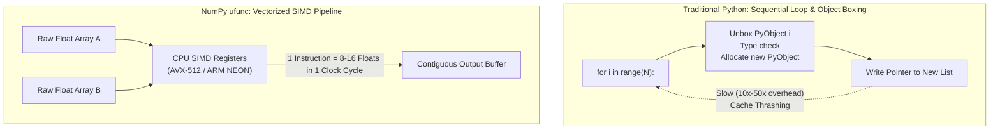

- **In Essence:** `ufuncs` are powerful, fast, and expressive — ideal for efficient array computations in NumPy.

---

## Creating Your Own Function in (`ufuncs`) NumPy :-
- You can convert any normal Python function into a NumPy universal function (`ufunc`) using `np.frompyfunc()`.
- The `frompyfunc()` method requires three parameters:
  1. **`function` —** The Python function you define.
  2. **`inputs` —** Number of input arguments (arrays).
  3. **`outputs` —** Number of output arrays.

**Example :-**
```python
import numpy as np

def myadd(x, y):
    return x + y

myadd = np.frompyfunc(myadd, 2, 1)
print(myadd([1, 2, 3], [4, 5, 6]))
```
- This applies `myadd` element-wise across arrays, just like NumPy's built-in `ufuncs`.

- **To confirm whether a function is a `ufunc`, you can check its type:**
```python
import numpy as np

print(type(np.add))          # <class 'numpy.ufunc'>
print(type(np.concatenate))  # not a ufunc
```
- **In code, you can even write:**
```python
if type(np.add) == np.ufunc:
    print('add is ufunc')
else:
    print('add is not ufunc')
```
- **In essence:** `np.frompyfunc()` allows you to wrap your own Python function into a fast, element-wise `ufunc` — with customizable numbers of inputs & outputs. And you can easily test if a given function is a genuine NumPy `ufunc` by checking its type.

---

## NumPy ufuncs :-

### Addition (`np.add`) :-
```python
import numpy as np

arr1 = np.array([10, 11, 12, 13, 14, 15])
arr2 = np.array([20, 21, 22, 23, 24, 25])
newarr = np.add(arr1, arr2)
print(newarr)
# -> [30, 32, 34, 36, 38, 40]
```

### Subtraction (`np.subtract`) :-
```python
arr1 = np.array([10, 20, 30, 40, 50, 60])
arr2 = np.array([20, 21, 22, 23, 24, 25])
newarr = np.subtract(arr1, arr2)
print(newarr)
# -> [-10, -1, 8, 17, 26, 35]
```

### Multiplication (`np.multiply`) :-
```python
arr1 = np.array([10, 20, 30, 40, 50, 60])
arr2 = np.array([20, 21, 22, 23, 24, 25])
newarr = np.multiply(arr1, arr2)
print(newarr)
# -> [200, 420, 660, 920, 1200, 1500]
```

### Division (`np.divide`) :-
```python
arr1 = np.array([10, 20, 30, 40, 50, 60])
arr2 = np.array([3, 5, 10, 8, 2, 33])
newarr = np.divide(arr1, arr2)
print(newarr)
# -> [3.33, 4, 3, 5, 25, 1.81]
```

### Power (`np.power`) :-
```python
arr1 = np.array([10, 20, 30, 40, 50, 60])
arr2 = np.array([3, 5, 6, 8, 2, 33])
newarr = np.power(arr1, arr2)
print(newarr)
# -> [1000, 3200000, 729000000, 6553600000000, 2500, 0]
```

### Remainder (Modulus: `np.mod` or `np.remainder`) :-
```python
arr1 = np.array([10, 20, 30, 40, 50, 60])
arr2 = np.array([3, 7, 9, 8, 2, 33])
newarr = np.mod(arr1, arr2)
print(newarr)  # [1, 6, 3, 0, 0, 27]
# same result with np.remainder()
```

### Quotient & Remainder (`np.divmod`) :-
```python
arr1 = np.array([10, 20, 30, 40, 50, 60])
arr2 = np.array([3, 7, 9, 8, 2, 33])
newarr = np.divmod(arr1, arr2)
print(newarr)
# (array([3, 2, 3, 5, 25, 1]), array([1, 6, 3, 0, 0, 27]))
```

### Absolute Value (`np.absolute` or `np.abs`) :-
```python
arr = np.array([-1, -2, 1, 2, 3, -4])
newarr = np.absolute(arr)
print(newarr)  # [1, 2, 1, 2, 3, 4]
```

#### Quick Takeaways :-

| Feature | What It Does | Example Outcome |
| :--- | :--- | :--- |
| **1) Vectorized** | Operates on entire arrays in one go | Fast and concise array operation. |
| **2) Element-wise** | Applies function to each element | Like doing `+`, `-`, `*`, etc., on lists in a loop. |
| **3) Conditional** | Apply operations selectively on elements | — |

- These `ufuncs` provide a functional & efficient way to apply common arithmetic operations across whole arrays — no loops required, just clean & expressive code.

---

## Rounding Decimals (with Examples) :-
- NumPy offers five primary `ufuncs` to round or adjust decimal values:

### 1. `np.trunc()` & `np.fix()` :-
- Remove decimal parts by rounding towards zero (i.e., toward `0`).

**Example :-**
```python
import numpy as np

arr = np.trunc([-3.1666, 3.6667])
print(arr)  # [-3.  3.]  # Same result with fix().
```

### 2. `np.around()` :-
- Rounds to the nearest value; rounds up if the discarded digit is \(\geq 5\).

**Example :-**
```python
arr = np.around(3.1666, 2)
print(arr)  # 3.17
```

### 3. `np.floor()` :-
- Rounds decimal values down to the next lower integer. Always rounds down (toward \(-\infty\)).

**Example :-**
```python
arr = np.floor([-3.1666, 3.6667])
print(arr)  # [-4.  3.]
```

### 4. `np.ceil()` :-
- Rounds decimal values up to the next higher integer. Always rounds up (toward \(+\infty\)).

**Example :-**
```python
arr = np.ceil([-3.1666, 3.6667])
print(arr)  # [-3.  4.]
```

---

## NumPy Logs :-

### `np.log2(arr)` :-
- Computes the logarithm base 2 for each element.

**e.g.**
```python
import numpy as np

arr = np.arange(1, 10)
print(np.log2(arr))
```
- This returns the base-2 logarithms of the numbers `1` through `9`.

### `np.log10(arr)` :-
- Computes the logarithm base 10 for each element.

**e.g.**
```python
arr = np.arange(1, 10)
print(np.log10(arr))
```
- This returns the base-10 logarithms of the numbers `1` through `9`.

### `np.log(arr)` :-
- Computes the natural logarithm (base \(e\)) for each element.

**e.g.**
```python
arr = np.arange(1, 10)
print(np.log(arr))
```
- This returns the natural logarithms of the numbers `1` through `9`.

---

### Custom Base Logarithm :-
- NumPy doesn't offer a direct `ufunc` for arbitrary base logs, but you can create your own using `np.frompyfunc()`:

**e.g.**
```python
from math import log
import numpy as np

nplog = np.frompyfunc(log, 2, 1)
print(nplog(100, 15))
```
- This applies Python's `math.log()` to compute logarithms with any base (input number and base), producing \(\log_{15}(100)\) in this case.

#### At a Glance :-

| Function | What It Does |
| :--- | :--- |
| **`np.log2()`** | Computes \(\log\) base 2 element-wise |
| **`np.log10()`** | Computes \(\log\) base 10 element-wise |
| **`np.log()`** | Computes natural \(\log\) (base \(e\)) |
| **`frompyfunc()`** | Enables custom-base \(\log\) functions |

---

## Summations :-

### Summation vs Addition :-
- **Addition (`np.add`)** operates between corresponding elements of two arrays.

**e.g.**
```python
import numpy as np

arr1 = np.array([1, 2, 3])
arr2 = np.array([1, 2, 3])

print(np.add(arr1, arr2))
# -> [2, 4, 6]
```

- **Summation (`np.sum`)** aggregates values across one or more arrays.

**e.g.**
```python
print(np.sum([arr1, arr2]))
# -> 12
```

### Summation Over an Axis :-
- Summing across rows or columns in a multidimensional array:

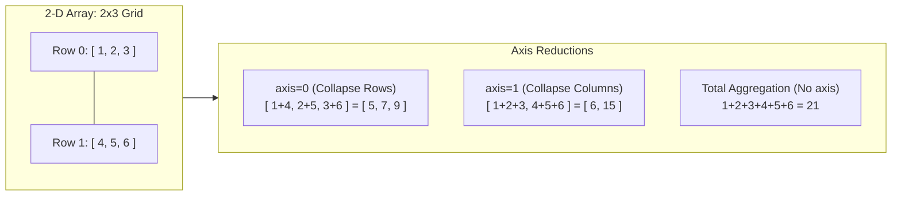

**e.g.**
```python
print(np.sum([arr1, arr2], axis=1))
# -> [6, 6]
```

### Cumulative Sum (`np.cumsum`) :-
- Builds a running total over array elements.

**e.g.**
```python
arr = np.array([1, 2, 3])
print(np.cumsum(arr))
# -> [1, 3, 6]
```

#### In Brief :-

| Ufunc | What It Does | Example Output |
| :--- | :--- | :--- |
| **`np.add()`** | Element-wise addition of two arrays | `[2, 4, 6]` |
| **`np.sum()`** | Total sum across arrays or along specified axis | `12` or `[6, 6]` |
| **`np.cumsum()`** | Produces cumulative totals along an array | `[1, 3, 6]` |

- These functions let you effortlessly perform both aggregate and element-wise summations in a clean & efficient way — no loops required.

---

## Products :-

### `np.prod()` :-
- Computes the product of all elements in an array.

**e.g.**
```python
import numpy as np

arr = np.array([1, 2, 3, 4])
x = np.prod(arr)
print(x)  # -> 24
```

### Product Across Multiple Arrays :-
- You can pass a list of arrays to calculate the combined product.

**e.g.**
```python
arr1 = np.array([1, 2, 3, 4])
arr2 = np.array([5, 6, 7, 8])
x = np.prod([arr1, arr2])
print(x)  # -> 40320
```

### Product Along an Axis :-
- By specifying `axis=1`, you get the product for each sub-array.

**e.g.**
```python
arr1 = np.array([1, 2, 3, 4])
arr2 = np.array([5, 6, 7, 8])
newarr = np.prod([arr1, arr2], axis=1)
print(newarr)
# -> [  24, 1680]
```

### Cumulative Product (`np.cumprod()`) :-
- Generates a running product (e.g., partial products).

**e.g.**
```python
arr = np.array([5, 6, 7, 8])
newarr = np.cumprod(arr)
print(newarr)  # -> [   5,   30,  210, 1680]
```

#### Quick Overview :-

| Function / Parameter | Description |
| :--- | :--- |
| **`np.prod()`** | Multiplies all elements in an array. |
| **`np.prod([...])`** | Multiplies elements across multiple arrays. |
| **`axis` parameter** | Applies product per sub-array along axis. |
| **`np.cumprod()`** | Returns cumulative products in sequence. |

- **In Short :-** These `ufuncs` give you powerful, loop-free ways to compute total and cumulative products — either across arrays or along specified axes.

---

## Differences :-
- A discrete difference subtracts each element from the next in an array — effectively capturing successive changes:

```python
import numpy as np

arr = np.array([10, 15, 25, 5])
newarr = np.diff(arr)
print(newarr)
# -> [  5,  10, -20]
```
- **Explanation :-** \(15 - 10 = 5\), \(25 - 15 = 10\), \(5 - 25 = -20\)

- You can apply the operation multiple times by setting the parameter `n`:
```python
arr = np.array([10, 15, 25, 5])
newarr = np.diff(arr, n=2)
print(newarr)
# -> [  5, -30]
```
- **Explanation :-**
  - \(1^{\text{st}}\) pass gives `[5, 10, -20]`
  - $2^{\text{nd}}$ pass (`n=2`): $10 - 5 = 5$, $-20 - 10 = -30$

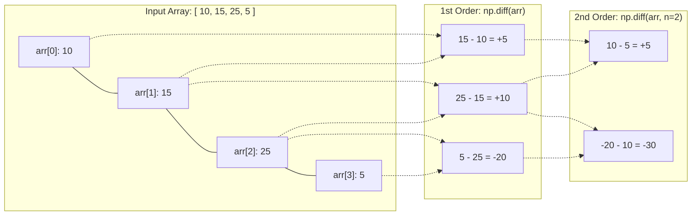

#### In Plain Terms :-
- `np.diff()` computes the difference between consecutive elements in an array.
- The `n` parameter determines how many times the differential operation repeats (i.e., first-order, second-order, etc.).
- This operation is handy to detect trends or changes in data sequences — like how values change over time, successive increases/decreases, or assessment of higher-order differences.

---

## NumPy ufunc — Lowest Common Multiple (LCM) :-

### Basic LCM of Two Numbers :-
```python
import numpy as np

num1 = 4
num2 = 6
x = np.lcm(num1, num2)
print(x)
# -> # 12 is the smallest number divisible by both 4 & 6
```

### LCM Across an Entire Array Using `.reduce()` :-
- You can compute the LCM of all elements in an array.
```python
arr = np.array([3, 6, 9])
x = np.lcm.reduce(arr)
print(x)  # -> # 18
```
- Here, the LCM of `3`, `6`, and `9` is `18`.

### LCM Over a Range of Values :-
- For example, to find the LCM of integers `1` through `10`:
```python
arr = np.arange(1, 11)
x = np.lcm.reduce(arr)
print(x)
# -> # returns LCM of all numbers from 1 to 10 (2520)
```
- This aggregates the LCM across the full range.

#### Summary Table :-

| Function | What It Does | Example |
| :--- | :--- | :--- |
| **`np.lcm(a, b)`** | Finds the LCM of two numbers | `np.lcm(4, 6)` \(\rightarrow\) `12` |
| **`np.lcm.reduce(arr)`** | Computes the LCM across all elements in `arr` | `[3, 6, 9]` \(\rightarrow\) `18` |
| **`np.lcm.reduce(np.arange(1, 11))`** | Gets LCM for a sequence `1` to `10` | LCM of `1–10` (`2520`) |

---

## NumPy ufunc — Greatest Common Divisor (GCD) :-

### Basic GCD of Two Numbers :-
```python
import numpy as np

num1 = 6
num2 = 9
x = np.gcd(num1, num2)
print(x)
# -> # 3: The GCD of 6 & 9 is 3 because it's the largest number that divides both evenly.
```

### GCD Over an Array Using `.reduce()` :-
```python
arr = np.array([20, 8, 32, 36, 16])
x = np.gcd.reduce(arr)
print(x)
# -> # 4 is the greatest common divisor of all elements in the array.
```

#### In Short :-
- **`np.gcd(a, b)` \(\rightarrow\)** Computes the GCD of two integers (or element-wise GCD across arrays).
- **`np.gcd.reduce(array)` \(\rightarrow\)** Computes the GCD of all elements in the array.

---

## Trigonometric Functions :-

### Sine (`np.sin`) :-
- Computes the sine of each element (in radians).
```python
import numpy as np

x = np.sin(np.pi / 2)
# -> # 1.0
```
- **Applied to Arrays :-**
```python
arr = np.array([np.pi / 2, np.pi / 3, np.pi / 4, np.pi / 5])
x = np.sin(arr)
# -> # [1, 0.866, 0.707, 0.587]
```

### Convert Degrees \(\leftrightarrow\) Radians :-
- NumPy expects input in radians, but offers convenient conversion functions:
- **`np.deg2rad()`** — converts degrees to radians:
```python
arr = np.array([90, 180, 270, 360])
print(np.deg2rad(arr))
# -> # [pi/2, pi, 3*pi/2, 2*pi]
```
- **`np.rad2deg()`** — converts radians to degrees:
```python
arr = np.array([np.pi / 2, np.pi, 1.5 * np.pi, 2 * np.pi])
print(np.rad2deg(arr))
# -> # [90, 180, 270, 360]
```

### Inverse Trigonometric Functions (`arcsin`, `arccos`, `arctan`) :-
- Compute the angle (in radians) given a trigonometric value.
- **Example using `arcsin`:**
```python
x = np.arcsin(1.0)  # pi/2 (1.57079633)
```
- **Applied across arrays:**
```python
arr = np.array([1, -1, 0.1])
print(np.arcsin(arr))  # [1.57, -1.57, 0.1]
```

### Hypotenuse (`np.hypot()`) :-
- Calculates the hypotenuse from the lengths of the two perpendicular sides.
```python
base = 3
perp = 4
print(np.hypot(base, perp))  # 5.0
```

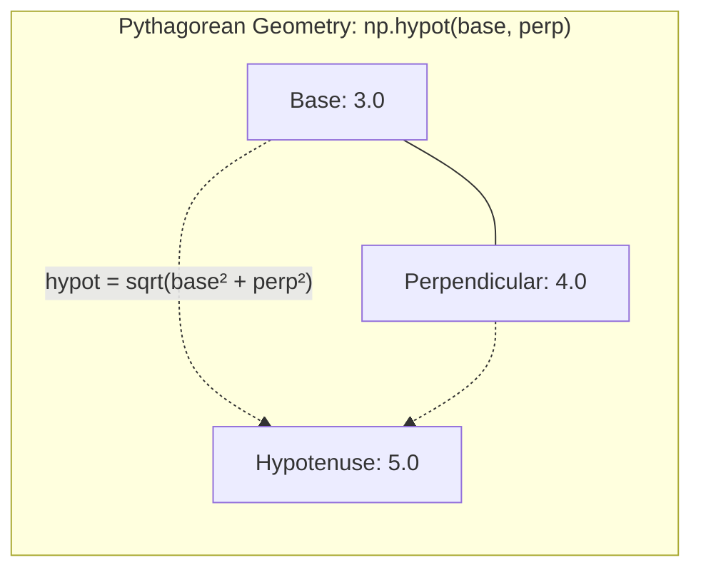

- These `ufuncs` offer fast, element-wise trigonometric and geometric transformations — ideal for clean vectorized operations without loops.

#### Quick Overview :-

| Function | What It Does |
| :--- | :--- |
| **`np.sin()`** | Element-wise sine of angles (radians) |
| **`np.deg2rad()` / `np.rad2deg()`** | Converts between degrees and radians |
| **`np.arcsin()` / `np.arccos()` / `np.arctan()`** | Computes angles from `sin`, `cos`, `tan` values (in radians) |
| **`np.hypot()`** | Computes hypotenuse using Pythagorean theorem |

---

## Hyperbolic Functions :-

### Hyperbolic Sine (`np.sinh`) :-
- Calculates the hyperbolic sine for each element (in radians).

**e.g.**
```python
import numpy as np

x = np.sinh(np.pi / 2)
```

### Hyperbolic Cosine (`np.cosh`) :-
- Computes the hyperbolic cosine for each element.

**e.g.**
```python
arr = np.array([np.pi / 2, np.pi / 3, np.pi / 4, np.pi / 5])
x = np.cosh(arr)
```

### Hyperbolic Tangent (`np.tanh`) :-
- Calculates the hyperbolic tangent of each value. Example similarly follows the same style as `sinh`, `cosh` on an array.

---

### Inverse Hyperbolic Functions :-

#### Inverse Hyperbolic Sine (`np.arcsinh`) :-
- Returns the value whose hyperbolic sine equals the input.
```python
x = np.arcsinh(1.0)
```

#### Inverse Hyperbolic Cosine (`np.arccosh`) & Inverse Hyperbolic Tangent (`np.arctanh`) :-
- Apply these element-wise on arrays to compute corresponding inverse hyperbolic functions:
```python
arr = np.array([0.1, 0.2, 0.5])
x = np.arctanh(arr)
```
- Outputs the radian values whose hyperbolic tangent matches each array entry.

#### In Short :-

| Functions | What It Does |
| :--- | :--- |
| **`np.sinh()`, `np.cosh()`, `np.tanh()`** | Compute hyperbolic sine, cosine & tangent, element-wise. |
| **`np.arcsinh()`, `np.arccosh()`, `np.arctanh()`** | Compute inverse hyperbolic functions (radian results). |

---

## NumPy Set Operations :-
- NumPy provides functions to perform set operations on arrays, such as union, intersection, and difference. These operations are useful for handling unique elements and performing mathematical set operations efficiently.

### Creating Sets in NumPy :-
- To create a set from an array, use the `np.unique()` function, which returns the sorted unique elements of an array.

**e.g.**
```python
import numpy as np

arr = np.array([1, 2, 2, 3, 4, 4, 5])
uni_ele = np.unique(arr)  # [1, 2, 3, 4, 5]
```

### Set Operations :-

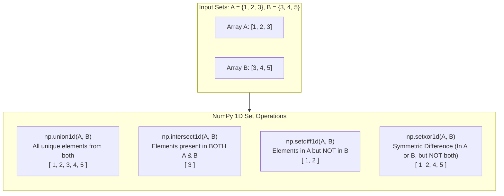

#### 1. Union (`np.union1d()`) :-
- Returns the sorted union of two arrays, i.e., all unique elements present in either array.

**e.g.**
```python
arr1 = np.array([1, 2, 3])
arr2 = np.array([3, 4, 5])
union = np.union1d(arr1, arr2)
# [1, 2, 3, 4, 5]
```

#### 2. Intersection (`np.intersect1d()`) :-
- Returns the sorted, unique values that are present in both input arrays.

**e.g.**
```python
arr1 = np.array([1, 2, 3])
arr2 = np.array([3, 4, 5])
intersection = np.intersect1d(arr1, arr2)
# [3]
```

#### 3. Difference (`np.setdiff1d()`) :-
- Returns the sorted, unique values in the first array that are not in the second array.

**e.g.**
```python
arr1 = np.array([1, 2, 3])
arr2 = np.array([3, 4, 5])
diff = np.setdiff1d(arr1, arr2)
# [1, 2]
```

#### 4. Symmetric Difference (`np.setxor1d()`) :-
- Returns the sorted, unique values that are in only one of the input arrays, but not both.

**e.g.**
```python
arr1 = np.array([1, 2, 3])
arr2 = np.array([3, 4, 5])
sym_diff = np.setxor1d(arr1, arr2)
# [1, 2, 4, 5]
```

#### In Short :-

| Function | What It Does |
| :--- | :--- |
| **`np.union1d()`** | Union of two arrays (all unique elements) |
| **`np.intersect1d()`** | Intersection of two arrays (common elements) |
| **`np.setdiff1d()`** | Elements in the first array, but not the second |
| **`np.setxor1d()`** | Elements in either array, but not in both |

- These functions allow for efficient set operations on arrays, enabling quick computations without the need for explicit loops.

---

## Deep Dive: Memory Architecture & Hardware Acceleration

A Python `list` is an array of pointers to boxed heap objects (`PyObject*`). Each integer element carries 28 bytes of overhead plus pointer indirection.

A NumPy `ndarray`, by contrast, is a lightweight C struct (`PyArrayObject`) that points to a **single contiguous block of raw memory bytes**:

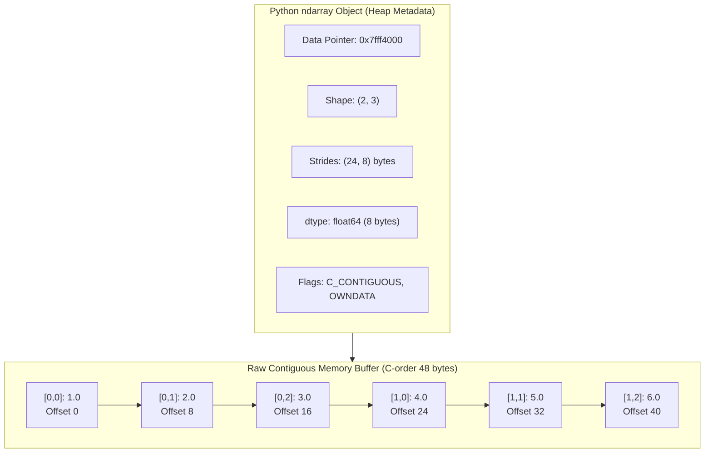

### The Anatomy of an Array

Every `ndarray` consists of:
1. **Raw Data Buffer**: Contiguous memory storing the raw binary values.
2. **`shape`**: A tuple defining dimensions (e.g., `(2, 3)`).
3. **`strides`**: A tuple of byte steps required to jump to the next item along each axis.
4. **`dtype`**: Data descriptor (e.g., `int32`, `float64`, `complex128`).
5. **`flags`**: Metadata detailing memory layout (`C_CONTIGUOUS`, `F_CONTIGUOUS`, `OWNDATA`, `WRITEABLE`).

### The Byte-Offset Formula
To locate element `(i, j)` in a 2D array, NumPy never iterates. It computes the direct memory address with a single arithmetic step:

$$\text{Memory Address} = \text{Data Pointer} + (i \times \text{strides}[0]) + (j \times \text{strides}[1])$$

#### Code Walkthrough: Inspecting Strides & Memory
```python
import numpy as np

# Create a 2D float64 array (each float64 = 8 bytes)
arr = np.array([[1.0, 2.0, 3.0], 
                [4.0, 5.0, 6.0]], dtype=np.float64)

print("Shape:", arr.shape)          # (2, 3)
print("Dtype:", arr.dtype)          # float64
print("Itemsize:", arr.itemsize)    # 8 bytes
print("Strides:", arr.strides)      # (24, 8) -> 3 columns * 8 bytes = 24 bytes per row
print("Memory address:", arr.ctypes.data)
```

---

## The SIMD Execution Engine (Why Vectorization is 100x Faster)

In pure Python, computing `a + b` for a list of 10,000,000 numbers requires:
1. Dynamically inspecting the type of every element.
2. Unwrapping `PyObject` headers.
3. Adding numbers in CPU registers.
4. Allocating a new `PyObject` for the result.
5. Incurring CPU L1/L2 cache misses due to fragmented pointer chains.

NumPy delegates execution directly to hardware **SIMD** (Single Instruction, Multiple Data) vector units (AVX-512, AVX2, or ARM Neon) and optimized C/Fortran libraries (**OpenBLAS**, **Intel MKL**, or **Apple Accelerate**).

### Benchmark: Python Loops vs. NumPy Vectorization

```python
import numpy as np
import time

N = 10_000_000
py_list_a = list(range(N))
py_list_b = list(range(N))

np_arr_a = np.arange(N, dtype=np.float64)
np_arr_b = np.arange(N, dtype=np.float64)

# 1. Pure Python Loop
t0 = time.perf_counter()
py_result = [a + b for a, b in zip(py_list_a, py_list_b)]
t_py = time.perf_counter() - t0

# 2. Vectorized NumPy SIMD
t0 = time.perf_counter()
np_result = np_arr_a + np_arr_b
t_np = time.perf_counter() - t0

print(f"Python list loop:  {t_py:.4f} seconds")
print(f"NumPy vectorized:  {t_np:.4f} seconds")
print(f"Speedup Factor:    {t_py / t_np:.1f}x faster!")
```

*Expected output: NumPy is typically **30x to 120x faster** while using 75% less RAM.*

---

## 5. Broadcasting Algebra & The Zero-Stride Trick

Broadcasting allows arithmetic operations on arrays of different shapes without copying data.

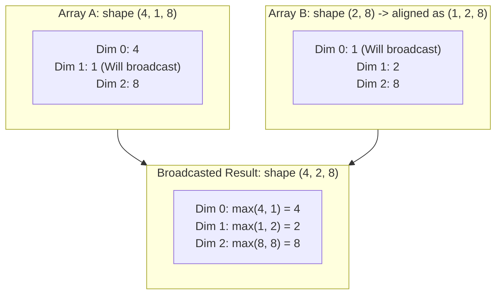

### The Two Golden Rules of Broadcasting
When operating on two arrays, NumPy compares their shapes element-wise, **starting from the trailing (rightmost) dimensions** and working backwards:
1. **Equality**: The dimensions are equal, OR
2. **Singular**: One of the dimensions is exactly `1`.

If neither condition is met, a `ValueError: operands could not be broadcast together` is raised.

### The Stride = 0 Optimization
How does NumPy broadcast an array of shape `(1, 5)` across 1,000 rows without duplicating memory?
**By setting the row stride to 0!**
When stride is 0, moving to the next row increments the memory pointer by `0 bytes`, reading the exact same memory row repeatedly at hardware speed without allocating a single extra byte.

#### Example: Vectorized Pairwise Euclidean Distance
Compute pairwise distances between $M$ query vectors and $N$ database vectors without a single Python `for` loop:

```python
import numpy as np

# M queries of dimension D=64
M, N, D = 100, 500, 64
queries = np.random.randn(M, D)       # shape: (100, 64)
database = np.random.randn(N, D)      # shape: (500, 64)

# Reshape queries to (M, 1, D) and database to (1, N, D)
# Broadcasting produces difference tensor of shape (M, N, D)
diff = queries[:, np.newaxis, :] - database[np.newaxis, :, :]

# Compute L2 distances
distances = np.sqrt(np.sum(diff ** 2, axis=-1))

print("Distance matrix shape:", distances.shape)  # (100, 500)
```

---

## 6. Einstein Summation (`np.einsum`): The LLM Builder's Weapon

`np.einsum` evaluates multi-dimensional tensor contractions using the classical Einstein summation convention. It replaces combinations of `transpose`, `reshape`, `sum`, and `matmul` with a single, highly readable signature.

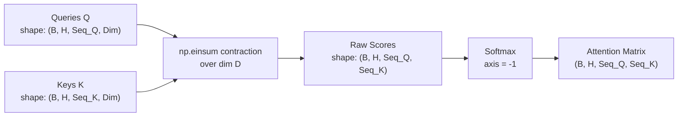

### Reading the Einsum Notation
`np.einsum('ij,jk->ik', A, B)`
- Input indices before `->` (`ij` for A, `jk` for B).
- Output indices after `->` (`ik`).
- Any index present in the inputs but omitted from the output (`j`) is **summed over** (contracted).

### Essential Einsum Patterns

| Operation | Mathematical Form | Traditional NumPy | `np.einsum` Equivalent |
| :--- | :--- | :--- | :--- |
| **Vector Dot Product** | $c = \sum_i a_i b_i$ | `np.dot(a, b)` | `np.einsum('i,i->', a, b)` |
| **Matrix Multiply** | $C_{ik} = \sum_j A_{ij} B_{jk}$ | `A @ B` | `np.einsum('ij,jk->ik', A, B)` |
| **Batch Matrix Multiply** | $C_{bij} = \sum_k A_{bik} B_{bkj}$ | `np.matmul(A, B)` | `np.einsum('bik,bkj->bij', A, B)` |
| **Trace (Diagonal Sum)** | $t = \sum_i A_{ii}$ | `np.trace(A)` | `np.einsum('ii->', A)` |
| **Tensor Transpose** | $T_{kji} = A_{ijk}$ | `np.transpose(A, (2, 1, 0))` | `np.einsum('ijk->kji', A)` |
| **Outer Product** | $C_{ij} = a_i b_j$ | `np.outer(a, b)` | `np.einsum('i,j->ij', a, b)` |

---

## 7. Hands-On Exercise: Implement Scaled Dot-Product Attention in Pure NumPy

In modern Large Language Models (LLMs like Llama, DeepSeek, and GPT-4), the heart of every transformer block is **Scaled Dot-Product Attention**:

$$\text{Attention}(Q, K, V) = \text{softmax}\left(\frac{Q K^T}{\sqrt{d_k}}\right) V$$

Let's implement this complete mathematical operation in 15 lines of pure NumPy using `np.einsum`:

```python
import numpy as np

def scaled_dot_product_attention(Q, K, V, mask=None):
    """
    Computes Multi-Head Attention in pure NumPy.
    
    Arguments:
        Q: Queries tensor of shape (batch, heads, seq_len_q, dim)
        K: Keys tensor of shape (batch, heads, seq_len_k, dim)
        V: Values tensor of shape (batch, heads, seq_len_v, dim)
        mask: Optional boolean mask of shape (seq_len_q, seq_len_k)
        
    Returns:
        output: Contextualized representations of shape (batch, heads, seq_len_q, dim)
        attention_weights: Normalized attention weights (batch, heads, seq_len_q, seq_len_k)
    """
    d_k = Q.shape[-1]
    
    # 1. Compute raw attention scores via einsum (contracts dimension 'd')
    # (b, h, q, d) x (b, h, k, d) -> (b, h, q, k)
    scores = np.einsum('bhqd,bhkd->bhqk', Q, K) / np.sqrt(d_k)
    
    # 2. Apply causal mask (if provided) for autoregressive decoding
    if mask is not None:
        scores = np.where(mask == 0, -1e9, scores)
        
    # 3. Stable Softmax across the keys dimension (axis=-1)
    # Subtract max for numerical stability against floating point overflow
    max_scores = np.max(scores, axis=-1, keepdims=True)
    exp_scores = np.exp(scores - max_scores)
    attention_weights = exp_scores / np.sum(exp_scores, axis=-1, keepdims=True)
    
    # 4. Multiply attention weights by values
    # (b, h, q, k) x (b, h, k, d) -> (b, h, q, d)
    output = np.einsum('bhqk,bhkd->bhqd', attention_weights, V)
    
    return output, attention_weights

# --- Verification & Test ---
batch_size = 2
num_heads = 4
seq_len = 8
head_dim = 64

Q = np.random.randn(batch_size, num_heads, seq_len, head_dim)
K = np.random.randn(batch_size, num_heads, seq_len, head_dim)
V = np.random.randn(batch_size, num_heads, seq_len, head_dim)

# Create causal lower-triangular mask
causal_mask = np.tril(np.ones((seq_len, seq_len)))

output, weights = scaled_dot_product_attention(Q, K, V, mask=causal_mask)

print("Attention Output Shape:", output.shape)    # (2, 4, 8, 64)
print("Attention Weights Shape:", weights.shape)  # (2, 4, 8, 8)
print("Row Sums (Softmax Check):", np.allclose(weights.sum(axis=-1), 1.0))  # True
```

---

## 8. NumPy 2.0 & Zero-Copy Interoperability with PyTorch

Released in 2024, **NumPy 2.0** represents the first major ABI overhaul in 18 years.

### DLPack Protocol (Zero-Copy GPU/CPU Bridge)
NumPy 2.0 standardizes **DLPack**, allowing PyTorch, JAX, and CuPy to share the exact same underlying memory buffers without CPU-to-GPU copying:

```python
import numpy as np

# NumPy array
np_arr = np.ones((4, 4), dtype=np.float32)

# If PyTorch is installed:
try:
    import torch
    # Zero-copy bridge using DLPack standard
    torch_tensor = torch.from_dlpack(np_arr.__dlpack__())
    print("Zero-copy PyTorch tensor acquired successfully!")
except ImportError:
    pass
```

---

## 9. Summary & Key Takeaways

1. **Memory is 1D**: Every multi-dimensional array is an illusion managed by `shape` and `strides` on a 1D contiguous byte buffer.
2. **Views Over Copies**: Slices (`a[::2]`, `a.T`) share memory; fancy indexing (`a[[0, 1]]`) duplicates memory.
3. **Broadcasting is Zero-Cost**: Broadcasting expands dimensions virtually by setting strides to `0`, requiring no additional memory.
4. **`np.einsum` is Universal**: Master einsum notation for clean, vectorized multi-dimensional matrix and tensor operations.
