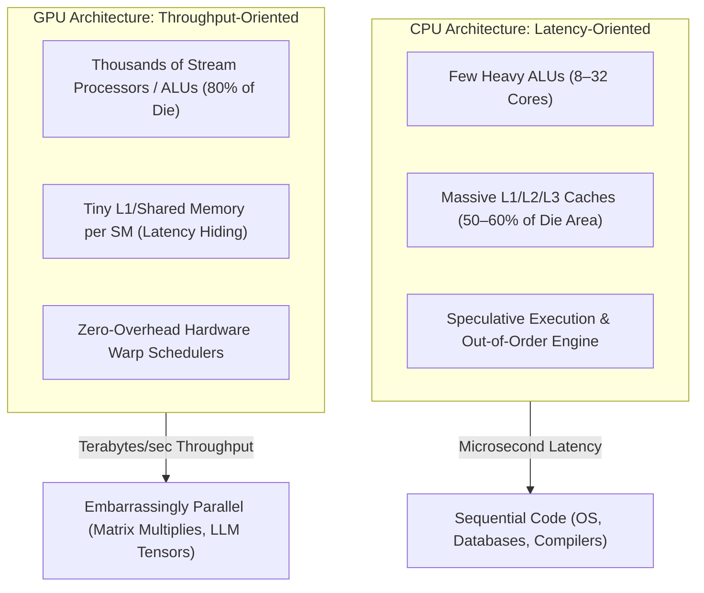
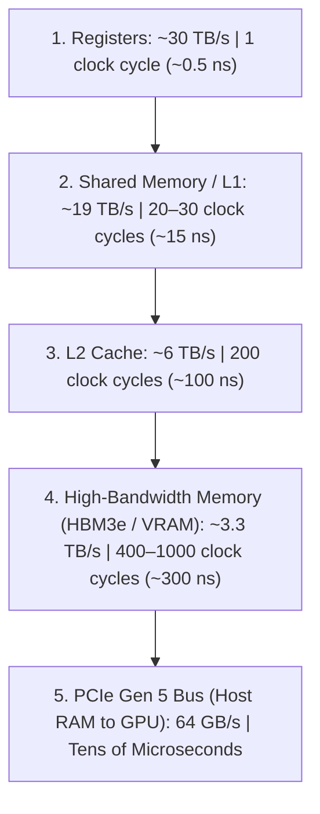
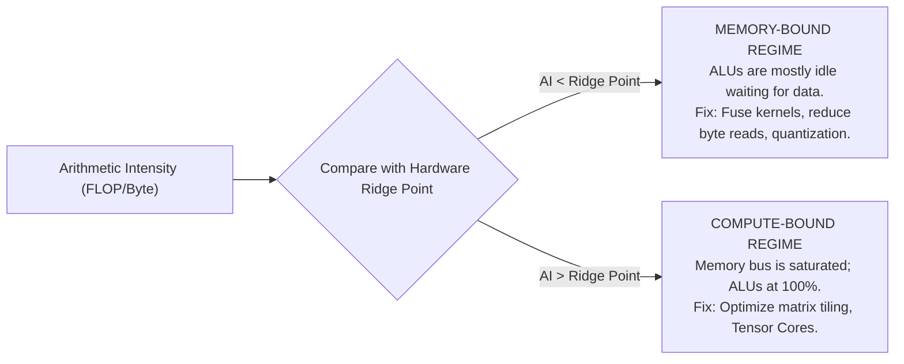

# Before GPU Engineering: Hardware Architecture, Memory Physics & The Roofline Model

<div class="notebook-callout mb-6">
  <span class="notebook-annotation font-hand font-bold text-xl">✍️ Architect's First Principle:</span>
  <p class="font-comic text-sm mt-1 text-slate-800 dark:text-slate-200">
    A GPU does <strong>not</strong> make an individual multiplication faster than a CPU. In fact, a CPU clock runs at 5.0 GHz while a GPU clock runs at 1.8 GHz. A GPU wins because it sacrifices single-thread latency to pack 16,000 parallel ALUs onto the silicon.
  </p>
</div>

Welcome to **Before GPU Engineering**. Before writing raw CUDA kernels, tuning Triton scripts, or debugging vLLM inference throughput, you must understand the **silicon physics, memory hierarchies, and hardware constraints** that dictate why modern AI systems behave the way they do.

---

## 1. Why CPUs Can't Have 10,000 Cores (Silicon Allocation)

A CPU and a GPU obey the exact same laws of physics and are fabricated on identical silicon processes (e.g., TSMC 4N / 3nm). The difference is entirely in **how die area is spent**:



### The Tradeoff
- **CPU Goal**: Minimize the time it takes for **1 thread** to finish a sequential series of instructions. It uses huge caches so the core never waits for RAM, and aggressive branch predictors to guess where code jumps next.
- **GPU Goal**: Maximize the aggregate count of floating-point operations completed across **100,000 threads**. If thread #1 is waiting for memory, the hardware warp scheduler context-switches in **0 clock cycles** to thread #2.

---

## 2. The GPU Memory Hierarchy & The Physics of Distance

In computing, speed is bound by the speed of light in copper and silicon. The closer data lives to the ALU, the faster it arrives:



<div class="notebook-callout my-6">
  <span class="notebook-annotation font-hand font-bold text-lg">⚠️ The Hardware Reality:</span>
  <p class="font-comic text-sm mt-1 text-slate-800 dark:text-slate-200">
    When an ALU requests a number from High-Bandwidth Memory (HBM), it must sit idle for <strong>500 to 1,000 clock cycles</strong> unless the GPU has enough other active threads ready to calculate while that memory is in flight. This is called <strong>latency hiding</strong>.
  </p>
</div>

---

## 3. The Roofline Model: Arithmetic Intensity

Every machine learning kernel runs into one of two physical ceilings:
1. **The Memory Bandwidth Ceiling**: How fast data moves from VRAM to registers.
2. **The Compute Ceiling**: How fast the ALUs can multiply and add numbers (TFLOPS).

We calculate the boundary using **Arithmetic Intensity**:

$$\text{Arithmetic Intensity} = \frac{\text{Total Floating Point Operations (FLOPs)}}{\text{Total Memory Bytes Transferred (Bytes)}}$$



### The Hardware Ridge Point Example (NVIDIA H100 SXM)
- **Peak FP16 Tensor Compute**: $\approx 1,000 \text{ TFLOPS}$ ($1 \times 10^{15} \text{ FLOP/s}$)
- **HBM3 Memory Bandwidth**: $\approx 3.35 \text{ TB/s}$ ($3.35 \times 10^{12} \text{ Bytes/s}$)

$$\text{Ridge Point} = \frac{1,000 \times 10^{12} \text{ FLOP/s}}{3.35 \times 10^{12} \text{ Bytes/s}} \approx 298.5 \text{ FLOP/Byte}$$

- If an operation performs **fewer than ~300 FLOPs for every byte loaded from memory**, it is **100% memory-bandwidth bound**. Faster tensor cores will make zero difference!

---

## 4. Why LLMs Break Into Two Regimes: Prefill vs. Decode

One of the most important lessons in modern inference engineering (e.g., vLLM, TensorRT-LLM) is why prompt ingestion behaves completely differently from token generation:

| Phase | What Happens | Arithmetic Intensity | Bottleneck | Optimization Strategy |
| :--- | :--- | :--- | :--- | :--- |
| **Prefill** (Prompt Processing) | All $N$ input tokens processed simultaneously ($Q \times K^T$) | **High** ($\approx 100-300$) | **Compute-Bound** | FlashAttention, Tensor Cores |
| **Decode** (Generating Next Token) | Generates **1 token** at a time; reads entire model weights for 1 token | **Low** ($\approx 1-2$) | **Memory-Bound** | PagedAttention, KV-Cache Quantization, Speculative Decoding |

<div class="notebook-callout my-6">
  <span class="notebook-annotation font-hand font-bold text-lg">💡 The Decode Math:</span>
  <p class="font-comic text-sm mt-1 text-slate-800 dark:text-slate-200">
    In a 70-Billion parameter FP16 model (140 GB weights), generating just <strong>one single token</strong> requires moving all 140 GB from HBM across the bus into SRAM. At 3.3 TB/s bandwidth:
    <br/>
    $$\text{Time per token} \ge \frac{140 \text{ GB}}{3,300 \text{ GB/s}} \approx 42.4 \text{ milliseconds} \implies \approx 23 \text{ tokens/sec peak}$$
  </p>
</div>

---

## 5. Warps, SIMT & Branch Divergence

On an NVIDIA GPU:
- Threads are grouped into hardware units called **Warps** (32 threads).
- A warp operates in **SIMT** (Single Instruction, Multiple Threads): all 32 threads execute the exact same instruction at the exact same clock cycle on different data.

### Why `if/else` Branching Kills GPU Performance
```python
# What you write:
if thread_id % 2 == 0:
    do_something()    # Even threads
else:
    do_other_thing()  # Odd threads
```

What the GPU hardware actually does:
1. Masks off odd threads; executes `do_something()` for even threads (**odd threads sit idle**).
2. Masks off even threads; executes `do_other_thing()` for odd threads (**even threads sit idle**).
3. **Execution time is doubled!** This is known as **Branch Divergence**.

---

## 6. Coalesced vs. Strided Memory Access

When 32 threads in a warp request data from global VRAM:
- **Coalesced Access**: Threads $0 \dots 31$ request contiguous 4-byte floats ($128 \text{ bytes}$). The memory controller fetches this in **one single 128-byte transaction**.
- **Strided / Scattered Access**: Threads request non-contiguous addresses (e.g. stepping down a matrix column). The hardware is forced to issue **32 separate memory transactions**, cutting effective bandwidth by 90%+.

<div class="notebook-callout my-6">
  <span class="notebook-annotation font-hand font-bold text-lg">🔑 The NumPy Connection:</span>
  <p class="font-comic text-sm mt-1 text-slate-800 dark:text-slate-200">
    This is why NumPy's <code>C_CONTIGUOUS</code> memory layout from Lab 02 is mandatory for GPU computing. A C-contiguous array naturally aligns with GPU warp coalescing!
  </p>
</div>

---

## 7. How Modern Open-Source Systems Solve The Memory Wall

1. **FlashAttention**: Reorders the attention computation into tiles that fit inside fast **SRAM / Shared Memory (19 TB/s)**, avoiding memory round-trips to high-latency **HBM (3.3 TB/s)**.
2. **vLLM (PagedAttention)**: Replaces contiguous tensor memory with non-contiguous virtual memory page tables, slashing KV-cache memory waste from 80% to under 4%.
3. **Speculative Decoding**: Uses a tiny 1B draft model to propose 5 tokens cheaply, then verifies all 5 tokens in parallel in a single compute-bound prefill pass on the large model.

---

## 8. Summary Checklist

<div class="p-6 rounded-2xl border border-slate-200 dark:border-slate-800 bg-slate-50/50 dark:bg-slate-900/50">
  <ul class="space-y-3 font-comic text-sm text-slate-800 dark:text-slate-200">
    <li>✅ <strong>Throughput over Latency</strong>: GPUs win on aggregate parallelism, not clock frequency.</li>
    <li>✅ <strong>Memory Latency is the Real Monster</strong>: 1 clock cycle in registers vs 1,000 cycles in VRAM.</li>
    <li>✅ <strong>Know your Arithmetic Intensity</strong>: Always calculate FLOP/Byte before attempting kernel optimization.</li>
    <li>✅ <strong>Coalesce or Die</strong>: 32 threads must read adjacent addresses to hit peak memory bandwidth.</li>
    <li>✅ <strong>Prefill is Compute-Bound, Decode is Memory-Bound</strong>: The defining reality of LLM systems.</li>
  </ul>
</div>
