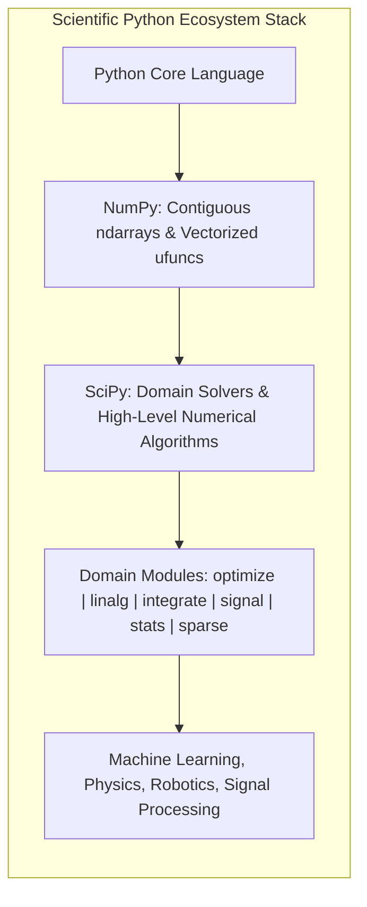
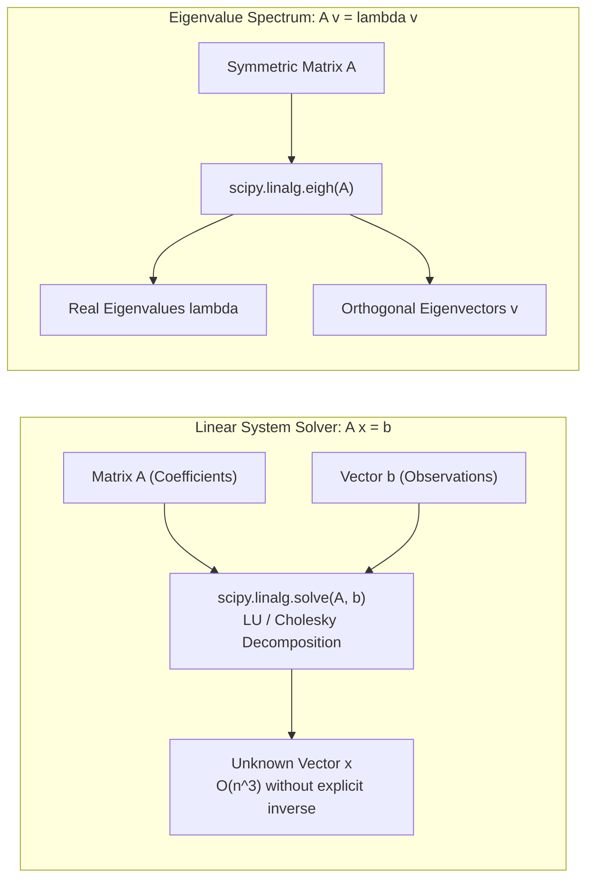
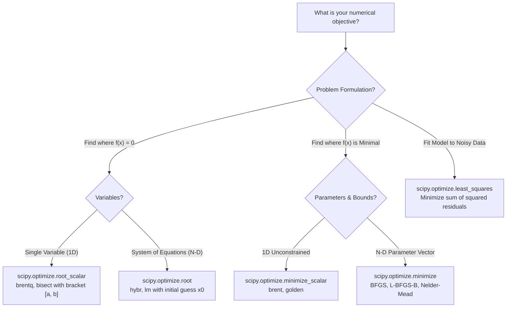
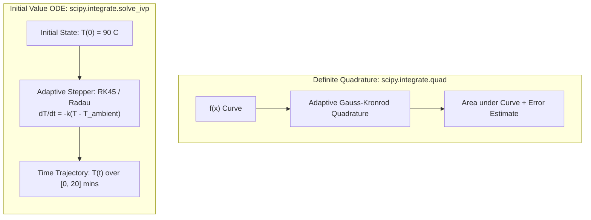
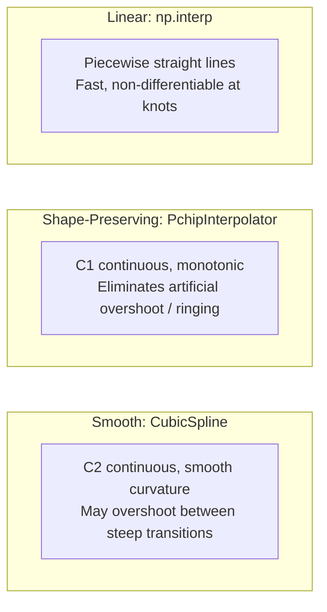
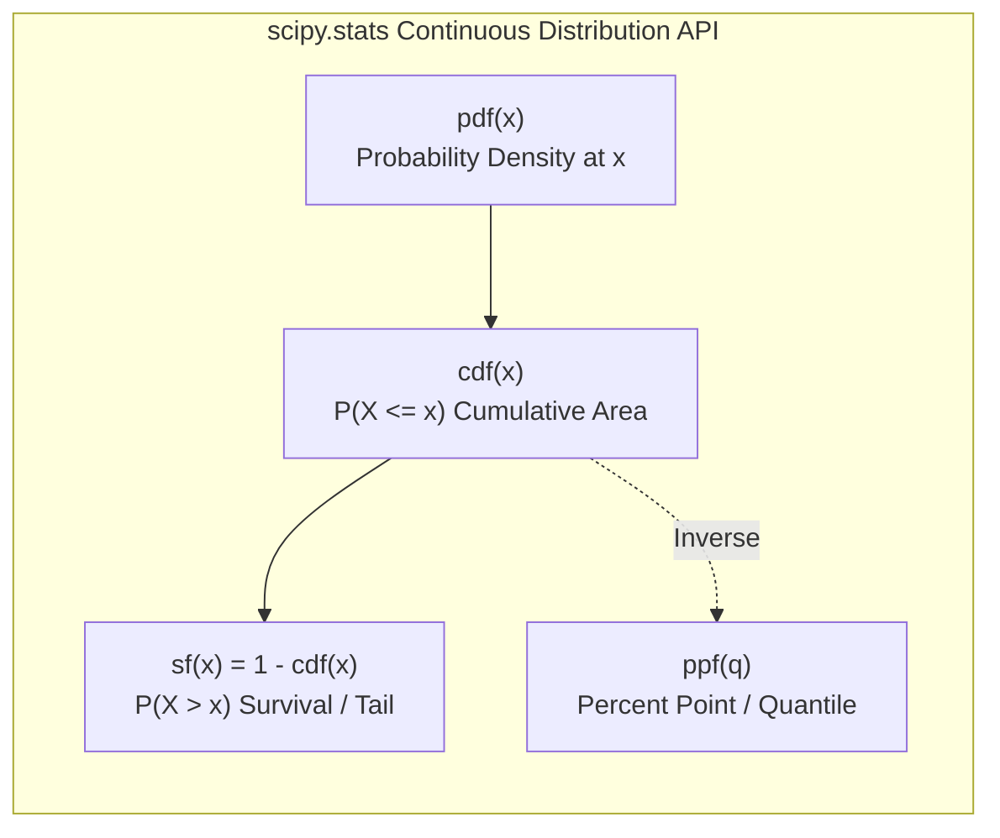
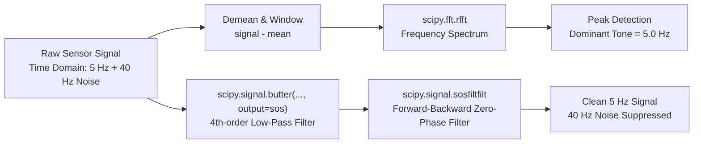
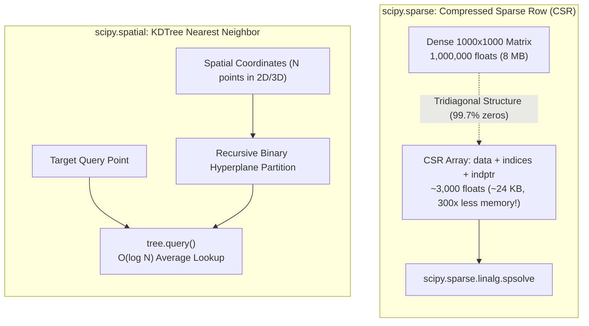
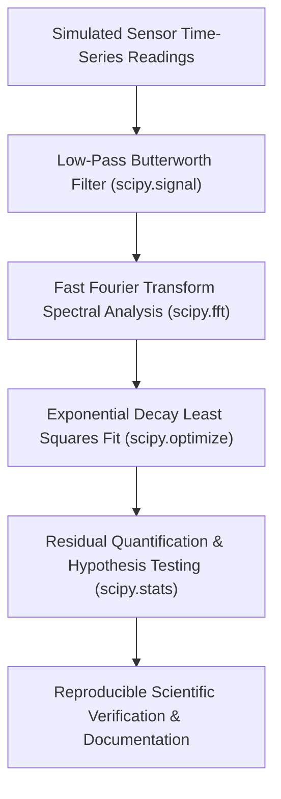

# SciPy Complete Guide: Beginner to Intermediate Scientific Python

> **Read and run:** Ten step-by-step lessons, five original Python labs, a cheat sheet, FAQ, glossary, and official documentation references.

**Prerequisites:** Python 3.11+, NumPy 1.26+, SciPy 1.13+. Install with `python -m pip install -r requirements.txt` from the full repository.

**Learning map:** Getting started → Linear algebra → Optimization → Integration & ODEs → Interpolation → Statistics → Signal & FFT → Sparse/Spatial → Special/Images → Projects.

**Note:** This is an independent educational guide, not the official SciPy documentation.

---

## Table of Contents

- [1. Getting started with SciPy](#1-getting-started-with-scipy)
- [2. Linear algebra with scipy.linalg](#2-linear-algebra-with-scipylinalg)
- [3. Optimization, roots, and curve fitting](#3-optimization-roots-and-curve-fitting)
- [4. Integration and differential equations](#4-integration-and-differential-equations)
- [5. Interpolation: fill values between measurements](#5-interpolation-fill-values-between-measurements)
- [6. Statistics and probability with scipy.stats](#6-statistics-and-probability-with-scipystats)
- [7. Signal processing and Fourier transforms](#7-signal-processing-and-fourier-transforms)
- [8. Sparse arrays and spatial search](#8-sparse-arrays-and-spatial-search)
- [9. Special functions and image processing](#9-special-functions-and-image-processing)
- [10. Hands-on SciPy projects](#10-hands-on-scipy-projects)
- [SciPy cheat sheet](#scipy-cheat-sheet)
- [Frequently asked questions about SciPy](#frequently-asked-questions-about-scipy)
- [SciPy and numerical computing glossary](#scipy-and-numerical-computing-glossary)
- [Appendix: complete runnable lab source code](#appendix-complete-runnable-lab-source-code)

---

# 1. Getting started with SciPy

**Goal:** understand what SciPy solves and run your first scientific computation in under five minutes.

## What is SciPy?

**SciPy** is an open-source Python library of numerical algorithms for scientific and technical computing. It builds on NumPy arrays and provides tested routines for tasks such as optimization, integration, statistics, signal processing, interpolation, sparse linear algebra, and spatial search.

**Quick comparison:** NumPy stores and computes with arrays; SciPy provides specialized numerical solvers that use those arrays.



| Need | Start with |
| --- | --- |
| Create arrays, calculate means | `numpy` |
| Find the minimum of a function | `scipy.optimize` |
| Integrate a mathematical function | `scipy.integrate` |
| Compare two sample means | `scipy.stats` |
| Filter a sound or sensor signal | `scipy.signal` |
| Solve a large sparse system | `scipy.sparse.linalg` |

## 1. Install and check

Use Python 3.11+ for this lab, ideally inside a virtual environment.

```bash
python -m venv .venv
source .venv/bin/activate   # Windows PowerShell: .venv\Scripts\Activate.ps1
python -m pip install -r requirements.txt
python -c "import numpy, scipy; print(numpy.__version__, scipy.__version__)"
```

This project requires SciPy 1.13+ and NumPy 1.26+. The individual APIs are chosen for broad compatibility, but installed-version support also depends on your Python interpreter and platform.

## 2. Your first optimization

Find the value of `x` that makes `(x - 3)^2 + 2` as small as possible.

```python
from scipy.optimize import minimize_scalar

result = minimize_scalar(lambda x: (x - 3) ** 2 + 2)
print(round(result.x, 6))     # 3.0
print(round(result.fun, 6))   # 2.0
print(result.success)         # True
```

**What happened?** The solver searched for the minimum and returned an **object** with the estimated answer, objective value, and status. Do not rely only on the printed number: check whether the solver succeeded.

## 3. What SciPy does *not* do

SciPy does not replace Python, NumPy, data cleaning, or scientific judgment. Solvers approximate answers, and results depend on assumptions, numerical precision, initial guesses, and input quality.

## 4. Understand the main result objects

```python
from scipy.optimize import root

solution = root(lambda x: x**2 - 9, x0=[2.0])
print(solution.x)       # approximate root near 3
print(solution.success) # whether solver reported success
print(solution.message) # explanation of termination
```

A **root** solves `f(x) = 0`; a **minimum** makes `f(x)` as small as possible. They are related but different tasks.

## 5. Mini exercise

Change `3` in the first objective to `7`. Predict the minimizing input before running. Then change the start value in `root` and see if it converges to a different root.

**Common error:** `from scipy import optimize` is fine, but trying `import scipy; scipy.optimize...` without explicitly importing the subpackage may be fragile. Prefer explicit imports.

**Official reference:** [SciPy user guide](https://docs.scipy.org/doc/scipy/tutorial/)

---

# 2. Linear algebra with `scipy.linalg`

**Goal:** solve equations involving matrices instead of implementing matrix elimination yourself.

## Understand the problem

Many engineering systems have the form **A x = b**. You know the matrix `A` and observations `b`; you want the unknown vector `x`.



```python
import numpy as np
from scipy.linalg import solve

A = np.array([[3.0, 1.0], [1.0, 2.0]])
b = np.array([9.0, 8.0])
x = solve(A, b)
print(x)                 # [2. 3.]
print(np.allclose(A @ x, b))  # True
```

`@` is matrix multiplication. The multiplication `A @ x` should reproduce `b` within numerical tolerance.

## Why not calculate the inverse?

Mathematically you might write $x = A^{-1} b$. Numerically, prefer `solve(A, b)` to `inv(A) @ b`: it avoids forming an unnecessary inverse and generally offers better efficiency and numerical behavior.

## Eigenvalues and eigenvectors

An eigenvector is a direction that a linear transformation stretches or shrinks without changing that direction.

```python
from scipy.linalg import eig

values, vectors = eig(np.array([[2., 0.], [0., 5.]]))
print(values)            # approximately [2.+0.j 5.+0.j]
```

For **symmetric real** matrices, prefer `scipy.linalg.eigh` to `eig` because it uses the special structure and returns real eigenvalues.

```python
from scipy.linalg import eigh

A = np.array([[2., 1.], [1., 2.]])
values, vectors = eigh(A)
print(values)            # [1. 3.]
```

## Least squares when there is no exact solution

A rectangular system may have more equations than unknowns. Solve for the best-fit vector using `lstsq`.

```python
from scipy.linalg import lstsq

A = np.array([[1., 0.], [1., 1.], [1., 2.]])
y = np.array([1., 2., 2.8])
coeffs, residuals, rank, singular = lstsq(A, y)
print(coeffs)            # approximate intercept and slope
```

This is linear least squares. For nonlinear relationships, use SciPy optimization.

## Accuracy and conditioning

A solver cannot reliably recover accurate values when a problem is badly conditioned or measurements are noisy. Check the residual `np.linalg.norm(A @ x - b)` and consider `np.linalg.cond(A)` to understand sensitivity.

## Practice

1. Change `b` in the first example and verify the new solution.
2. Fit a line to five observations using `lstsq`.
3. Predict the eigenvalues of a diagonal matrix before running.

**Reference:** [SciPy linear algebra tutorial](https://docs.scipy.org/doc/scipy/tutorial/linalg.html)

---

# 3. Optimization, roots, and curve fitting

**Goal:** recognize what to minimize, how to find roots, and how to fit model parameters.



## Task A: minimize a cost function

Suppose a cost increases when a parameter differs from its ideal value. Optimization finds a small cost.

```python
import numpy as np
from scipy.optimize import minimize

objective = lambda x: (x[0] - 2)**2 + (x[1] + 1)**2
result = minimize(objective, x0=[0., 0.], method="BFGS")
assert result.success
print(np.round(result.x, 4))  # [ 2. -1.]
```

A multivariable `minimize` objective receives an array and must return a scalar.

### Optimization with bounds

```python
from scipy.optimize import minimize

result = minimize(lambda x: (x[0] - 5)**2,
                  x0=[1.], bounds=[(0., 3.)], method="L-BFGS-B")
print(result.x)  # approximately [3.]
```

The unconstrained best value is 5, but 3 is the best allowed by the specified bound.

## Task B: find a root

A root solves an equation equal to zero.

```python
from scipy.optimize import root_scalar

root = root_scalar(lambda x: x**2 - 2, bracket=[0, 2], method="brentq")
print(root.root)         # 1.414213... (sqrt(2))
print(root.converged)    # True
```

A bracketing method requires an interval where the function changes sign and appropriate continuity. This often improves reliability over an arbitrary initial guess.

## Task C: fit a model to measurements

Suppose an amount decays as $a \cdot \exp(-k \cdot t)$. Estimate the positive parameters $a$ and $k$ from measured data.

```python
import numpy as np
from scipy.optimize import least_squares

t = np.array([0., 1., 2., 3.])
y = np.array([5., 3.1, 1.8, 1.1])

def residuals(params):
    a, k = params
    return a * np.exp(-k*t) - y

result = least_squares(residuals, x0=[5., 0.3], bounds=(0, np.inf))
assert result.success
print(result.x)            # fitted amplitude and rate
```

**Residuals** are prediction minus observed value. `least_squares` tries to make their squared sum small. For noisy or outlier-heavy measurements, look at robust `loss` options and the residual pattern.

## Which function should you choose?

| Question | SciPy function |
| --- | --- |
| What `x` minimizes one variable's cost? | `minimize_scalar` |
| What parameter vector minimizes a cost? | `minimize` |
| Where does a 1D function equal zero? | `root_scalar` |
| Where does a system of equations equal zero? | `root` |
| What parameters best fit nonlinear observations? | `least_squares` |

## Lab and self-check

Run `python labs/lab01_curve_fitting.py` from the repository root. The project generates seeded measurement noise, fits an exponential decay, and prints its two parameters. In the source code, try different initial values and compare fitted parameters.

**Pitfall:** `result.success` describes solver termination; it does not guarantee that your model is scientifically correct or that you found the global optimum.

**References:** [minimize](https://docs.scipy.org/doc/scipy/reference/generated/scipy.optimize.minimize.html) · [least_squares](https://docs.scipy.org/doc/scipy/reference/generated/scipy.optimize.least_squares.html)

---

# 4. Integration and differential equations

**Goal:** calculate the area under a curve and simulate a system that changes over time.



## Task A: compute a definite integral

Integration sums tiny contributions over a continuous interval. For example, the integral of $x^2$ from 0 to 1 equals $1/3$.

```python
from scipy.integrate import quad

value, estimated_error = quad(lambda x: x**2, 0, 1)
print(value)            # approximately 0.33333333333333337
print(estimated_error)  # numerical absolute-error estimate
```

`quad` returns an estimated integral and an error estimate. For discontinuities, singularities, or highly oscillatory functions, inspect the problem and choose suitable options or methods rather than assuming a result is exact.

## Task B: ordinary differential equations (ODEs)

An ODE describes a system's **rate of change**. Newton's cooling model is:

$$
\frac{dT}{dt} = -k(T - T_{\text{ambient}})
$$

At every instant, the cooling rate is proportional to the difference from ambient temperature.

```python
import numpy as np
from scipy.integrate import solve_ivp

ambient = 20.0
rate = 0.2

def cooling_derivative(t, state):
    return [-rate * (state[0] - ambient)]

times = np.linspace(0, 20, 11)
solution = solve_ivp(cooling_derivative, (0, 20), [90.0], t_eval=times)
assert solution.success
print(solution.y[0])   # temperatures at requested times
```

Read the arguments as `solve_ivp(derivative, (start, end), initial_state, ...)`.

## Difference: integration versus ODE solving

| You know... | Use... |
| --- | --- |
| A formula `f(x)` and want its accumulated area | `quad` |
| A state derivative `dy/dt` and its starting state | `solve_ivp` |

## Understand solver output

- `solution.t`: evaluation times.
- `solution.y`: states; row `i` corresponds to state component `i`.
- `solution.success`: solver status.
- `rtol` and `atol`: relative and absolute error controls.

For problems with very different state scales, consider component-specific `atol`. For stiff systems, methods such as `Radau`, `BDF`, or `LSODA` may be more appropriate than the default `RK45`.

## Try the lab

```bash
python labs/lab02_differential_equations.py
```

The lab checks solver success and provides reproducible time steps for a cooling simulation. Compare the numerical result to the exact formula $T(t) = T_{\text{ambient}} + (T_{\text{start}} - T_{\text{ambient}}) \cdot e^{-kt}$.

**Practice:** What changes if the ambient temperature is hotter than the starting state? Predict the direction of change before running.

**References:** [quad](https://docs.scipy.org/doc/scipy/reference/generated/scipy.integrate.quad.html) · [solve_ivp](https://docs.scipy.org/doc/scipy/reference/generated/scipy.integrate.solve_ivp.html)

---

# 5. Interpolation: fill values between measurements

**Goal:** estimate values at positions you did not measure.



## What is interpolation?

Imagine recording temperature at hour 0, 1, 2, and 3. Interpolation estimates temperature at hour 1.5 using nearby observations. **Extrapolation** estimates outside the observed range and is generally less reliable.

## Start with simple linear interpolation

For a straightforward one-dimensional estimate, NumPy is enough:

```python
import numpy as np

hours = np.array([0., 1., 2., 3.])
temp = np.array([20., 22., 24., 25.])
print(np.interp(1.5, hours, temp))  # 23.0
```

## Use SciPy for smoother or shape-preserving curves

```python
import numpy as np
from scipy.interpolate import PchipInterpolator

x = np.array([0., 1., 2., 3., 4.])
y = np.array([0., 1., 1.3, 1.35, 1.4])
interpolator = PchipInterpolator(x, y, extrapolate=False)
new_x = np.linspace(0, 4, 17)
print(np.round(interpolator(new_x), 3))
```

`PchipInterpolator` is useful for ordered observations whose shape you want to preserve. Its input `x` must be strictly increasing, with no duplicates. Setting `extrapolate=False` produces NaNs outside the observed range instead of inventing an extension.

## Cubic splines

```python
from scipy.interpolate import CubicSpline

spline = CubicSpline([0., 1., 2., 3.], [0., 1., 0., 1.])
print(spline(1.5))  # smooth interpolation inside the domain
```

Cubic splines have smooth derivatives but can overshoot between points. Shape-preserving PCHIP avoids some overshoot patterns, but it is not a universal solution for all data.

## Method chooser

| You need... | Prefer... |
| --- | --- |
| Quick straight-line estimates | `np.interp` |
| Shape-preserving 1D estimates | `PchipInterpolator` |
| A smooth 1D cubic polynomial between knots | `CubicSpline` |
| Scattered points on a plane | investigate `scipy.interpolate.griddata` |

## Practice

1. Add a duplicate x-coordinate. Why does PCHIP reject it?
2. Try predicting outside the data range with `extrapolate=False`.
3. Compare interpolated midpoints from PCHIP and a cubic spline.

**Key limitation:** interpolation reproduces or approximates observed points; it cannot prove an unseen physical law or make bad data accurate.

**Reference:** [PchipInterpolator](https://docs.scipy.org/doc/scipy/reference/generated/scipy.interpolate.PchipInterpolator.html)

---

# 6. Statistics and probability with `scipy.stats`

**Goal:** describe uncertainty, compute probabilities, and make careful comparisons between groups.



## Probability distributions

`scipy.stats` includes mathematical distributions such as the normal distribution. A continuous distribution has a probability density function (`pdf`) and cumulative distribution function (`cdf`).

```python
from scipy.stats import norm

print(round(norm.cdf(0), 3))    # 0.5: P(Z <= 0) for a standard normal
print(round(norm.sf(1.96), 4))  # about 0.025: P(Z > 1.96)
print(norm.ppf(0.975))          # about 1.96: 97.5th percentile
```

- `pdf(x)` = density at x, **not** probability of exactly x.
- `cdf(x)` = probability of a value at or below x.
- `sf(x)` = probability above x, often more numerically accurate than `1 - cdf(x)`.
- `ppf(q)` = percentile corresponding to a cumulative probability q.

## Generate reproducible sample data

```python
import numpy as np

rng = np.random.default_rng(42)
samples = rng.normal(loc=100, scale=15, size=100)
print(samples.mean())
```

Use an explicitly seeded NumPy random generator for educational reproducibility, not an unseeded hidden global generator.

## Compare two independent samples

Use **Welch's t-test** when comparing means without assuming equal population variances.

```python
from scipy.stats import ttest_ind

control = [12, 11, 13, 12, 14, 13]
treatment = [14, 15, 13, 17, 14, 16]
result = ttest_ind(treatment, control, equal_var=False)
print(result.statistic)
print(result.pvalue)
print(result.confidence_interval())
```

**Important:** A p-value is the probability, under the null model and assumptions, of a test statistic at least as extreme as observed. It is **not** the probability that the null hypothesis is true. A small p-value does not by itself measure practical importance or demonstrate causation.

## Which test fits?

| Research question | Starting function |
| --- | --- |
| Two independent group means | `ttest_ind(..., equal_var=False)` |
| Matched measurements, before versus after | `ttest_rel` |
| Association between continuous variables | `pearsonr`, if assumptions fit |
| Rank-based monotonic association | `spearmanr` |
| Normality diagnostics | `normaltest` for sufficiently sized samples |
| Categorical counts and expected frequencies | `chi2_contingency` |

A test is only appropriate when its design assumptions match the sampling method and question. Statistical significance should be interpreted alongside effect sizes, uncertainty, and study design.

## Hands-on lab

```bash
python labs/lab03_statistics.py
```

The lab reports means, treatment-minus-control difference, Welch t-statistic, p-value, and a 95% confidence interval for the difference. Samples are simulated and independent by construction.

## Practice

1. Increase the sample sizes; run multiple seeded simulations.
2. Change the group spread while keeping group means similar.
3. Explain why an observational study may be biased even if its p-value is tiny.

**Reference:** [ttest_ind](https://docs.scipy.org/doc/scipy/reference/generated/scipy.stats.ttest_ind.html)

---

# 7. Signal processing and Fourier transforms

**Goal:** identify patterns in time-series signals and filter unwanted frequency components.

## Time domain versus frequency domain

A signal in the **time domain** says how a measurement changes over time. A Fourier transform describes how that signal is distributed across frequencies.



## Build a synthetic signal

```python
import numpy as np

sampling_rate = 200.0                 # 200 samples each second
t = np.arange(400) / sampling_rate    # 2 seconds
signal = np.sin(2 * np.pi * 5 * t) + 0.2 * np.sin(2 * np.pi * 40 * t)
```

This mixes a strong 5 Hz wave with a smaller 40 Hz wave.

## Find the strongest frequency

```python
from scipy.fft import rfft, rfftfreq

frequencies = rfftfreq(signal.size, d=1/sampling_rate)
amplitudes = np.abs(rfft(signal - signal.mean()))
strongest_bin = np.argmax(amplitudes[1:]) + 1
print(frequencies[strongest_bin])  # 5.0 Hz
```

`rfft` returns just the nonnegative-frequency bins needed for **real-valued** inputs. For short records or frequencies between bins, spectral leakage affects estimates. The sample rate determines the Nyquist limit (`sampling_rate / 2`).

## Low-pass Butterworth filtering

```python
from scipy.signal import butter, sosfiltfilt

sos = butter(4, 10.0, btype="lowpass", fs=sampling_rate, output="sos")
cleaned = sosfiltfilt(sos, signal)
```

Use **second-order sections** (`output="sos"`) for better numerical behavior in IIR filter implementations. `sosfiltfilt` filters forward and backward to reduce phase shift; because it uses future samples, it is suitable for offline analysis, not causal real-time filtering.

## Detect peaks

```python
from scipy.signal import find_peaks

peaks, properties = find_peaks(signal, prominence=0.5, distance=15)
print(peaks[:5])
```

The appropriate `prominence` and `distance` parameters depend on units, sampling rate, and the signal's expected shape.

## Run the lab

```bash
python labs/lab04_signal_analysis.py
```

The code measures the dominant tone and filters a higher-frequency component. Change the filter cutoff and compare the cleaned output with the original 5 Hz component.

## Practice

1. What is the Nyquist frequency at 200 samples/second?
2. What goes wrong if you treat `fs=200` data as `fs=100`?
3. Add a DC offset of 100 and explain the reason for mean subtraction.

**References:** [rfft](https://docs.scipy.org/doc/scipy/reference/generated/scipy.fft.rfft.html) · [sosfiltfilt](https://docs.scipy.org/doc/scipy/reference/generated/scipy.signal.sosfiltfilt.html)

---

# 8. Sparse arrays and spatial search

**Goal:** work efficiently with systems that have many zeros and find nearby points in space.



## Why sparse arrays?

A dense 1,000 × 1,000 matrix holds one million entries, even if almost all of them are zero. A **sparse** representation stores non-zero values and structural information. Sparse formats can save memory and accelerate suitable computations, though they also have storage and conversion overhead.

For new SciPy code, prefer **sparse arrays** (`csr_array`, `diags_array`) instead of older sparse-matrix classes when appropriate.

## Create a sparse matrix-like array

```python
import numpy as np
from scipy.sparse import diags_array

A = diags_array(
    [-np.ones(3), 3*np.ones(4), -np.ones(3)],
    offsets=[-1, 0, 1], format="csr", dtype=float
)
print(A.shape)           # (4, 4)
print(A.nnz)             # 10 stored entries
print(A.toarray())       # for inspection ONLY on this tiny example
```

`A.nnz` counts stored values (including any explicitly stored zeros). `toarray()` can consume substantial memory on large sparse systems; avoid converting huge arrays just to print them.

## Solve a sparse linear system

```python
from scipy.sparse.linalg import spsolve

b = np.array([1., 0., 0., 1.])
x = spsolve(A, b)
print(np.allclose(A @ x, b))  # True
```

Sparse solves are useful in graph problems, network equations, finite-difference models, and some large scientific simulations.

## Spatial nearest-neighbor lookup

For points in 2D or 3D, `KDTree` can speed up searches for nearby observations compared with checking every point for every query.

```python
from scipy.spatial import KDTree

points = np.array([[0, 0], [2, 2], [5, 5]], dtype=float)
tree = KDTree(points)
distance, index = tree.query([2.2, 1.8])
print(index)        # 1
print(distance)     # approximately 0.283
```

`KDTree` is useful for low- to moderate-dimensional nearest-neighbor queries. Its advantage can shrink in high dimensions; always benchmark against a simple baseline for your data.

## Important pitfall

Modern SciPy sparse **arrays** use NumPy-style `*` for elementwise multiplication and `@` for matrix multiplication. Old `spmatrix`-based examples can have different semantics; do not blindly mix sparse matrices and arrays.

## Run the lab

```bash
python labs/lab05_sparse_spatial.py
```

The lab solves a tridiagonal system and finds the closest coordinate.

## Practice

1. Increase the system size to 1,000 unknowns without converting to dense.
2. Verify `np.linalg.norm(A @ x - b)` is close to zero.
3. Query a point equidistant from two observations. Does the nearest index have to be uniquely defined?

**References:** [diags_array](https://docs.scipy.org/doc/scipy/reference/generated/scipy.sparse.diags_array.html) · [KDTree](https://docs.scipy.org/doc/scipy/reference/generated/scipy.spatial.KDTree.html)

---

# 9. Special functions and image processing

**Goal:** discover useful numerical functions beyond the main optimization and statistics modules.

## Special functions

`scipy.special` contains high-quality mathematical functions that occur in probability, physics, and engineering, including `erf`, `gamma`, `expit`, and `logsumexp`.

### Stable logistic function

```python
import numpy as np
from scipy.special import expit, logsumexp

scores = np.array([-1000., 0., 1000.])
print(expit(scores))          # approximately [0.  0.5 1.]
print(logsumexp([1000., 1001.]))  # finite number, unlike naive exp-then-log
```

Naively computing $1 / (1 + \exp(-x))$ can overflow for sufficiently negative inputs. `expit` is designed for stable numerical evaluation.

### Error function

```python
from scipy.special import erf

print(erf(0.0))  # 0.0
```

The error function appears in the formula for the normal distribution's cumulative probabilities.

## Image and multidimensional filtering

`scipy.ndimage` operates on arrays representing images or other gridded measurements.

```python
import numpy as np
from scipy.ndimage import gaussian_filter

image = np.zeros((7, 7), dtype=float)
image[3, 3] = 1.0
smoothed = gaussian_filter(image, sigma=1.0)
print(smoothed[3, 3])   # peak is reduced and spread into nearby cells
print(smoothed.sum())   # approximately 1 for this impulse
```

A Gaussian filter averages neighboring values with weights that decrease with distance, giving a smoothing effect. Boundary handling and choice of `sigma` affect results.

## Other useful SciPy areas

| Module | Example use |
| --- | --- |
| `scipy.cluster` | clustering and hierarchical groupings |
| `scipy.constants` | scientific constants and unit conversions |
| `scipy.ndimage` | edge detection, image transforms, labeling |
| `scipy.special` | stable mathematical functions |
| `scipy.io` | loading or saving supported scientific formats |

## Practice

1. Compare `expit([-50, 0, 50])` to a handwritten sigmoid.
2. Use `gaussian_filter` on a small matrix with two isolated bright points.
3. Explore `scipy.constants` and check the units of one physical constant.

**Caution:** image smoothing can remove useful detail along with noise. A processed image is not necessarily a better scientific measurement.

**References:** [SciPy special functions](https://docs.scipy.org/doc/scipy/reference/special.html) · [SciPy ndimage](https://docs.scipy.org/doc/scipy/reference/ndimage.html)

---

# 10. Hands-on SciPy projects

**Goal:** leave with examples that run, tests that explain expected behavior, and practical questions to explore.



## Run everything

From the repository root:

```bash
python -m pip install -r requirements-dev.txt
python labs/lab01_curve_fitting.py
python labs/lab02_differential_equations.py
python labs/lab03_statistics.py
python labs/lab04_signal_analysis.py
python labs/lab05_sparse_spatial.py
python -m pytest -q
```

All examples use built-in synthetic data, so no external datasets or API keys are required. The tests are deterministic.

## Lab 1 — Fit a decay curve

**File:** `labs/lab01_curve_fitting.py`

**Concept:** nonlinear regression using `scipy.optimize.least_squares`.

**Question:** What amplitude and decay rate explain the observations?

**Skills:** construct residuals, impose non-negative parameter bounds, check convergence, compare fitted coefficients.

**Challenge:** double the measurement noise. Run with multiple seeds and compare variability of estimates.

## Lab 2 — Model cooling over time

**File:** `labs/lab02_differential_equations.py`

**Concept:** initial-value ODE integration using `solve_ivp`.

**Question:** How quickly does an object approach ambient temperature?

**Skills:** formulate a derivative, choose an initial state, evaluate at specific times, test against an analytic result.

**Challenge:** simulate a cooling and heating scenario; compare curves without assuming the same starting temperature.

## Lab 3 — Compare two groups

**File:** `labs/lab03_statistics.py`

**Concept:** descriptive statistics and Welch's two-sample t-test.

**Question:** How large is the observed difference, and how uncertain is the estimate?

**Skills:** check samples, interpret a confidence interval, distinguish effect size from p-value.

**Challenge:** design a separate permutation test, then compare results and assumptions.

## Lab 4 — Find and filter a frequency

**File:** `labs/lab04_signal_analysis.py`

**Concept:** FFT bins and low-pass filtering with second-order sections.

**Question:** What frequency dominates a noisy sensor record?

**Skills:** sample rate, Fourier transform, high-frequency suppression, offline zero-phase filtering.

**Challenge:** add a 60 Hz wave and compare signal quality before and after filtering.

## Lab 5 — Solve and search efficiently

**File:** `labs/lab05_sparse_spatial.py`

**Concept:** sparse direct solution plus a 2D KDTree.

**Question:** How do we avoid dense storage for banded matrices, and search nearby coordinates quickly?

**Skills:** build sparse diagonals, verify residuals, perform spatial queries.

**Challenge:** grow the sparse system and measure time versus a dense version only at sizes your memory can handle.

## Suggested capstone

Create a **sensor quality analysis** using methods from at least three lessons: track the known ground truth, noise model, sample rate, solver status, and limitations. This is more instructive than reporting a model's output alone.

---

# SciPy cheat sheet

The fastest way to find the right SciPy function. Import each subpackage explicitly.

| Problem | Import | Typical call |
| --- | --- | --- |
| Single-variable minimum | `from scipy.optimize import minimize_scalar` | `minimize_scalar(f)` |
| Multivariable minimum | `from scipy.optimize import minimize` | `minimize(f, x0)` |
| Equation root | `from scipy.optimize import root_scalar` | `root_scalar(f, bracket=[a,b])` |
| Nonlinear fit | `from scipy.optimize import least_squares` | `least_squares(residuals, x0)` |
| Definite integral | `from scipy.integrate import quad` | `quad(f, a, b)` |
| Initial-value ODE | `from scipy.integrate import solve_ivp` | `solve_ivp(f, (t0,t1), y0)` |
| Linear-system solve | `from scipy.linalg import solve` | `solve(A, b)` |
| Linear least squares | `from scipy.linalg import lstsq` | `lstsq(A, b)` |
| Cubic spline | `from scipy.interpolate import CubicSpline` | `CubicSpline(x, y)` |
| Shape-preserving interpolation | `from scipy.interpolate import PchipInterpolator` | `PchipInterpolator(x, y)` |
| Independent group means | `from scipy.stats import ttest_ind` | `ttest_ind(a, b, equal_var=False)` |
| Normal CDF | `from scipy.stats import norm` | `norm.cdf(z)` |
| Real-input FFT | `from scipy.fft import rfft, rfftfreq` | `rfft(signal)` |
| Design a digital filter | `from scipy.signal import butter` | `butter(4, cutoff, fs=fs, output='sos')` |
| Apply zero-phase filter | `from scipy.signal import sosfiltfilt` | `sosfiltfilt(sos, x)` |
| Detect peaks | `from scipy.signal import find_peaks` | `find_peaks(x, prominence=1)` |
| Create sparse array | `from scipy.sparse import diags_array` | `diags_array(diagonals, offsets=...)` |
| Sparse linear solve | `from scipy.sparse.linalg import spsolve` | `spsolve(A, b)` |
| Nearest neighbor | `from scipy.spatial import KDTree` | `KDTree(points).query(query)` |
| Logistic function | `from scipy.special import expit` | `expit(scores)` |
| Gaussian smoothing | `from scipy.ndimage import gaussian_filter` | `gaussian_filter(image, sigma=1)` |

## Solver checklist

- Define the actual question: **minimize**, **find a root**, **integrate**, or **estimate**.
- Validate input shapes, units, finite numbers, and domain assumptions.
- Look at `success`, `converged`, residuals, and solver messages.
- Use tolerances and avoid expecting exact floating-point equality.
- Check model assumptions, not just numerical convergence.
- Compare a toy case against an exact known answer when possible.

## Five useful examples

```python
import numpy as np
from scipy.integrate import quad
from scipy.optimize import root_scalar
from scipy.stats import norm
from scipy.special import expit
from scipy.spatial import KDTree

print(quad(lambda x: x*x, 0, 1)[0])
print(root_scalar(lambda x: x*x - 2, bracket=(0, 2)).root)
print(norm.cdf(0))
print(expit(np.array([-1, 0, 1])))
print(KDTree([[0,0],[1,1]]).query([0.8, 0.9]))
```

**Official documentation:** [SciPy Reference Guide](https://docs.scipy.org/doc/scipy/)

---

# Frequently asked questions about SciPy

## What is SciPy used for?

SciPy provides numerical algorithms for scientific and engineering problems, including optimization, integration, statistical analysis, signal processing, interpolation, matrix operations, and spatial queries.

## Is SciPy the same as NumPy?

No. NumPy provides multidimensional arrays and core numerical operations. SciPy builds on that foundation with specialized scientific algorithms. You commonly use both together.

## Do I need NumPy before SciPy?

Basic array knowledge makes SciPy much easier. Learn array construction, shapes, `@`, slicing, and broadcasting first. You do not need to master NumPy's advanced features before starting SciPy.

## Is SciPy free?

Yes. SciPy is an open-source project; use its official documentation for licensing details.

## How do I install SciPy?

Inside a virtual environment, run `python -m pip install scipy`. In this lab, install the tested project dependencies using `python -m pip install -r requirements.txt`.

## Which Python version should I use?

This project targets Python 3.11 and later and specifies SciPy and NumPy minimums in its requirements file. Compatibility varies by release, platform, and interpreter. Check the release notes for your selected versions.

## How do I minimize a function in SciPy?

For one scalar input, start with `scipy.optimize.minimize_scalar`. For a vector of parameters, use `scipy.optimize.minimize`. Inspect result status and constraints.

## What's the difference between a root and a minimum?

A root solves `f(x) = 0`. A minimum finds an `x` where the function's value is smallest within a specified domain or local neighborhood. They may be different values.

## How do I fit a curve?

For nonlinear parameters, define model residuals (`prediction - observation`) and call `scipy.optimize.least_squares`. Inspect residuals, bounds, parameter uncertainty, and whether the model is appropriate.

## Can SciPy solve differential equations?

Yes. `scipy.integrate.solve_ivp` numerically solves initial-value problems for ordinary differential equations given derivatives and initial conditions.

## What is a p-value?

A p-value measures how extreme a test statistic would be under a null model. It does not give the probability that a hypothesis is true or that a result is important. Study design and assumptions matter.

## What's the recommended way to filter a digital signal?

For an IIR Butterworth design, `scipy.signal.butter(..., output='sos')` is a useful starting point. For offline zero-phase filtering, use `sosfiltfilt` if appropriate; online causal filtering may require `sosfilt` and careful state handling.

## What is the difference between scipy.fft and scipy.fftpack?

For new code, prefer the modern `scipy.fft` interface. Older tutorials may show `scipy.fftpack`.

## What are sparse arrays?

Sparse arrays hold mostly-zero data with compact nonzero storage. Use types such as `csr_array` or `diags_array` when their structure suits the problem. They can reduce memory use substantially on suitable matrices, but not for dense data.

## Is SciPy faster than pure Python?

For many suitable numerical problems, SciPy's compiled and optimized routines can be faster, but no speedup applies to every workload. Compare correctness and performance on representative input sizes.

## Is this official SciPy documentation?

No. This is an independent educational lab with links to SciPy's official documentation. SciPy and NumPy are trademarks of their respective projects.

---

# SciPy and numerical computing glossary

| Term | Plain-language meaning |
| --- | --- |
| **Absolute tolerance (`atol`)** | Allowed error scale when the true solution is near zero. |
| **Approximation** | A computed value that is close to, not necessarily equal to, an ideal mathematical value. |
| **Convergence** | A numerical method's progress toward satisfying its stopping criteria. |
| **Dense matrix** | Matrix stored with space for every position, including zeros. |
| **Distribution** | A mathematical model for how a random variable behaves. |
| **FFT** | Fast Fourier Transform; efficient algorithm for discrete Fourier transforms. |
| **Frequency bin** | A discrete frequency location represented in a computed spectrum. |
| **Global minimum** | Lowest objective value over the whole allowed domain. |
| **Gradient** | Vector of partial derivatives indicating local change. |
| **Interpolation** | Estimate inside the range of measured data. |
| **Extrapolation** | Estimate outside the measured data range. |
| **Initial value problem** | A changing system defined by its rate of change and known starting state. |
| **Jacobian** | Matrix of first-order partial derivatives. |
| **Least squares** | Fit parameters by reducing a sum of squared residuals. |
| **Local minimum** | Lowest objective value in a nearby region. |
| **Nyquist frequency** | Half the sampling rate; the highest uniquely representable frequency under ideal sampling assumptions. |
| **ODE** | Ordinary differential equation linking a function to one or more derivatives. |
| **Optimization** | Search for parameter values that minimize or maximize a target. |
| **p-value** | Probability of a result at least as extreme under the specified null model and assumptions. |
| **Residual** | Difference between model prediction and observation, or between the two sides of an equation. |
| **Relative tolerance (`rtol`)** | Allowed error proportion relative to the solution scale. |
| **Root** | Input satisfying an equation of the form `f(x) = 0`. |
| **Sampling rate** | Number of observations recorded per second. |
| **Sparse array** | Array storing only a subset of elements plus position information, usually for mostly-zero arrays. |
| **Stiff ODE** | Differential equation for which some standard explicit numerical methods must use extremely small steps for stability. |
| **Welch's t-test** | Comparison of independent sample means that does not require equal population variances. |
| **Zero-phase filtering** | Offline forward-and-backward filtering approach that removes net phase shift but is not causal. |

---

# Appendix: complete runnable lab source code

## lab01_curve_fitting.py

```python
"""Lab 1: estimate exponential-decay parameters with least squares."""
import numpy as np
from scipy.optimize import least_squares


def fit_decay(time, observations):
    """Return (initial_amplitude, decay_rate) for amplitude * exp(-rate*t)."""
    t = np.asarray(time, dtype=float)
    y = np.asarray(observations, dtype=float)
    if t.ndim != 1 or y.shape != t.shape or t.size < 3:
        raise ValueError("time and observations must be 1D arrays of length >= 3")
    if not np.all(np.isfinite(t)) or not np.all(np.isfinite(y)) or np.any(t < 0):
        raise ValueError("inputs must be finite; times must be nonnegative")

    def residuals(parameters):
        amplitude, rate = parameters
        return amplitude * np.exp(-rate * t) - y

    result = least_squares(residuals, x0=[max(y[0], 0.01), 0.4], bounds=(0, np.inf))
    if not result.success:
        raise RuntimeError(result.message)
    return result.x


if __name__ == "__main__":
    rng = np.random.default_rng(14)
    times = np.linspace(0, 6, 40)
    measured = 4.0 * np.exp(-0.65 * times) + rng.normal(0, 0.04, times.size)
    amplitude, rate = fit_decay(times, measured)
    print(f"Estimated amplitude: {amplitude:.3f}; decay rate: {rate:.3f}")
    print("Challenge: change the noise level and see how the fit changes.")
```

## lab02_differential_equations.py

```python
"""Lab 2: simulate Newton's law of cooling with an ODE solver."""
import numpy as np
from scipy.integrate import solve_ivp


def simulate_cooling(initial_temp=90, ambient_temp=20, rate=0.2, minutes=30):
    """Return (times, temperatures) for exponential cooling."""
    if not np.all(np.isfinite([initial_temp, ambient_temp, rate, minutes])):
        raise ValueError("all inputs must be finite")
    if rate <= 0 or minutes <= 0:
        raise ValueError("rate and minutes must be positive")
    times = np.linspace(0, minutes, 61)

    def derivative(_t, state):
        return [-rate * (state[0] - ambient_temp)]

    solution = solve_ivp(derivative, (0, minutes), [initial_temp],
                         t_eval=times, rtol=1e-9, atol=1e-11)
    if not solution.success:
        raise RuntimeError(solution.message)
    return solution.t, solution.y[0]


if __name__ == "__main__":
    times, temperatures = simulate_cooling()
    for step in (0, 10, 30, 60):
        print(f"Minute {times[step]:4.1f}: {temperatures[step]:.2f}°C")
    print("Challenge: change ambient temperature and the cooling rate.")
```

## lab03_statistics.py

```python
"""Lab 3: compare two independent groups with Welch's t-test."""
import numpy as np
from scipy.stats import ttest_ind


def compare_groups(control, treatment):
    """Return descriptive statistics and a Welch t-test result.

    This is a teaching example, not a causal inference or production A/B framework.
    """
    a, b = np.asarray(control, dtype=float), np.asarray(treatment, dtype=float)
    if a.ndim != 1 or b.ndim != 1 or min(a.size, b.size) < 2:
        raise ValueError("both samples must be 1D with >= 2 observations")
    if not np.all(np.isfinite(a)) or not np.all(np.isfinite(b)):
        raise ValueError("samples must contain finite values")
    if np.var(a, ddof=1) == 0 and np.var(b, ddof=1) == 0:
        raise ValueError("at least one group must have variation")
    test = ttest_ind(b, a, equal_var=False)
    ci = test.confidence_interval(confidence_level=0.95)
    return {
        "control_mean": float(np.mean(a)),
        "treatment_mean": float(np.mean(b)),
        "difference": float(np.mean(b) - np.mean(a)),
        "t_statistic": float(test.statistic),
        "p_value": float(test.pvalue),
        "ci_95": (float(ci.low), float(ci.high)),
    }


if __name__ == "__main__":
    rng = np.random.default_rng(25)
    control = rng.normal(50, 8, 120)
    treatment = rng.normal(53, 9, 110)
    report = compare_groups(control, treatment)
    for key, value in report.items():
        print(f"{key}: {value}")
    print("Challenge: vary sample size; do not interpret a p-value as P(hypothesis true).")
```

## lab04_signal_analysis.py

```python
"""Lab 4: find a dominant tone and remove high-frequency noise."""
import numpy as np
from scipy.fft import rfft, rfftfreq
from scipy.signal import butter, sosfiltfilt


def analyze_signal(samples, sampling_rate=200.0, cutoff=10.0):
    """Return dominant non-DC frequency and low-pass filtered samples."""
    x = np.asarray(samples, dtype=float)
    if x.ndim != 1 or x.size < 32 or not np.all(np.isfinite(x)):
        raise ValueError("samples must be a finite 1D signal with >= 32 values")
    if not 0 < cutoff < sampling_rate / 2:
        raise ValueError("cutoff must be between zero and Nyquist frequency")
    # Remove the mean so the DC bin does not dominate.
    centered = x - x.mean()
    magnitudes = np.abs(rfft(centered))
    freqs = rfftfreq(x.size, d=1.0 / sampling_rate)
    strongest_bin = int(np.argmax(magnitudes[1:]) + 1)
    sos = butter(4, cutoff, btype="lowpass", fs=sampling_rate, output="sos")
    filtered = sosfiltfilt(sos, x)
    return {"dominant_hz": float(freqs[strongest_bin]), "filtered": filtered}


if __name__ == "__main__":
    fs = 200.0
    t = np.arange(400) / fs
    signal = np.sin(2 * np.pi * 5 * t) + 0.25 * np.sin(2 * np.pi * 40 * t)
    report = analyze_signal(signal, sampling_rate=fs)
    print(f"Dominant frequency: {report['dominant_hz']:.1f} Hz")
    print("Challenge: move the noise frequency below the low-pass cutoff.")
```

## lab05_sparse_spatial.py

```python
"""Lab 5: solve a sparse linear system and query nearest neighbors."""
import numpy as np
from scipy.sparse import diags_array
from scipy.sparse.linalg import spsolve
from scipy.spatial import KDTree


def solve_smooth_chain(forces):
    """Solve a symmetric positive-definite tridiagonal system A*x=forces."""
    b = np.asarray(forces, dtype=float)
    if b.ndim != 1 or b.size < 2 or not np.all(np.isfinite(b)):
        raise ValueError("forces must be a finite 1D array with >= 2 values")
    n = b.size
    a = diags_array([
        -np.ones(n - 1), 3.0 * np.ones(n), -np.ones(n - 1)
    ], offsets=[-1, 0, 1], format="csr", dtype=float)
    return spsolve(a, b)


def find_nearest(points, query):
    """Return (index, distance) of nearest coordinate in points."""
    points = np.asarray(points, dtype=float)
    query = np.asarray(query, dtype=float)
    if (points.ndim != 2 or points.shape[0] == 0 or query.shape != (points.shape[1],)
            or not np.all(np.isfinite(points)) or not np.all(np.isfinite(query))):
        raise ValueError("provide finite 2D points and a matching 1D query")
    distance, index = KDTree(points).query(query)
    return int(index), float(distance)


if __name__ == "__main__":
    result = solve_smooth_chain([1, 0, 0, 1])
    print("Sparse system solution:", np.round(result, 3))
    index, distance = find_nearest([[0, 0], [2, 2], [5, 5]], [1.9, 2.2])
    print(f"Nearest point index={index}, distance={distance:.3f}")
    print("Challenge: expand the sparse system to 1,000 unknowns.")
```

## Primary reference links

- [SciPy documentation](https://docs.scipy.org/doc/scipy/)
- [NumPy documentation](https://numpy.org/doc/stable/)
- [Google helpful content guidance](https://developers.google.com/search/docs/fundamentals/creating-helpful-content)
