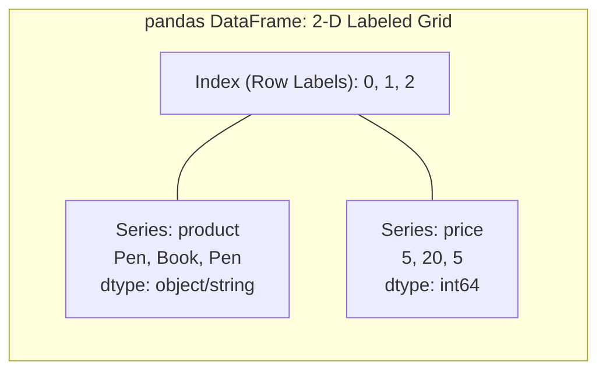
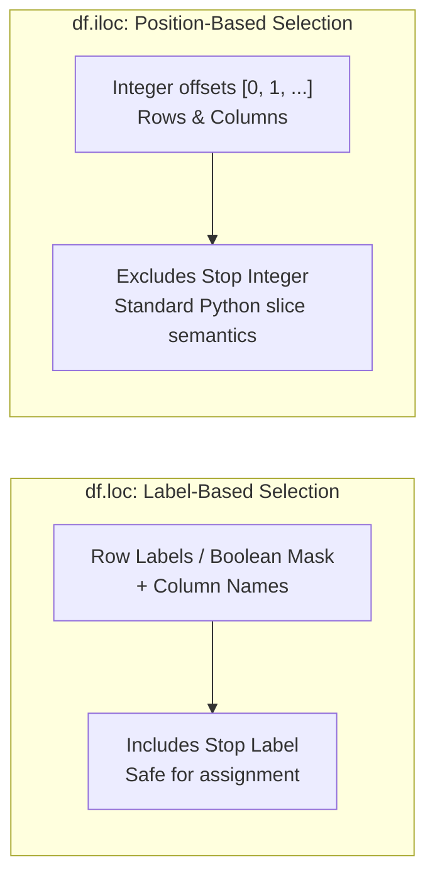
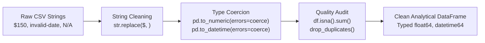
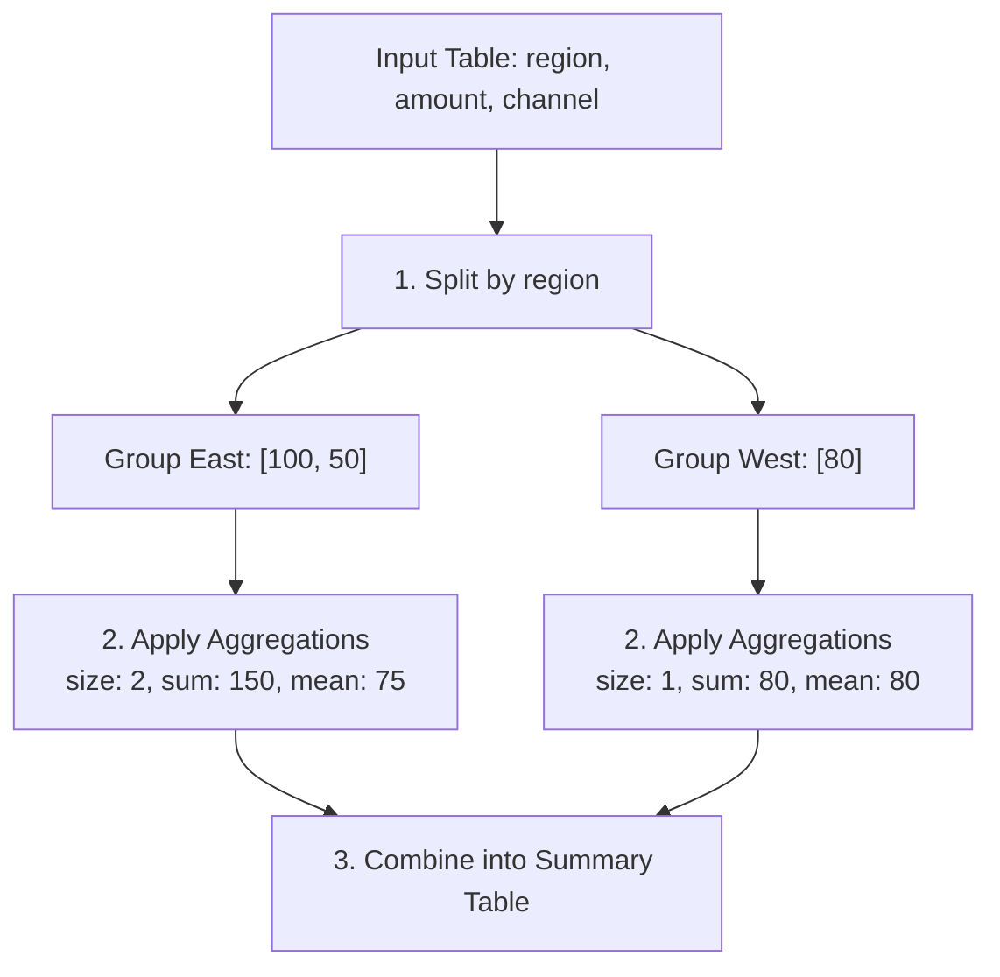
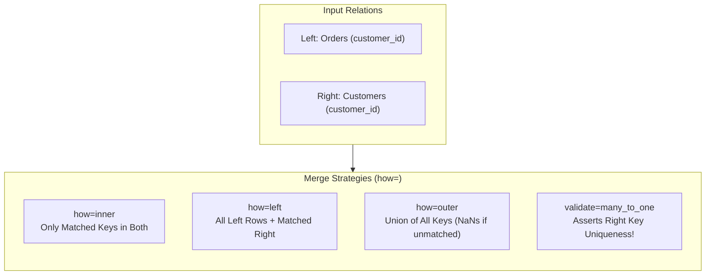
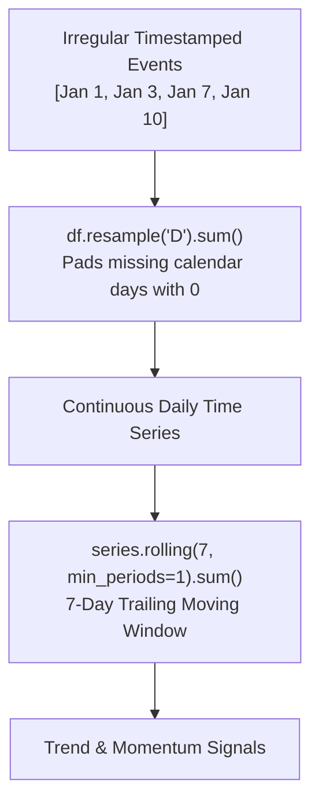
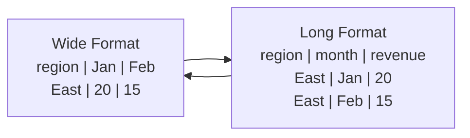
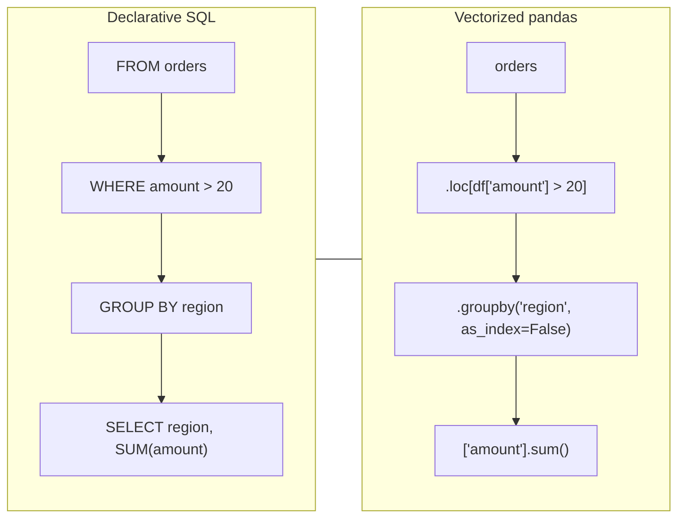
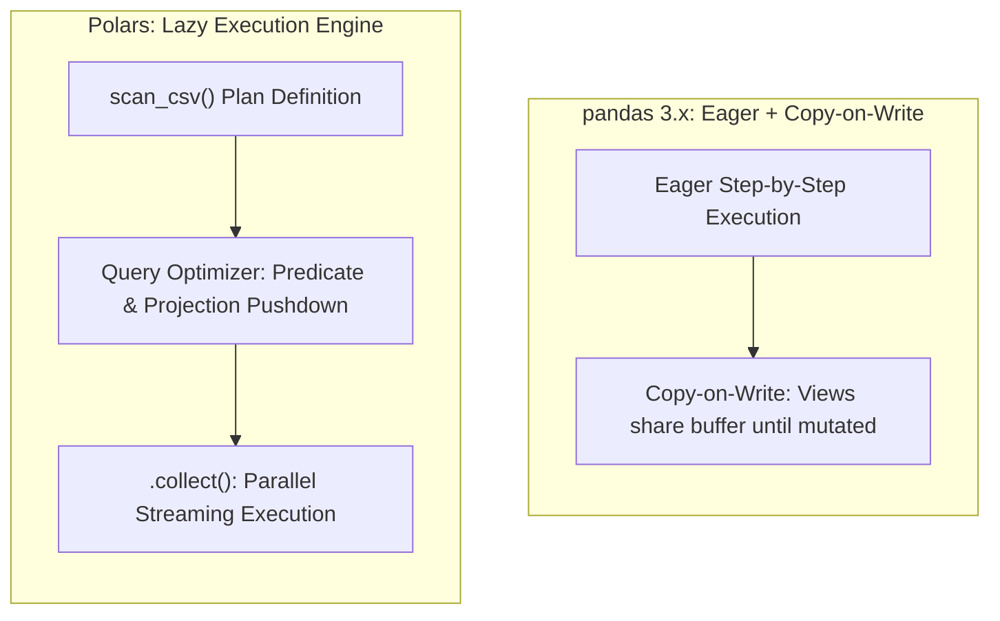
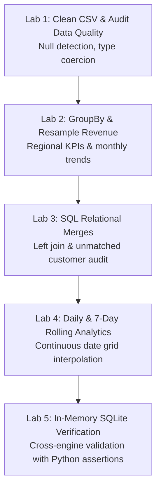

# Pandas Complete Guide: From DataFrames to SQL Joins and Analytics

> Single-file version of the 10-lesson course. The repository also contains standalone runnable labs and tests.

## Course map

- [1. Pandas Getting Started: DataFrame and Series](#01-getting-started)
- [2. Pandas loc vs iloc: Select and Filter DataFrames](#02-select-filter)
- [3. Pandas CSV Cleaning: Missing Data, Dtypes and Dates](#03-csv-cleaning)
- [4. Pandas GroupBy Tutorial: Aggregation and Pivot Tables](#04-groupby-aggregation)
- [5. Pandas Merge and Join: SQL Inner, Left, Outer Joins](#05-merge-joins)
- [6. Pandas Time Series: Datetime, Resample and Rolling](#06-time-series)
- [7. Pandas Pivot Melt and String Operations](#07-reshape-strings)
- [8. Pandas vs SQL: Join, Filter, Group and SQLite](#08-sql-comparison)
- [9. Pandas vs Polars: Performance, Parquet and Copy-on-Write](#09-performance-polars)
- [10. Pandas Practice Projects: Five Hands-On Labs](#10-hands-on-labs)
- [Pandas cheat sheet](#pandas-cheat-sheet)
- [Pandas questions and answers](#pandas-questions-and-answers)
- [Glossary](#glossary)
- [Runnable Python projects](#runnable-python-projects)

---

<a id="01-getting-started"></a>

# 1. Getting started with pandas

**Goal:** Open a small table, inspect it, and understand pandas' two core objects.

A **Series** is a one-dimensional labeled column. A **DataFrame** is a table with labeled rows and columns. pandas is ideal for tasks such as CSV cleaning, grouping sales, and joining customer records.



```python
import pandas as pd

sales = pd.DataFrame({"product": ["Pen", "Book", "Pen"], "price": [5, 20, 5]})
print(sales.head())               # First rows
print(sales.shape)                # (3, 2)
print(sales["price"].sum())       # 30
print(sales.dtypes)               # Column data types
```

## Install and check

```bash
python -m pip install -r requirements.txt
python -c "import pandas as pd; print(pd.__version__)"
```

Use Python 3.11+ for the latest pandas 3.1 line. This course runs against pandas 2.2+ and avoids version-sensitive dtype output.

| Command | Meaning |
| --- | --- |
| `df.head()` | Peek at first five records |
| `df.info()` | Column counts and types |
| `df.describe()` | Summary of numeric columns |
| `df.shape` | (number of rows, number of columns) |
| `df.columns` | Column labels |

**Exercise:** Add a `quantity` column and compute total `price * quantity`.

**Pitfall:** A `DataFrame` is not a SQL database: it does not enforce primary-key uniqueness by default.

---

<a id="02-select-filter"></a>

# 2. Select, filter, and sort rows

**Goal:** Use labels and positions correctly; apply more than one filter.



```python
import pandas as pd

df = pd.DataFrame({"city": ["Pune", "Delhi", "Pune"], "sales": [90, 120, 150]})
print(df.loc[df["sales"] >= 100, ["city", "sales"]])
print(df.iloc[0:2, 0:2])
print(df.query("sales > 100"))
print(df.sort_values("sales", ascending=False))
```

- `loc` selects **row/column labels**; a label-based slice generally includes the stop label.
- `iloc` selects **integer positions**; the stop is excluded.
- Use `&`, `|`, and parentheses when combining boolean filters.

```python
import pandas as pd

df = pd.DataFrame({"city": ["Pune", "Delhi", "Pune"], "sales": [90, 120, 150]})
mask = (df["city"] == "Pune") & (df["sales"] >= 100)
print(df.loc[mask, ["city", "sales"]])
```

**Exercise:** Select only Pune rows, sorted from highest to lowest sales.

**Pitfall:** Avoid `df[df["city"] == "Pune"]["sales"] = 0`. Assign directly with `df.loc[mask, "sales"] = 0`. pandas 3.x uses Copy-on-Write, so a temporary subset cannot be relied on to modify its parent.

---

<a id="03-csv-cleaning"></a>

# 3. Read and clean CSV data

**Goal:** Turn messy strings into reliable numeric, datetime, and categorical-like columns.

The repository includes `data/orders.csv` with **synthetic** sales records, an invalid date, and two missing/invalid amounts.



```python
import pandas as pd

df = pd.read_csv("data/orders.csv", dtype={"order_id": "string"})
amount = df["amount"].astype("string").str.replace("$", "", regex=False)
df["amount"] = pd.to_numeric(amount, errors="coerce")
df["order_date"] = pd.to_datetime(df["order_date"], format="%Y-%m-%d", errors="coerce")
print(df[["order_id", "amount", "order_date"]].head())
print(df.isna().sum())
```

## Common cleaning tools

| Task | Function | Warning |
| --- | --- | --- |
| Detect missing | `df.isna().sum()` | Missing is not the same as zero |
| Fill known default | `df["x"].fillna(0)` | Fill only when business meaning supports it |
| Remove duplicates | `df.drop_duplicates()` | Check which columns define an event |
| Parse numeric | `pd.to_numeric(..., errors="coerce")` | Bad text becomes missing |
| Parse dates | `pd.to_datetime(..., errors="coerce")` | Invalid dates become `NaT` |
| Export CSV | `df.to_csv("clean.csv", index=False)` | Set index behavior explicitly |

**Exercise:** Report the number of invalid dates and numeric amounts, then decide whether these records should be excluded from revenue.

**Pitfall:** Do not invent revenue by replacing a missing amount with zero without documenting the decision.

---

<a id="04-groupby-aggregation"></a>

# 4. GroupBy, aggregation, and pivot tables

**Goal:** Answer business questions from event data.



```python
import pandas as pd

df = pd.DataFrame({
    "region": ["East", "East", "West"],
    "amount": [100, 50, 80],
    "channel": ["web", "mobile", "web"],
})
summary = df.groupby("region", as_index=False).agg(
    orders=("amount", "size"), revenue=("amount", "sum"), average=("amount", "mean")
)
print(summary)
print(pd.pivot_table(df, index="region", columns="channel", values="amount", aggfunc="sum", fill_value=0))
```

`groupby` means **split rows into categories → apply aggregates → combine results**.

| SQL idea | pandas idea |
| --- | --- |
| `GROUP BY region` | `df.groupby("region")` |
| `COUNT(*)` | `.size()` |
| `SUM(amount)` | `.agg(revenue=("amount", "sum"))` |
| `ORDER BY revenue DESC` | `.sort_values("revenue", ascending=False)` |

**Exercise:** Run `lab02_groupby_sales.py` and explain why pending orders are excluded from recognized revenue in this example.

**Pitfall:** `.count()` ignores missing cells; `.size()` counts rows, including rows with missing values.

---

<a id="05-merge-joins"></a>

# 5. Merge and join like SQL

**Goal:** Enrich orders with customer attributes while catching accidental row multiplication.



```python
import pandas as pd

orders = pd.DataFrame({"customer_id": [1, 2, 2], "amount": [10, 20, 30]})
customers = pd.DataFrame({"customer_id": [1, 2], "tier": ["pro", "basic"]})
joined = orders.merge(customers, on="customer_id", how="left",
                      validate="many_to_one", indicator=True)
print(joined)
```

| `how=` | SQL analogy | Keeps |
| --- | --- | --- |
| `inner` | `INNER JOIN` | Matched keys |
| `left` | `LEFT JOIN` | All left rows |
| `right` | `RIGHT JOIN` | All right rows |
| `outer` | `FULL OUTER JOIN` | Union of keys |
| `cross` | `CROSS JOIN` | Every pair of rows |

- `indicator=True` adds `_merge`, useful for unmatched records.
- `validate="many_to_one"` throws an error if the right-hand key is not unique.
- `concat` stacks tables; `merge` matches key values.

**Critical difference:** pandas may match null join keys with other null keys; SQL usually does not. Remove or intentionally handle missing keys before joining.

**Exercise:** Run `lab03_sql_joins.py` and investigate the synthetic order that lacks a matching customer.

**Pitfall:** If either side contains repeated keys, a many-to-many join can increase row count unexpectedly.

---

<a id="06-time-series"></a>

# 6. Dates, resampling, and rolling totals

**Goal:** Convert timestamped events into daily and monthly trends.



```python
import pandas as pd

df = pd.DataFrame({
    "date": pd.to_datetime(["2026-01-01", "2026-01-03", "2026-02-02"]),
    "revenue": [50, 70, 80],
}).set_index("date")
print(df.resample("MS")["revenue"].sum())  # Monthly, start-labeled
print(df.resample("D")["revenue"].sum())   # Daily sums; empty days become zero
```

If daily data are regularly spaced, `rolling(7)` covers seven **observations**. If timestamps are irregular, `rolling("7D")` covers a **seven-day time window**.

```python
import pandas as pd

df = pd.DataFrame({"date": pd.to_datetime(["2026-01-01", "2026-01-03", "2026-02-02"]),
                   "revenue": [50, 70, 80]}).set_index("date")
series = df.resample("D")["revenue"].sum()
print(series.rolling(7, min_periods=1).sum())
```

**Exercise:** Run `lab04_time_series.py` and verify that the trailing sum on January 10 does not include January 3 (it is 7 days earlier and outside a seven-observation daily window).

**Pitfall:** Rolling over sparse events is not the same as rolling over calendar days. Time zones and daylight saving changes require explicit handling in real datasets.

---

<a id="07-reshape-strings"></a>

# 7. Reshape tables and clean text

**Goal:** Move between wide and long data, and normalize text fields without row loops.



```python
import pandas as pd

wide = pd.DataFrame({"region": ["East", "West"], "Jan": [20, 30], "Feb": [15, 45]})
long = wide.melt(id_vars="region", var_name="month", value_name="revenue")
print(long)
print(long.pivot(index="region", columns="month", values="revenue"))

names = pd.Series(["  Ada  ", "GRACE", None], dtype="string")
print(names.str.strip().str.lower())
```

- `melt()` turns wide columns into key-value rows.
- `pivot()` requires unique row-column pairs; `pivot_table()` aggregates duplicates.
- `.str.strip()` removes surrounding whitespace; `.str.contains("text", na=False, regex=False)` safely performs literal substring matching.

**Exercise:** Turn January/February columns into rows and back. Confirm that values are unchanged.

**Pitfall:** Avoid Python loops over DataFrame rows for routine column operations. Vectorized expressions are usually clearer and often faster.

---

<a id="08-sql-comparison"></a>

# 8. pandas and SQL: same question, two languages

**Goal:** Compare pandas transformations with SQLite queries using the same in-memory data.



```python
import pandas as pd

df = pd.DataFrame({"region": ["East", "East", "West"], "amount": [100, 20, 70]})
print(df.loc[df["amount"] > 20].groupby("region", as_index=False)["amount"].sum())
```

The SQL equivalent:

```sql
SELECT region, SUM(amount) AS amount
FROM orders
WHERE amount > 20
GROUP BY region;
```

| SQL | pandas |
| --- | --- |
| `SELECT col` | `df[["col"]]` |
| `WHERE x > 10` | `df.loc[df["x"] > 10]` |
| `GROUP BY x` | `df.groupby("x")` |
| `JOIN ... ON` | `df.merge(other, on="key")` |
| `ORDER BY x` | `df.sort_values("x")` |

Run `lab05_sqlite_comparison.py` to execute both approaches and check the results. SQLite runs in memory, with no database server required.

**Exercise:** Add an additional filter on `region` to both implementations and compare.

**Pitfall:** SQL `NULL` logic and pandas missing-value handling differ. Ensure filters and join keys mean the same thing before comparing results.

---

<a id="09-performance-polars"></a>

# 9. Performance, Parquet, and pandas vs Polars

**Goal:** Learn the simple optimizations before choosing another tool.



```python
import pandas as pd

df = pd.DataFrame({"region": ["East", "East", "West"], "amount": [20, 40, 80]})
print(df.memory_usage(deep=True).sum())
print(df.groupby("region")["amount"].sum())
```

## Good pandas habits

1. Read only columns you need: `pd.read_csv(path, usecols=[...])`.
2. Declare useful dtypes when data semantics are known.
3. Use column operations and `groupby` before `apply(axis=1)`.
4. Use `to_parquet` / `read_parquet` with **optional `pyarrow`** for typed analytics files.
5. Measure memory and runtime with representative data before optimizing.

## Pandas vs Polars

| Question | pandas | Polars |
| --- | --- | --- |
| Core API | DataFrame + Series | DataFrame + expressions |
| Default execution | Eager | Eager or lazy |
| Lazy query optimization | Not a general lazy API | Yes (`scan_csv`, `.collect()`) |
| Typical strength | Ecosystem and familiarity | Optimized columnar pipelines |
| Best choice | Your workflows depend on pandas ecosystem | You benefit from optimized lazy operations |

Optional Polars example (install `requirements-optional.txt` separately):

```python
import polars as pl

result = (pl.DataFrame({"region": ["East", "East", "West"], "amount": [20, 40, 80]})
          .lazy().group_by("region").agg(pl.col("amount").sum()).collect())
print(result)
```

**pandas 3.0+ note:** Copy-on-Write is the default; modify a DataFrame through one direct assignment such as `df.loc[mask, "col"] = value` instead of modifying a temporary selection. Also don't assume string dtype display is identical across versions.

**Exercise:** Time a `groupby` on your own synthetic dataset; do not assert blanket speedup claims for pandas or Polars without a reproducible benchmark.

**Pitfall:** Parquet requires a supported engine such as `pyarrow`; it's optional and not installed by the core requirements.

---

<a id="10-hands-on-labs"></a>

# 10. Five runnable pandas projects

**Goal:** Finish a complete small analytics pipeline on realistic synthetic order data.



| Lab | Script | Primary skill | Check |
| --- | --- | --- | --- |
| 1 | `lab01_clean_data.py` | CSV + data-quality checks | Invalid dates/amounts detected |
| 2 | `lab02_groupby_sales.py` | Business metrics + monthly aggregation | Paid revenue totals 1,230 |
| 3 | `lab03_sql_joins.py` | SQL joins with cardinality validation | Unmatched `C006` found |
| 4 | `lab04_time_series.py` | Daily and rolling 7-day totals | Missing calendar days included |
| 5 | `lab05_sqlite_comparison.py` | pandas vs SQL | Exact business totals agree |

## Run them

From the repository root after `pip install -r requirements.txt`:

```bash
python -m labs.lab01_clean_data
python -m labs.lab02_groupby_sales
python -m labs.lab03_sql_joins
python -m labs.lab04_time_series
python -m labs.lab05_sqlite_comparison
```

Run `python -m pytest -q` after installing `requirements-dev.txt`.

### Why are there only 930 units of revenue in the SQL segmentation result?

The demo includes a **paid order for `C006`**, but `C006` does not appear in the customer dimension table. An inner join drops that 300-unit order (1,230 − 300 = 930). This teaches why joins require explicit checks and why mismatched totals are not always calculation bugs.

### Challenge project: a small BI report

Create `my_report.py` that reports (a) paid order count, (b) revenue by region, (c) unmatched customers, and (d) trailing seven-day revenue. Verify the result with assertions.

**Pitfall:** Never calculate a financial KPI without documenting its filters (paid/refunded/pending, invalid dates, missing amounts, duplicate IDs).

---

# pandas cheat sheet

| Need | Code |
| --- | --- |
| Import | `import pandas as pd` |
| Create table | `pd.DataFrame({"a": [1, 2]})` |
| Read CSV | `pd.read_csv("file.csv")` |
| First rows | `df.head()` |
| Types | `df.dtypes` |
| Select columns | `df[["a", "b"]]` |
| Filter | `df.loc[df["a"] > 0]` |
| Assign safely | `df.loc[df["a"] > 0, "b"] = 1` |
| Parse number | `pd.to_numeric(df["a"], errors="coerce")` |
| Parse date | `pd.to_datetime(df["date"], errors="coerce")` |
| Missing values | `df.isna().sum()` |
| Unique values | `df["x"].value_counts(dropna=False)` |
| Group | `df.groupby("x", as_index=False).agg(total=("a", "sum"))` |
| SQL join | `left.merge(right, on="id", how="left", validate="many_to_one")` |
| Union rows | `pd.concat([df1, df2], ignore_index=True)` |
| Reshape long | `df.melt(id_vars="id")` |
| Monthly sums | `df.set_index("date").resample("MS")["a"].sum()` |
| Rolling 7 rows | `df["a"].rolling(7).mean()` |
| Memory | `df.memory_usage(deep=True).sum()` |
| Export CSV | `df.to_csv("out.csv", index=False)` |
| Parquet optional | `df.to_parquet("out.parquet", index=False)` |

## Four rules to remember

1. Use `.loc` for label-based selection and safe direct assignment.
2. Don't confuse `count()` with `size()`.
3. Validate joins with `validate=` and inspect unmatched keys with `indicator=True`.
4. Filter invalid and non-paid transactions **before** calculating revenue.

---

# pandas questions and answers

### What is pandas used for?

Reading, cleaning, transforming, joining, and analyzing tabular data in Python. It supports time series, spreadsheet-style data, and many file formats.

### What is a DataFrame?

A two-dimensional table with labeled rows and columns. A Series is one labeled column.

### Is pandas the same as NumPy?

No. NumPy provides general-purpose numerical arrays; pandas builds labeled tabular analytics and time-series operations on top of numerical arrays.

### Is pandas a database replacement?

No. It is an analysis library. It does not by itself provide database transactions, concurrent writes, or persistent constraints.

### `loc` vs `iloc`?

`loc` selects by labels; `iloc` selects by integer positions.

### What is the difference between `merge` and `concat`?

`merge` matches relational keys; `concat` stacks DataFrames along an axis.

### Why did a join create more rows?

Repeated join keys on both sides can create a many-to-many result. Use `validate=` and check key uniqueness.

### Does pandas match null join keys?

Yes, `merge` can match null keys against null keys. Standard SQL join semantics commonly do not, so handle these explicitly.

### How do I handle missing data?

First inspect it with `isna()`. Then drop, impute, or retain missing records based on the actual meaning of the field. Don't assume zero.

### Should I learn pandas or Polars first?

pandas is a practical starting point because of its large ecosystem. Learn Polars for expression-based and lazy optimized workflows, especially if profiling shows a need.

### Does pandas 3.x still use Copy-on-Write?

Yes. Copy-on-Write became the default in pandas 3.0. Direct assignment to the object you intend to modify is the reliable pattern.

### Do I need `pyarrow`?

Not for the five core labs. Install it when you want a compatible Parquet engine or Arrow interoperability.

### Can I use pandas with SQL?

Yes. Use `read_sql_query` with supported database connections or SQLAlchemy, and `to_sql` for loading tables. The course's SQLite demo requires no server.

---

# Glossary

- **DataFrame:** A labeled 2-D table.
- **Series:** A labeled 1-D array-like object.
- **Index:** Row labels used for selection and alignment.
- **dtype:** A column's data type.
- **NA / NaN / NaT:** Different representations of missing data.
- **Boolean mask:** A True/False selection per row.
- **Vectorization:** Applying operations to whole columns instead of explicit row loops.
- **GroupBy:** Split rows by keys, aggregate each group, combine results.
- **Aggregation:** Reduction of rows to statistics such as sum or count.
- **Join:** Combining tables by matching keys.
- **Cardinality:** Whether join keys are one-to-one, many-to-one, or many-to-many.
- **Resampling:** Reducing or expanding time-series frequency.
- **Rolling window:** Aggregation over a moving window of observations or time.
- **Pivot:** Reshaping long data into wide columns.
- **Melt:** Reshaping wide data into long key-value records.
- **Parquet:** Column-oriented analytics file format.
- **Copy-on-Write:** pandas behavior that avoids unintended mutation through derived views.
- **Lazy execution:** Deferring transformations so an engine can optimize the full query plan, supported by Polars.

---

# Runnable Python projects

The following code is also available as independent files in `labs/`. Run the files from the repository root using `python -m labs.<module>`.

## common.py

```python
"""Shared loading and validation. Run from any working directory."""
from pathlib import Path
import pandas as pd

DATA_DIR = Path(__file__).resolve().parent.parent / "data"


def load_orders(path: str | Path | None = None) -> pd.DataFrame:
    """Load raw CSV with identifiers preserved as strings."""
    csv_path = Path(path) if path is not None else DATA_DIR / "orders.csv"
    return pd.read_csv(csv_path, dtype={"order_id": "string", "customer_id": "string"})


def clean_orders(frame: pd.DataFrame) -> pd.DataFrame:
    """Normalize data without mutating the caller's DataFrame."""
    required = {"order_id", "customer_id", "order_date", "amount", "quantity", "region", "channel", "status"}
    missing = sorted(required.difference(frame.columns))
    if missing:
        raise ValueError(f"Missing required columns: {missing}")
    result = frame.copy()
    result["order_date"] = pd.to_datetime(result["order_date"], format="%Y-%m-%d", errors="coerce")
    cleaned_amount = (result["amount"].astype("string")
                      .str.replace("$", "", regex=False)
                      .str.replace(",", "", regex=False)
                      .str.strip())
    result["amount"] = pd.to_numeric(cleaned_amount, errors="coerce")
    result["quantity"] = pd.to_numeric(result["quantity"], errors="coerce")
    result["status"] = result["status"].astype("string").str.strip().str.lower()
    result["region"] = result["region"].astype("string").str.strip().str.title()
    result["channel"] = result["channel"].astype("string").str.strip().str.lower()
    return result


def valid_paid_orders(frame: pd.DataFrame) -> pd.DataFrame:
    """Business rule: revenue counts valid paid orders only, not pending/refunded."""
    keep = (frame["status"].eq("paid").fillna(False)
            & frame["order_date"].notna()
            & frame["amount"].gt(0).fillna(False)
            & frame["quantity"].gt(0).fillna(False))
    return frame.loc[keep].copy()
```

## lab01_clean_data.py

```python
"""Lab 1: CSV cleaning and quality checks. No real customer data is used."""
from labs.common import load_orders, clean_orders


def data_quality_summary():
    orders = clean_orders(load_orders())
    return {
        "rows": len(orders),
        "invalid_dates": int(orders["order_date"].isna().sum()),
        "invalid_amounts": int(orders["amount"].isna().sum()),
        "status_counts": orders["status"].value_counts().to_dict(),
    }


if __name__ == "__main__":
    print("CSV quality report:")
    print(data_quality_summary())
    print("\nCleaned preview:")
    print(clean_orders(load_orders()).head().to_string(index=False))
```

## lab02_groupby_sales.py

```python
"""Lab 2: GroupBy KPIs and monthly revenue."""
import pandas as pd
from labs.common import load_orders, clean_orders, valid_paid_orders


def revenue_by_region() -> pd.DataFrame:
    paid = valid_paid_orders(clean_orders(load_orders()))
    return (paid.groupby("region", as_index=False)
            .agg(orders=("order_id", "nunique"), revenue=("amount", "sum"))
            .sort_values("revenue", ascending=False, ignore_index=True))


def monthly_revenue() -> pd.DataFrame:
    paid = valid_paid_orders(clean_orders(load_orders()))
    result = (paid.set_index("order_date").sort_index()
              .resample("MS")["amount"].sum().rename("revenue").reset_index())
    return result


if __name__ == "__main__":
    print("Revenue by region:\n", revenue_by_region().to_string(index=False))
    print("\nMonthly revenue:\n", monthly_revenue().to_string(index=False))
```

## lab03_sql_joins.py

```python
"""Lab 3: explicit SQL-style joins, missing matches and key cardinality."""
from pathlib import Path
import pandas as pd
from labs.common import DATA_DIR, load_orders, clean_orders


def load_customers(path: str | Path | None = None) -> pd.DataFrame:
    return pd.read_csv(path or DATA_DIR / "customers.csv", dtype={"customer_id": "string"})


def enriched_orders(customers: pd.DataFrame | None = None) -> pd.DataFrame:
    orders = clean_orders(load_orders())
    customers = load_customers() if customers is None else customers
    # Many orders may belong to one customer, never duplicate the order rows.
    return orders.merge(customers, on="customer_id", how="left",
                        validate="many_to_one", indicator=True)


def unmatched_orders() -> pd.DataFrame:
    joined = enriched_orders()
    return joined.loc[joined["_merge"].eq("left_only"), ["order_id", "customer_id"]].copy()


if __name__ == "__main__":
    print("Join row count:", len(enriched_orders()))
    print("Orders without a customer record:\n", unmatched_orders().to_string(index=False))
```

## lab04_time_series.py

```python
"""Lab 4: daily sales, seven-day trailing totals and monthly resampling."""
import pandas as pd
from labs.common import load_orders, clean_orders, valid_paid_orders


def daily_revenue() -> pd.Series:
    paid = valid_paid_orders(clean_orders(load_orders()))
    daily = paid.groupby("order_date")["amount"].sum().sort_index()
    # Include days with zero paid orders; do not fill unknown transactions as revenue.
    return daily.asfreq("D", fill_value=0).rename("daily_revenue")


def trailing_seven_day_revenue() -> pd.Series:
    return daily_revenue().rolling(window=7, min_periods=1).sum().rename("trailing_7d_revenue")


if __name__ == "__main__":
    daily = daily_revenue()
    trailing = trailing_seven_day_revenue()
    print(pd.concat([daily, trailing], axis=1).head(12).to_string())
```

## lab05_sqlite_comparison.py

```python
"""Lab 5: same business calculation in pandas and SQL (SQLite in memory)."""
import sqlite3
import pandas as pd
from labs.common import load_orders, clean_orders, valid_paid_orders
from labs.lab03_sql_joins import load_customers


def pandas_segment_revenue() -> pd.DataFrame:
    paid = valid_paid_orders(clean_orders(load_orders()))
    customers = load_customers()
    joined = paid.merge(customers, on="customer_id", how="inner", validate="many_to_one")
    return (joined.groupby("segment", as_index=False)
            .agg(revenue=("amount", "sum"))
            .sort_values("segment", ignore_index=True))


def sqlite_segment_revenue() -> pd.DataFrame:
    paid = valid_paid_orders(clean_orders(load_orders()))
    customers = load_customers()
    with sqlite3.connect(":memory:") as conn:
        paid.to_sql("orders", conn, index=False, if_exists="replace")
        customers.to_sql("customers", conn, index=False, if_exists="replace")
        sql = """
            SELECT c.segment, SUM(o.amount) AS revenue
            FROM orders AS o
            INNER JOIN customers AS c ON o.customer_id = c.customer_id
            GROUP BY c.segment
            ORDER BY c.segment
        """
        result = pd.read_sql_query(sql, conn)
    return result


def compare_results() -> bool:
    a, b = pandas_segment_revenue(), sqlite_segment_revenue()
    return (a["segment"].tolist() == b["segment"].tolist()
            and all(abs(x - y) < 1e-9 for x, y in zip(a["revenue"], b["revenue"])))


if __name__ == "__main__":
    print("pandas:\n", pandas_segment_revenue().to_string(index=False))
    print("\nSQL:\n", sqlite_segment_revenue().to_string(index=False))
    print("\nSame results?", compare_results())
```

## Primary reference links

- [pandas documentation](https://pandas.pydata.org/docs/)
- [Polars documentation](https://docs.pola.rs/)
- [Python documentation](https://docs.python.org/3/)
