<USER_REQUEST>
# Seaborn Complete Guide: Statistical Visualizations and Five Python Labs

**Offline learning edition:** Ten lessons, five projects, cheat sheet, FAQ and glossary. All data are synthetic.

**Tested API:** Seaborn 0.13.2. See the [online user guide](https://seaborn.pydata.org/tutorial.html) for full function signatures.


---

# 1. Get Started with Seaborn: Your First DataFrame Plot

**Goal:** Install Seaborn, load a local CSV, and create a chart in a few lines.

Seaborn makes **statistical graphics** from a dataset. You typically pass a `pandas.DataFrame`, choose column names with `x` and `y`, and optionally group the marks with `hue`. It draws with Matplotlib, so you can still use `Figure` and `Axes` for export and fine control.

## Install and verify

```bash
python -m pip install -r requirements.txt
python -c "import seaborn as sns; print(sns.__version__)"
```

## First plot: distributions by region

Run this code from the repository root:

```python
import pandas as pd
import seaborn as sns
import matplotlib.pyplot as plt

df = pd.read_csv("data/transactions.csv")
sns.set_theme(style="whitegrid")
fig, ax = plt.subplots(figsize=(7, 4), layout="constrained")
sns.histplot(data=df, x="delivery_minutes", hue="region", bins=16, ax=ax)
ax.set(title="Delivery times by region", xlabel="Delivery time (minutes)")
fig.savefig("first-seaborn-chart.png", dpi=160)
plt.close(fig)
```

**What happened?** `histplot` groups delivery times into bins; the `hue` column separates regional groups. The `ax=` argument tells Seaborn which Matplotlib Axes to draw on.

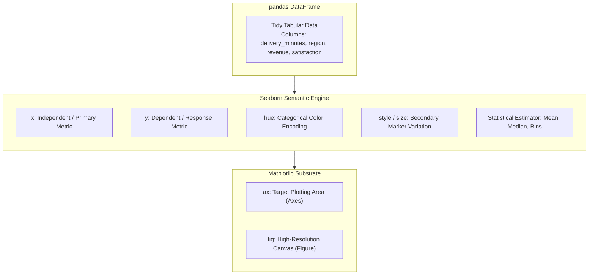

## Important terms

| Term | Meaning |
| --- | --- |
| `DataFrame` | A labeled table with rows and columns |
| `data=` | Dataset containing the named columns |
| `x=`, `y=` | Columns to place on the axes |
| `hue=` | Encode groups with distinct colors |
| `Figure` | The entire exported picture |
| `Axes` | One plotting area in the figure |

**Exercise:** Change `x="delivery_minutes"` to `x="revenue"`. Which plot has a longer right tail?

**Common pitfall:** Seaborn's built-in example datasets may require network access. This repository uses local CSV data so every exercise is reproducible offline.

---

**Official reference:** [Seaborn user guide](https://seaborn.pydata.org/tutorial.html).


---

# 2. Seaborn Distributions: Histogram, KDE and ECDF

**Goal:** Answer three different questions about the same variable.

- **Histogram:** How many observations fall in each interval?
- **KDE:** What does a smoothed distribution look like? The shape depends on bandwidth.
- **ECDF:** What fraction of observations fall at or below a threshold?

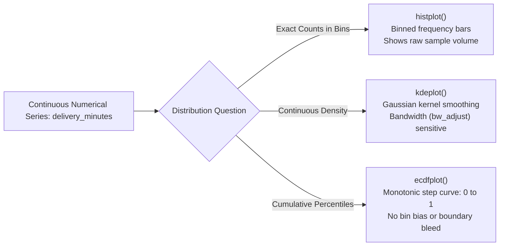

## Compare histogram and ECDF

```python
import pandas as pd
import matplotlib.pyplot as plt
import seaborn as sns

df = pd.read_csv("data/transactions.csv")
fig, axs = plt.subplots(1, 2, figsize=(11, 4), layout="constrained")
sns.histplot(data=df, x="delivery_minutes", hue="region", bins=18, ax=axs[0])
sns.ecdfplot(data=df, x="delivery_minutes", hue="region", ax=axs[1])
axs[0].set_title("Histogram: counts by bin")
axs[1].set_title("ECDF: cumulative proportion")
fig.savefig("distribution-comparison.png")
plt.close(fig)
```

## Smooth with a KDE (carefully)

```python
import pandas as pd
import matplotlib.pyplot as plt
import seaborn as sns

df = pd.read_csv("data/transactions.csv")
fig, ax = plt.subplots()
sns.kdeplot(data=df, x="revenue", hue="channel", bw_adjust=1.0, ax=ax)
ax.set_title("Smoothed revenue distributions")
plt.close(fig)
```

KDE is a **smoothed estimate**, not a direct count. It can misleadingly extend outside meaningful limits, particularly with hard boundaries or a small sample. Use a histogram or ECDF to check the underlying data.

**Tip:** Use `sns.displot(..., col="region")` when you want **separate small multiples** instead of overlapping groups.

**Exercise:** Change `bins=18` to `bins=8` and `bins=36`. How does the visible shape change?

**Common pitfall:** `stat="density"` changes the y-axis meaning; it is not the same as a count histogram. Also, `common_norm` changes how multiple groups are normalized.

---

**Official reference:** [Seaborn user guide](https://seaborn.pydata.org/tutorial.html).


---

# 3. Categorical Plots: Box, Violin, Strip and Bar

**Goal:** Compare groups without hiding variation.

| Chart | Shows | Watch out for |
| --- | --- | --- |
| `boxplot` | median, quartiles, whiskers/outliers | can hide sample size and distribution shape |
| `violinplot` | smoothed distribution shape | shapes depend on KDE smoothing |
| `stripplot` | individual observations | overplotting with large samples |
| `barplot` | estimated statistic (mean by default) | **does not count records** by default |
| `countplot` | category counts | doesn't show measurement values |

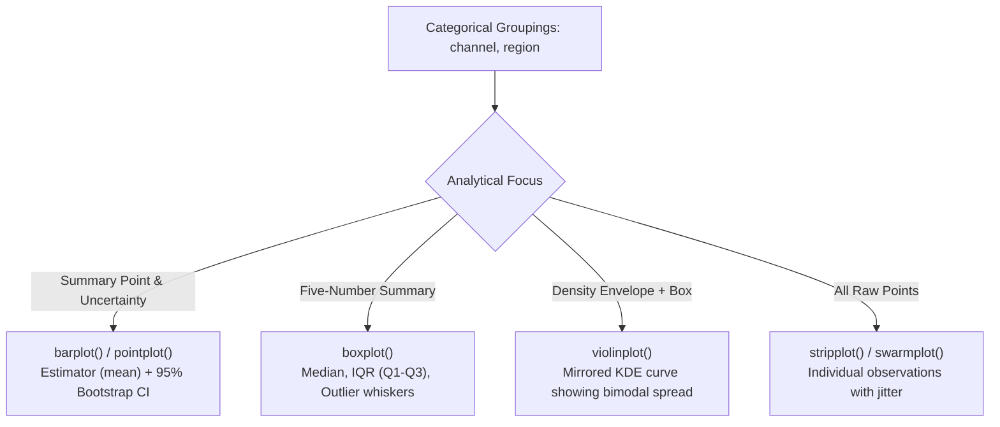

## Plot order value by marketing channel

```python
import pandas as pd
import matplotlib.pyplot as plt
import seaborn as sns

df = pd.read_csv("data/transactions.csv")
order = df.groupby("channel")["revenue"].median().sort_values().index
fig, ax = plt.subplots(figsize=(8, 4))
sns.boxplot(data=df, x="channel", y="revenue", order=order, ax=ax)
sns.stripplot(data=df, x="channel", y="revenue", order=order,
              color="0.25", alpha=0.3, jitter=0.2, size=2, ax=ax)
ax.set(title="Revenue by channel", ylabel="Revenue (synthetic units)")
fig.savefig("category-comparison.png", bbox_inches="tight")
plt.close(fig)
```

For a count, use `sns.countplot(data=df, x="channel")`; for means with uncertainty, use `sns.barplot(data=df, x="channel", y="revenue", errorbar=("ci", 95))`. Seaborn's default error bars represent uncertainty in an estimated statistic, **not** the spread of all individual values.

**Exercise:** Replace the box plot with `sns.violinplot(..., cut=0)`. What information becomes easier to see?

**Common pitfall:** A bar chart with `y="revenue"` is not the same as a bar chart of total revenue. Calculate totals in pandas first if that is what you need.

---

**Official reference:** [Seaborn user guide](https://seaborn.pydata.org/tutorial.html).


---

# 4. Relationships: Scatter, Line and Regression

**Goal:** Choose an appropriate chart for the relationship you want to inspect.

- **Scatterplot:** Each point is an observation; useful for associations and clusters.
- **Lineplot:** Often connects values across ordered x positions; can aggregate repeated x values and show uncertainty.
- **Regression plot:** Adds an estimated trend line; association does not imply causation.

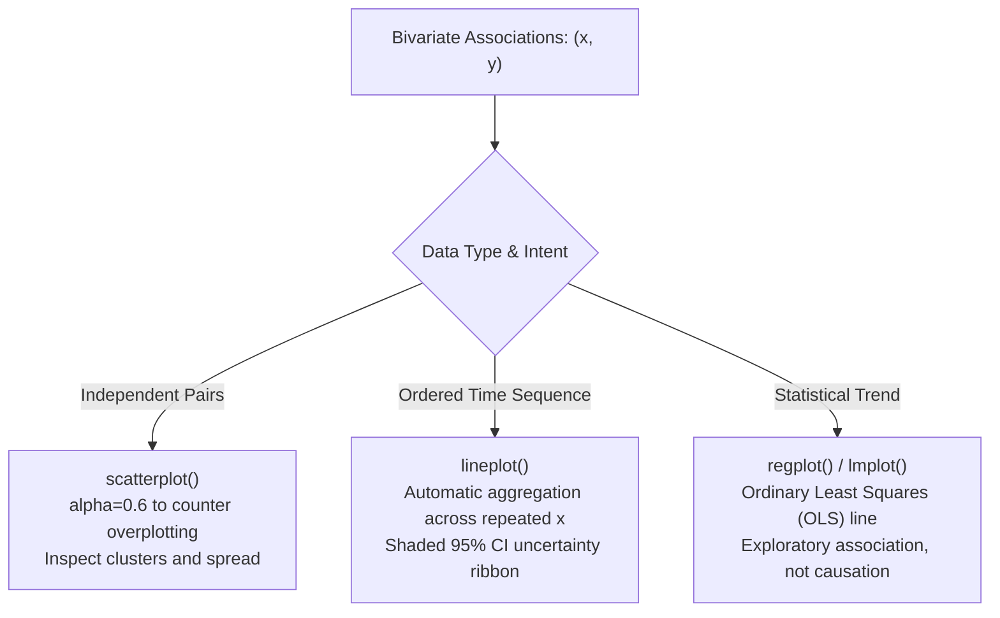

## Scatterplot with grouping

```python
import pandas as pd
import matplotlib.pyplot as plt
import seaborn as sns

df = pd.read_csv("data/transactions.csv")
fig, ax = plt.subplots(figsize=(7, 4))
sns.scatterplot(data=df, x="delivery_minutes", y="satisfaction",
                hue="region", alpha=0.65, ax=ax)
ax.set(title="Delivery time vs satisfaction", xlabel="Minutes", ylabel="Rating (1–5)")
fig.savefig("scatterplot.png", bbox_inches="tight")
plt.close(fig)
```

## Scatterplot with a fitted linear trend

```python
import pandas as pd
import matplotlib.pyplot as plt
import seaborn as sns

df = pd.read_csv("data/transactions.csv")
fig, ax = plt.subplots()
sns.regplot(data=df, x="delivery_minutes", y="satisfaction",
            scatter_kws={"alpha": 0.25, "s": 15}, ax=ax)
ax.set_title("Exploratory linear trend (not a causal model)")
plt.close(fig)
```

`regplot` fits a simple regression for exploration; it does not test your study design or establish causation. If you need an analysis model, inspect assumptions and use a statistical package.

**Exercise:** Switch the scatterplot's `hue` to `channel`. Are four groups clearer than two?

**Common pitfall:** If multiple rows share an x-value, `lineplot` can average them by default. Use `estimator=None` when you intend to plot individual series, or pre-aggregate deliberately.

---

**Official reference:** [Seaborn user guide](https://seaborn.pydata.org/tutorial.html).


---

# 5. Heatmaps and Correlation Matrices

**Goal:** Turn a numeric table into an understandable heatmap.

A `heatmap` accepts a **two-dimensional matrix or DataFrame**. To show correlations, first calculate them with pandas. Correlations measure association; they do **not** demonstrate causality.

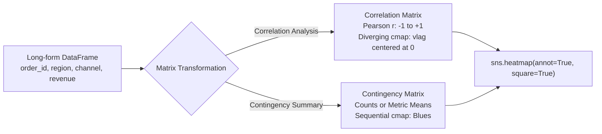

## Correlation heatmap with numbers

```python
import pandas as pd
import matplotlib.pyplot as plt
import seaborn as sns

df = pd.read_csv("data/transactions.csv")
cols = ["revenue", "delivery_minutes", "satisfaction", "shipping_cost"]
corr = df[cols].corr(numeric_only=True)
fig, ax = plt.subplots(figsize=(7, 5))
sns.heatmap(corr, annot=True, fmt=".2f", center=0, cmap="vlag",
            vmin=-1, vmax=1, square=True, ax=ax)
ax.set_title("Feature correlation (Pearson)")
fig.savefig("correlation-heatmap.png", bbox_inches="tight")
plt.close(fig)
```

## How to read it

A value near **+1** means a strong positive linear association; near **−1** means a strong negative linear association; near **0** means little linear association. Correlation can miss nonlinear relationships. Missing values can also change pairwise sample sizes.

## Matrix heatmaps beyond correlation

Create a matrix with `pivot_table` for examples such as orders by region and channel:

```python
import pandas as pd
import matplotlib.pyplot as plt
import seaborn as sns

df = pd.read_csv("data/transactions.csv")
matrix = df.pivot_table(index="region", columns="channel",
                        values="order_id", aggfunc="count", fill_value=0)
fig, ax = plt.subplots()
sns.heatmap(matrix, annot=True, fmt="d", cmap="Blues", ax=ax)
ax.set_title("Order counts: region × channel")
plt.close(fig)
```

**Exercise:** Replace `aggfunc="count"` with `values="revenue", aggfunc="mean"`, and change `fmt="d"` to `fmt=".1f"`.

**Common pitfall:** Use a diverging palette centered at 0 for positive/negative values. For nonnegative counts, a sequential palette is usually easier to read.

---

**Official reference:** [Seaborn user guide](https://seaborn.pydata.org/tutorial.html).


---

# 6. Faceting: Axes-level vs Figure-level Functions

**Goal:** Understand how Seaborn composes one chart versus multiple charts.

| Kind | Example | Returns | Best for |
| --- | --- | --- | --- |
| Axes-level | `sns.scatterplot`, `sns.histplot`, `sns.heatmap` | Matplotlib `Axes` | Custom layouts and dashboards |
| Figure-level | `sns.relplot`, `sns.displot`, `sns.catplot` | Seaborn grid object | Easy faceting across `row=` / `col=` |
| Figure-level | `sns.pairplot`, `sns.jointplot` | Seaborn grid object | Multivariate and joint views |

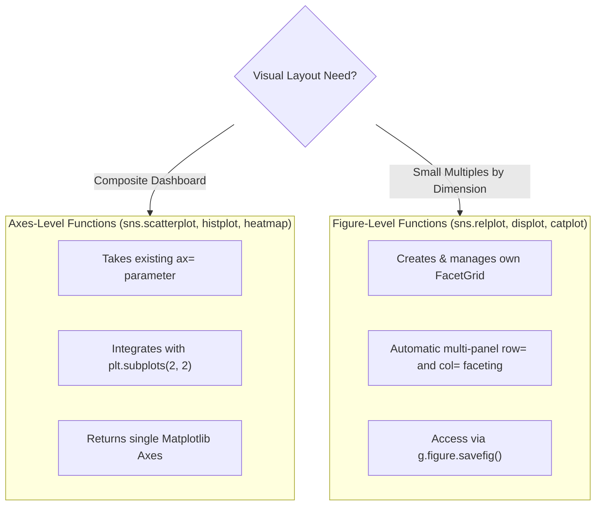

## Facet trends by region

```python
import pandas as pd
import matplotlib.pyplot as plt
import seaborn as sns

df = pd.read_csv("data/campaigns_weekly.csv")
g = sns.relplot(data=df, x="week", y="signups", hue="channel",
                col="region", kind="line", errorbar=None,
                height=3.5, aspect=1.25, marker="o")
g.set_axis_labels("Week", "Signups")
g.figure.savefig("faceted-trends.png", bbox_inches="tight")
plt.close(g.figure)
```

Figure-level functions create and manage their own figure; generally **do not** pass `ax=` to `relplot`, `displot` or `catplot`. For a 2×2 report, use `fig, axs = plt.subplots(...)` and **axes-level** calls with `ax=axs[0, 0]` instead.

**Exercise:** Change `col="region"` to `row="region"`. Does this improve readability at mobile widths?

**Common pitfall:** `FacetGrid.figure` is the underlying Matplotlib Figure. Save that figure, not whatever happens to be the current pyplot figure.

---

**Official reference:** [Seaborn user guide](https://seaborn.pydata.org/tutorial.html).


---

# 7. Themes, Palettes and Chart Accessibility

**Goal:** Make figures clearer, not just more colorful.

Seaborn's themes set consistent defaults for backgrounds, grid lines and font scaling. Good charts also need **clear labels, units, meaningful ordering, adequate contrast, and explanations not conveyed by color alone**.

```python
import pandas as pd
import matplotlib.pyplot as plt
import seaborn as sns

df = pd.read_csv("data/transactions.csv")
sns.set_theme(style="ticks", context="talk", palette="colorblind")
fig, ax = plt.subplots(figsize=(8, 5), layout="constrained")
sns.scatterplot(data=df, x="revenue", y="delivery_minutes",
                hue="region", style="region", alpha=0.6, ax=ax)
ax.set(title="Order value and delivery time", xlabel="Revenue (synthetic units)",
       ylabel="Delivery time (minutes)")
sns.despine()
fig.savefig("accessible-scatter.svg")
plt.close(fig)
```

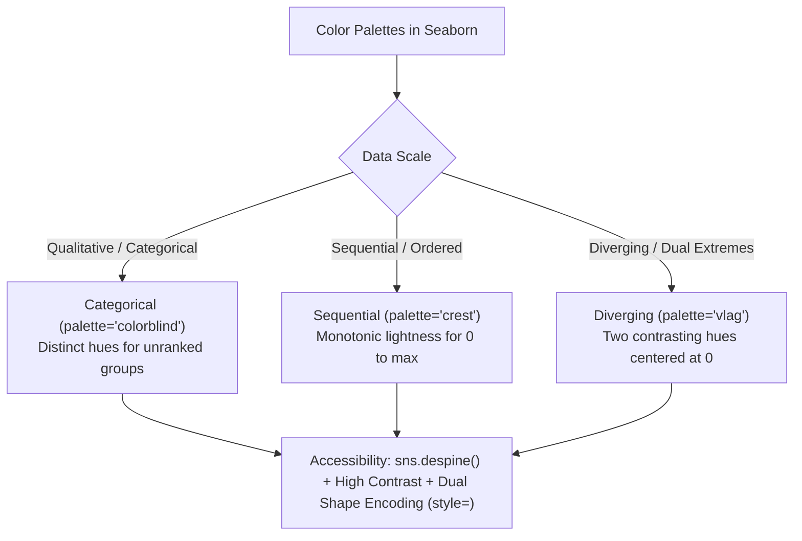

## Palette rules

- **Categorical:** distinguish groups (e.g. `colorblind`).
- **Sequential:** show increasing magnitude (e.g. `crest`).
- **Diverging:** show deviations around a meaningful midpoint (e.g. `vlag` for correlations).

## Export basics

Use a larger canvas and `dpi=160` or more for raster images. SVG is resolution-independent, but it can be larger for dense scatterplots. Always review legibility at a realistic screen width.

**Exercise:** Try `sns.set_theme(style="whitegrid")` and `sns.set_theme(style="ticks")`; which emphasizes values without adding noise?

**Common pitfall:** A rainbow palette is usually a poor choice for ordered numeric magnitude. Also avoid interpreting subtle palette differences as statistical significance.

---

**Official reference:** [Seaborn user guide](https://seaborn.pydata.org/tutorial.html).


---

# 8. Statistics and Uncertainty: What Error Bars Mean

**Goal:** Avoid making charts that overstate confidence.

Seaborn can **aggregate raw rows** when calling `barplot`, `pointplot`, or `lineplot`. The selected `estimator` calculates a summary statistic, while `errorbar` specifies a measure of variation or uncertainty.

```python
import pandas as pd
import matplotlib.pyplot as plt
import seaborn as sns

df = pd.read_csv("data/transactions.csv")
fig, ax = plt.subplots(figsize=(7, 4))
sns.barplot(data=df, x="channel", y="revenue", estimator="mean",
            errorbar=("ci", 95), n_boot=500, seed=7,
            color=sns.color_palette()[0], ax=ax)
ax.set(title="Mean order revenue with bootstrap intervals", ylabel="Mean revenue")
fig.savefig("mean-and-uncertainty.png", bbox_inches="tight")
plt.close(fig)
```

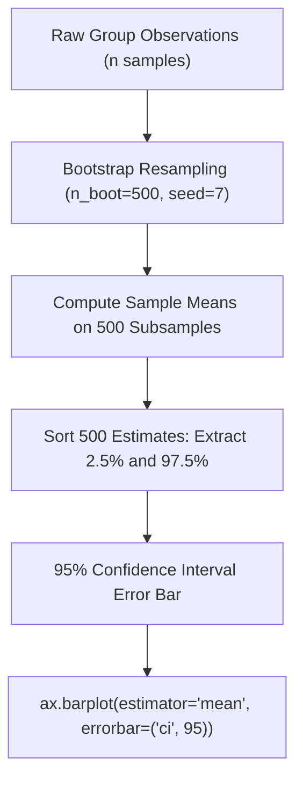

The 95% bootstrap confidence intervals describe uncertainty **under the sampling assumptions**; they are not the range containing 95% of observations. Bootstrap intervals may be misleading for dependent, biased or nonrepresentative samples.

## Choose correctly

| Question | Chart / parameter |
| --- | --- |
| How spread out are individual values? | box / violin / histogram |
| How uncertain is an estimated group mean? | `barplot(errorbar=("ci", 95))` |
| How much do observations vary? | `errorbar="sd"` for a descriptive standard deviation |
| How many records are there? | `countplot` |
| What is the total, not mean? | pre-aggregate with pandas, then draw totals |

**Exercise:** Draw the same groups with `sns.boxplot`; compare the apparent story against the mean-only bar chart.

**Common pitfall:** These synthetic rows are for learning visualization, **not** for inferring population-level effects.

---

**Official reference:** [Seaborn user guide](https://seaborn.pydata.org/tutorial.html).


---

# 9. Seaborn Objects Interface: Composable Plots

**Goal:** Recognize the newer compositional API without getting lost in it.

Seaborn also provides `seaborn.objects`, introduced in 0.12. Its `Plot`, `Mark`, and `Stat` concepts offer a declarative alternative to function calls. **As of Seaborn 0.13.2 it remains experimental and incomplete**, so this course teaches the mature function interface first.

## Scatter marks from a DataFrame

```python
import pandas as pd
import matplotlib.pyplot as plt
import seaborn.objects as so

df = pd.read_csv("data/transactions.csv")
fig, ax = plt.subplots()
p = (
    so.Plot(df, x="delivery_minutes", y="satisfaction", color="region")
    .add(so.Dots(pointsize=4, alpha=0.5))
    .label(title="Delivery time vs satisfaction", x="Minutes", y="Rating")
    .on(ax)
)
p.plot()
fig.savefig("objects-scatter.png")
plt.close(fig)
```

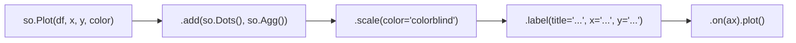

You compose a plot in steps: choose **data and mappings**, add a **Mark**, optionally add a **Stat**, then display or save it. Compare to the function form: `sns.scatterplot(data=df, x="delivery_minutes", y="satisfaction", hue="region")`.

## When should you use which?

Choose `sns.histplot`, `sns.heatmap`, `sns.catplot`, etc. for common workflows. Explore `so.Plot` when building reusable compositional specifications and after checking its supported marks and statistics.

**Exercise:** Change `.add(so.Dots(...))` to `.add(so.Dots(pointsize=2))`. Does it reduce overplotting?

**Common pitfall:** The objects interface is not a 1:1 replacement for every `sns.*plot` function. Check support before migrating a dashboard.

---

**Official reference:** [Seaborn user guide](https://seaborn.pydata.org/tutorial.html).


---

# 10. Five Hands-on Seaborn Projects

**Goal:** Practice everything in real `.py` files and export the results.

Run from the repository root after installing `requirements.txt`:

```bash
python -m labs.lab01_distributions
python -m labs.lab02_categorical
python -m labs.lab03_correlation_heatmap
python -m labs.lab04_facet_trends
python -m labs.lab05_eda_dashboard
```

| Lab | Input data | What it produces | Main skills |
| --- | --- | --- | --- |
| 1. Delivery distribution | `transactions.csv` | histogram + ECDF | `histplot`, `ecdfplot`, grouped data |
| 2. Category comparisons | `transactions.csv` | box/strip + violin charts | variation, median, quartiles |
| 3. Correlation heatmap | `transactions.csv` | labeled correlation grid | `DataFrame.corr`, `heatmap` |
| 4. Campaign facets | `campaigns_weekly.csv` | two small-multiple trend charts | `relplot`, `FacetGrid` |
| 5. EDA dashboard | `transactions.csv` | four-panel PNG, SVG, PDF | composition, export, labeling |

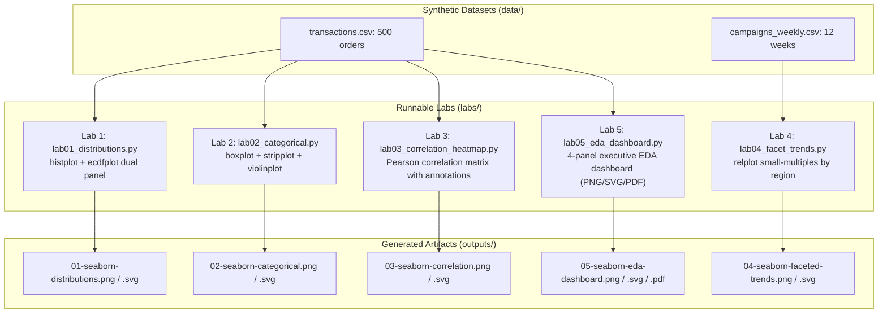

## Run all tests

```bash
python -m pip install -r requirements-dev.txt
python -m pytest -q
```

## Interpret with care

Every dataset is **synthetic and deterministic**. There are no real customer records or claims about actual business performance. A chart can help you explore plausible patterns; it cannot guarantee a useful explanation of causality.

## Challenge: make a useful report

1. Choose a business question that can be answered with the available columns.
2. Select the plot that directly answers that question.
3. Add meaningful titles, units, and a visible description of the population.
4. Export one screenshot-friendly PNG and one editable/vector-friendly SVG.
5. Write two sentences: one about what the data **show**, one about what they **do not show**.

**Next step:** Combine this course with [pandas](https://pandas.pydata.org/docs/) for cleaning and aggregation, [Matplotlib](https://matplotlib.org/stable/) for complex layouts, and [SciPy](https://docs.scipy.org/doc/scipy/) for formal numerical or statistical work.

---

**Official reference:** [Seaborn user guide](https://seaborn.pydata.org/tutorial.html).


---

# Seaborn Cheat Sheet

## What chart do I use?

| Question | Function | Example use |
| --- | --- | --- |
| How do values distribute? | `sns.histplot` | order revenue |
| How many records are below threshold? | `sns.ecdfplot` | delivery time |
| What is a smooth density estimate? | `sns.kdeplot` | distribution shape |
| How are two variables associated? | `sns.scatterplot` | time vs satisfaction |
| What's the ordered trend? | `sns.lineplot` | weekly signups |
| How do group medians and spread compare? | `sns.boxplot` | revenue by channel |
| How do group shapes compare? | `sns.violinplot` | delivery by region |
| How many category rows? | `sns.countplot` | channel counts |
| How do groups differ in mean? | `sns.barplot` | revenue mean and CI |
| How do variables correlate? | `sns.heatmap` | correlation matrix |
| How does a linear fit look? | `sns.regplot` | scatter + regression |
| How do plots differ across subsets? | `sns.relplot`, `sns.displot`, `sns.catplot` | region facets |

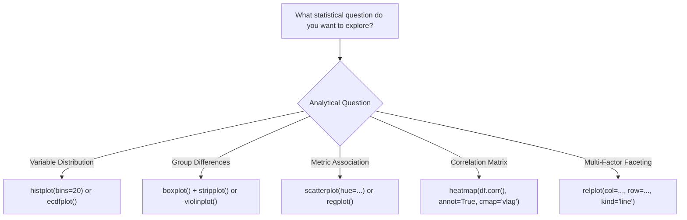

## Plot return types

| Axes-level: `ax=` supported | Figure-level: builds its own figure |
| --- | --- |
| `histplot`, `scatterplot`, `boxplot`, `heatmap`, `lineplot` | `displot`, `relplot`, `catplot`, `jointplot`, `pairplot` |

## Template: reusable single plot

```python
import pandas as pd
import seaborn as sns
import matplotlib.pyplot as plt

df = pd.read_csv("data/transactions.csv")
sns.set_theme(style="whitegrid", palette="colorblind")
fig, ax = plt.subplots(figsize=(8, 4), layout="constrained")
sns.scatterplot(data=df, x="delivery_minutes", y="satisfaction", hue="region", ax=ax)
ax.set(title="Delivery versus satisfaction", xlabel="Minutes", ylabel="Rating")
fig.savefig("chart.svg", bbox_inches="tight")
plt.close(fig)
```

## Avoid misleading visuals

- Prefer a box/violin plot to see variability, not just a mean bar.
- Do not mistake histogram density for count.
- Do not mistake error bars for the range of raw observations.
- Correlation is not causation.
- Avoid rainbow palettes for ordered numeric data.
- Name your groups and units; don't rely solely on color.


---

# Seaborn Frequently Asked Questions

### What is Seaborn in Python?
Seaborn is a high-level statistical visualization library built on Matplotlib. It integrates well with pandas DataFrames and maps fields to visual properties such as position and color.

### Is Seaborn better than Matplotlib?
They complement each other: Seaborn simplifies statistical views and theme defaults; Matplotlib exposes lower-level layout and rendering control. Seaborn depends on Matplotlib rather than replacing it.

### How do I create a Seaborn heatmap?
Create a numeric matrix (often `df.corr(numeric_only=True)`), then call `sns.heatmap(matrix, annot=True)`. A heatmap is not automatically a correlation plot: its meaning comes from the matrix you give it.

### How do I plot a histogram in Seaborn?
Call `sns.histplot(data=df, x="column", bins=20)`. Change `bins` to see how it affects the display, and label whether the y-axis is count, frequency, density or probability.

### What is the difference between `histplot` and `displot`?
`histplot` is axes-level and can draw on an existing `ax`. `displot` is figure-level, manages its own figure and can facet with `col` and `row`.

### What is the difference between boxplot and violinplot?
A boxplot displays quartiles and median with whiskers; a violin plot visualizes a smoothed distribution. The violin shape depends on KDE estimation.

### How do I show correlation with Seaborn?
Use `sns.heatmap(df[numeric_columns].corr(), annot=True, vmin=-1, vmax=1, center=0)`; remember a high correlation does not imply causation.

### Does `barplot` count rows?
No. `barplot` estimates a statistic (mean by default) of a numeric variable for each category. Use `countplot` for raw row counts or pre-aggregate for sums.

### How do I save a Seaborn figure?
With an axes-level plot, create `fig, ax = plt.subplots()` and call `fig.savefig(...)`. With `sns.relplot` or `sns.displot`, use `grid.figure.savefig(...)`.

### Do I need internet to run these labs?
No. The repository contains two deterministic synthetic CSV datasets. You need only install the Python dependencies once in your environment.

### Is `seaborn.objects` stable?
Its interface is documented in Seaborn 0.13.2 but described as experimental and incomplete. Prefer the main function API if a needed feature is missing.


---

# Beginner-Friendly Glossary

| Term | Meaning |
| --- | --- |
| **Axes** | A single Matplotlib plotting region; many `sns.*plot` functions return it |
| **Figure** | The full Matplotlib image containing Axes and labels |
| **FacetGrid** | Seaborn's grid manager for small-multiple charts |
| **DataFrame** | pandas table of observations and variables |
| **Long-form** | One observation per row, variables in columns |
| **hue** | Column mapped to group color |
| **style** | Column mapped to marker shape or line pattern |
| **Histogram bin** | Interval grouping numerical observations |
| **KDE** | Kernel density estimation; a smoothed distribution estimate |
| **ECDF** | Empirical cumulative distribution function |
| **Median** | Middle value after sorting a sample |
| **Quartile** | Cut point dividing ordered values into quarters |
| **Boxplot** | Summary using quartiles, median and whiskers |
| **Violinplot** | Smoothed density shape for group distributions |
| **Estimator** | Summary function (e.g. mean) applied to grouped values |
| **Confidence interval** | Procedure-derived interval describing uncertainty in an estimated parameter |
| **Correlation** | Numeric measure of association; not proof of causal effect |
| **Heatmap** | A rectangular matrix colored by numerical values |
| **Diverging palette** | Color scale separating values on opposite sides of a midpoint |
| **Sequential palette** | Color scale for low-to-high magnitude |
| **Statistical significance** | A separate inferential concept; chart colors do not determine it |


</USER_REQUEST>
<ADDITIONAL_METADATA>
The current local time is: 2026-11-02T06:19:21+05:30.
</ADDITIONAL_METADATA>