<USER_REQUEST>
# Scikit-learn Complete Guide: Beginner to Intermediate

> 10 lessons · 5 offline Python labs · Quick reference · Common questions · Glossary

This is a consolidated reading version of the website course. Links that point into `docs/` work when reading this file in the repository root. Run the project scripts from the repository root.

[GitHub-ready README](README.md) · [Chart gallery](docs/gallery.md) · [Official scikit-learn docs](https://scikit-learn.org/stable/)

---


---


# Scikit-learn Tutorial for Beginners: Estimators, Fit and Predict

> **In one sentence:** Start using scikit-learn with a clear example of training a classifier, making predictions and understanding the estimator API.

## What is scikit-learn?

**scikit-learn** (imported as `sklearn`) is a Python library for traditional machine learning. It supplies models for classification, regression, clustering and dimensionality reduction, plus data preprocessing, evaluation and model selection. Its core inputs are usually NumPy arrays or pandas DataFrames.

A *feature* is an input column, such as length or price. A *target* is the value you want to predict. For supervised learning, `X` usually has shape `(rows, features)` and `y` has one value per row.

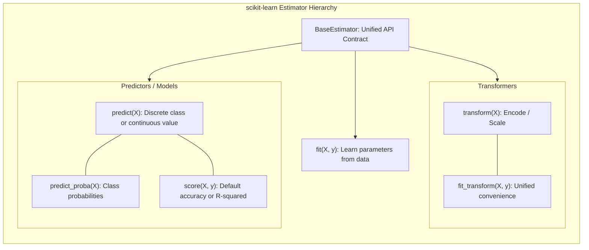

## The four main methods

| Method | Plain-English meaning | Used by |
| --- | --- | --- |
| `fit(X, y)` | Learn from the training examples | Supervised estimators |
| `predict(X)` | Make predictions using what was learned | Predictors |
| `transform(X)` | Convert data, such as scaling features | Transformers |
| `score(X, y)` | Return an estimator-specific score | Many estimators |

`score` is not the same metric for every estimator; classifiers commonly return **accuracy**, regressors often return **R²**. Choose explicit metrics whenever you compare models.

## Your first classifier

```python
from sklearn.datasets import load_iris
from sklearn.model_selection import train_test_split
from sklearn.neighbors import KNeighborsClassifier
from sklearn.metrics import accuracy_score

X, y = load_iris(return_X_y=True)
X_train, X_test, y_train, y_test = train_test_split(
    X, y, test_size=0.25, random_state=42, stratify=y
)
model = KNeighborsClassifier(n_neighbors=5)
model.fit(X_train, y_train)
predictions = model.predict(X_test)
print('Accuracy:', round(accuracy_score(y_test, predictions), 3))
```

The dataset is bundled with scikit-learn, so no network connection is needed. The split occurs **before fitting** so your test data remains unseen during training.

## What the algorithm sees

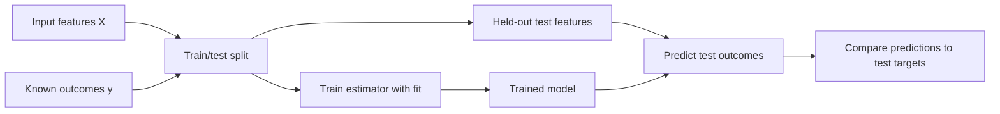

**Common mistake:** training and reporting performance on the same rows. That measures how well the model memorizes the examples, not how well it predicts new data.

**Try it:** Change `n_neighbors` to 3. Does the score move? Avoid repeatedly selecting parameters by inspecting the final test score; use cross-validation in [Lesson 6](docs/06-cross-validation-tuning.md).

---

**Up next:** [Explore the course contents](docs/index.md) · [See the cheat sheet](docs/cheatsheet.md) · [Official scikit-learn docs](https://scikit-learn.org/stable/)


---


# Scikit-learn Train Test Split: Baselines and Data Leakage

> **In one sentence:** Learn train_test_split, stratified sampling, dummy baselines and leakage prevention in a concise Python tutorial.

## Why split your dataset?

A machine-learning model needs a fair examination. Train it on **training rows**, choose settings with **validation or cross-validation**, and reserve a **test set** for final evaluation. A test set is only meaningful if you did not repeatedly tune your choices on it.

For independent tabular examples, a random split is a useful starting point. Time series, repeated users and grouped observations need special splitting strategies.

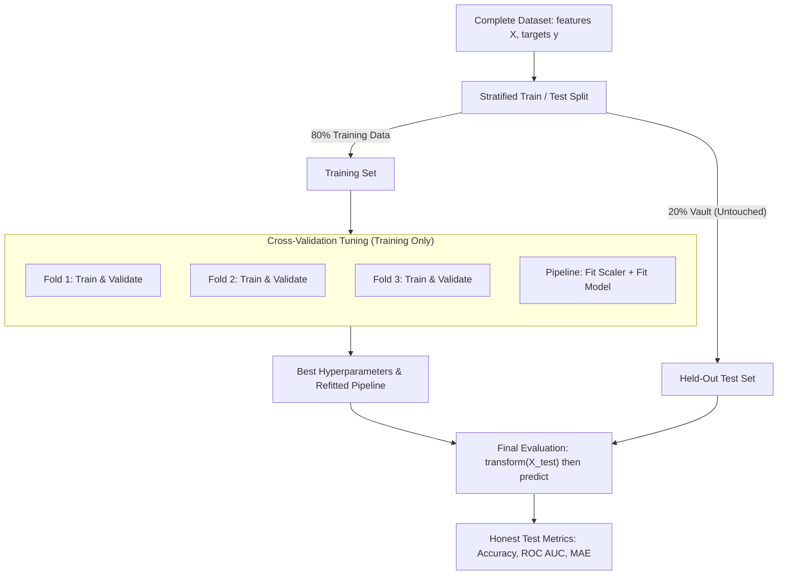

## A basic stratified classification split

```python
from sklearn.datasets import load_breast_cancer
from sklearn.model_selection import train_test_split
from sklearn.dummy import DummyClassifier
from sklearn.linear_model import LogisticRegression
from sklearn.preprocessing import StandardScaler
from sklearn.pipeline import make_pipeline
from sklearn.metrics import balanced_accuracy_score

X, y = load_breast_cancer(return_X_y=True)
X_train, X_test, y_train, y_test = train_test_split(
    X, y, test_size=.2, stratify=y, random_state=42
)
baseline = DummyClassifier(strategy='most_frequent').fit(X_train, y_train)
model = make_pipeline(StandardScaler(), LogisticRegression(max_iter=1000))
model.fit(X_train, y_train)
print('Baseline balanced accuracy:', round(balanced_accuracy_score(y_test, baseline.predict(X_test)), 3))
print('Model balanced accuracy:', round(balanced_accuracy_score(y_test, model.predict(X_test)), 3))
```

This bundled dataset is used only as a **software learning example**, not for clinical decision-making.

**Why stratify?** `stratify=y` approximately preserves target class proportions in each subset. This is especially helpful with imbalanced classes, but doesn't solve every evaluation problem.

## Choose the correct split

| Your data | Recommended starting point | Why |
| --- | --- | --- |
| Independent rows | `train_test_split` | Random hold-out |
| Class imbalance | Stratified split | Class distribution preserved |
| Several rows from one person/device | `GroupKFold` or group hold-out | Avoid overlapping entities |
| Historical/time-dependent data | `TimeSeriesSplit` or chronological hold-out | Train before prediction time |

## Leakage: the error to avoid

**Bad:** `StandardScaler().fit_transform(X)` on all rows, then split. The test data has influenced the scaling parameters.

**Good:** put `StandardScaler()` in a `Pipeline`, split first, then `pipeline.fit(X_train, y_train)`.

**Try it:** Why can a majority-class baseline score highly on an imbalanced dataset? Compare accuracy with **balanced accuracy** or **average precision**.

**Next:** Choose [classification metrics](docs/03-classification-metrics.md) appropriate to the cost of your errors.

---

**Up next:** [Explore the course contents](docs/index.md) · [See the cheat sheet](docs/cheatsheet.md) · [Official scikit-learn docs](https://scikit-learn.org/stable/)


---


# Scikit-learn Classification Metrics: Precision, Recall, F1, ROC AUC

> **In one sentence:** Understand confusion matrices, precision, recall, F1, average precision and ROC AUC with runnable Python code.

## Classification: predict categories

Classification assigns a class label, such as spam/not spam or one of three product categories. A model may produce labels via `predict` and scores or probabilities via `decision_function` or `predict_proba` when available.

## Accuracy is not enough

Imagine 95% of emails are legitimate. A model that predicts **legitimate for every email** obtains 95% accuracy while failing to detect spam. Choose metrics that match the real decision.

| Metric | Measures | Useful when |
| --- | --- | --- |
| Accuracy | Fraction correctly labeled | Classes are reasonably balanced |
| Precision | Of predicted positives, fraction truly positive | False alarms are costly |
| Recall | Of actual positives, fraction detected | Misses are costly |
| F1 | Harmonic mean of precision and recall | Both matter |
| ROC AUC | Ranking quality across score thresholds | Comparing binary rankers |
| Average precision | Precision-recall tradeoff summary | Rare-positive problems |

A confusion matrix gives counts of **true negative, false positive, false negative and true positive** for binary classification, with class ordering controlled by labels.

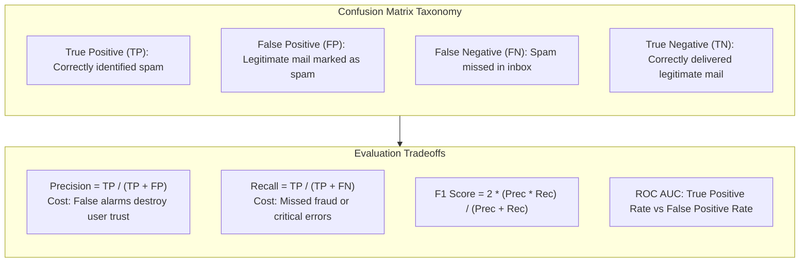

## Measure more than one metric

```python
from sklearn.datasets import make_classification
from sklearn.linear_model import LogisticRegression
from sklearn.model_selection import train_test_split
from sklearn.pipeline import make_pipeline
from sklearn.preprocessing import StandardScaler
from sklearn.metrics import classification_report, roc_auc_score, average_precision_score

X, y = make_classification(n_samples=400, n_features=8, weights=[.8, .2], random_state=4)
X_train, X_test, y_train, y_test = train_test_split(X, y, stratify=y, random_state=42)
model = make_pipeline(StandardScaler(), LogisticRegression(max_iter=1000))
model.fit(X_train, y_train)
proba = model.predict_proba(X_test)[:, 1]
print(classification_report(y_test, model.predict(X_test), zero_division=0))
print('ROC AUC:', round(roc_auc_score(y_test, proba), 3))
print('Average precision:', round(average_precision_score(y_test, proba), 3))
```

**Thresholds matter:** `predict()` chooses class labels using a model's default decision rule. A different threshold changes the false-positive/false-negative tradeoff without changing ROC AUC (as long as the ranking remains the same).

**Try it:** Run [Lab 01](README.md#five-hands-on-projects), which creates a confusion-matrix PNG for 3-class classification. For rare events, use [Lab 03](README.md#five-hands-on-projects), which plots precision–recall.

---

**Up next:** [Explore the course contents](docs/index.md) · [See the cheat sheet](docs/cheatsheet.md) · [Official scikit-learn docs](https://scikit-learn.org/stable/)


---


# Scikit-learn Regression Tutorial: Ridge, MAE, RMSE and R²

> **In one sentence:** Learn regression with scikit-learn and evaluate continuous predictions using MAE, RMSE, R² and residual plots.

## Regression: predict numbers

Regression predicts a continuous value: for example energy demand, delivery time or a measured quantity. Start with a simple baseline and an interpretable model before trying complex ensembles.

**Metrics:** MAE is the average absolute error in the original target units; RMSE also has target units and penalizes larger errors more strongly; R² compares predictions to a constant-mean baseline and can be **negative**.

## Ridge regression in a pipeline

```python
import numpy as np
from sklearn.datasets import make_regression
from sklearn.dummy import DummyRegressor
from sklearn.linear_model import Ridge
from sklearn.model_selection import train_test_split
from sklearn.pipeline import make_pipeline
from sklearn.preprocessing import StandardScaler
from sklearn.metrics import mean_absolute_error, mean_squared_error, r2_score

X, y = make_regression(n_samples=200, n_features=6, noise=12, random_state=42)
X_train, X_test, y_train, y_test = train_test_split(X, y, random_state=42)
model = make_pipeline(StandardScaler(), Ridge(alpha=1.0)).fit(X_train, y_train)
pred = model.predict(X_test)
baseline = DummyRegressor().fit(X_train, y_train)
print('MAE:', round(mean_absolute_error(y_test, pred), 2))
print('RMSE:', round(np.sqrt(mean_squared_error(y_test, pred)), 2))
print('R²:', round(r2_score(y_test, pred), 3))
print('Baseline MAE:', round(mean_absolute_error(y_test, baseline.predict(X_test)), 2))
```

**Ridge** is linear regression with L2 regularization. The `alpha` parameter balances fit and coefficient size; it should be selected on training folds rather than by repeatedly testing possible values on the test set.

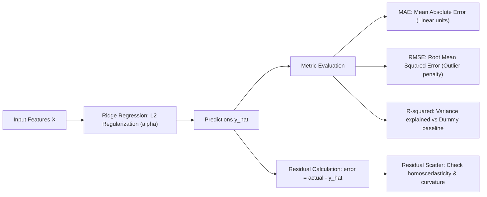

## Inspect residuals

A residual is `actual − prediction`. A plot against fitted predictions helps spot systematic patterns, extreme errors, changing variance and nonlinear structure. Even a high R² does not guarantee that predictions work on every important subgroup.

**Try it:** Run [Lab 02](README.md#five-hands-on-projects) for a side-by-side predicted-vs-actual and residual chart. What happens if you increase the synthetic noise?

---

**Up next:** [Explore the course contents](docs/index.md) · [See the cheat sheet](docs/cheatsheet.md) · [Official scikit-learn docs](https://scikit-learn.org/stable/)


---


# Scikit-learn Pipeline and ColumnTransformer Tutorial

> **In one sentence:** Prevent data leakage with scikit-learn Pipeline, SimpleImputer, StandardScaler and OneHotEncoder for DataFrame columns.

## Real data is messy

A pandas DataFrame may mix numbers, text categories, missing values and columns measured on different scales. A **ColumnTransformer** applies the right preparation to each group. A **Pipeline** combines those transformations with a predictor, ensuring each fold learns its preprocessing from training rows only.

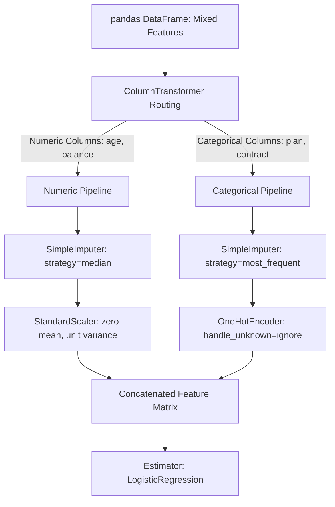

## Mixed numeric and categorical features

```python
import pandas as pd
from sklearn.compose import ColumnTransformer
from sklearn.impute import SimpleImputer
from sklearn.linear_model import LogisticRegression
from sklearn.pipeline import Pipeline
from sklearn.preprocessing import OneHotEncoder, StandardScaler

X = pd.DataFrame({
    'age': [22., 35., None, 47., 29., 38.],
    'plan': ['Basic', 'Plus', 'Basic', None, 'Pro', 'Plus'],
})
y = [0, 1, 0, 1, 0, 1]
num = Pipeline([('fill', SimpleImputer(strategy='median')), ('scale', StandardScaler())])
cat = Pipeline([('fill', SimpleImputer(strategy='most_frequent')),
                ('encode', OneHotEncoder(handle_unknown='ignore'))])
preprocess = ColumnTransformer([('num', num, ['age']), ('cat', cat, ['plan'])])
model = Pipeline([('prep', preprocess), ('classifier', LogisticRegression())])
model.fit(X, y)
print(model.predict(pd.DataFrame({'age': [31.], 'plan': ['Starter']})))
```

**Important:** `handle_unknown='ignore'` allows a previously unseen category at prediction time without raising an exception; the unseen category is represented by all zero indicators for that feature by default.

**Do not:** fill missing values or select features using the entire dataset before cross-validation. Put learned transformations inside the pipeline.

**Try it:** Run [Lab 03](README.md#five-hands-on-projects), with synthetic customer data containing missing numeric and categorical values. Compare metrics against the positive-class prevalence.

---

**Up next:** [Explore the course contents](docs/index.md) · [See the cheat sheet](docs/cheatsheet.md) · [Official scikit-learn docs](https://scikit-learn.org/stable/)


---


# Scikit-learn Cross-Validation and GridSearchCV Tutorial

> **In one sentence:** Tune hyperparameters safely using Pipeline, StratifiedKFold, GridSearchCV and an untouched test set.

## Why one split is not enough

A validation result depends on which rows were selected. **K-fold cross-validation** repeats training on different training subsets and measures performance on their held-out folds. That is useful for estimating relative performance and selecting hyperparameters.

A robust beginner workflow is:

1. Split off the **test set** once.
2. Run cross-validation **only on the training data**.
3. Choose the best settings from the CV results.
4. Evaluate the final refitted pipeline **once on the untouched test set**.

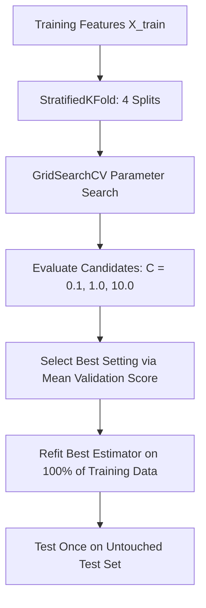

## GridSearchCV with a full pipeline

```python
from sklearn.datasets import load_iris
from sklearn.linear_model import LogisticRegression
from sklearn.model_selection import GridSearchCV, StratifiedKFold, train_test_split
from sklearn.pipeline import make_pipeline
from sklearn.preprocessing import StandardScaler

X, y = load_iris(return_X_y=True)
X_train, X_test, y_train, y_test = train_test_split(
    X, y, stratify=y, random_state=42
)
pipe = make_pipeline(StandardScaler(), LogisticRegression(max_iter=1000))
cv = StratifiedKFold(n_splits=4, shuffle=True, random_state=42)
search = GridSearchCV(pipe, {'logisticregression__C': [0.1, 1, 10]}, cv=cv)
search.fit(X_train, y_train)
print('Best parameters:', search.best_params_)
print('Cross-validation accuracy:', round(search.best_score_, 3))
print('Final held-out accuracy:', round(search.score(X_test, y_test), 3))
```

`GridSearchCV` tries each listed combination; a `RandomizedSearchCV` samples a specified number of combinations and can be more economical for large search spaces. In both cases, tune the **pipeline**, not preprocessing or estimator pieces independently.

**Critical distinction:** the highest CV score is a **selection score**, not a guarantee for deployment; the test score is one estimate of generalization, not a performance promise.

**Try it:** Run [Lab 05](README.md#five-hands-on-projects). The left plot shows CV performance by regularization strength, while the right plot evaluates the tuned model on the untouched test set.

---

**Up next:** [Explore the course contents](docs/index.md) · [See the cheat sheet](docs/cheatsheet.md) · [Official scikit-learn docs](https://scikit-learn.org/stable/)


---


# Scikit-learn KMeans and PCA Tutorial for Beginners

> **In one sentence:** Understand unsupervised clustering, standardization, KMeans labels, silhouette score and PCA visualizations.

## Learning without target labels

Unsupervised learning searches for structure in input data without a provided target. **KMeans** divides samples into `k` clusters. **PCA** finds directions explaining as much feature variance as possible; it is often used for reduction or visualization.

The two techniques answer different questions: *Which observations are grouped together?* versus *How can we summarize dimensions?*

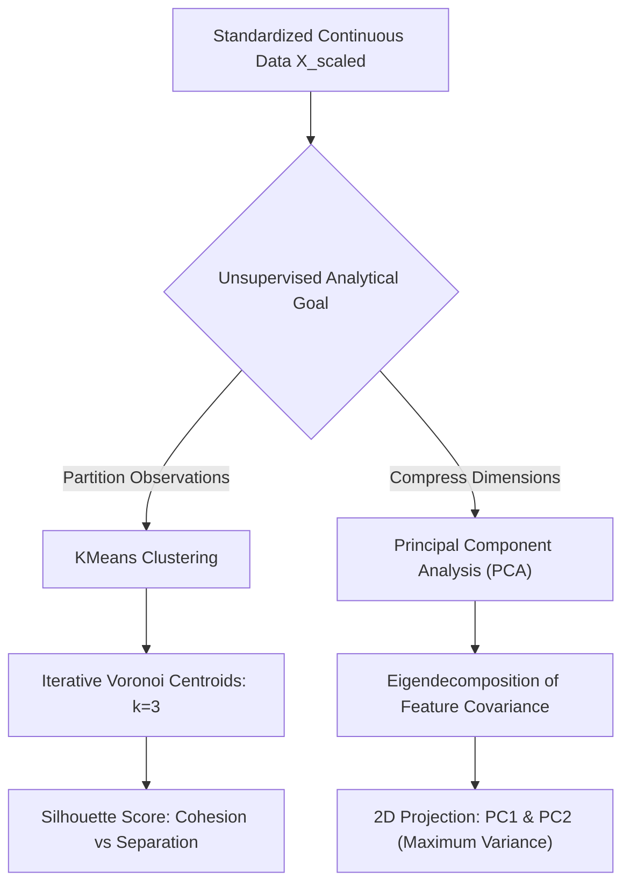

## Cluster, score, then project

```python
from sklearn.cluster import KMeans
from sklearn.datasets import make_blobs
from sklearn.decomposition import PCA
from sklearn.metrics import silhouette_score
from sklearn.preprocessing import StandardScaler

X, _ = make_blobs(n_samples=180, n_features=5, centers=3, random_state=42)
X_scaled = StandardScaler().fit_transform(X)
clusters = KMeans(n_clusters=3, n_init=10, random_state=42).fit_predict(X_scaled)
embedding = PCA(n_components=2).fit_transform(X_scaled)
print('Projected shape:', embedding.shape)
print('Silhouette score:', round(silhouette_score(X_scaled, clusters), 3))
```

**Interpretation cautions:**

- KMeans assigns arbitrary integer IDs. Cluster 0 is not inherently better than Cluster 2.
- A nice two-dimensional PCA picture does **not** prove the clusters are meaningful.
- Silhouette score ranges from -1 to 1 and describes separation under the chosen distance/representation; higher is not automatically more useful to the business.
- KMeans favors comparatively compact groups and often needs feature scaling. Outliers, shape and feature choice affect results.

**Try it:** Run [Lab 04](README.md#five-hands-on-projects) and change `n_clusters` to 3 or 5. Do not compare cluster labels as if their numbers were stable across runs.

---

**Up next:** [Explore the course contents](docs/index.md) · [See the cheat sheet](docs/cheatsheet.md) · [Official scikit-learn docs](https://scikit-learn.org/stable/)


---


# Scikit-learn Feature Importance and Model Interpretation

> **In one sentence:** Use permutation importance and model coefficients to inspect predictive features while avoiding causal claims.

## What made the model predict?

Some estimators expose `coef_` or `feature_importances_`, but their meanings differ. A model's parameters are not interchangeable with an explanation of cause and effect. Correlated features can obscure each other's apparent importance.

**Permutation importance** checks how much a trained model's chosen score deteriorates when one feature is shuffled. It is *model- and dataset-dependent*, and shuffling correlated features can be misleading.

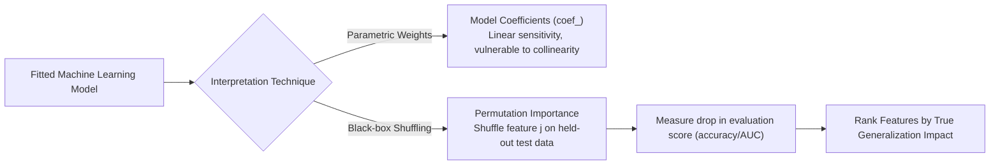

## Permutation importance on held-out rows

```python
import numpy as np
from sklearn.datasets import load_iris
from sklearn.inspection import permutation_importance
from sklearn.model_selection import train_test_split
from sklearn.ensemble import RandomForestClassifier

X, y = load_iris(return_X_y=True)
X_train, X_test, y_train, y_test = train_test_split(X, y, stratify=y, random_state=42)
model = RandomForestClassifier(n_estimators=80, random_state=42).fit(X_train, y_train)
importance = permutation_importance(model, X_test, y_test, n_repeats=5, random_state=42)
for index in np.argsort(importance.importances_mean)[::-1]:
    print(f'Feature {index}: {importance.importances_mean[index]:.3f}')
```

The scores are changes in the estimator's default `score` (accuracy for this classifier). A feature with near-zero permutation importance is not necessarily useless in all alternative models; it may be redundant or weak for this particular model.

## Interpretable results need context

Ask: Is there leakage? Is the model better than a baseline? Do the input columns make sense at prediction time? Do important subgroups have very different error rates? Would someone mistake correlation for causation?

**Try it:** Find the strongest features in the wine classification lab and test their importance on data that was **not** used to fit the model.

---

**Up next:** [Explore the course contents](docs/index.md) · [See the cheat sheet](docs/cheatsheet.md) · [Official scikit-learn docs](https://scikit-learn.org/stable/)


---


# Scikit-learn Production Checklist: Saving Models, Drift and Fair Evaluation

> **In one sentence:** A practical checklist for saving pipelines, avoiding unsafe model files and validating machine-learning systems over time.

## A model is more than a `.predict()` call

A useful ML artifact includes a schema, fitted preprocessing, a model, validation information, dependency versions, and intended usage. A good evaluation must match **how the data will arrive later**, not just a random shuffle of historical rows.

## Evaluation questions before release

| Question | Why it matters |
| --- | --- |
| Does the train/test split match the real deployment timeline? | Prevents future-looking leakage |
| Can the same person appear in both training and test? | Repeated entities can inflate performance |
| Do you compare with a basic baseline? | Complex isn't always better |
| What happens with missing or new categories? | Inputs change |
| Are costs of false positives vs false negatives clear? | Metrics should match decisions |
| Do subgroup results differ? | Aggregate metrics can hide failures |
| Will drift and feature availability be monitored? | Performance can degrade |

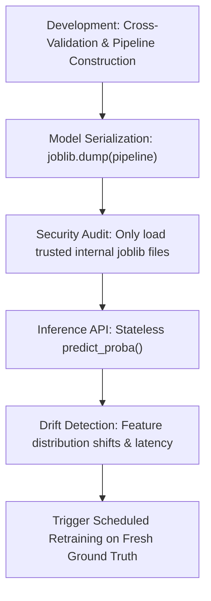

## Save and reload only trusted models

```python
import joblib
import sklearn
from sklearn.datasets import load_iris
from sklearn.pipeline import make_pipeline
from sklearn.preprocessing import StandardScaler
from sklearn.linear_model import LogisticRegression

X, y = load_iris(return_X_y=True)
model = make_pipeline(StandardScaler(), LogisticRegression(max_iter=1000)).fit(X, y)
joblib.dump(model, 'trusted-demo-model.joblib')
print('Saved with scikit-learn', sklearn.__version__)
# Only load files from sources you trust: joblib/pickle can execute code on load.
```

`joblib`, `pickle` and similar formats are **unsafe to load from untrusted sources**. Production systems should pin compatible versions, store a trusted artifact in a controlled location, track schemas and metadata, and rehearse loading in the target environment. The snippet above is a minimal saving demonstration, **not** an evaluated production release: it trains on every Iris row and supplies no test results.

## Reproducibility and honest limitations

Set a `random_state` for repeated experiments, but recognize that hardware, versions, floating-point order and threading may still change outputs. Never claim a synthetic benchmark proves real-world performance.

**Try it:** Write a short model card for [Lab 03](README.md#five-hands-on-projects): intended task, data provenance, splitting method, evaluation metric, known limitations, and what the model must not be used for.

---

**Up next:** [Explore the course contents](docs/index.md) · [See the cheat sheet](docs/cheatsheet.md) · [Official scikit-learn docs](https://scikit-learn.org/stable/)


---


# Five Scikit-learn Machine Learning Projects with Complete Python Code

> **In one sentence:** Practice classification, regression, preprocessing, clustering and cross-validation with five reproducible, offline Python labs.

## Learn by building

Every project runs without cloud accounts or API tokens. Four datasets come from scikit-learn generators/loaders; the churn dataset is created by the included script. The customer data and regression target are **synthetic**, not real business or financial observations.

| Lab | Goal | Key components | Output |
| --- | --- | --- | --- |
| 01 | Classify wine classes | LogisticRegression, StandardScaler, DummyClassifier | Confusion matrix |
| 02 | Predict a numeric target | Ridge, DummyRegressor, MAE/RMSE/R² | Residual chart |
| 03 | Handle a realistic table | ColumnTransformer, imputation, OneHotEncoder | Precision–recall |
| 04 | Discover clusters | KMeans, silhouette_score, PCA | Cluster projection |
| 05 | Tune without leakage | StratifiedKFold, GridSearchCV, Pipeline | CV + ROC chart |

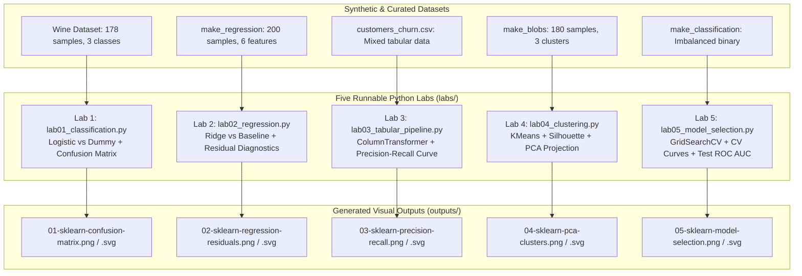

## Run all five

```bash
python -m labs.lab01_classification
python -m labs.lab02_regression
python -m labs.lab03_tabular_pipeline
python -m labs.lab04_clustering
python -m labs.lab05_model_selection
```

Each lab saves an image in the `outputs/` directory. Images included in `previews/` were generated by these exact scripts. Use `python -m pytest -q` to verify behavior.

### Lab 01: baseline before complexity

Start with a most-frequent-class baseline, then fit a standardized logistic-regression model. Inspect which wine classes are confused. **Exercise:** examine errors row by row.

### Lab 02: regression diagnostics

Generate noisy features, fit ridge regression and compare MAE against a mean-value baseline. **Exercise:** increase the noise and observe residual dispersion.

### Lab 03: one repeatable preprocessing recipe

Work with a synthetic customer DataFrame, missing values and text categories. Preprocess inside a pipeline and inspect the precision–recall curve. **Exercise:** predict on a record with an unseen plan name.

### Lab 04: structure without labels

Fit KMeans on standardized blobs, calculate a silhouette score in the scaled feature space and visualize a PCA projection. **Exercise:** try different cluster counts and explain what a label number actually means.

### Lab 05: choose hyperparameters carefully

Search over regularization strength using **training-only** cross-validation, then calculate test ROC AUC. **Exercise:** change the candidate parameter grid; resist choosing your final setting based on repeated peeks at the test set.

**Portfolio tip:** Include your chart, your metric, the baseline, where the data came from, how the split worked, and one limitation in every project README.

---

**Up next:** [Explore the course contents](docs/index.md) · [See the cheat sheet](docs/cheatsheet.md) · [Official scikit-learn docs](https://scikit-learn.org/stable/)


---


# Scikit-learn Cheat Sheet

A quick lookup for common **sklearn Python functions**. Code examples use the canonical public APIs and avoid any model-specific shortcuts.

## Standard workflow

```python
from sklearn.model_selection import train_test_split
from sklearn.pipeline import make_pipeline
from sklearn.preprocessing import StandardScaler
from sklearn.linear_model import LogisticRegression
from sklearn.metrics import accuracy_score

X_train, X_test, y_train, y_test = train_test_split(
    X, y, stratify=y, random_state=42
)
model = make_pipeline(StandardScaler(), LogisticRegression(max_iter=1000))
model.fit(X_train, y_train)
predictions = model.predict(X_test)
print(accuracy_score(y_test, predictions))
```

The snippet assumes that `X` and `y` are already defined; use [Lesson 1](docs/01-getting-started.md) for a self-contained example.

## Task → API

| Need | Library feature | Watch out for |
| --- | --- | --- |
| Split independent rows | `model_selection.train_test_split` | Leakage for users or time series |
| Stratify classes | `stratify=y` | Rare classes may be too small |
| Trivial baseline | `DummyClassifier` / `DummyRegressor` | Compare same split and metric |
| Scale numeric features | `StandardScaler` | Fit only on training folds |
| Missing numeric values | `SimpleImputer(strategy='median')` | Fit on training only |
| Categorical features | `OneHotEncoder(handle_unknown='ignore')` | New/unseen categories |
| Different columns | `ColumnTransformer` | Specify column selectors |
| Compose preprocessing and model | `Pipeline` / `make_pipeline` | The final step predicts |
| Cross-validation | `cross_val_score`, `cross_validate` | Split must reflect deployment |
| Hyperparameter search | `GridSearchCV`, `RandomizedSearchCV` | Tune pipeline, not test set |
| Classification performance | `accuracy_score`, `f1_score`, `roc_auc_score` | Pick metric by costs |
| Imbalanced class ranking | `average_precision_score` | Use scores/probabilities |
| Regression performance | `mean_absolute_error`, `mean_squared_error`, `r2_score` | R² can be negative |
| Clustering | `KMeans`, `DBSCAN` | Cluster IDs are arbitrary |
| Dimensionality reduction | `PCA` | Not necessarily optimal for classification |
| Feature inspection | `permutation_importance` | Correlated features matter |

## Choosing a model (simple starting points)

| Problem | First model to try | More flexible alternative |
| --- | --- | --- |
| Binary classification | `LogisticRegression` | `RandomForestClassifier` |
| Multi-class classification | `LogisticRegression` | `HistGradientBoostingClassifier` |
| Regression | `Ridge` | `RandomForestRegressor` |
| Text classification | `TfidfVectorizer` + `LogisticRegression` | Try alternative linear estimators |
| Clustering | `KMeans` | `DBSCAN` for density-based groups |

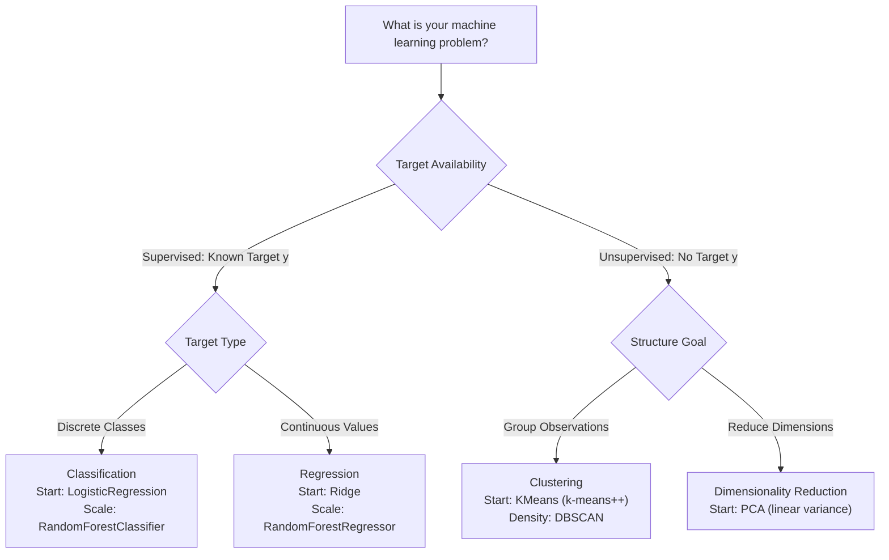

## Quick metric definitions

- Precision = TP / (TP + FP), when denominator is nonzero.
- Recall = TP / (TP + FN), when denominator is nonzero.
- F1 = harmonic mean of precision and recall.
- MAE = mean of absolute target errors.
- RMSE = square root of mean squared target errors.
- R² = 1 − residual sum of squares / total sum of squares, when defined.

## Recommended default checklist

Split first → create baseline → put learned preprocessing in pipeline → evaluate with CV on train → select/tune → test once → inspect errors and limitations.

[Lesson index](docs/index.md) · [Common questions](docs/faq.md)


---


# Scikit-learn FAQ

## What is scikit-learn used for?

It is a Python toolkit for classification, regression, clustering, dimensionality reduction, preprocessing, model selection and evaluation. It is not primarily a deep-learning or large-language-model training framework.

## Is sklearn the same as scikit-learn?

Yes: the library is named **scikit-learn**, but the Python import namespace is **`sklearn`**. Install it with `pip install scikit-learn`.

## Does scikit-learn work with pandas DataFrames?

Yes. Many estimators accept DataFrames. Underneath, estimators typically work with numeric arrays or sparse matrices. Categorical columns often require encoding and `ColumnTransformer` handles mixed input types.

## What is the difference between fit and transform?

`fit` learns parameters from the training data; `transform` applies a learned conversion. Transformers often support `fit_transform` as a convenience for training data.

## What is a Pipeline?

A Pipeline chains preprocessing and an estimator so cross-validation can correctly refit all learned steps on each training fold, reducing leakage risk.

## How do I prevent data leakage?

Split before fitting; keep test rows and future-only features out of training; put learned preprocessing inside a pipeline; use group/time-based splitting when your data requires it.

## Is logistic regression a regression or classification model?

Despite the name, scikit-learn's `LogisticRegression` is a **classifier**. Its output can provide class probabilities when available.

## How much data should be in the test set?

There is no universally correct percentage. A 20–25% hold-out is often a useful starting point for introductory datasets, but data size, grouping, rare labels and deployment conditions matter more than a fixed ratio.

## Why can my test accuracy be misleading?

Accuracy can hide failure on rare classes. Consider precision, recall, F1, average precision and/or ROC AUC according to error costs and class balance.

## Can R² be negative?

Yes. It is negative when your model fits the evaluated data worse than the reference constant-mean prediction under the usual R² definition.

## What is the difference between cross-validation and a test set?

Cross-validation typically helps **estimate and select** within the training data. The held-out test set provides a final check after those choices have been made.

## Are KMeans cluster labels meaningful?

The grouping may be informative, but its numeric IDs (0, 1, 2…) have no inherent order and can change between runs.

## Should I save models with joblib?

Only when you control the artifact's source and deployment environment. Loading a joblib/pickle file from an untrusted source can run arbitrary code. Version compatibility is also important.

## Is scikit-learn better than TensorFlow or PyTorch?

They solve overlapping but different tasks. scikit-learn is a great starting point for classical ML on tabular data; PyTorch and TensorFlow provide neural network and differentiable computing ecosystems.

[Back to course](docs/index.md)


---


# Scikit-learn Glossary

| Term | Plain English |
| --- | --- |
| Estimator | Object that learns from data using `fit` |
| Transformer | Estimator that converts inputs via `transform` |
| Pipeline | Series of steps for learned preprocessing and prediction |
| Feature (X) | Input variable supplied to a model |
| Target (y) | Outcome being predicted in supervised learning |
| Training set | Rows used to learn fitted parameters |
| Validation fold | Temporary held-out rows used during model selection |
| Test set | Reserved rows used for final evaluation |
| Data leakage | Information unintentionally flowing from evaluation/future data into training |
| Classification | Predicting discrete labels |
| Regression | Predicting numerical values |
| Overfitting | Learning details of training data that fail to generalize |
| Underfitting | Model too limited to capture important structure |
| Hyperparameter | User-chosen setting such as regularization strength |
| Cross-validation | Repeated train/validation partitions |
| Stratification | Retaining approximate class proportions in splits |
| Dummy baseline | Simple reference estimator used as a sanity check |
| Precision | Fraction of predicted positives that are correct |
| Recall | Fraction of actual positives found |
| F1 | Harmonic mean of precision and recall |
| ROC AUC | Binary ranking performance across thresholds |
| Average precision | Precision-recall summary score for ranked binary predictions |
| MAE | Average absolute regression error |
| RMSE | Square root of average squared regression error |
| R² | Relative goodness of fit against a constant-mean reference |
| Imputation | Filling in missing input values |
| One-hot encoding | Convert categories into indicator columns |
| ColumnTransformer | Apply different transformations to selected columns |
| KMeans | Partition observations into a chosen number of clusters |
| PCA | Rotate input dimensions to directions of greatest variance |
| Silhouette score | Compare cohesion and separation of assigned clusters |
| Permutation importance | Drop in predictive score when a feature is shuffled |

[Course home](docs/index.md) · [Cheat sheet](docs/cheatsheet.md)


</USER_REQUEST>
<ADDITIONAL_METADATA>
The current local time is: 2026-11-02T06:38:45+05:30.
</ADDITIONAL_METADATA>