<USER_REQUEST>
# XGBoost Complete Guide: 10 Lessons + 5 Python Labs

A consolidated, offline-first Markdown tutorial covering gradient-boosted trees, classification, regression, DMatrix, early stopping, native categorical features, model tuning and saving. Install dependencies from `requirements.txt` to run examples from the repository root.

## Chapters

1. [What Is XGBoost? Gradient Boosting Explained](docs/01-what-is-xgboost.md)
2. [XGBClassifier Tutorial: Binary Classification](docs/02-xgbclassifier.md)
3. [XGBRegressor Tutorial: RMSE, MAE and Residuals](docs/03-xgbregressor.md)
4. [DMatrix and xgb.train: Native XGBoost Python API](docs/04-dmatrix.md)
5. [XGBoost Early Stopping Without Data Leakage](docs/05-early-stopping.md)
6. [XGBoost Hist vs Exact: Tree Methods and max_bin](docs/06-hist-vs-exact.md)
7. [XGBoost Categorical Features and Missing Values](docs/07-categorical.md)
8. [XGBoost GridSearchCV: Tune on Training Data Only](docs/08-gridsearch.md)
9. [XGBoost Save Model JSON, Feature Importance and Deployment](docs/09-save-interpret.md)
10. [5 Hands-on XGBoost Projects with Python Source Code](docs/10-projects.md)

---

## Lesson 1


# What Is XGBoost? Gradient Boosting Explained

**XGBoost** (Extreme Gradient Boosting) trains an additive ensemble of decision trees. New boosting rounds make corrections to previous predictions by optimizing an objective function using gradients and, where applicable, second-order information. The `learning_rate` controls how much each new tree contributes.

The model is useful on **tabular data** but is not always better than linear models, random forests or neural networks. The right model depends on your dataset, evaluation metric and deployment constraints.

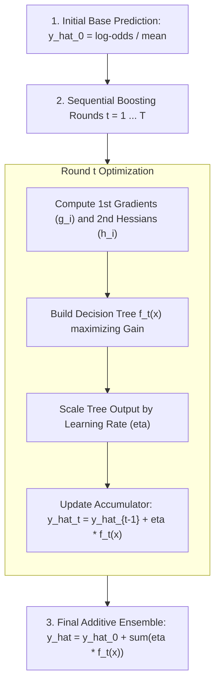

## Runnable example

```python
from labs.common import classification_data
from sklearn.model_selection import train_test_split
from sklearn.metrics import roc_auc_score
from xgboost import XGBClassifier
X, y = classification_data(n_samples=400)
X_tr, X_te, y_tr, y_te = train_test_split(X, y, stratify=y, test_size=.25, random_state=42)
model = XGBClassifier(n_estimators=70, max_depth=3, tree_method="hist", n_jobs=1, random_state=42)
model.fit(X_tr, y_tr)
print('ROC AUC:', round(roc_auc_score(y_te, model.predict_proba(X_te)[:, 1]), 3))
```

## Important habit

Do not report accuracy measured on the same rows used for fitting as an unbiased performance estimate.

## Try it yourself

Vary `max_depth` (1, 3, 6) while keeping your test set fixed. Do the results always improve?

**Continue:** [Complete tutorial](XGBOOST_COMPLETE_GUIDE.md) · [Cheat sheet](docs/cheatsheet.md) · [FAQ](docs/faq.md).

---

## Lesson 2


# XGBClassifier Tutorial: Binary Classification

`XGBClassifier` uses the familiar scikit-learn estimator API: `.fit`, `.predict` and `.predict_proba`. Class labels answer *which class?*; probabilities support threshold-based policies and ranking metrics.

| Metric | Meaning | Main caveat |
| --- | --- | --- |
| ROC AUC | Ranking of positive over negative cases | May be less informative under extreme class imbalance |
| Balanced accuracy | Average class-specific recall | Ignores probabilistic calibration |
| Precision | Correct among predicted positives | Depends on the threshold |
| Recall | Positive cases found | Can trade off with false alarms |
| Average precision | Summary of precision-recall ranking | Depends on prevalence |

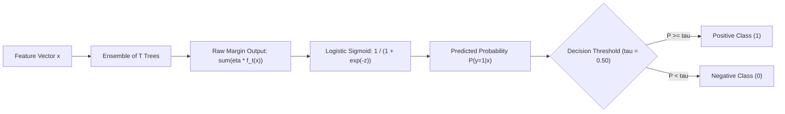

## Runnable example

```python
from labs.common import classification_data
from sklearn.model_selection import train_test_split
from sklearn.dummy import DummyClassifier
from sklearn.metrics import roc_auc_score, balanced_accuracy_score
from xgboost import XGBClassifier
X, y = classification_data()
X_tr, X_te, y_tr, y_te = train_test_split(X, y, test_size=.25, stratify=y, random_state=42)
clf = XGBClassifier(n_estimators=80, tree_method='hist', eval_metric='logloss', n_jobs=1, random_state=42).fit(X_tr,y_tr)
base = DummyClassifier(strategy='prior').fit(X_tr,y_tr)
print('Balanced accuracy:', balanced_accuracy_score(y_te, clf.predict(X_te)))
print('Model ROC AUC:', roc_auc_score(y_te, clf.predict_proba(X_te)[:,1]))
print('Baseline ROC AUC:', roc_auc_score(y_te, base.predict_proba(X_te)[:,1]))
```

## Important habit

Use a stratified split for appropriate classification datasets; report a baseline rather than only the model score.

## Try it yourself

Change the class balance of the synthetic dataset and compare ROC AUC with average precision.

**Continue:** [Complete tutorial](XGBOOST_COMPLETE_GUIDE.md) · [Cheat sheet](docs/cheatsheet.md) · [FAQ](docs/faq.md).

---

## Lesson 3


# XGBRegressor Tutorial: RMSE, MAE and Residuals

`XGBRegressor` predicts a number. Start with `objective="reg:squarederror"` and assess performance on an unseen test set.

- **MAE:** average absolute error, in target units.
- **RMSE:** square root of mean squared error; penalizes larger errors more.
- **R²:** improvement over a constant-mean predictor by squared-error comparison; can be negative.

Residual plots help detect patterns in errors. They do not prove that a model is unbiased or deployable.

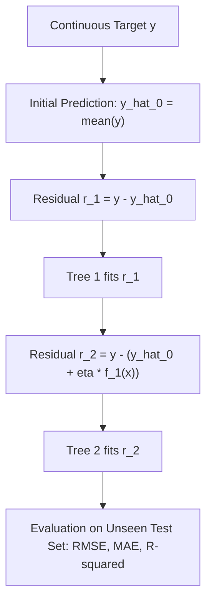

## Runnable example

```python
from labs.common import regression_data
from sklearn.model_selection import train_test_split
from sklearn.dummy import DummyRegressor
from sklearn.metrics import mean_absolute_error, root_mean_squared_error
from xgboost import XGBRegressor
X, y = regression_data()
X_tr, X_te, y_tr, y_te = train_test_split(X,y,test_size=.25,random_state=42)
model = XGBRegressor(n_estimators=160,max_depth=3,learning_rate=.07,tree_method='hist',n_jobs=1,random_state=42).fit(X_tr,y_tr)
base = DummyRegressor().fit(X_tr,y_tr)
print('MAE:', round(mean_absolute_error(y_te,model.predict(X_te)),3))
print('RMSE:',round(root_mean_squared_error(y_te,model.predict(X_te)),3))
print('Baseline RMSE:',round(root_mean_squared_error(y_te,base.predict(X_te)),3))
```

## Important habit

Do not compare a training-set RMSE with a held-out baseline RMSE; compute both on the same rows.

## Try it yourself

Compare `max_depth=2` and `max_depth=8`, then inspect the residual plot generated by Lab 02.

**Continue:** [Complete tutorial](XGBOOST_COMPLETE_GUIDE.md) · [Cheat sheet](docs/cheatsheet.md) · [FAQ](docs/faq.md).

---

## Lesson 4


# DMatrix and xgb.train: Native XGBoost Python API

**`DMatrix`** stores features, labels and optional metadata in a format for native XGBoost training. It is **not** a replacement for a pandas DataFrame when cleaning or joining tables.

| API | Training call | Typical choice |
| --- | --- | --- |
| `XGBClassifier` / `XGBRegressor` | `model.fit(X, y)` | scikit-learn model selection and pipelines |
| `xgb.DMatrix` + `xgb.train` | `xgb.train(params, dtrain)` | Native evaluation, callbacks, custom logic |
| `xgb.QuantileDMatrix` | Native training | Memory-oriented histogram data representation |

Keep feature names and column order consistent between training and inference.

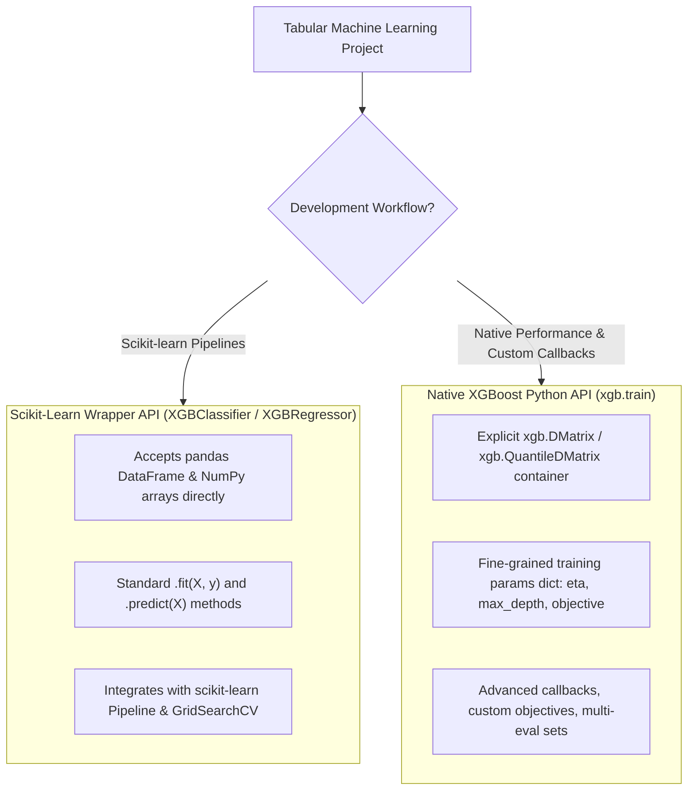

## Runnable example

```python
import xgboost as xgb
from labs.common import classification_data
from sklearn.model_selection import train_test_split
from sklearn.metrics import roc_auc_score
X,y=classification_data(n_samples=360)
X_tr,X_te,y_tr,y_te=train_test_split(X,y,stratify=y,test_size=.25,random_state=42)
train=xgb.DMatrix(X_tr,label=y_tr)
test=xgb.DMatrix(X_te,label=y_te)
params={'objective':'binary:logistic','tree_method':'hist','eval_metric':'logloss','eta':.08,'max_depth':3,'nthread':1,'seed':42}
booster=xgb.train(params,train,num_boost_round=80)
print('ROC AUC:',roc_auc_score(y_te,booster.predict(test)))
```

## Important habit

For native `xgb.train`, the parameter is commonly called `eta` rather than `learning_rate` (both are aliases).

## Try it yourself

Build the same classifier once with `XGBClassifier` and once with `xgb.train`, then compare metrics.

**Continue:** [Complete tutorial](XGBOOST_COMPLETE_GUIDE.md) · [Cheat sheet](docs/cheatsheet.md) · [FAQ](docs/faq.md).

---

## Lesson 5


# XGBoost Early Stopping Without Data Leakage

Early stopping watches a **validation** metric and chooses the best boosting iteration when subsequent iterations stop improving. It must not use the untouched **final test set**.

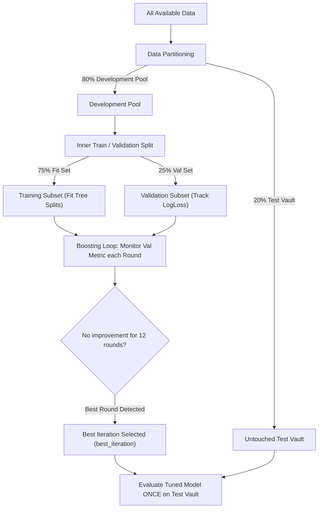

For the scikit-learn wrapper, `early_stopping_rounds` belongs in the estimator constructor. The native `Booster` may retain later iterations, so choose `iteration_range=(0, booster.best_iteration + 1)` for prediction with the best iteration.

## Runnable example

```python
from labs.common import classification_data
from sklearn.model_selection import train_test_split
from sklearn.metrics import roc_auc_score
from xgboost import XGBClassifier
X,y=classification_data(n_samples=640)
Xp,Xtest,yp,ytest=train_test_split(X,y,stratify=y,test_size=.2,random_state=42)
Xtr,Xval,ytr,yval=train_test_split(Xp,yp,stratify=yp,test_size=.25,random_state=42)
clf=XGBClassifier(n_estimators=220,tree_method='hist',learning_rate=.06,max_depth=3,
                  early_stopping_rounds=12,eval_metric='logloss',n_jobs=1,random_state=42)
clf.fit(Xtr,ytr,eval_set=[(Xval,yval)],verbose=False)
print('Best iteration:',clf.best_iteration)
print('Final ROC AUC:',roc_auc_score(ytest,clf.predict_proba(Xtest)[:,1]))
```

## Important habit

Using `eval_set=[(X_test, y_test)]` to select a model leaks information from your final test set.

## Try it yourself

Find the selected boosting round, then inspect Lab 03’s validation-loss curves.

**Continue:** [Complete tutorial](XGBOOST_COMPLETE_GUIDE.md) · [Cheat sheet](docs/cheatsheet.md) · [FAQ](docs/faq.md).

---

## Lesson 6


# XGBoost Hist vs Exact: Tree Methods and max_bin

Two supported tree-building strategies are **`hist`** (quantizes numeric features into bins) and **`exact`** (evaluates exact split candidates). `hist` is generally a strong production default because of its efficiency.

| Argument | Use |
| --- | --- |
| `tree_method="hist"` | Histogram-optimized approximate splits, native categorical support |
| `tree_method="exact"` | Exact greedy split search on numeric data; native categorical support unavailable |
| `max_bin=256` | Number of numeric bins for `hist`/`approx`, not `exact` |
| `device="cpu"` | CPU mode; included labs require no GPU |
| `device="cuda"` | Optional CUDA acceleration when supported |

Whether hist is faster or more accurate depends on dataset, training configuration and machine. A small code example is **not** a defensible global speed benchmark.

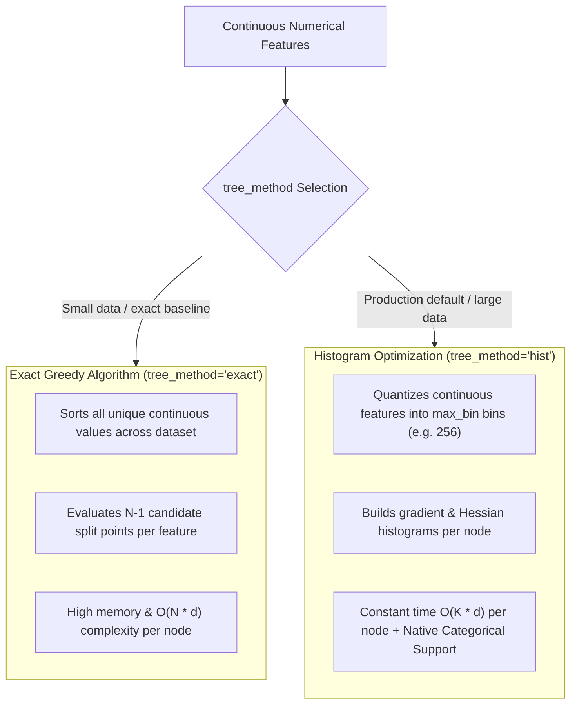

## Runnable example

```python
from sklearn.datasets import make_regression
from sklearn.model_selection import train_test_split
from sklearn.metrics import root_mean_squared_error
from xgboost import XGBRegressor
X,y=make_regression(n_samples=250,n_features=6,random_state=31)
Xtr,Xte,ytr,yte=train_test_split(X,y,random_state=31)
for method in ('hist','exact'):
    model=XGBRegressor(tree_method=method,n_estimators=50,max_depth=2,n_jobs=1,random_state=31).fit(Xtr,ytr)
    print(method, round(root_mean_squared_error(yte,model.predict(Xte)),3))
```

## Important habit

`tree_method="exact"` is not the original meaning of the word “XGBoost”; XGBoost supports multiple split-building methods.

## Try it yourself

Try `max_bin=32` versus `max_bin=256` with hist, then compare predictive error.

**Continue:** [Complete tutorial](XGBOOST_COMPLETE_GUIDE.md) · [Cheat sheet](docs/cheatsheet.md) · [FAQ](docs/faq.md).

---

## Lesson 7


# XGBoost Categorical Features and Missing Values

XGBoost handles `NaN` missing numeric values using learned default branches. Native categorical feature handling uses pandas columns typed as **`category`** and `enable_categorical=True` with a supported tree method.

Starting with XGBoost **3.1**, supported Python DataFrame inputs can carry category encoding information into the model to support recoding at prediction time. Still validate input data types, feature names and the domain of allowed values.

**Limitations:** plain Python object-string columns are not automatically categorical. Learned NaN routing does not repair missing source data. Categorical models should be serialized with JSON or UBJSON.

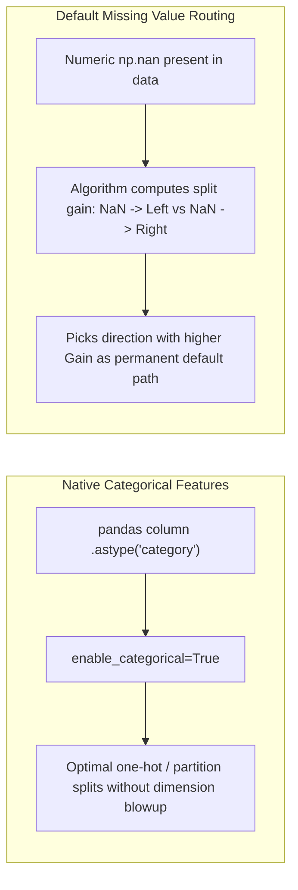

## Runnable example

```python
from labs.common import churn_data
from sklearn.model_selection import train_test_split
from xgboost import XGBClassifier
X,y=churn_data() # bundled synthetic CSV; plan/region converted to category
Xtr,Xte,ytr,yte=train_test_split(X,y,stratify=y,test_size=.25,random_state=19)
model=XGBClassifier(n_estimators=80,tree_method='hist',enable_categorical=True,
                    eval_metric='logloss',random_state=19,n_jobs=1)
model.fit(Xtr,ytr)
print('Missing values:',int(X.isna().sum().sum()))
print('First predicted probabilities:',model.predict_proba(Xte)[:3,1].round(3))
```

## Important habit

Treat model feature gain as association, not cause-and-effect; verify data types when deploying.

## Try it yourself

Try dropping a numeric feature and compare metrics without changing the train/test split.

**Continue:** [Complete tutorial](XGBOOST_COMPLETE_GUIDE.md) · [Cheat sheet](docs/cheatsheet.md) · [FAQ](docs/faq.md).

---

## Lesson 8


# XGBoost GridSearchCV: Tune on Training Data Only

Small parameter searches help learners build intuition before expensive tuning. `max_depth` changes complexity, `learning_rate` changes each update, `subsample` and `colsample_bytree` add sampling, and `reg_lambda` applies L2 regularization.

1. Split off the final test set **before** tuning.
2. Run `GridSearchCV` with stratified folds inside the training set.
3. Select the best cross-validated estimator.
4. Report the test metric **once** after model selection.

Avoid a global external early-stopping validation set shared indiscriminately across CV folds.

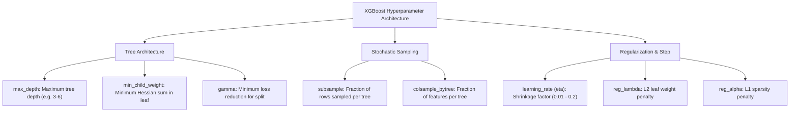

## Runnable example

```python
from labs.common import classification_data
from sklearn.model_selection import train_test_split, GridSearchCV, StratifiedKFold
from sklearn.metrics import roc_auc_score
from xgboost import XGBClassifier
X,y=classification_data(n_samples=450)
Xtr,Xte,ytr,yte=train_test_split(X,y,stratify=y,test_size=.25,random_state=42)
base=XGBClassifier(n_estimators=55,learning_rate=.08,tree_method='hist',n_jobs=1,random_state=42)
cv=StratifiedKFold(n_splits=3,shuffle=True,random_state=42)
search=GridSearchCV(base,{'max_depth':[2,4],'subsample':[.8,1.]},scoring='roc_auc',cv=cv,n_jobs=1)
search.fit(Xtr,ytr)
print('CV AUC:',search.best_score_)
print('Held-out AUC:',roc_auc_score(yte,search.predict_proba(Xte)[:,1]))
```

## Important habit

Do not select hyperparameters based on which combination gives the highest test-set score.

## Try it yourself

Try a small `min_child_weight` grid and compare CV variability.

**Continue:** [Complete tutorial](XGBOOST_COMPLETE_GUIDE.md) · [Cheat sheet](docs/cheatsheet.md) · [FAQ](docs/faq.md).

---

## Lesson 9


# XGBoost Save Model JSON, Feature Importance and Deployment

**Portable model IO:** `model.save_model("name.json")` or `.ubj` saves XGBoost trees and model information. It does not automatically include every external preprocessing step, data schema, metric threshold, or deployment contract.

**Feature importance:** `weight` counts split usage; `gain` measures average split-related loss improvement; `cover` reflects average coverage. They are not proof of causality.

For production readiness, document input names/types/order, version dependencies, model provenance, expected class balance, latency constraints, metric thresholds, drift detection and rollback plans.

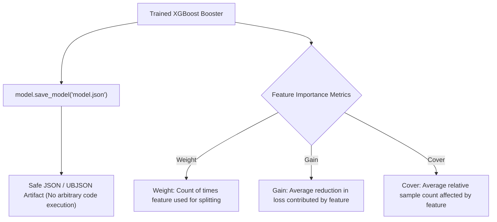

## Runnable example

```python
from pathlib import Path
from tempfile import TemporaryDirectory
import numpy as np
from labs.common import classification_data
from sklearn.model_selection import train_test_split
from xgboost import XGBClassifier
X,y=classification_data(n_samples=350)
Xtr,Xte,ytr,yte=train_test_split(X,y,random_state=42)
model=XGBClassifier(tree_method='hist',n_estimators=55,n_jobs=1,random_state=42).fit(Xtr,ytr)
with TemporaryDirectory() as d:
    path=Path(d)/'model.json'
    model.save_model(path)
    reloaded=XGBClassifier()
    reloaded.load_model(path)
    print('Reload matches:',np.allclose(model.predict_proba(Xte),reloaded.predict_proba(Xte)))
```

## Important habit

Avoid loading untrusted pickle or joblib files; keep model artifacts and upstream data trustworthy.

## Try it yourself

Write a short model card describing the training dataset and known evaluation limitations.

**Continue:** [Complete tutorial](XGBOOST_COMPLETE_GUIDE.md) · [Cheat sheet](docs/cheatsheet.md) · [FAQ](docs/faq.md).

---

## Lesson 10


# 5 Hands-on XGBoost Projects with Python Source Code

The five scripts below are **real executable Python projects**, not pseudocode, and they run fully offline on bundled synthetic data.

| Lab | Problem | Output |
| --- | --- | --- |
| [`labs/lab01_xgb_classification.py`](labs/lab01_xgb_classification.py) | Binary classification versus a dummy baseline | Confusion matrix + ROC |
| [`labs/lab02_xgb_regression.py`](labs/lab02_xgb_regression.py) | Nonlinear regression | Predicted vs actual + residuals |
| [`labs/lab03_dmatrix_early_stopping.py`](labs/lab03_dmatrix_early_stopping.py) | Native `DMatrix` and early stopping | Training/validation log loss |
| [`labs/lab04_categorical_model_io.py`](labs/lab04_categorical_model_io.py) | Missing values, categoricals, JSON reload | Gain importance + model file |
| [`labs/lab05_grid_search.py`](labs/lab05_grid_search.py) | Cross-validated hyperparameter selection | CV comparison + ROC |

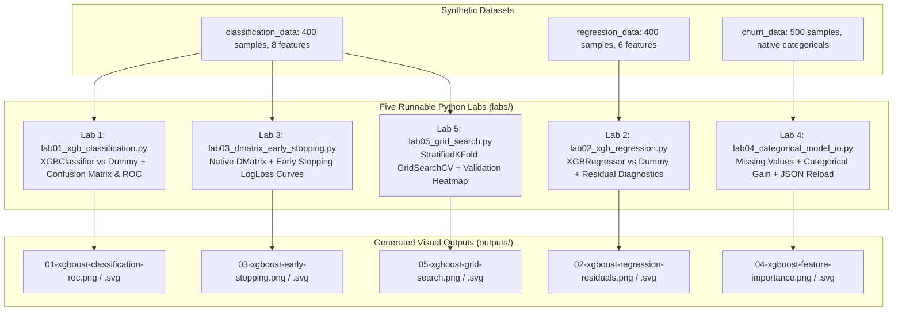

Use the scripts' `run()` functions to explore returned metrics or modify the hyperparameters. The scripts save PNG and SVG files under `outputs/`. All charts are computed from synthetic datasets and do not represent production performance.

## Runnable example

```python
from labs.lab01_classification import run as classification
from labs.lab03_dmatrix_early_stopping import run as early_stopping
print('Classification metrics:', classification())
print('Early stopping metrics:', early_stopping())
```

## Important habit

Only report model scores from new unseen data with assumptions and dataset limitations clearly stated.

## Try it yourself

Modify any two experiments, then write down exactly which split and metric you used.

**Continue:** [Complete tutorial](XGBOOST_COMPLETE_GUIDE.md) · [Cheat sheet](docs/cheatsheet.md) · [FAQ](docs/faq.md).

---

# XGBoost Python Cheat Sheet

XGBoost is a gradient-boosted decision-tree library for tabular data. Use `XGBClassifier` for categories, `XGBRegressor` for numbers, or native `DMatrix` + `xgb.train` for low-level control.

| Topic | Code / setting | When to use |
| --- | --- | --- |
| Install | `pip install xgboost` | Local training |
| Classify | `XGBClassifier().fit(X_train, y_train)` | Label prediction |
| Regress | `XGBRegressor().fit(X_train, y_train)` | Numeric prediction |
| Native data | `xgb.DMatrix(X, label=y)` | Native train API |
| Native train | `xgb.train(params, dtrain)` | Booster/callback control |
| Hist | `tree_method="hist"` | Usually a good starting point |
| Exact | `tree_method="exact"` | Small-data numeric comparisons |
| Early stopping | `early_stopping_rounds=15` | Validation-driven selection |
| Native categories | `.astype("category")`, `enable_categorical=True` | DataFrame categorical columns |
| Handle NaN | Leave `np.nan` in numeric features | Learned missing-value branches |
| Save model | `model.save_model("model.json")` | Portable XGBoost trees |
| Cross validate | `GridSearchCV(..., cv=3)` | Tune only on training data |

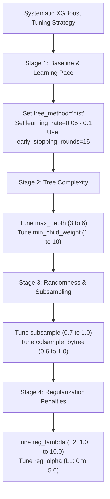

**Core tuning parameters:** `n_estimators`, `learning_rate` (`eta`), `max_depth`, `min_child_weight`, `subsample`, `colsample_bytree`, `reg_lambda`, `reg_alpha`, `max_bin`.

**Always:** split before fitting, compare a baseline, choose metrics for your business question, keep validation separate from final test, store input schemas.

---

# XGBoost FAQ — Common Beginner Questions

### What is XGBoost?
XGBoost is an optimized gradient-boosting library that learns tree-based predictive ensembles from tabular features.

### Is XGBoost part of scikit-learn?
No. It is a separate library with scikit-learn-compatible estimators.

### What is the difference between XGBClassifier and XGBRegressor?
Classification estimates labels or class probabilities; regression estimates numbers.

### What is `DMatrix`?
XGBoost's native container for features, labels and metadata used by `xgb.train`.

### What is the difference between `hist` and `exact`?
`hist` searches splits on bins; `exact` considers all eligible split candidates. Neither is guaranteed to always be more accurate.

### Does XGBoost need feature scaling?
Tree-based boosters generally do not require standardizing numeric inputs. Other components in a broader pipeline might.

### How can I use categorical data?
Convert supported pandas columns to `category`, then pass `enable_categorical=True` and a compatible tree method such as `hist`.

### Does XGBoost support missing values?
Yes, numeric `NaN` can be handled by learned missing-value routing; it does not restore missing data.

### How does early stopping work?
It selects the boosting iteration using a validation metric. Do not use the untouched final test set for stopping.

### Why can ROC AUC look good but precision be poor?
ROC AUC evaluates ranking across thresholds, while precision depends on a specific threshold and class prevalence.

### What is the best XGBoost learning rate?
There is no universal optimal learning rate. Lower rates generally need more rounds; tune with train-only cross-validation and appropriate metrics.

### How can I save a model?
Use `model.save_model("model.json")`, and record feature schema and any external preprocessing as separate assets.

### Can I use these example models in production?
Not without validating the dataset, quality, security and operations for the real use case. The lab data are synthetic and educational.

---

# XGBoost Glossary — Concepts in Plain English

| Concept | Meaning |
| --- | --- |
| Boosting | Sequentially combining learners to improve predictions |
| GBDT | Gradient-boosted decision-tree ensemble |
| Gradient | First derivative of the objective with respect to predictions |
| Hessian | Second derivative information for supported losses |
| Learning rate (`eta`) | Scale applied to each boosting update |
| Boosting round | Model update step, potentially involving multiple trees |
| `hist` | Histogram-based approximate numeric split search |
| `exact` | Exact greedy split search |
| `max_bin` | Maximum numeric bins for histogram/approximate splitting |
| `DMatrix` | Native data format for the Booster API |
| `Booster` | Trained native XGBoost model |
| `eval_metric` | Metric reported during training and validation |
| Early stopping | Select boosting iteration based on a validation metric |
| `best_iteration` | Zero-based best boosting iteration |
| `stratify` | Maintain class proportions during sampling/splitting |
| ROC AUC | Binary-class ranking discrimination |
| RMSE | Root mean squared prediction error |
| Gain importance | Split-improvement-based feature importance, not causality |
| Data leakage | Information contaminating training or evaluation unfairly |
| JSON / UBJSON | Supported model serialization formats |

</USER_REQUEST>
<ADDITIONAL_METADATA>
The current local time is: 2026-11-02T07:00:02+05:30.
</ADDITIONAL_METADATA>