# LightGBM Complete Learning Guide

**Beginner → intermediate · 10 lessons · 5 runnable projects**

This self-contained Markdown guide collects the lessons, quick references, FAQs and example outputs. It is designed for offline reading, GitHub hosting and sharing. The course uses synthetic data and follows modern LightGBM APIs (official 4.7.0 docs; tested with 4.6.0).

## Contents

1. [What Is LightGBM? Gradient Boosting Explained](#what-is-lightgbm-gradient-boosting-explained)
2. [LGBMClassifier Tutorial: Train and Evaluate a Classifier](#lgbmclassifier-tutorial-train-and-evaluate-a-classifier)
3. [LGBMRegressor Tutorial: Regression, RMSE and Residuals](#lgbmregressor-tutorial-regression-rmse-and-residuals)
4. [LightGBM Dataset and Booster: Native Python Training](#lightgbm-dataset-and-booster-native-python-training)
5. [LightGBM Early Stopping: Validation Without Data Leakage](#lightgbm-early-stopping-validation-without-data-leakage)
6. [LightGBM Parameters: num_leaves, max_bin and Fast Training](#lightgbm-parameters-numleaves-maxbin-and-fast-training)
7. [LightGBM Categorical Features and Missing Values in pandas](#lightgbm-categorical-features-and-missing-values-in-pandas)
8. [LightGBM GridSearchCV: Tune Parameters Correctly](#lightgbm-gridsearchcv-tune-parameters-correctly)
9. [LightGBM Production: Save Models, Sparse Data and Feature Importance](#lightgbm-production-save-models-sparse-data-and-feature-importance)
10. [Five LightGBM Python Projects: Beginner to Production Workflow](#five-lightgbm-python-projects-beginner-to-production-workflow)
11. [LightGBM Python Cheat Sheet](#lightgbm-python-cheat-sheet)
12. [LightGBM FAQ](#lightgbm-faq)
13. [LightGBM Glossary](#lightgbm-glossary)
14. [Sources and additional reading](#sources-and-additional-reading)

---

# What Is LightGBM? Gradient Boosting Explained

**In one minute:** LightGBM (Light Gradient Boosting Machine) builds an ensemble of decision trees. Each new tree tries to correct errors left by the earlier trees. It is designed for efficient training on structured numerical and categorical features.

## Where LightGBM fits

Use it for problems such as customer churn classification, demand regression, and ranking search results. It is not automatically better than every other model: always compare against simple baselines and validate on representative data. For large datasets, measure both training time **and** prediction quality on your hardware.

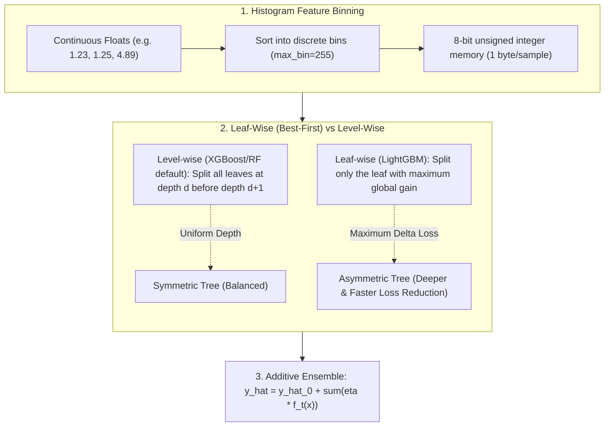

### Why histogram-based trees?

Instead of checking every unique continuous value as a possible split, LightGBM groups values into bins. Fewer candidate splits can improve efficiency. LightGBM also grows trees **leaf-wise**, choosing the leaf with the largest improvement instead of growing each level uniformly. This can fit complex patterns, but may overfit smaller datasets if leaves are too flexible.

## First LightGBM model

```python
from sklearn.datasets import make_classification
from sklearn.model_selection import train_test_split
from lightgbm import LGBMClassifier

X, y = make_classification(n_samples=400, n_features=8, random_state=42)
X_train, X_test, y_train, y_test = train_test_split(
    X, y, test_size=0.2, stratify=y, random_state=42
)
model = LGBMClassifier(n_estimators=40, num_leaves=7, verbosity=-1, random_state=42)
model.fit(X_train, y_train)
print("Accuracy:", round(model.score(X_test, y_test), 3))
```

**What you learned:** `fit()` learns a model; `predict()` returns classes; `predict_proba()` returns probabilities. Accuracy alone is not enough when classes are imbalanced.

**Try it:** Change `num_leaves` from 7 to 31. Does accuracy always improve? Why might your answer vary by data split?

**Common mistake:** “LightGBM is always the fastest.” Performance depends on data, preprocessing, hardware and evaluation.

---

# LGBMClassifier Tutorial: Train and Evaluate a Classifier

`LGBMClassifier` offers a familiar scikit-learn interface. It is a convenient choice for the majority of everyday Python classification projects.

## The correct workflow

1. Separate a **test set before model selection**.
2. Fit only on training rows.
3. Select metrics appropriate for the business cost of false positives and false negatives.
4. Compare against a trivial baseline.

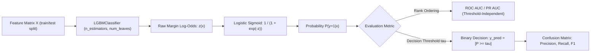

```python
from lightgbm import LGBMClassifier
from sklearn.datasets import make_classification
from sklearn.model_selection import train_test_split
from sklearn.metrics import roc_auc_score, classification_report

X, y = make_classification(n_samples=500, n_features=10,
                            weights=[0.75, 0.25], random_state=13)
X_train, X_test, y_train, y_test = train_test_split(
    X, y, stratify=y, test_size=0.25, random_state=42
)
clf = LGBMClassifier(n_estimators=90, learning_rate=0.05,
                     num_leaves=15, verbosity=-1, random_state=42)
clf.fit(X_train, y_train)
p = clf.predict_proba(X_test)[:, 1]
print('ROC AUC:', round(roc_auc_score(y_test, p), 3))
print(classification_report(y_test, clf.predict(X_test)))
```

## How to read metrics

| Metric | Useful when | Watch out for |
| --- | --- | --- |
| Accuracy | Classes are reasonably balanced | Hides minority-class failures |
| Precision | False alarms are costly | Can be boosted by predicting few positives |
| Recall | Missing positives is costly | May cause more false alarms |
| ROC AUC | Ranking positives above negatives | Does not select a decision threshold |
| PR AUC | Positives are rare | Compare to positive prevalence |

For heavily imbalanced problems, inspect a precision–recall curve and calibrate thresholds using **validation** data, not the final test set.

**Hands-on:** Run `python -m labs.lab01_lgbm_classification` to create a confusion matrix and ROC plot.


**Try it:** What happens to precision and recall if you change the classification threshold to 0.3?

---

# LGBMRegressor Tutorial: Regression, RMSE and Residuals

Use `LGBMRegressor` when the target is a number such as demand, energy use or delivery duration. Always compare its performance against a simple predictor (for example, the training target mean).

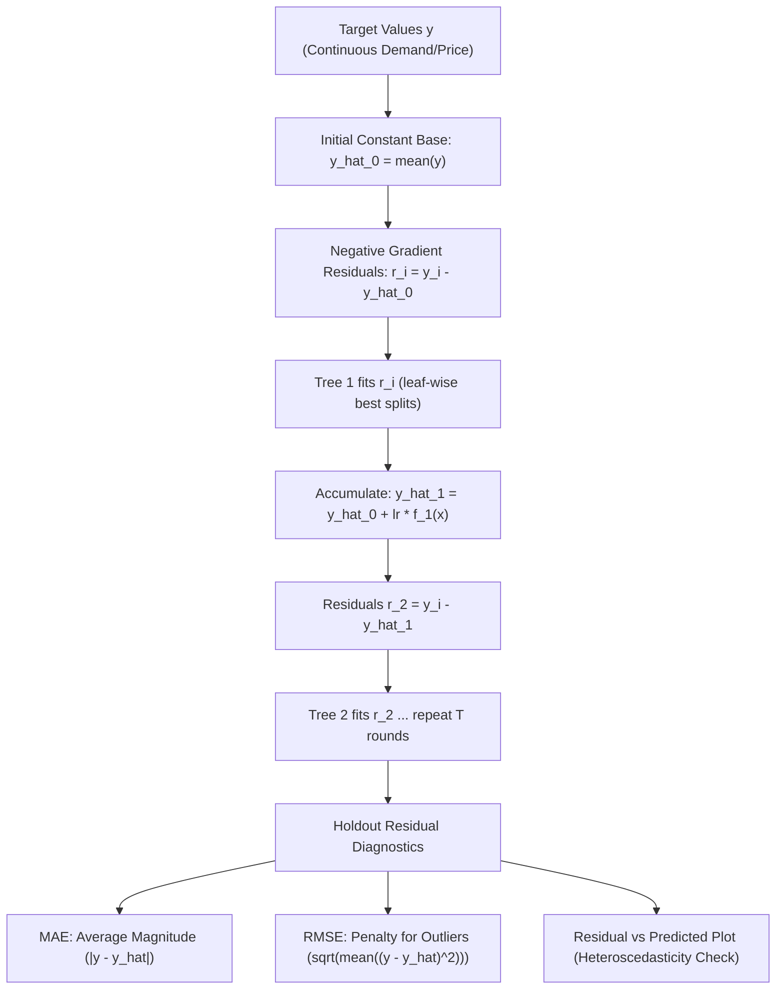

```python
from lightgbm import LGBMRegressor
from sklearn.datasets import make_regression
from sklearn.model_selection import train_test_split
from sklearn.metrics import mean_absolute_error, root_mean_squared_error

X, y = make_regression(n_samples=550, n_features=8, noise=25, random_state=17)
Xtr, Xte, ytr, yte = train_test_split(X, y, test_size=.2, random_state=42)
reg = LGBMRegressor(n_estimators=100, num_leaves=15,
                    learning_rate=.07, verbosity=-1, random_state=42)
reg.fit(Xtr, ytr)
pred = reg.predict(Xte)
print('MAE:', round(mean_absolute_error(yte, pred), 2))
print('RMSE:', round(root_mean_squared_error(yte, pred), 2))
```

## MAE vs RMSE

- **MAE** is the typical absolute difference in units of the target.
- **RMSE** penalizes large errors more heavily because it squares residuals.
- **Residual** = actual value minus predicted value. Residual plots can reveal bias, outliers and unexplained patterns.

If your observations have a time order, split chronologically rather than randomly. Random splits often create unrealistic forecasting evaluations.

**Hands-on:** Run `python -m labs.lab02_lgbm_regression` to visualize predicted values and residuals.


**Try it:** Add a baseline using `DummyRegressor(strategy='mean')`. Does LightGBM consistently improve RMSE on your dataset?

---

# LightGBM Dataset and Booster: Native Python Training

LightGBM provides two main Python entry points:

| API | Works with | Best for |
| --- | --- | --- |
| `LGBMClassifier` / `LGBMRegressor` | DataFrame / ndarray | scikit-learn workflows and tuning |
| `Dataset` + `lgb.train()` | `lightgbm.Dataset` | Native callbacks, training details and `Booster` control |

A `Dataset` is a training-oriented representation that supports feature binning, labels and categorical metadata. A validation `Dataset` should reference the training one, to reuse training preprocessing metadata such as bin boundaries.

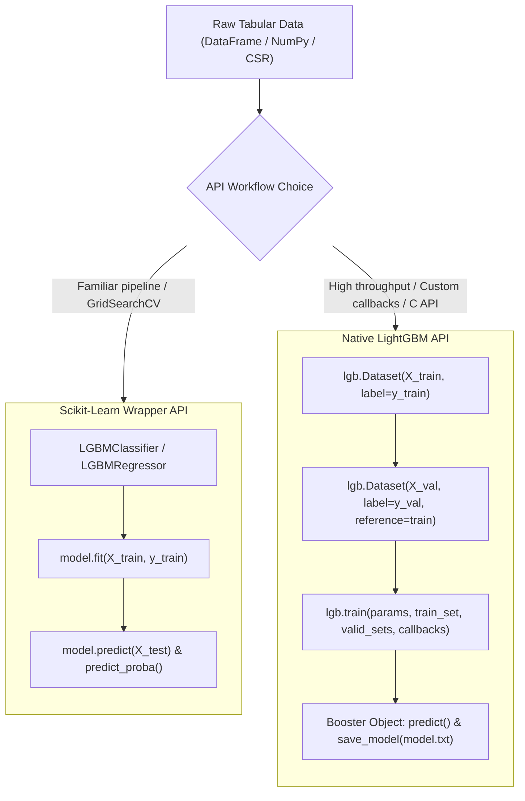

```python
import lightgbm as lgb
from sklearn.datasets import make_classification
from sklearn.model_selection import train_test_split

X, y = make_classification(n_samples=400, n_features=8, random_state=7)
Xtr, Xval, ytr, yval = train_test_split(X, y, test_size=.25,
                                        stratify=y, random_state=42)
train = lgb.Dataset(Xtr, label=ytr)
valid = lgb.Dataset(Xval, label=yval, reference=train)
params = {'objective':'binary', 'metric':'auc', 'learning_rate': .08,
          'num_leaves': 7, 'verbosity': -1, 'num_threads': 2}
booster = lgb.train(params, train, num_boost_round=35,
                    valid_sets=[valid], callbacks=[lgb.log_evaluation(0)])
print('Rows predicted:', len(booster.predict(Xval)))
```

## `Dataset` vs raw NumPy arrays

A NumPy matrix is an input container. `Dataset` is a LightGBM-specific structure prepared for training and can store a compact representation of features. It is not a drop-in replacement for a pandas DataFrame in general Python code.

**Practical tip:** A fresh evaluation dataset may use `reference=train` for consistent binning, as in the example. For huge datasets, memory settings and creating unnecessary copies matter.

**Try it:** Replace the `Xtr` array with a pandas DataFrame with the same feature values and names.

---

# LightGBM Early Stopping: Validation Without Data Leakage

**Early stopping chooses the number of boosting rounds using validation performance.** The final test set must not choose that number.

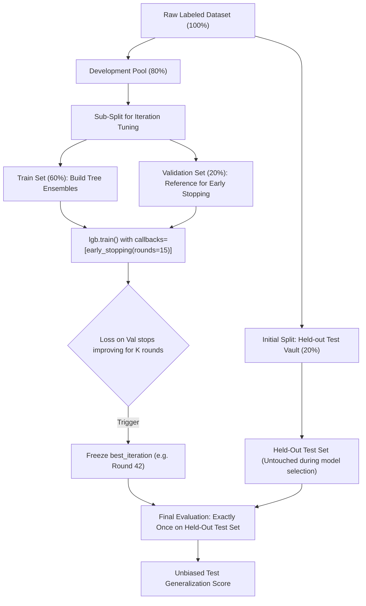

```python
import lightgbm as lgb
from sklearn.datasets import make_classification
from sklearn.model_selection import train_test_split

X, y = make_classification(n_samples=650, n_features=10, random_state=9)
Xdev, Xtest, ydev, ytest = train_test_split(X, y, test_size=.2,
                                           stratify=y, random_state=42)
Xtr, Xval, ytr, yval = train_test_split(Xdev, ydev, test_size=.25,
                                        stratify=ydev, random_state=42)
train = lgb.Dataset(Xtr, label=ytr)
valid = lgb.Dataset(Xval, label=yval, reference=train)
metrics = {}
booster = lgb.train({'objective':'binary','metric':'binary_logloss',
    'learning_rate':.05,'num_leaves':12,'verbosity':-1,'num_threads':2},
    train, num_boost_round=180, valid_sets=[valid],
    callbacks=[lgb.early_stopping(12, verbose=False),
               lgb.record_evaluation(metrics)])
print('Best iteration:', booster.best_iteration)
print('Final test predictions:', len(booster.predict(Xtest)))
```

## Why `callbacks`?

Modern LightGBM Python examples supply `lgb.early_stopping(...)` through `callbacks`. Avoid outdated examples that put `early_stopping_rounds` directly into `fit()` without checking the installed API.

**Hands-on:** `python -m labs.lab03_dataset_early_stopping` records training and validation loss separately.


**Pitfall:** Early stopping is not available for every boosting configuration (for example, DART ignores this callback). When tuning hyperparameters, reserve validation data or use an appropriate cross-validation scheme.

---

# LightGBM Parameters: num_leaves, max_bin and Fast Training

LightGBM is designed to use histogram-based splitting and leaf-wise growth. These make it a useful choice for large tabular datasets, but there is no universally best `num_leaves`, `max_bin` or number of threads.

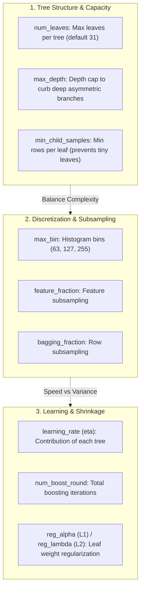

## Five parameters that matter most

| Parameter | What it controls | Practical starting idea |
| --- | --- | --- |
| `num_leaves` | Maximum leaves per tree | Start modestly, then validate larger trees |
| `min_child_samples` (sklearn) / `min_data_in_leaf` (native) | Minimum samples per leaf | Raise it when small data overfits |
| `learning_rate` | Contribution of each tree | Lower it with more boosting rounds |
| `max_bin` | Number of histogram bins | Fewer may save memory but lose detail |
| `feature_fraction` / `colsample_bytree` | Fraction of features per tree | Useful for regularization and speed |

### Why leaf-wise can overfit

Imagine a tree that repeatedly splits a very small leaf: it can fit training irregularities rather than general patterns. Restrict depth and/or leaf count and monitor validation metrics.

```python
from lightgbm import LGBMClassifier
from sklearn.datasets import make_classification
X, y = make_classification(n_samples=450, n_features=12, random_state=12)
model = LGBMClassifier(n_estimators=60, num_leaves=15,
    max_depth=5, min_child_samples=25, max_bin=127,
    n_jobs=2, verbosity=-1, random_state=42)
model.fit(X, y)
print('Trees:', model.n_estimators_)
```

## Benchmarking fairly

Compare models with the same **dataset, hardware, train/validation split and accuracy target**. Include preprocessing and peak memory, not only `.fit()` time. Set thread counts, warm up the runtime, repeat timing, and report mean/variation. Avoid claims such as “always 10x faster” based on a single result.

**Try it:** With validation held constant, compare `max_bin=63` and `max_bin=255` and record runtime plus ROC AUC. Which tradeoff works for your actual workload?

---

# LightGBM Categorical Features and Missing Values in pandas

LightGBM supports categorical features directly. You generally do not have to one-hot encode a pandas column with `category` dtype. You **do** have to keep feature names and category meanings consistent at inference.

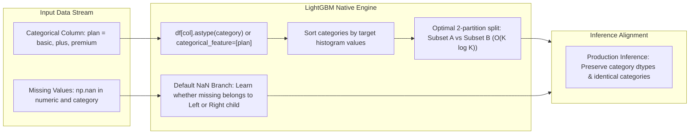

```python
import pandas as pd
from lightgbm import LGBMClassifier

frame = pd.DataFrame({
    'price': [10,15,12,25,22,30,11,27,21,13],
    'plan': pd.Categorical(['basic','plus','basic','premium','premium',
                           'plus','basic','premium','plus','basic'])
})
labels = [0,0,0,1,1,1,0,1,1,0]
model = LGBMClassifier(n_estimators=20, num_leaves=3,
    min_child_samples=1, verbosity=-1, random_state=42)
model.fit(frame, labels, categorical_feature=['plan'])
print(model.predict_proba(frame)[:2])
```

## Missing values

Numerical NaNs are supported. Missing categories can be represented by missing values in pandas categorical columns. This **does not** mean it is safe to introduce arbitrary new category encodings or change column order in production.

**Avoid:** converting unseen categories to unrelated integer codes, fitting new category mappings on a test set, and dropping missing rows without understanding bias.

**Hands-on:** Run `python -m labs.lab04_categorical_save` to learn from categorical `plan` and `region` columns, with deliberately missing values, then reload the saved Booster.


**Try it:** Add an unseen plan in a separate inference DataFrame. Investigate how that value is represented after mapping into the training categories.

---

# LightGBM GridSearchCV: Tune Parameters Correctly

Hyperparameters describe how a model learns. **Model selection uses training or validation data.** The final test set is for an independent estimate after you have decided on the final model.

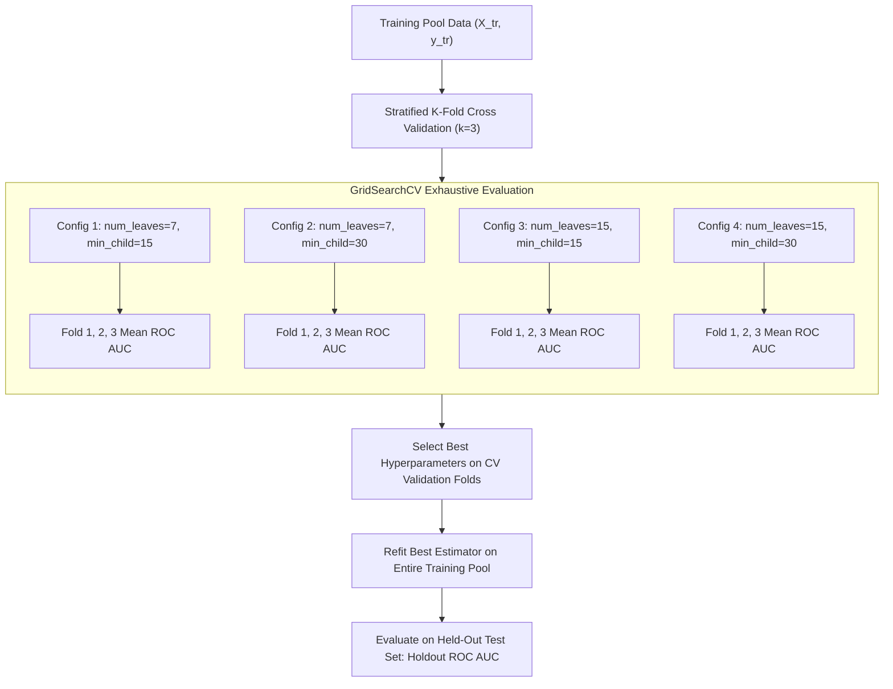

```python
from lightgbm import LGBMClassifier
from sklearn.datasets import make_classification
from sklearn.model_selection import GridSearchCV, StratifiedKFold, train_test_split

X, y = make_classification(n_samples=420, n_features=10, random_state=5)
Xtr, Xte, ytr, yte = train_test_split(X, y, test_size=.2,
                                     stratify=y, random_state=42)
search = GridSearchCV(
    LGBMClassifier(n_estimators=60, verbosity=-1, n_jobs=2, random_state=42),
    {'num_leaves':[7,15], 'min_child_samples':[15,30]},
    scoring='roc_auc', cv=StratifiedKFold(3, shuffle=True, random_state=42),
    n_jobs=1,
)
search.fit(Xtr, ytr)
print('Selected:', search.best_params_)
print('Holdout ROC AUC:', round(search.score(Xte, yte), 3))
```

**Important:** Here `GridSearchCV.score()` reports ROC AUC because `scoring='roc_auc'` was selected. In the complete Lab 05, the result is explicitly named `test_auc`.

| Method | Advantage | Tradeoff |
| --- | --- | --- |
| Manual train/validation split | Easy to understand | High variance on small datasets |
| `GridSearchCV` | Exhaustive small search | Cost grows with grid size |
| Randomized search | Samples broader spaces | May miss promising configurations |
| Early stopping | Chooses boosting rounds | Needs careful validation management |

**Hands-on:** Run `python -m labs.lab05_tuning` to compare eight candidate combinations and plot the final ROC curve.


**Exercise:** Add `max_depth=4` to the search and predict how the grid size changes.

---

# LightGBM Production: Save Models, Sparse Data and Feature Importance

A trained LightGBM model is an artifact. Reliable prediction also depends on **the data schema**, feature order, categorical codes, validation protocol and dependency versions.

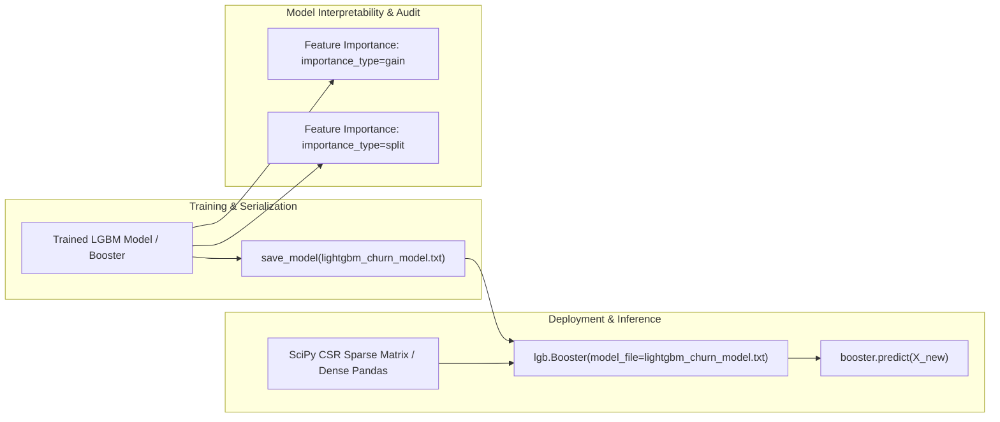

## Save and reload the Booster

```python
from pathlib import Path
import lightgbm as lgb
from sklearn.datasets import make_classification

X, y = make_classification(n_samples=350, n_features=6, random_state=42)
model = lgb.LGBMClassifier(n_estimators=30, num_leaves=7,
                           verbosity=-1, random_state=42)
model.fit(X, y)
artifact = Path('lightgbm_example_model.txt')
model.booster_.save_model(str(artifact))
loaded = lgb.Booster(model_file=str(artifact))
print('Reloaded probabilities:', loaded.predict(X[:3]).round(3))
artifact.unlink()
```

The native Booster's `.txt` model is a supported LightGBM model format; it is **not** XGBoost JSON. For a scikit-learn wrapper, separately store your preprocessing and configuration as needed. Serialize only trusted artifacts.

## Sparse datasets

LightGBM supports SciPy sparse matrices. Sparse input may reduce memory for high-dimensional, mostly-zero features; measure your actual memory footprint rather than assuming sparse is always better.

```python
import numpy as np
from scipy.sparse import csr_matrix
import lightgbm as lgb
X = csr_matrix(np.eye(12))
y = np.array([0, 1] * 6)
dataset = lgb.Dataset(X, label=y)
print('Sparse shape:', X.shape)
```

## Production checklist

- Persist features, categorical mappings, target meaning and any preprocessing.
- Keep training, validation and test responsibilities separate.
- Monitor missing-rate changes, categorical drift, performance and latency.
- Benchmark threads, histograms and memory on deployment hardware.
- Verify save/reload predictions and define a rollback plan.

**Interpretation caution:** feature gain/split counts describe the model's usage of variables. They do not measure causal effects or prove fairness. Consider permutation importance or SHAP only with appropriate assumptions and safeguards.

---

# Five LightGBM Python Projects: Beginner to Production Workflow

All five labs run locally with synthetic data. No external dataset download, GPU or account credentials are needed.

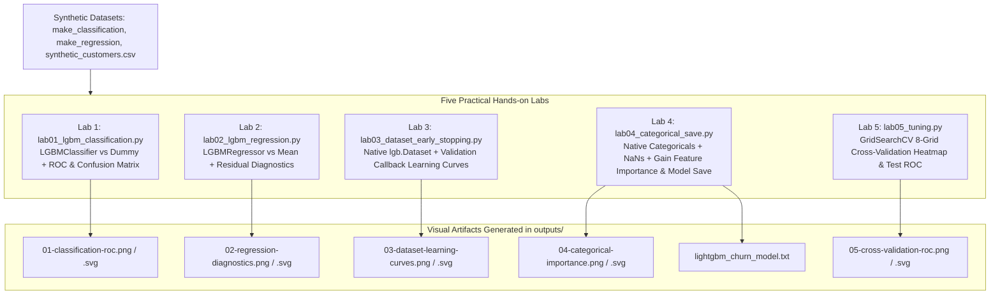

| Lab | Script | What you build | Output |
| --- | --- | --- | --- |
| 01 | `labs/lab01_lgbm_classification.py` | Binary classifier + ROC and confusion matrix | `01-classification-roc.png` |
| 02 | `labs/lab02_lgbm_regression.py` | Numerical regression + residual analysis | `02-regression-diagnostics.png` |
| 03 | `labs/lab03_dataset_early_stopping.py` | Native Dataset + callbacks | `03-dataset-learning-curves.png` |
| 04 | `labs/lab04_categorical_save.py` | Categorical learning, NaNs, model reload | `04-categorical-importance.png` |
| 05 | `labs/lab05_tuning.py` | GridSearchCV + final ROC curve | `05-cross-validation-roc.png` |

Run from the repository root:

```bash
python -m pip install -r requirements.txt
python -m labs.lab01_lgbm_classification
python -m labs.lab02_lgbm_regression
python -m labs.lab03_dataset_early_stopping
python -m labs.lab04_categorical_save
python -m labs.lab05_tuning
```

Each lab prints its metrics and creates real PNG and SVG charts under `outputs/`. Lab 04 also writes a native LightGBM model text file (`outputs/lightgbm_churn_model.txt`).

## Capstone challenge

Start with the synthetic customer dataset in `data/synthetic_customers.csv` and build a churn dashboard:

1. Check label prevalence, missing values and basic categorical distributions.
2. Set aside a test set before exploring model variants.
3. Use a validation set to select hyperparameters and decision thresholds.
4. Compare a dummy baseline, logistic regression and LightGBM.
5. Save the model and document how features must be prepared for inference.
6. Present **test** ROC AUC, precision, recall, latency and the limitations of synthetic data.

### When should you choose XGBoost or CatBoost instead?

LightGBM is an especially useful candidate for large structured datasets. XGBoost, CatBoost, linear models and smaller models can be competitive. Benchmark real data: dataset size, cardinality, missingness and hardware affect the outcome.

**Final exercise:** Reproduce Lab 03 using `LGBMClassifier.fit()` and callback-based early stopping, then compare the selected number of boosting rounds.

---

# LightGBM Python Cheat Sheet

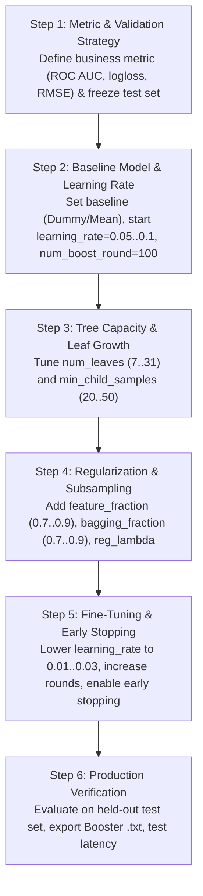

| Task | Minimal API | Key note |
| --- | --- | --- |
| Install | `pip install lightgbm` | Check Python compatibility in the official install guide |
| Classification | `LGBMClassifier().fit(X, y)` | `predict_proba(X)[:, 1]` for binary positive class |
| Regression | `LGBMRegressor().fit(X, y)` | Predict numerical targets |
| Native dataset | `lgb.Dataset(X, label=y)` | Bin-oriented training container |
| Native training | `lgb.train(params, train, num_boost_round=100)` | Returns `Booster` |
| Early stopping | `callbacks=[lgb.early_stopping(20)]` | Needs validation data / supported boosting setup |
| History | `lgb.record_evaluation(history)` | Save metric series |
| Category support | `astype('category')` | Keep consistent categories and feature names |
| Save model | `model.booster_.save_model('model.txt')` | Reload with `lgb.Booster(model_file=...)` |
| Feature importance | `booster.feature_importance(importance_type='gain')` | Not proof of causality |

## Parameter glossary

- `n_estimators`: boosting rounds in sklearn wrappers
- `num_boost_round`: rounds in native `lgb.train`
- `learning_rate`: how much each tree contributes
- `num_leaves`: maximum leaves in one tree
- `max_depth`: upper bound on tree depth; `-1` means no explicit limit
- `min_child_samples` / `min_data_in_leaf`: minimum examples per leaf
- `max_bin`: histogram discretization resolution
- `colsample_bytree` / `feature_fraction`: fraction of feature columns per tree
- `subsample` / `bagging_fraction`: row subsampling; also configure subsample frequency
- `reg_lambda`, `reg_alpha`: L2 and L1 penalties
- `n_jobs` / `num_threads`: thread control
- `verbosity`: console output

**Three critical rules:** hold out the final test set, choose evaluation metrics before tuning, and save the preprocessing/schema together with any deployed model.

---

# LightGBM FAQ

## What is LightGBM used for?
LightGBM trains boosted decision trees on tabular data for classification, regression and ranking. It is useful when a problem has structured columns with meaningful predictive patterns.

## Is LightGBM always faster than XGBoost?
No. Histogram implementations, preprocessing, threading, sparse layout and hyperparameters differ; benchmark on your own dataset and hardware, including the quality target and memory.

## What is `lightgbm.Dataset`?
It is a LightGBM training container for feature bins, labels and optional categorical metadata. The scikit-learn wrappers accept raw DataFrames and arrays directly.

## Does LightGBM support categorical strings?
Use pandas categorical dtype or supported categorical encoding. Plain arbitrary object/string columns are not interchangeable with a correctly typed categorical feature matrix.

## How does LightGBM handle missing data?
It has built-in handling for missing numerical values and categorical missingness; the correct treatment of missingness still depends on your data semantics and collection process.

## What is the difference between leaf-wise and level-wise growth?
Leaf-wise chooses a leaf with high estimated gain to split next, whereas level-wise grows all leaves in a level. Leaf-wise can be efficient and expressive but requires overfitting controls.

## Do I need a GPU?
No. All five projects run on a CPU. GPU can help some workloads but adds setup and does not guarantee faster results on every dataset.

## What should I tune first?
Start with meaningful validation, `num_leaves`, minimum examples per leaf, learning rate, boosting rounds and a stable metric. Keep the final holdout untouched.

## How do I save a LightGBM model?
Use a native Booster `save_model('model.txt')` and reload with `lgb.Booster(model_file='model.txt')`, or use an appropriate trusted persistence mechanism for the full sklearn pipeline.

## Can I use a SciPy sparse CSR matrix?
Yes. LightGBM accepts sparse matrices, which may save memory for wide sparse tables. Measure performance for your particular data distribution.

## Is it safe to use test data for early stopping?
No. Early stopping selects model complexity and therefore requires validation data. Evaluate the final test split once after selection.

## Can LightGBM explain why an outcome happens?
Model-based feature importance can indicate which features the fitted model uses, not prove causes. Additional causal and fairness analysis is necessary for consequential uses.

---

# LightGBM Glossary

| Term | Meaning |
| --- | --- |
| Gradient boosting | Trains sequential models to improve an objective |
| GBDT | Gradient Boosted Decision Trees |
| Histogram binning | Groups feature values into discrete bins for split search |
| Leaf-wise growth | Splits the most promising leaf based on an objective improvement |
| `num_leaves` | Upper bound on leaves per tree |
| `Dataset` | Native LightGBM training data wrapper |
| `Booster` | Trained native LightGBM ensemble |
| Early stopping | Chooses iteration count using validation metrics |
| ROC AUC | Measures binary ranking quality across thresholds |
| RMSE | Square root of average squared regression error |
| Data leakage | Information from outside the allowed training data influences learning/selection |
| Categorical feature | A column of distinct groups such as product plan |
| Sparse matrix | Representation storing mostly nonzero entries rather than all values |
| Gain importance | Sum of split objective improvements attributed to a feature |
| `best_iteration` | Best selected boosting iteration from validation when early stopping is used |

## Sources and additional reading

- [Official LightGBM Python API](https://lightgbm.readthedocs.io/en/stable/Python-API.html)
- [LightGBM Features](https://lightgbm.readthedocs.io/en/stable/Features.html)
- [LightGBM Tuning](https://lightgbm.readthedocs.io/en/stable/Parameters-Tuning.html)
