# CatBoost Complete Guide: Python Tutorial, Pool, Categories & Five ML Labs

> Standalone, offline-friendly learning book. The examples are written for CatBoost 1.2.8+ APIs and tested with CatBoost 1.2.8. See [official CatBoost documentation](https://catboost.ai/docs/).

## Table of Contents

- [What Is CatBoost? Gradient Boosting for Categorical Data](#what-is-catboost-gradient-boosting-for-categorical-data)
- [CatBoostClassifier Tutorial: Binary Classification in Python](#catboostclassifier-tutorial-binary-classification-in-python)
- [CatBoostRegressor Tutorial: Predict Numbers and Check Residuals](#catboostregressor-tutorial-predict-numbers-and-check-residuals)
- [CatBoost Pool Tutorial: DataFrames and Categorical Features](#catboost-pool-tutorial-dataframes-and-categorical-features)
- [CatBoost Categorical Features: Missing Values and Unseen Labels](#catboost-categorical-features-missing-values-and-unseen-labels)
- [CatBoost Early Stopping: Train, Validation and Test Splits](#catboost-early-stopping-train-validation-and-test-splits)
- [CatBoost Hyperparameters: iterations, depth and learning_rate](#catboost-hyperparameters-iterations-depth-and-learningrate)
- [CatBoost Evaluation: ROC AUC, Precision, Recall and Class Imbalance](#catboost-evaluation-roc-auc-precision-recall-and-class-imbalance)
- [CatBoost Model Saving, Feature Importance and Production Inference](#catboost-model-saving-feature-importance-and-production-inference)
- [Five CatBoost Python Projects: Beginner to Production Workflow](#five-catboost-python-projects-beginner-to-production-workflow)
- [CatBoost Python Cheat Sheet](#catboost-python-cheat-sheet)
- [Frequently Asked Questions](#frequently-asked-questions)
- [Glossary](#glossary)
- [Official References](#official-references)

---

# What Is CatBoost? Gradient Boosting for Categorical Data

CatBoost is a gradient-boosted decision-tree (GBDT) library. A tree makes a prediction by splitting features; boosting adds more trees to correct earlier errors. CatBoost is especially useful when a table contains a mixture of numbers and categories such as `region`, `plan`, or `product_type`.

**Quick answer:** Start with `CatBoostClassifier` for categories and `CatBoostRegressor` for numerical targets. You can train with NumPy arrays, pandas DataFrames, or the lower-level `Pool` object.

## Three ideas to remember

1. **Boosting:** many small trees work together rather than fitting one large tree.
2. **Categorical features:** pass the column names in `cat_features`; do not automatically one-hot encode everything.
3. **Validation:** evaluate on rows not seen during fitting and compare with a simple baseline.

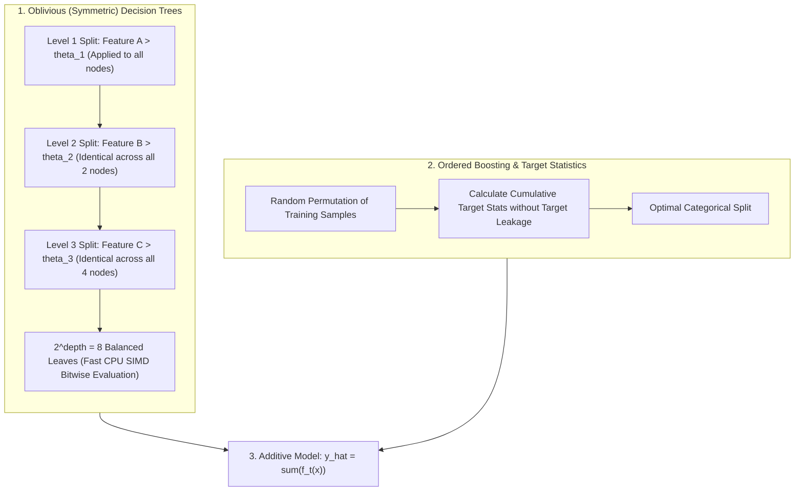

```python
import catboost
from catboost import CatBoostClassifier, CatBoostRegressor, Pool
print('CatBoost:', catboost.__version__)
print(CatBoostClassifier.__name__, CatBoostRegressor.__name__, Pool.__name__)
```

## CatBoost versus XGBoost and LightGBM

All three are serious choices for tabular ML. CatBoost offers convenient native handling of string categories and ordered target-statistics methods. XGBoost and LightGBM also support categorical workflows with different data requirements. **No library guarantees the best accuracy:** use matching train/test splits, metrics, compute budgets and tuning effort before comparing.

**Try it:** Name a categorical column from a data table and a numerical column. Which one belongs in `cat_features`?

---

# CatBoostClassifier Tutorial: Binary Classification in Python

Binary classification predicts one of two outcomes, such as churn vs. retention. `predict()` gives class labels and `predict_proba()` gives class probabilities.

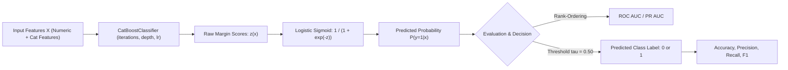

## Minimal example

```python
from catboost import CatBoostClassifier
from sklearn.datasets import make_classification
from sklearn.model_selection import train_test_split
from sklearn.metrics import roc_auc_score

X, y = make_classification(n_samples=280, n_features=6,
                           n_informative=4, random_state=42)
X_train, X_test, y_train, y_test = train_test_split(
    X, y, test_size=0.25, stratify=y, random_state=42)
model = CatBoostClassifier(iterations=70, depth=4,
                           verbose=False, random_seed=42,
                           allow_writing_files=False)
model.fit(X_train, y_train)
p = model.predict_proba(X_test)[:, 1]
print('Held-out ROC AUC:', round(roc_auc_score(y_test, p), 3))
```

## What to check

- Compare to `DummyClassifier` or logistic regression to understand the baseline.
- Examine class balance before judging accuracy.
- Keep the test split untouched while changing parameters.
- For actual decisions, select the probability threshold using validation data and costs.

**Run the full lab:** `python -m labs.lab01_catboost_classification`.


**Try it:** Change `depth=4` to `depth=2`. Does the test ROC AUC always improve?

---

# CatBoostRegressor Tutorial: Predict Numbers and Check Residuals

Use regression when the target is numerical: price, demand, latency, or time-to-resolution. CatBoost optimizes a regression objective such as `RMSE` and predicts real numbers.

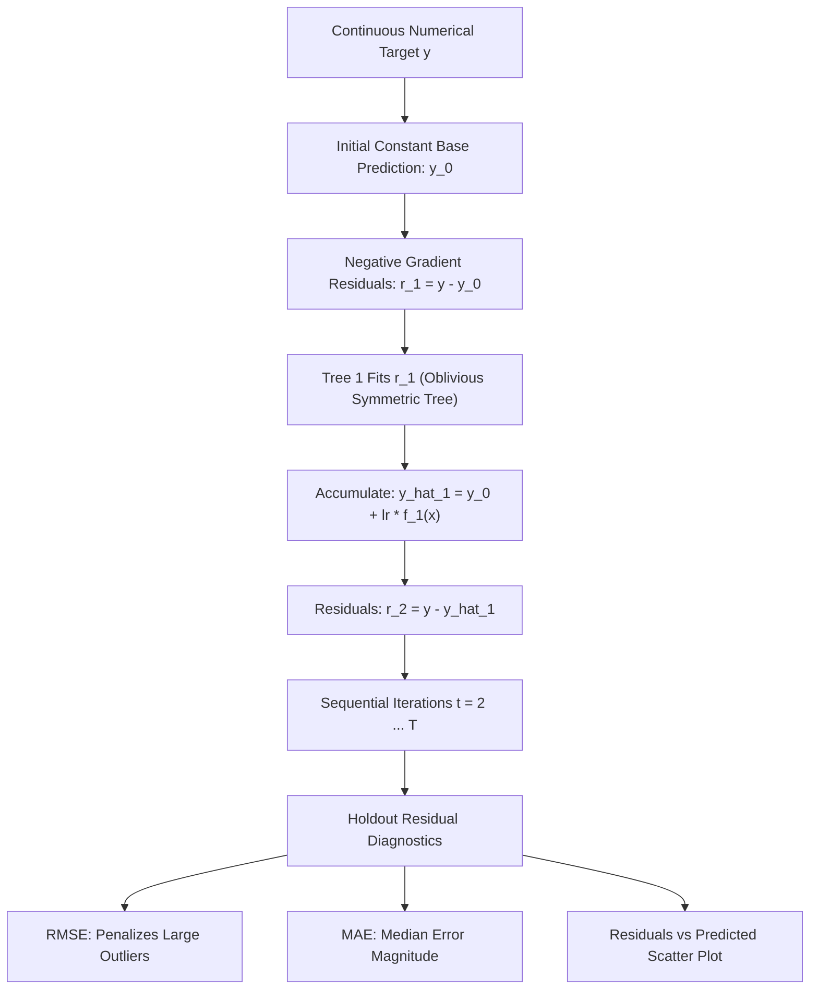

```python
import numpy as np
from catboost import CatBoostRegressor
from sklearn.datasets import make_friedman1
from sklearn.model_selection import train_test_split
from sklearn.metrics import mean_absolute_error, mean_squared_error

X, y = make_friedman1(n_samples=280, noise=1.0, random_state=7)
X_train, X_test, y_train, y_test = train_test_split(
    X, y, test_size=0.25, random_state=42)
model = CatBoostRegressor(iterations=100, depth=4,
                          verbose=False, random_seed=42,
                          allow_writing_files=False)
model.fit(X_train, y_train)
pred = model.predict(X_test)
print('MAE:', round(mean_absolute_error(y_test, pred), 3))
print('RMSE:', round(np.sqrt(mean_squared_error(y_test, pred)), 3))
```

**MAE** is average absolute error, in the target's units. **RMSE** penalizes large errors more strongly. A **residual** is the actual value minus the predicted value; patterns in residuals can reveal bias or missing features.

**Run the full lab:** `python -m labs.lab02_catboost_regression`.


**Try it:** Compare the RMSE with a `DummyRegressor(strategy='mean')` baseline.

---

# CatBoost Pool Tutorial: DataFrames and Categorical Features

`Pool` is CatBoost's native dataset wrapper. It can keep labels, feature names, weights, and categorical feature specifications together.

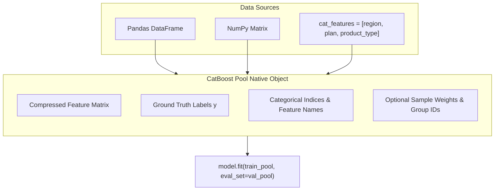

```python
from catboost import Pool, CatBoostClassifier
from data.generate_dataset import make_customers, prepare_categories, CATEGORICAL

df = prepare_categories(make_customers(n=200))
X = df.drop(columns='churned')
y = df['churned']
train_pool = Pool(X, label=y, cat_features=CATEGORICAL)
model = CatBoostClassifier(iterations=40, depth=3,
                           verbose=False, random_seed=42,
                           allow_writing_files=False)
model.fit(train_pool)
print('Rows:', train_pool.num_row())
print('Categorical indices:', train_pool.get_cat_feature_indices())
```

## Two important rules

- For string column names in `cat_features`, use a DataFrame with named columns or specify `feature_names` explicitly.
- Keep the same feature schema at inference time, including column meaning and categorical types.

`Pool` can also hold instance weights and ranking group IDs. This course uses `Pool` for binary classification, but the pattern extends to other CatBoost tasks.

**Try it:** Add one category to the DataFrame. What needs to change in `CATEGORICAL`?

---

# CatBoost Categorical Features: Missing Values and Unseen Labels

CatBoost can learn from numeric missing values, but **categorical NaN values should first be converted into stable strings** (or valid integer categories). This makes your categorical schema reproducible.

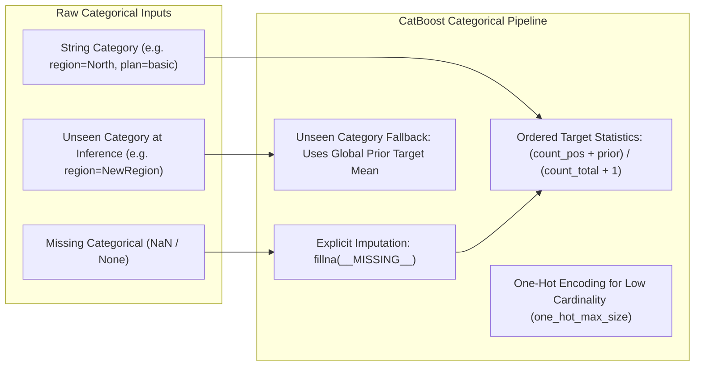

```python
from catboost import Pool, CatBoostClassifier
from data.generate_dataset import make_customers, prepare_categories, CATEGORICAL

df = prepare_categories(make_customers(n=220))
X, y = df.drop(columns='churned'), df['churned']
model = CatBoostClassifier(iterations=55, depth=3,
                           verbose=False, random_seed=42,
                           allow_writing_files=False)
model.fit(Pool(X, y, cat_features=CATEGORICAL))
new_rows = X.head(2).copy()
new_rows['region'] = 'NewRegion'
print(model.predict_proba(Pool(new_rows, cat_features=CATEGORICAL))[:, 1])
```

For missing numeric values, keep `NaN` and let CatBoost's numerical missing-value handling work. For missing categories, use one explicit token such as `__MISSING__` consistently in training, validation and production.

**Don't** use `.astype(str)` alone on random missing values without deciding whether the resulting string (`'nan'`, `'None'`, etc.) matches your production convention.

**Run the full lab:** `python -m labs.lab04_categorical_model`.


**Try it:** What happens if your production input changes a categorical column from strings to floats?

---

# CatBoost Early Stopping: Train, Validation and Test Splits

Increasing the number of trees improves fit until the model starts learning noise. **Early stopping** monitors validation performance and stops training after a period without improvement.

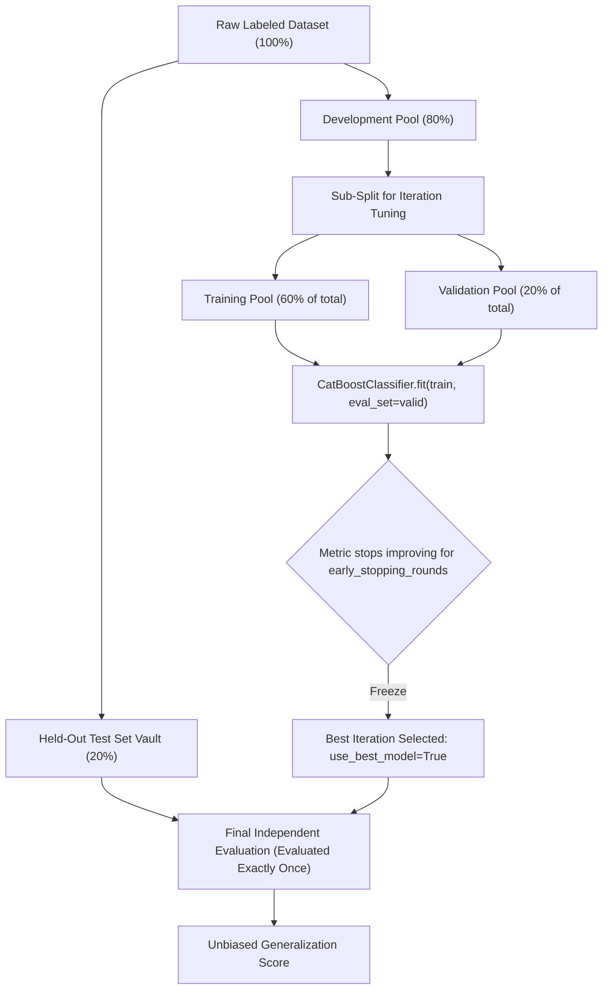

```python
from catboost import CatBoostClassifier, Pool
from sklearn.model_selection import train_test_split
from data.generate_dataset import make_customers, prepare_categories, CATEGORICAL

df = prepare_categories(make_customers(n=350))
X, y = df.drop(columns='churned'), df['churned']
X_train, X_val, y_train, y_val = train_test_split(
    X, y, test_size=0.25, stratify=y, random_state=42)
train = Pool(X_train, y_train, cat_features=CATEGORICAL)
valid = Pool(X_val, y_val, cat_features=CATEGORICAL)
model = CatBoostClassifier(iterations=130, depth=4,
                           verbose=False, random_seed=42,
                           allow_writing_files=False)
model.fit(train, eval_set=valid, early_stopping_rounds=15,
          use_best_model=True)
print('Best iteration:', model.get_best_iteration())
```

**Important:** This short example has only training and validation sets for demonstration. The complete Lab 03 reserves an **independent test set before** creating the training/validation split, then evaluates it only once.

The `get_evals_result()` method returns training and validation metrics for plotting. The final number of saved trees can differ from the requested `iterations` when `use_best_model=True`.

**Run the full lab:** `python -m labs.lab03_pool_early_stopping`.


---

# CatBoost Hyperparameters: iterations, depth and learning_rate

Most tabular tasks can start with a short list of parameters:

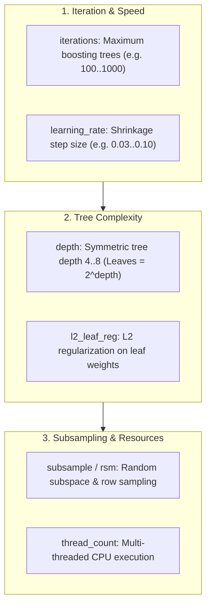

| Parameter | Meaning | Typical effect |
| --- | --- | --- |
| `iterations` | Maximum boosting rounds | More rounds can improve fit but cost time |
| `learning_rate` | Contribution of each new tree | Lower values often need more rounds |
| `depth` | Depth of symmetric trees | Larger depth can fit more complex patterns |
| `l2_leaf_reg` | Regularizes leaf predictions | Can reduce overfitting |
| `random_seed` | Random state | Supports reproducibility |
| `thread_count` | CPU training threads | Controls local resource use |

## Inspect a simple parameter grid

```python
from sklearn.model_selection import ParameterGrid
candidates = list(ParameterGrid({
    'depth': [3, 5],
    'learning_rate': [0.04, 0.10]
}))
print('Candidate settings:', len(candidates))
print(candidates[0])
```

The full Lab 05 uses **manual `StratifiedKFold` cross-validation** so it runs with the local CatBoost 1.2.8+ and scikit-learn combination, where native `GridSearchCV` triggers an estimator-tag compatibility error. This is not a fundamental limit of CatBoost; check version compatibility before using sklearn's automatic search wrappers.

Do not choose hyperparameters based on repeated peeks at the final test set. Optimize CV scores on training data, fit the selected model on the training split, then report a single final holdout result.

**Run the full lab:** `python -m labs.lab05_cross_validation`.


---

# CatBoost Evaluation: ROC AUC, Precision, Recall and Class Imbalance

A model can have high accuracy yet perform poorly on rare events. Choose evaluation measures based on what a wrong decision costs:

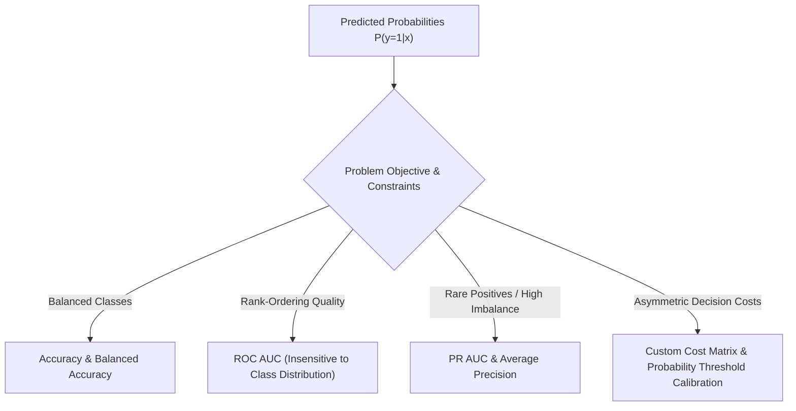

| Metric | Helps answer |
| --- | --- |
| Accuracy | How often is the predicted class correct? |
| Precision | Among alerts, how many are correct? |
| Recall | Among actual positives, how many are found? |
| ROC AUC | How well does the model rank classes over thresholds? |
| Average precision | How well does the model retrieve positives across precision–recall tradeoffs? |
| Log loss | Are predicted probabilities well calibrated to labels? |

```python
from sklearn.metrics import precision_score, recall_score, roc_auc_score
true = [0, 0, 1, 1, 0, 1]
prob = [0.1, 0.3, 0.9, 0.45, 0.2, 0.7]
pred = [int(p >= 0.5) for p in prob]
print('Precision:', precision_score(true, pred))
print('Recall:', recall_score(true, pred))
print('ROC AUC:', round(roc_auc_score(true, prob), 3))
```

Consider PR AUC, cost-sensitive thresholds, calibration, and relevant subgroup analysis for high-impact use cases. Compare all metrics on untouched held-out data and document uncertainty when possible.

**Try it:** Change the cutoff from `0.5` to `0.4`. Which metric changes more, precision or recall?

---

# CatBoost Model Saving, Feature Importance and Production Inference

Model training is not the entire production workflow. You also need stable feature names, categorical missing-value conventions, model versioning, monitoring, and a reproducible train/test procedure.

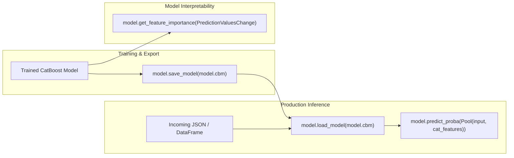

## Save and load a native model

```python
from pathlib import Path
from tempfile import TemporaryDirectory
from catboost import CatBoostClassifier

X = [[0.1], [0.9], [0.2], [0.8], [0.3], [0.7]]
y = [0, 1, 0, 1, 0, 1]
model = CatBoostClassifier(iterations=25, depth=2,
                           verbose=False, random_seed=42,
                           allow_writing_files=False)
model.fit(X, y)
with TemporaryDirectory() as d:
    file = str(Path(d) / 'model.cbm')
    model.save_model(file)
    loaded = CatBoostClassifier()
    loaded.load_model(file)
    print('Prediction:', loaded.predict_proba([[0.6]])[0, 1])
```

**Use `.cbm` for the native model format.** JSON export is available, but interchange formats such as ONNX have limitations with categorical models—check format restrictions before relying on them. Avoid loading untrusted serialized artifacts.

Feature importance is useful for inspection but **not causality**. In Lab 04, `get_feature_importance()` gives a relative importance signal, not proof that a feature caused a change in outcome.

**Run the full lab:** `python -m labs.lab04_categorical_model`.

---

# Five CatBoost Python Projects: Beginner to Production Workflow

This final module combines earlier lessons into five runnable projects. Each one uses **synthetic offline data** and creates a PNG and SVG chart.

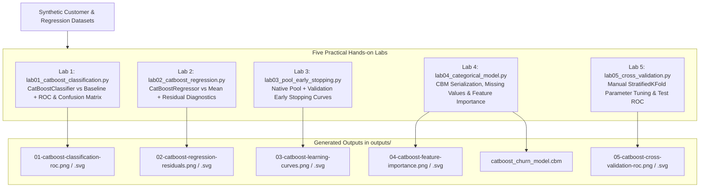

| Lab | Script | Outcome |
| --- | --- | --- |
| 01. Binary classification | `labs/lab01_catboost_classification.py` | ROC AUC and baseline accuracy |
| 02. Regression | `labs/lab02_catboost_regression.py` | RMSE and residual chart |
| 03. Native Pool | `labs/lab03_pool_early_stopping.py` | Train/validation learning curves, test AUC |
| 04. Categorical production | `labs/lab04_categorical_model.py` | CBM save/load, unseen categories, importance |
| 05. CV tuning | `labs/lab05_cross_validation.py` | Three-fold parameter selection, final ROC |

## Run from repository root

```bash
python -m pip install -r requirements.txt
python -m labs.lab01_catboost_classification
python -m labs.lab02_catboost_regression
python -m labs.lab03_pool_early_stopping
python -m labs.lab04_categorical_model
python -m labs.lab05_cross_validation
```

## What to put in your project report

- Problem statement, target, and unit of prediction
- Data source, missing-value rules, and categorical columns
- Split strategy and potential leakage paths
- Baseline model, evaluation metrics, and parameter search
- Final holdout scores and reproducibility limitations
- Deployment schema, model artifact, and monitoring plan

The included lab metrics are **demonstrations**, not claims about CatBoost's performance on real customer data.

---

# CatBoost Python Cheat Sheet

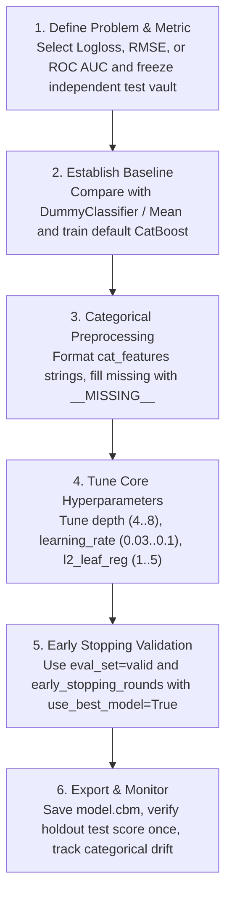

| Task | API / argument | Tip |
| --- | --- | --- |
| Binary classification | `CatBoostClassifier(loss_function='Logloss')` | Get probabilities with `predict_proba` |
| Regression | `CatBoostRegressor(loss_function='RMSE')` | Inspect MAE, RMSE and residuals |
| Native dataset | `Pool(X, label=y, cat_features=['region'])` | Strings in categorical columns, not NaN |
| pandas categories | `cat_features=['region', 'plan']` | Keep column names consistent |
| Early stopping | `fit(train, eval_set=valid, early_stopping_rounds=30)` | Only validation controls best iteration |
| Stop at best model | `use_best_model=True` | Requires validation data |
| Curves | `get_evals_result()` | Read train and validation metrics |
| Feature importance | `get_feature_importance()` | Relative signal, not causality |
| Save model | `save_model('model.cbm')` | Native CatBoost binary |
| Load model | `load_model('model.cbm')` | Preserve input schema |
| Cross-validation | `StratifiedKFold` | Select params using training data only |
| Categorical missing | `fillna('__MISSING__')` | Apply same policy at inference |

## Safe default sequence

```text
Define target → Split train/test → Split train/validation →
Prepare categorical schema → Train CatBoost → Stop on validation →
Evaluate once on test → Save model + schema → Monitor
```

## Quick fixes

- **Cannot convert NaN to string category:** explicitly fill categorical missing values before constructing a `Pool`.
- **Model trained but predictions fail:** verify identical input feature names, order and categorical types.
- **GridSearchCV errors with estimator tags:** check your installed CatBoost and sklearn version compatibility; manual folds are a portable fallback.
- **Perfect validation score:** audit leakage, duplicates, target-derived features and split strategy.

---

# Frequently Asked Questions

### What is CatBoost used for?

Classification, regression and ranking on structured datasets. It is particularly convenient for tables that contain string categories.

### Is CatBoost always more accurate than XGBoost or LightGBM?

No. Accuracy depends on data, validation method, metrics and tuning. Compare all three with the same split and evaluation budget.

### What is a CatBoost `Pool`?

A dataset wrapper that combines features, optional labels and categorical column metadata.

### Do I have to one-hot encode string categories?

Not for CatBoost's native categorical workflow. Pass the relevant column names or indices as `cat_features`.

### Can CatBoost accept missing values?

It supports missing numerical features. For categorical columns, replace missing entries with an explicit string token or valid integer category first.

### How do I avoid data leakage?

Split before training, fit only on train rows, choose trees/parameters using validation or CV rows, and report final performance on an untouched holdout set.

### Should I use accuracy or ROC AUC?

Depends on class balance and decision goals. For rare positives, precision, recall and average precision are especially important.

### Which model format should I save?

`model.save_model('model.cbm')` creates the native CatBoost format. Store the feature schema alongside it.

### Is GPU required?

No. The course runs fully on CPU. GPU training may be helpful for larger datasets on supported hardware.

### Is CatBoost compatible with scikit-learn?

CatBoost provides scikit-learn-style estimators, but wrapper compatibility can vary by installed library version. This lab uses manual `StratifiedKFold` for robust tuning with CatBoost 1.2.8+ and scikit-learn.

---

# Glossary

| Term | Meaning |
| --- | --- |
| GBDT | Gradient-boosted decision trees, an ensemble trained sequentially |
| Oblivious/symmetric tree | Tree that applies the same split at each level |
| Pool | CatBoost's input dataset container |
| `cat_features` | Names or indices of categorical input columns |
| Category encoding | Numerical representation learned from categorical values |
| Target leakage | Unfair use of target or future information during training |
| Validation split | Data used for parameter selection and early stopping |
| Test split | Holdout data evaluated after training decisions are finalized |
| ROC AUC | Threshold-independent ranking performance measure |
| Logloss | Probability-sensitive binary classification loss |
| RMSE | Square root of mean squared prediction error |
| Best iteration | The boosting round selected using validation performance |
| Stratified fold | A fold preserving approximate class proportions |
| Feature importance | A model-dependent measure of feature contribution |
| CBM | CatBoost native saved-model format |

---

## Official References

- [CatBoost Python quick start](https://catboost.ai/docs/en/concepts/python-quickstart)
- [CatBoost Pool](https://catboost.ai/docs/en/concepts/python-reference_pool)
- [CatBoostClassifier.fit](https://catboost.ai/docs/en/concepts/python-reference_catboostclassifier_fit)
- [Categorical features](https://catboost.ai/docs/en/features/categorical-features)
- [Model export](https://catboost.ai/docs/en/concepts/python-reference_catboost_save_model)
