# Complete Pillow Guide — Python Image Processing, Examples and Labs

> Read offline as Markdown or publish the included individual lessons as an SEO-ready site. Official reference: Pillow 13.0.0. Locally tested: 12.3.0. Input images are synthetic and trusted; this is not a production upload security implementation.

## Table of contents

- [What Is Pillow? Python Image Processing for Beginners](#what-is-pillow-python-image-processing-for-beginners)
- [Pillow Open and Save Images: PNG, JPEG and WebP](#pillow-open-and-save-images-png-jpeg-and-webp)
- [Pillow Resize, Crop and Thumbnail Without Stretching](#pillow-resize-crop-and-thumbnail-without-stretching)
- [Pillow RGB vs RGBA vs Grayscale: Modes and Transparency](#pillow-rgb-vs-rgba-vs-grayscale-modes-and-transparency)
- [Pillow Filters, Blur, Sharpen, Contrast and Brightness](#pillow-filters-blur-sharpen-contrast-and-brightness)
- [Pillow ImageDraw: Shapes, Text and Watermarks](#pillow-imagedraw-shapes-text-and-watermarks)
- [Pillow Rotate, Flip and EXIF Orientation Explained](#pillow-rotate-flip-and-exif-orientation-explained)
- [Pillow Batch Image Conversion: PNG, JPEG, WebP](#pillow-batch-image-conversion-png-jpeg-webp)
- [Secure Pillow Image Processing: Validation and Resource Limits](#secure-pillow-image-processing-validation-and-resource-limits)
- [Five Pillow Projects: Image Resizer to Batch Portfolio](#five-pillow-projects-image-resizer-to-batch-portfolio)
- [Pillow Cheat Sheet — Common Image Operations](#pillow-cheat-sheet-common-image-operations)
- [Pillow FAQ — Frequently Asked Questions](#pillow-faq-frequently-asked-questions)
- [Pillow Image Processing Glossary](#pillow-image-processing-glossary)

---

# What Is Pillow? Python Image Processing for Beginners

Pillow is the maintained Python Imaging Library fork. It can **open, inspect, draw, transform and save raster images** (PNG, JPEG and supported WebP). The main object is `PIL.Image.Image`. Despite the installation name `Pillow`, you **import from `PIL`**.

**Mental model:** an `Image` holds pixels and metadata such as `size`, `mode` and `format`. Size is `(width, height)`, not `(height, width)`. Common modes include `RGB` (three color channels), `RGBA` (red, green, blue + transparency), and `L` (grayscale).

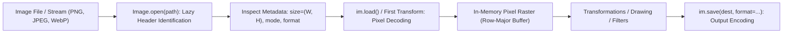

```python
from PIL import Image
with Image.open('data/scene-01.png') as im:
    print(im.size, im.mode, im.format)
    im.load()  # actually decode the pixels
```

`Image.open()` is usually *lazy*; decoding often happens on `load()` or when a transform uses the pixels. Use a context manager to close file handles. `im.copy()` keeps pixels after the file is closed.

### When should you use Pillow?

Use Pillow for image thumbnails, visual assets, badges, screenshots, compositing and output format conversion. For heavy computer vision features such as object detection, use specialized tools; Pillow is **not** an ML model or secure isolation boundary.

### Try it

Print the width, height, mode, and format of `data/scene-02.png`. Then save a copy with a new filename. The original synthetic fixtures are generated locally with `python -m data.generate_samples`.

**Watch out:** Pillow's `Image.Image` is a class, not a canvas widget. Pillow creates and manipulates raster pixels. Read [the Image API](https://pillow.readthedocs.io/en/stable/reference/Image.html).

---

# Pillow Open and Save Images: PNG, JPEG and WebP

Use `Image.open(path)` to identify an image; it may not fully decode until needed. Use `image.save(destination, format=...)` to encode output. **Choose the format for the content**, not by file extension alone.

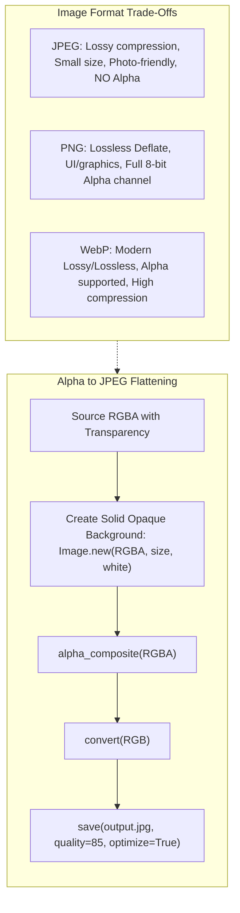

```python
from PIL import Image
with Image.open('data/scene-01.png') as source:
    im = source.convert('RGB')
    im.save('outputs/example-photo.jpg', quality=85, optimize=True)
    im.save('outputs/example-copy.png', optimize=True)
```

JPEG is lossy, excellent for many photos, and **does not support transparency**. PNG is lossless and useful for illustrations, UI art and alpha transparency. WebP supports lossy/lossless modes and can support transparency, but availability can depend on your Pillow installation.

To save an image with an alpha channel as JPEG, first combine it with a chosen background:

```python
from PIL import Image
rgba=Image.new('RGBA',(80,50),(255,0,0,110))
background=Image.new('RGBA',rgba.size,'white')
background.alpha_composite(rgba)
background.convert('RGB').save('outputs/alpha-to-jpeg.jpg')
```

The default save operation may strip some metadata. Consider ICC color profiles and EXIF deliberately if output fidelity requires them; do not assume they are kept or removed in every workflow.

### Practice

Save a scene as JPEG at qualities 60 and 90, inspect file sizes, and zoom into edges. Smaller files do not automatically mean better images or web performance.

**Lab:** [JPEG/PNG/WebP format comparison](labs/lab04_format_export.py). [Pillow image formats](https://pillow.readthedocs.io/en/stable/handbook/image-file-formats.html).

---

# Pillow Resize, Crop and Thumbnail Without Stretching

A thumbnail and a crop do different jobs. `resize((w,h))` enforces an exact size and can distort the image if you choose a different aspect ratio. `thumbnail((w,h))` modifies the image **in place**, keeps its ratio and does not enlarge it.

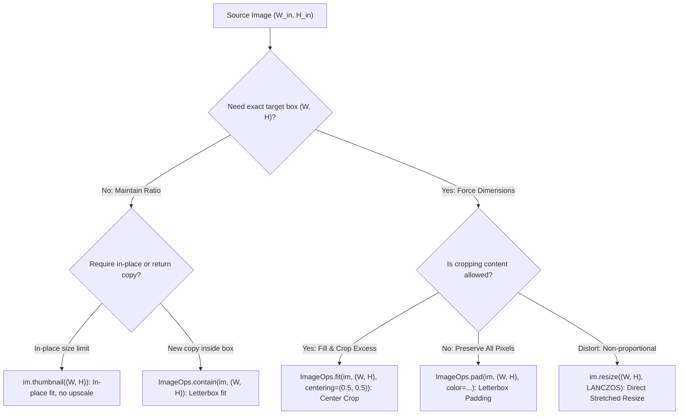

```python
from PIL import Image, ImageOps
with Image.open('data/scene-01.png') as src:
    image=src.copy()
image.thumbnail((400,400),Image.Resampling.LANCZOS)
image.save('outputs/example-thumbnail.png')

cropped=ImageOps.fit(image,(300,300),method=Image.Resampling.LANCZOS)
cropped.save('outputs/example-square.png')
```

### Five related methods

| Method | Keeps aspect ratio? | Behavior |
|---|---|---|
| `resize((w,h))` | Only if ratio matches | Forces exact dimensions |
| `thumbnail((w,h))` | Yes | Fits in box, changes image in place, no upscaling |
| `ImageOps.contain(im,size)` | Yes | Fits *inside* box; one side may be shorter |
| `ImageOps.fit(im,size)` | Yes | Fills exact box by cropping excess |
| `ImageOps.pad(im,size)` | Yes | Fills exact box by adding colored padding |

For high-quality shrinking, `Image.Resampling.LANCZOS` is a common default. Use center or custom `centering=` with `ImageOps.fit` to preserve important subjects.


### Practice

Produce a 300×300 avatar and a 640×360 banner from the same image. Explain why one must crop and the other may pad.

**Lab:** [Resize comparison](labs/lab01_resize_crop.py).

---

# Pillow RGB vs RGBA vs Grayscale: Modes and Transparency

Color mode controls pixel representation. `RGB` has three channels; `RGBA` adds an alpha channel; `L` is one 8-bit grayscale channel. **Conversion changes representation**, not merely the filename.

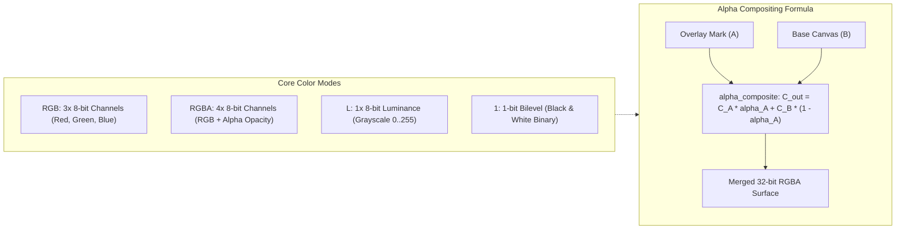

```python
from PIL import Image
with Image.open('data/scene-01.png') as src:
    rgb=src.convert('RGB')
    gray=src.convert('L')
print(rgb.mode,gray.mode)
gray.save('outputs/example-grayscale.png')
```

For an opaque image, `RGB` is fine. For a logo with a transparent background use `RGBA` and PNG (or WebP when supported). To paste an image with alpha, use alpha compositing rather than discarding transparency.

```python
from PIL import Image
base=Image.new('RGBA',(300,180),'#17344a')
mark=Image.new('RGBA',(100,100),(250,180,80,100))
base.alpha_composite(mark,(30,25))
base.save('outputs/example-alpha.png')
```

**Color-management caution:** `convert('RGB')` alone does not provide full ICC color management; use `ImageCms` for color-profile conversion when needed.

### Practice

Create a semi-transparent colored badge, composite it onto a photo, and export to PNG. Then try JPEG and explain the failure until you flatten onto an RGB background.

**Lab:** [Alpha watermark example](labs/lab03_watermark.py).

---

# Pillow Filters, Blur, Sharpen, Contrast and Brightness

Pillow's enhancement operations are building blocks. Use `ImageEnhance` to alter contrast, color, brightness and sharpness. Use `ImageFilter` for spatial filters such as Gaussian blur, edge detection and unsharp masking.

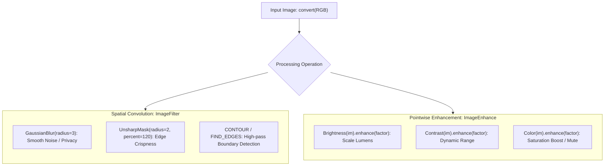

```python
from PIL import Image, ImageEnhance, ImageFilter, ImageOps
with Image.open('data/scene-02.png') as im:
    rgb=im.convert('RGB')
bright=ImageEnhance.Brightness(rgb).enhance(1.2)
blur=bright.filter(ImageFilter.GaussianBlur(radius=3))
sharp=bright.filter(ImageFilter.UnsharpMask(radius=2,percent=120,threshold=2))
sharp.save('outputs/example-sharpened.png')
```

These operations do not infer missing detail. Sharpening may introduce ringing or noise; heavy compression can conceal artifacts. `ImageOps.autocontrast` can improve tonal range but sometimes shifts the look of an illustration.


### Practice

Apply `GaussianBlur(1)`, `(4)`, and `(10)` to the same scene. Compare edge detail. For contrast tests, use a dim image and avoid assuming all images benefit from auto-contrast.

**Lab:** [Image enhancement grid](labs/lab02_enhance_filters.py). [ImageFilter reference](https://pillow.readthedocs.io/en/stable/reference/ImageFilter.html).

---

# Pillow ImageDraw: Shapes, Text and Watermarks

`ImageDraw.Draw(image)` draws rectangles, lines, circles, polygons and text directly into an image. When drawing text, you can use `ImageFont.truetype` to choose a font installed on the system (the repository does not bundle third-party fonts).

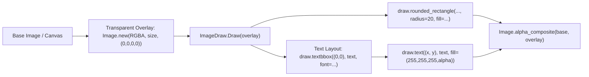

```python
from PIL import Image,ImageDraw,ImageFont
image=Image.new('RGB',(620,220),'#172438')
draw=ImageDraw.Draw(image)
draw.rounded_rectangle((20,20,600,200),radius=24,fill='#305a78')
font=ImageFont.load_default(size=30)
label='Hello, Pillow!'
bounds=draw.textbbox((0,0),label,font=font)
draw.text((40,70),label,font=font,fill='#ffffff')
image.save('outputs/example-banner.png')
print('text width:',bounds[2]-bounds[0])
```

For transparent watermarks, use an RGBA overlay and `Image.alpha_composite`; editing only the RGB pixels loses transparency. For positioning text, use `textbbox`, not the removed legacy `textsize` API.


### Practice

Design a photo watermark in the lower right. Make opacity configurable and test both 0.3 and 0.8. Never treat a visible watermark as strong protection against copying.

**Lab:** [Watermark and text overlay](labs/lab03_watermark.py). [ImageDraw reference](https://pillow.readthedocs.io/en/stable/reference/ImageDraw.html).

---

# Pillow Rotate, Flip and EXIF Orientation Explained

Images from phones can contain an EXIF orientation flag rather than pre-rotated pixel data. If you resize or draw on the uncorrected pixels, the output can appear sideways in apps that interpret metadata differently.

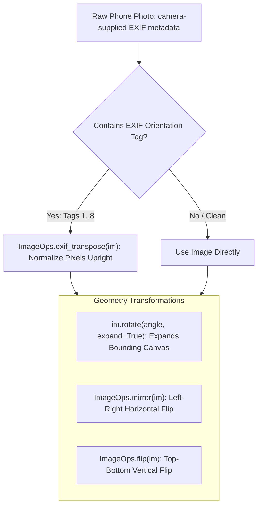

```python
from PIL import Image,ImageOps
with Image.open('data/scene-03.png') as im:
    upright=ImageOps.exif_transpose(im)
flipped=ImageOps.mirror(upright)
rotated=flipped.rotate(12,expand=True)
rotated.save('outputs/example-rotated.png')
```

`ImageOps.exif_transpose()` applies EXIF orientation where present. `rotate(angle, expand=True)` makes the canvas large enough to include the rotated content, while `Image.Transpose.ROTATE_90` works efficiently for 90-degree turns.

### Privacy and metadata

EXIF may contain camera details, timestamps or GPS information. Saving a new image may drop some metadata by default, but **do not rely on that as a guaranteed privacy scrub**. Inspect the output with a metadata-checking tool before sharing sensitive photos. If you need a fixed privacy policy, explicitly control metadata handling.

### Practice

Flip one sample left-to-right and rotate it by 45°. Compare `expand=False` with `expand=True`. For actual EXIF orientation testing, use a camera-supplied example you are authorized to use.

[ImageOps EXIF documentation](https://pillow.readthedocs.io/en/stable/reference/ImageOps.html).

---

# Pillow Batch Image Conversion: PNG, JPEG, WebP

For multiple images, write a function that receives an input path and an output folder. **Validate each input, choose the output format deliberately, and record what happened**. A CSV manifest makes batch output easier to audit.

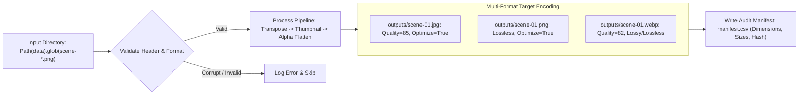

```python
from pathlib import Path
from PIL import Image,ImageOps
out=Path('outputs');out.mkdir(exist_ok=True)
for file in sorted(Path('data').glob('scene-*.png')):
    with Image.open(file) as src:
        photo=ImageOps.exif_transpose(src).convert('RGB')
        photo.thumbnail((800,800))
        photo.save(out/f'{file.stem}.jpg',quality=85,optimize=True)
```

A name ending in `.jpg` does not make a file a valid JPEG. Let Pillow actually encode it. Avoid blindly converting transparent images to RGB because hidden RGB values can appear as black; compose onto a chosen background instead.


### Practice

Run the batch lab and compare PNG/JPEG/WebP byte sizes. Try changing JPEG quality from 85 to 60. File size depends on image complexity and codec settings; do **not** advertise universal compression percentages.

**Lab:** [Batch format exports](labs/lab04_format_export.py).

---

# Secure Pillow Image Processing: Validation and Resource Limits

When working with untrusted uploads, image decoding can consume significant CPU and memory. **Keep Pillow patched**. The October 2026 Pillow 13.0.0 release includes important security fixes. The examples in this course use only trusted, synthetic local fixtures.

A basic defensive pipeline checks the file size, limits decoded dimensions, chooses acceptable formats, treats decompression-bomb warnings as errors, and loads the pixels. Importantly, `verify()` checks file integrity *without decoding pixels*; **reopen the file before `load()`**.

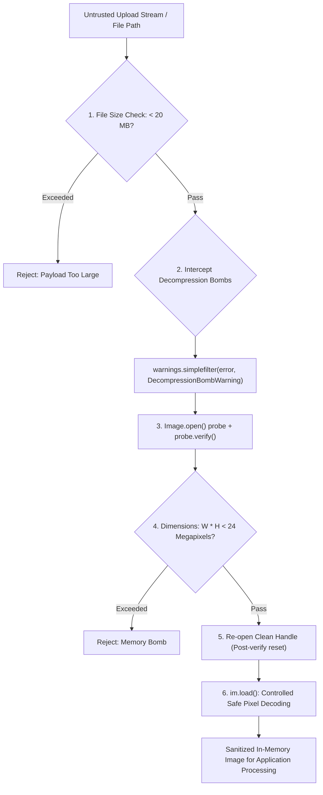

```python
from PIL import Image
import warnings
from pathlib import Path
path=Path('data/scene-01.png')
assert path.stat().st_size < 20_000_000
with warnings.catch_warnings():
    warnings.simplefilter('error',Image.DecompressionBombWarning)
    with Image.open(path,formats=['PNG','JPEG','WEBP']) as probe:
        assert probe.width*probe.height < 24_000_000
        probe.verify()
    with Image.open(path,formats=['PNG','JPEG','WEBP']) as src:
        src.load()
        print(src.size)
```

For real upload services, also add request limits, timeouts, isolated processing, storage quotas, authenticated access, MIME checking, audit logs and security updates. This example is **not** a production-hardened image parser or sandbox. Do not disable `Image.MAX_IMAGE_PIXELS` for convenience.

### Practice

Try opening a small text file with `Image.open()` and catch `UnidentifiedImageError`. Write a policy for files larger than your upload limit. Never test unknown or hostile image payloads on an unpatched version.

**Lab:** [Validation and contact sheet](labs/lab05_contact_sheet.py). [Pillow 13.0 security release](https://pillow.readthedocs.io/en/stable/releasenotes/13.0.0.html).

---

# Five Pillow Projects: Image Resizer to Batch Portfolio

Finish the course by running these five projects. They share four original, synthetic images and a transparent logo. **No internet, API key or proprietary source image is required.**

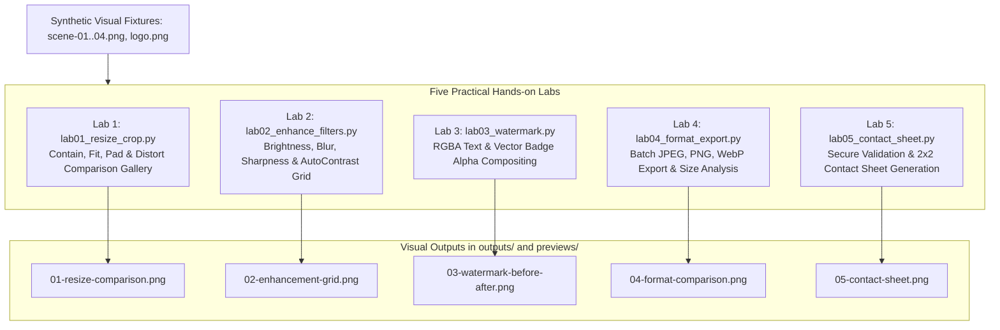

| Project | Input | Main APIs | Output |
|---|---|---|---|
| 01. Resize and crop | `scene-01.png` | `ImageOps.contain`, `fit`, `pad` | Side-by-side gallery |
| 02. Enhance and filter | `scene-02.png` | `ImageEnhance`, `ImageFilter` | Six-panel before/after grid |
| 03. Watermark | `scene-03.png`, logo | `ImageDraw`, `alpha_composite` | RGBA PNG and comparison |
| 04. Format conversion | Four scenes | `save`, JPEG, PNG, WebP | File sizes CSV and chart |
| 05. Contact sheet | Four scenes | `verify`, `load`, `ImageOps.fit` | 2×2 image sheet and manifest |

```bash
python -m data.generate_samples
python -m labs.lab01_resize_crop
python -m labs.lab02_enhance_filters
python -m labs.lab03_watermark
python -m labs.lab04_format_export
python -m labs.lab05_contact_sheet
python -m pytest -q
```


### Capstone challenge

Write `make_social_card(image_path, title, output_path)` that corrects orientation, crops to a fixed box, draws a title on a contrast-safe background, exports PNG, and raises an error if the input exceeds a size limit. Add tests for the output dimensions, mode, text placement and invalid inputs.

### Go further

After completing Pillow, explore [OpenCV](https://opencv.org/) for computer vision, [scikit-image](https://scikit-image.org/) for scientific image analysis, and [imageio](https://imageio.readthedocs.io/) for media I/O. Use `numpy.asarray(image)` when you need array-based pixel calculations.

---

# Pillow Cheat Sheet — Common Image Operations

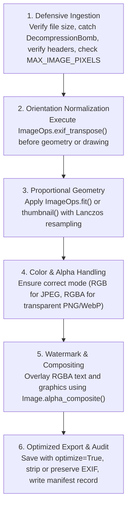

| Task | Code | Notes |
|---|---|---|
| Install | `python -m pip install Pillow` | Import using `from PIL import Image` |
| Open | `Image.open(path)` | Usually lazy; context manager recommended |
| Decode | `im.load()` | Reads the image pixels |
| Get size | `im.size` | `(width,height)` |
| Get mode | `im.mode` | `RGB`, `RGBA`, `L`, ... |
| Copy | `im.copy()` | Separate in-memory image |
| Convert | `im.convert('RGB')` | Remove alpha; flatten consciously |
| Grayscale | `im.convert('L')` | Grayscale |
| Exact resize | `im.resize((w,h),Image.Resampling.LANCZOS)` | May distort |
| Keep ratio | `im.thumbnail((w,h))` | Modifies in place |
| Fit in box | `ImageOps.contain(im,(w,h))` | May leave gaps |
| Crop to fill | `ImageOps.fit(im,(w,h))` | Exact size |
| Pad to fill | `ImageOps.pad(im,(w,h))` | Exact size |
| Crop rectangle | `im.crop((left,top,right,bottom))` | Right / bottom boundaries exclusive |
| Flip | `ImageOps.mirror(im)` | Left/right |
| Rotate | `im.rotate(45,expand=True)` | Expand avoids cutoff |
| EXIF orientation | `ImageOps.exif_transpose(im)` | Correct phone-image orientation |
| Blur | `im.filter(ImageFilter.GaussianBlur(3))` | Blur radius |
| Brighten | `ImageEnhance.Brightness(im).enhance(1.2)` | 1.0 = unchanged |
| Draw | `ImageDraw.Draw(im).rectangle(...)` | Draw onto image |
| Text bounds | `draw.textbbox((0,0), text, font=font)` | Modern text measuring |
| Layer overlay | `Image.alpha_composite(base,overlay)` | Both RGBA same dimensions |
| Save JPEG | `rgb.save('out.jpg',quality=85)` | No transparency |
| Save PNG | `im.save('out.png',optimize=True)` | Lossless |
| Save WebP | `im.save('out.webp',quality=82)` | Codec support required |
| Verify | `im.verify()` | Reopen before actual decoding |
| Test | `python -m pytest -q` | Run included tests |

## Gotchas

- `thumbnail()` returns `None`, because it changes the image in place.
- `ImageOps.fit` may cut off content; choose the `centering` carefully.
- JPEG requires RGB/L/CMYK rather than RGBA, and may discard metadata.
- `Image.open` can delay decode until later; `verify()` alone is not a complete safety check.
- Fix EXIF orientation before sizing and drawing.
- Update Pillow frequently; decoder/security fixes matter for user uploads.

---

# Pillow FAQ — Frequently Asked Questions

### What is the difference between PIL and Pillow?

Pillow is the maintained fork of the original Python Imaging Library (PIL). Install `Pillow`, import `PIL`.

### Is Pillow a replacement for OpenCV?

Not generally. Pillow excels at image decoding, manipulation and export. OpenCV provides extensive computer-vision algorithms.

### Why is `Image.open()` not loading pixels immediately?

Pillow often identifies files lazily. Call `load()` or run a transform to decode the image.

### What does `im.size` return?

A tuple `(width, height)` in pixels.

### How can I resize without stretching the image?

Use `thumbnail` for an in-place size limit, `ImageOps.contain` to stay inside a box, `fit` to crop and fill, or `pad` to keep content with borders.

### What is the difference between crop and pad?

Crop removes content outside a selected box. Pad adds pixels so the entire image fits in a fixed-size canvas.

### Why does saving an RGBA image as JPEG fail?

JPEG has no alpha channel. Composite onto a background and convert to RGB before saving.

### How do I make image backgrounds transparent?

Use `RGBA` pixels and a supporting output format such as PNG. Simply changing the mode does not automatically identify background pixels.

### How do I add text to an image?

Use `ImageDraw.Draw(im).text()` and a font from `ImageFont`. Use `textbbox` to position accurately.

### What is an EXIF orientation tag?

Metadata that tells viewers how to rotate an image for display. `ImageOps.exif_transpose` applies the orientation to pixels.

### Does `verify()` make image uploads secure?

No. It does not fully decode pixel data. Add file size and pixel limits, full decoding, application controls, secure deployment and prompt security patching.

### Which is smaller, PNG, JPEG or WebP?

It depends on the image and quality settings. JPEG and lossy WebP are commonly efficient for photography, while PNG is lossless. Measure your own output.

### Can I batch-convert images with Pillow?

Yes. Loop over paths, use explicit format settings, and write a CSV manifest. Lab 04 demonstrates this.

### How do I inspect the installed Pillow version?

```python
import PIL
print(PIL.__version__)
```

### Is this course suitable for production upload services?

The image APIs and concepts apply, but the labs use known local fixtures. Production upload pipelines need stronger isolation, limits, security patching and operational testing.

---

# Pillow Image Processing Glossary

**Alpha channel:** Per-pixel opacity information, often the fourth channel in RGBA. **Anti-aliasing:** Smoothing jagged edges when drawing or resizing. **Aspect ratio:** Width divided by height. **Bicubic / Lanczos:** Resampling filters used when resizing. **Canvas:** The pixel area of an image being drawn to. **Color mode:** Pixel representation such as RGB, RGBA or L. **Contact sheet:** Multiple image thumbnails arranged on one image. **Crop:** Remove pixels outside a rectangular area. **Decoder:** Component converting file bytes into image pixels. **DPI:** A physical print density hint; not image width/height in pixels. **EXIF:** Image metadata including camera settings and possible orientation. **Histogram:** Distribution of pixel intensities. **ICC profile:** Color-management metadata describing a color space. **JPEG:** Common lossy image format with no alpha transparency. **PNG:** Lossless image format supporting alpha. **RGBA:** Red, green, blue and alpha channels. **Resampling:** Calculating new pixel values while resizing. **Unsharp mask:** Image sharpening operation. **WebP:** Image format supporting lossy/lossless compression, often including transparency. **`ImageOps.fit`:** Resize and crop to exact dimensions. **`ImageOps.pad`:** Resize and add borders to exact dimensions.
