# OpenCV Python Complete Guide — 10 Lessons and 5 Computer Vision Labs

Learn OpenCV using executable examples and offline synthetic images. This standalone guide contains all ten tutorial lessons and a complete reference for running the five project scripts.

**Reference releases:** OpenCV 4.14 and OpenCV 5.0. **Verified locally:** cv2 5.0.0 (compatible with 4.13.0+). The official OpenCV 4-to-5 migration notes apply to production upgrades.

## Setup

```bash
python -m pip install -r requirements.txt
python -m data.generate_samples
python -m labs.lab01_image_colors
python -m pytest -q
```

---

## Lesson 01: What Is OpenCV? Python Computer Vision for Beginners

**You will learn:** Understand computer vision, install cv2, inspect a BGR image and learn OpenCV vs Pillow.

## What is OpenCV?

**OpenCV** (Open Source Computer Vision Library) provides fast C++ computer-vision implementations that Python calls through the **`cv2`** package. Its main image representation is a **NumPy `ndarray`**, often in **BGR channel order**. It handles image processing, video streams, geometric transformations, contours, feature extraction and much more.

A computer sees images as arrays of values, not photographs. A color image of width 640 and height 400 usually has `shape == (400, 640, 3)` and `dtype == uint8`.

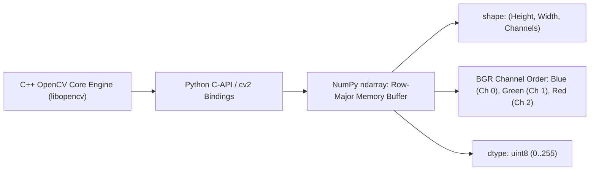

## Install and verify

```bash
python -m pip install -r requirements.txt
python -c "import cv2; print(cv2.__version__)"
python -m data.generate_samples
```

Use **one** OpenCV wheel variant per environment. This course installs `opencv-python-headless` for CI, servers and notebooks; it supports image files, but not OpenCV desktop GUI functions such as `cv2.imshow`. For a desktop GUI project, choose `opencv-python` *instead*, not alongside it.

## First runnable example

```python
import cv2
from labs.common import DATA

image = cv2.imread(str(DATA / 'color-scene.png'))
assert image is not None, 'Run python -m data.generate_samples'
print(image.shape, image.dtype)
print('OpenCV:', cv2.__version__)
```

**Expected shape:** `(400, 640, 3)`; individual pixel components have values 0–255 in this example.

## OpenCV vs Pillow

| Need | Often start with |
|---|---|
| Resize, JPEG/PNG conversion, add text | Pillow or OpenCV |
| Contours, edge detection, frame-by-frame pipelines | OpenCV |
| Data processing and ML | NumPy / pandas / scikit-learn alongside OpenCV |

Neither library is universally faster for every task. Benchmark your specific inputs.

**Common mistake:** assuming installing `opencv-python` means `import opencv`. The correct import is `import cv2`.

**Try it:** print the number of channels and the pixel at `[0, 0]`.

---

## Lesson 02: OpenCV imread and imwrite: Read, Inspect and Save Images

**You will learn:** Load PNG and JPEG safely, check for imread failures, access pixels, and save ndarray outputs.

## Open an image

`cv2.imread(path)` decodes an image and returns an `ndarray`, or `None` if decoding fails. **Always check for `None`** before processing. `cv2.IMREAD_GRAYSCALE` requests a single-channel image; `cv2.IMREAD_UNCHANGED` preserves channels where supported.

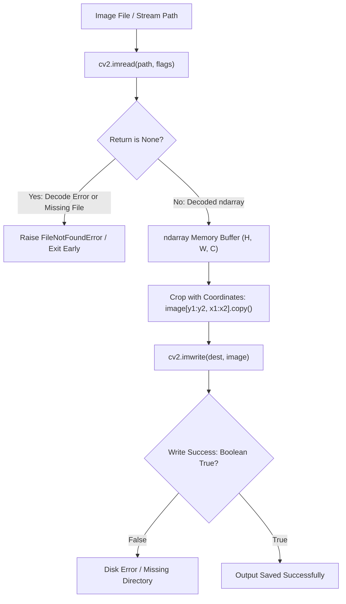

```python
import cv2
from labs.common import DATA, OUTPUTS

img = cv2.imread(str(DATA / 'color-scene.png'), cv2.IMREAD_COLOR)
if img is None:
    raise FileNotFoundError('Missing color-scene.png')
print('height, width, channels:', img.shape)
print('BGR pixel:', img[0, 0].tolist())
OUTPUTS.mkdir(exist_ok=True)
assert cv2.imwrite(str(OUTPUTS / 'example-copy.png'), img)
```

## Array layout

- `image.shape[0]` is **height**, `shape[1]` is **width**.
- `image[y, x]` accesses a pixel — **row before column**.
- A color image is usually `uint8` and **BGR**, not RGB.
- `image[y1:y2, x1:x2]` creates a NumPy **view**, typically sharing memory.
- `cv2.imwrite()` returns a boolean; inspect it before claiming success.

## Cropping with coordinates

```python
import cv2
from labs.common import DATA

img = cv2.imread(str(DATA / 'color-scene.png'))
crop = img[70:310, 45:275].copy()
print('Cropped height and width:', crop.shape[:2])
```

The `.copy()` gives the crop independent memory; omit it if you intentionally want a view.

**Common mistake:** treating OpenCV's `(width, height)` resizing arguments as if they matched NumPy's `(height, width)` shape.

**Try it:** save both the full image and a 100×100 crop; compare their dimensions.

---

## Lesson 03: OpenCV BGR vs RGB vs HSV: Colors and Masks

**You will learn:** Convert BGR to RGB correctly, understand HSV ranges, and segment colored objects.

## Why OpenCV colors look wrong

By default, color images loaded with `cv2.imread` are **BGR**. Pillow and most plotting tools expect **RGB**. Passing OpenCV BGR pixels directly to a plotting function may swap red and blue.

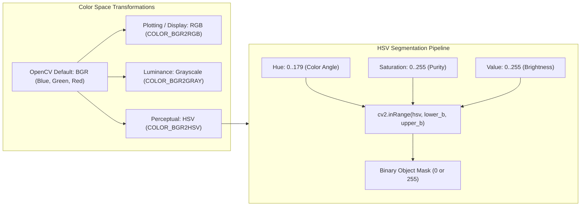

```python
import cv2
from labs.common import DATA

bgr = cv2.imread(str(DATA / 'color-scene.png'))
rgb = cv2.cvtColor(bgr, cv2.COLOR_BGR2RGB)
recovered = cv2.cvtColor(rgb, cv2.COLOR_RGB2BGR)
assert (recovered == bgr).all()
```

## Convert to grayscale and HSV

```python
import cv2
from labs.common import DATA

bgr = cv2.imread(str(DATA / 'color-scene.png'))
gray = cv2.cvtColor(bgr, cv2.COLOR_BGR2GRAY)
hsv = cv2.cvtColor(bgr, cv2.COLOR_BGR2HSV)
print('Gray', gray.shape, 'HSV', hsv.shape)
```

HSV can make **color segmentation** easier than comparing red/green/blue channels independently. With OpenCV 8-bit HSV, **hue is typically 0–179**, while saturation and value are 0–255.

## Segment a colored video object

```python
import cv2
import numpy as np
from labs.common import DATA

frame = cv2.imread(str(DATA / 'frames/frame-00.png'))
hsv = cv2.cvtColor(frame, cv2.COLOR_BGR2HSV)
mask = cv2.inRange(hsv, np.array([10, 90, 120]), np.array([35, 255, 255]))
print('Detected pixels:', int(np.count_nonzero(mask)))
```

This range is deliberately chosen for the **synthetic orange ball**, not a universal real-world detector. Real cameras introduce exposure, illumination and white-balance changes.

**Common mistake:** using RGB values as input to `cv2.COLOR_BGR2HSV` without first checking the original channel order.

**Try it:** experiment with narrower hue ranges and measure how many pixels remain.

---

## Lesson 04: OpenCV Resize, Crop, Rotate and Geometric Transforms

**You will learn:** Use cv2.resize, affine transforms and crop correctly without mixing x/y with width/height.

## Resize images

Use `cv2.resize(src, (width, height), interpolation=...)`. `INTER_AREA` is often a good starting point when **shrinking**; `INTER_LINEAR` is a practical general-purpose choice.

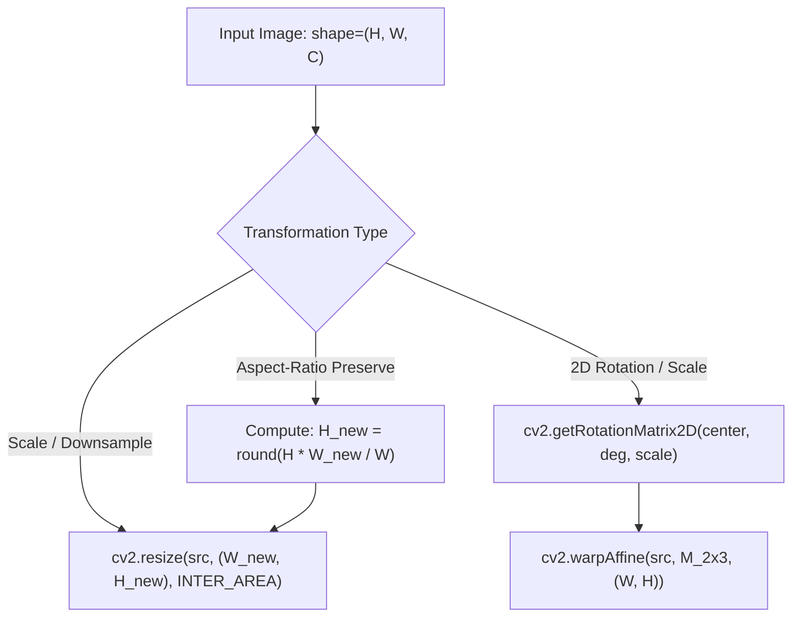

```python
import cv2
from labs.common import DATA

img = cv2.imread(str(DATA / 'color-scene.png'))
small = cv2.resize(img, (320, 200), interpolation=cv2.INTER_AREA)
assert small.shape == (200, 320, 3)
```

## Maintain aspect ratio

Set one target dimension and compute the other. A size of 640×400 is **1.6:1**. Resizing directly to 320×320 stretches the original contents.

```python
import cv2
from labs.common import DATA

img = cv2.imread(str(DATA / 'color-scene.png'))
h, w = img.shape[:2]
target_width = 300
resized = cv2.resize(img, (target_width, round(h * target_width / w)))
print('New shape:', resized.shape)
```

## Rotation and translation

`cv2.getRotationMatrix2D(center, degrees, scale)` returns a 2×3 affine transform. `warpAffine` accepts output `(width, height)`.

```python
import cv2
from labs.common import DATA

img = cv2.imread(str(DATA / 'color-scene.png'))
h, w = img.shape[:2]
M = cv2.getRotationMatrix2D((w/2, h/2), 12, 1.0)
rotated = cv2.warpAffine(img, M, (w, h))
print('Rotated:', rotated.shape)
```

`warpAffine` may clip the outer corners. Later, the perspective lesson introduces a **3×3** transformation for four-corner projective correction.

**Common mistake:** passing `(height, width)` to `cv2.resize`, `warpAffine`, or `warpPerspective`.

**Try it:** compare `INTER_NEAREST` and `INTER_AREA` when reducing an image to 20%.

---

## Lesson 05: OpenCV Image Filters: Gaussian Blur, Sobel and Canny Edges

**You will learn:** Denoise using Gaussian, median and bilateral filtering, then detect gradients and edges.

## Filtering fundamentals

Image filtering compares each pixel with a nearby neighborhood. The right filter depends on the noise and the structure you want to preserve.

| Technique | Best first use | Trade-off |
|---|---|---|
| Gaussian blur | Smooth Gaussian-like noise | Softens boundaries |
| Median filter | Remove isolated salt-and-pepper pixels | Can simplify fine textures |
| Bilateral filter | Smooth color regions while preserving some edges | Often slower |
| Sobel | Estimate intensity gradients | Highlights directional changes |
| Canny | Produce thin, thresholded edge maps | Sensitive to thresholds |

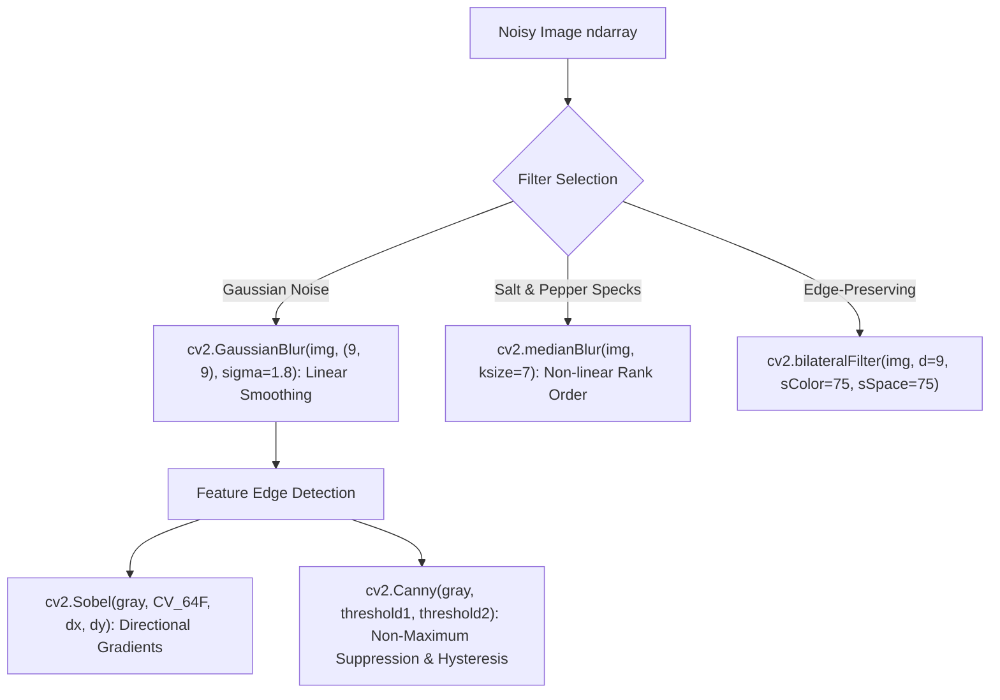

## Working edge detector

```python
import cv2
from labs.common import DATA

img = cv2.imread(str(DATA / 'noisy-scene.png'))
smoothed = cv2.GaussianBlur(img, (9, 9), 1.8)
gray = cv2.cvtColor(smoothed, cv2.COLOR_BGR2GRAY)
edges = cv2.Canny(gray, 65, 145)
print('Edge pixels:', cv2.countNonZero(edges))
```

- Gaussian kernels such as `(5, 5)` are **odd-sized**.
- Sobel gradients often need a **signed or floating-point dtype** to avoid losing negative responses.
- `cv2.Canny` takes a lower and upper threshold; they are not universally optimal numbers.

## Compare actual results

Run `python -m labs.lab02_filters_edges` and open [the 6-panel preview](outputs/02-filters-and-edges.png).

**Common mistake:** judging a denoiser by visual smoothness alone. A heavily blurred image may look cleaner but lose important boundaries.

**Try it:** vary Gaussian sigma and count resulting edge pixels.

---

## Lesson 06: OpenCV Threshold, Morphology and Contours Explained

**You will learn:** Learn binary masks, erosion, dilation, morphology, findContours and object bounding boxes.

## Convert gray pixels into objects

A **binary mask** has background `0` and foreground `255`. If you need to isolate bright objects on a dark background, thresholding can be the simplest path.

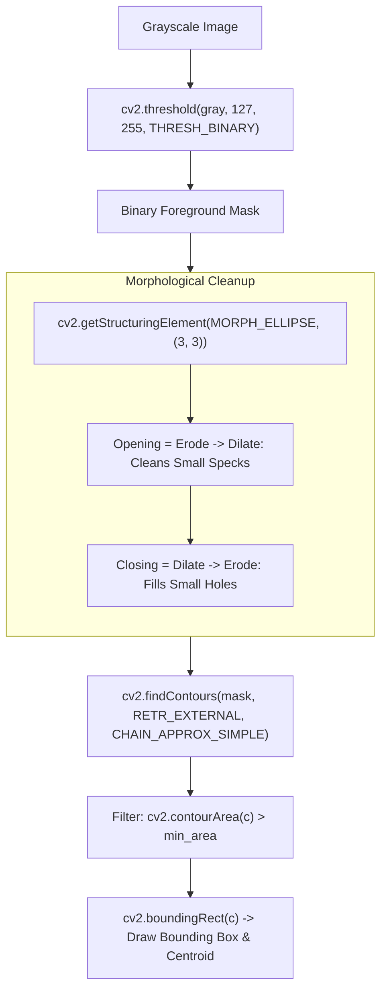

```python
import cv2
from labs.common import DATA

image = cv2.imread(str(DATA / 'binary-shapes.png'), cv2.IMREAD_GRAYSCALE)
_, mask = cv2.threshold(image, 127, 255, cv2.THRESH_BINARY)
contours, hierarchy = cv2.findContours(mask, cv2.RETR_EXTERNAL, cv2.CHAIN_APPROX_SIMPLE)
print('Number of contours:', len(contours))
```

The synthetic image has **five disconnected shapes**. `RETR_EXTERNAL` ignores nested child contours. A contour is a boundary, not necessarily an object recognized by an ML model.

## Remove tiny bright noise

```python
import cv2
from labs.common import DATA

image = cv2.imread(str(DATA / 'binary-shapes.png'), cv2.IMREAD_GRAYSCALE)
kernel = cv2.getStructuringElement(cv2.MORPH_ELLIPSE, (3, 3))
cleaned = cv2.morphologyEx(image, cv2.MORPH_OPEN, kernel)
print('Foreground pixels:', cv2.countNonZero(cleaned))
```

- **Erosion** shrinks bright foreground structures.
- **Dilation** grows bright foreground structures.
- **Opening = erosion then dilation**; it helps remove small bright specks.
- **Closing = dilation then erosion**; it helps fill small dark gaps.

## Detect bounding boxes

Run `python -m labs.lab03_contours` to draw boxes around each of the five shapes. Filter contours by `cv2.contourArea` so noise does not become a detected object.

**Common mistake:** trying to count touching objects via `RETR_EXTERNAL` when they form one connected region.

**Try it:** add a sixth small shape and change `min_area` to see when it disappears.

---

## Lesson 07: OpenCV Perspective Transform: Build a Document Scanner

**You will learn:** Map four source corners to a rectangle using getPerspectiveTransform and warpPerspective.

## From a tilted quadrilateral to a rectangle

A camera can view a flat document at an angle. A **perspective transform** can map its four measured corners onto a rectangular output. The corner order in our lab is **top-left, top-right, bottom-right, bottom-left**.

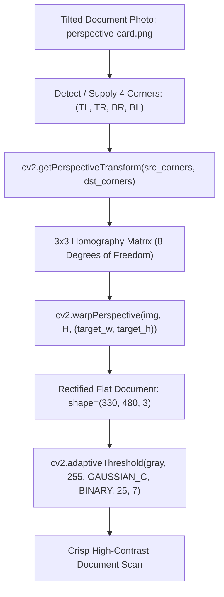

```python
import cv2
import numpy as np
from labs.common import DATA

image = cv2.imread(str(DATA / 'perspective-card.png'))
src = np.load(DATA / 'document-corners.npy').astype(np.float32)
dst = np.float32([[0, 0], [479, 0], [479, 329], [0, 329]])
H = cv2.getPerspectiveTransform(src, dst)
corrected = cv2.warpPerspective(image, H, (480, 330))
print('Homography shape:', H.shape, 'Output:', corrected.shape)
```

The 3×3 transform has eight effective degrees of freedom up to an overall scale. It describes a planar projective mapping. For real documents, your pipeline must first detect or manually supply the correct four corners.

## Improve contrast after correcting geometry

```python
import cv2
from labs.lab04_perspective import process

aligned = process()['aligned']
gray = cv2.cvtColor(aligned, cv2.COLOR_BGR2GRAY)
thresholded = cv2.adaptiveThreshold(gray, 255, cv2.ADAPTIVE_THRESH_GAUSSIAN_C,
                                    cv2.THRESH_BINARY, 25, 7)
print(thresholded.shape)
```

Adaptive thresholding computes local thresholds; it helps with uneven illumination but can create artifacts with poor parameters.

**Common mistake:** mixing corner order. An incorrect order can rotate, flip or severely distort the output.

**Try it:** change the destination dimensions and compare text legibility.

---

## Lesson 08: OpenCV VideoCapture, VideoWriter and Frame-by-Frame Tracking

**You will learn:** Read videos frame by frame, process HSV masks, annotate frames and release camera/video resources.

## Videos are sequences of images

`cv2.VideoCapture` opens a camera index **or** file path. `cap.read()` returns `(ok, frame)`; `ok=False` signals end-of-file or capture failure. **Always call `release()`**, ideally in `finally`.

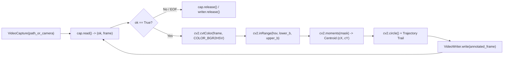

```python
import cv2
from labs.common import DATA

path = DATA / 'frames' / 'frame-00.png'
frame = cv2.imread(str(path))
assert frame is not None
print('BGR frame:', frame.shape)
```

Our lab supplies a 12-frame offline sequence and generates a short AVI only if the `MJPG` codec is supported. Camera access is **not required**.

## Read an encoded video safely

```python
import cv2
from labs.common import OUTPUTS
from labs.lab05_video_frames import process

result = process()
if result['video_exported']:
    cap = cv2.VideoCapture(str(OUTPUTS / '05-tracking.avi'))
    try:
        ok, frame = cap.read()
        print('Decoded a frame:', ok, None if frame is None else frame.shape)
    finally:
        cap.release()
else:
    print('Video encoding unavailable; PNG frame workflow still works')
```

To write with `VideoWriter`, specify `(width, height)`, frame rate (FPS) and a codec available on your system; check `writer.isOpened()` before writing. Codec support differs among platforms and wheel builds.

## Object tracking without a neural network

The synthetic yellow-orange ball is isolated in HSV with `cv2.inRange`, then connected components estimate its center per frame. This is simple color tracking, **not** robust general-purpose object recognition.

**Common mistake:** relying on `imshow` inside headless Docker or remote notebooks. Write image previews instead.

**Try it:** plot each frame's ball center against frame number using the JSON results.

---

## Lesson 09: OpenCV Performance, NumPy Views and Safe Image Processing

**You will learn:** Work with contiguous arrays, restrict untrusted inputs, monitor large images and check codec support.

## Practical memory and performance

An uncompressed color image with height 1080, width 1920 and three uint8 channels occupies about `1080*1920*3 = 6,220,800` bytes (about 5.93 MiB) **before temporary arrays and codec buffers**.

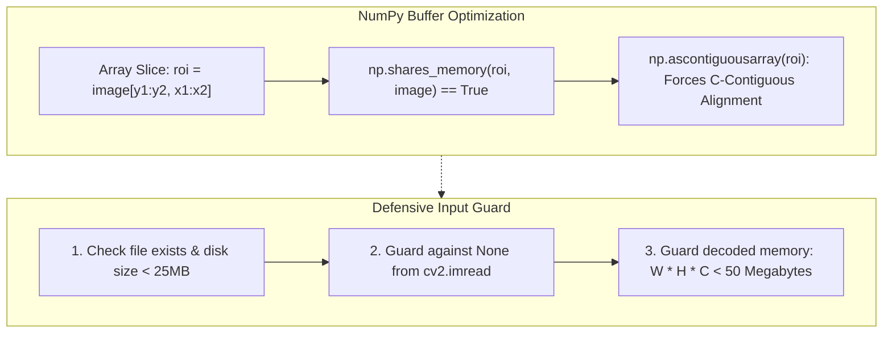

```python
import cv2
import numpy as np
from labs.common import DATA

image = cv2.imread(str(DATA / 'color-scene.png'))
roi = image[50:250, 80:400]
print('ROI shares data:', np.shares_memory(roi, image))
print('ROI contiguous:', roi.flags.c_contiguous)
safe_copy = np.ascontiguousarray(roi)
print('Contiguous copy:', safe_copy.flags.c_contiguous)
```

Some OpenCV functions accept strided NumPy views; others may copy memory or reject incompatible layouts. When interoperability is uncertain, consider `np.ascontiguousarray` and benchmark on representative data.

## Input safety checklist

- Keep OpenCV and its codecs updated; image/video formats are parsed by native code.
- Check upload sizes, decoded dimensions and file formats before processing. **Bytes on disk** are not the same as **decoded memory**.
- Reject `None` from `imread`, failed video capture, missing files and unknown codec outputs.
- Avoid processing untrusted files with excessively permissive CPU/memory limits; isolate public upload pipelines.
- Do not feed arbitrary paths or network URLs from users directly into file/video decoders.
- Scrub metadata/frames if exporting private user recordings.

The sample input files here are generated locally; they are **not** a fuzzing test or a guarantee of safety for external uploads.

## OpenCV 4 vs 5

OpenCV 5 removes legacy C APIs and relocates some optional modules to `opencv_contrib`. Core Python operations used in this lab are designed around commonly available APIs, but **they are only locally tested with OpenCV 4.13 / 5.0**. Review the [official 4-to-5 migration guide](https://github.com/opencv/opencv/wiki/OpenCV-4-to-5-migration) before upgrading production projects.

**Try it:** compare `image.nbytes` with the size of the compressed PNG file on disk.

---

## Lesson 10: Five OpenCV Projects: Image Filters, Contours and Video Tracking

**You will learn:** Run a complete offline computer vision portfolio, evaluate outputs and plan the next stage.

## Turn concepts into five projects

The five projects produce deterministic outputs from original synthetic images and frames. No trained weights, external image downloads, webcam or cloud API are required.

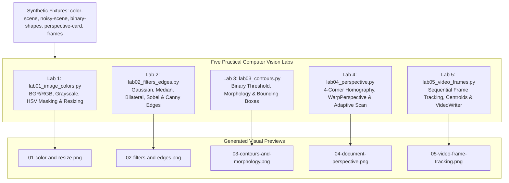

| Lab | Skills | Generated preview |
|---|---|---|
| 01: Image basics | BGR/RGB, `imread`, `resize` | `01-color-and-resize.png` |
| 02: Filters/edges | Gaussian, median, bilateral, Sobel, Canny | `02-filters-and-edges.png` |
| 03: Contours | threshold, morphology, bounding boxes | `03-contours-and-morphology.png` |
| 04: Document scan | homography, warpPerspective, adaptive threshold | `04-document-perspective.png` |
| 05: Video frames | HSV masking, centroid, VideoCapture/Writer | `05-video-frame-tracking.png` |

## Run everything

```bash
python -m data.generate_samples
python -m labs.lab01_image_colors
python -m labs.lab02_filters_edges
python -m labs.lab03_contours
python -m labs.lab04_perspective
python -m labs.lab05_video_frames
python -m pytest -q
```

Inspect `previews/` for rendered illustrations and `outputs/` for exported images, frame JSON and an optional AVI clip.

## What to learn next

1. Feature detectors and matching for correspondence problems.
2. Camera calibration for accurate geometric measurement.
3. Real-time optimization, profiling and batching.
4. A trained detector, with an annotated dataset and meaningful precision/recall evaluation.
5. Model export and inference if you transition to deep learning.

**When to use Pillow:** everyday image format conversion, simple image composition, and publishing-oriented operations. **When to use OpenCV:** geometric processing, frame analysis, image segmentation and traditional CV algorithms. For many production applications, the libraries complement each other.

**Portfolio exercise:** create an experiment report with threshold settings, timing, edge counts, contour counts, and a preview image for each change. Don't claim accuracy without ground-truth labels and a defined benchmark.

---

## Visual gallery


---

# OpenCV Python Cheat Sheet

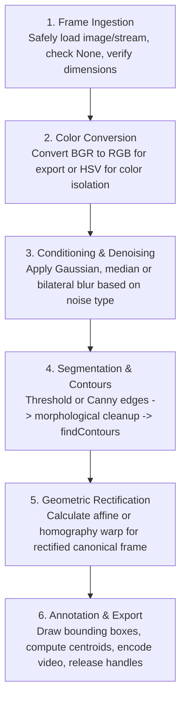

| Task | API Function | Example Note |
|---|---|---|
| Load color image | `cv2.imread(path, cv2.IMREAD_COLOR)` | Returns BGR `ndarray`, or `None` |
| Load grayscale | `cv2.imread(path, cv2.IMREAD_GRAYSCALE)` | Single-channel 2D array |
| Write image | `cv2.imwrite(path, img)` | Returns boolean success |
| BGR to RGB | `cv2.cvtColor(bgr, cv2.COLOR_BGR2RGB)` | Essential for Matplotlib / Pillow |
| BGR to HSV | `cv2.cvtColor(bgr, cv2.COLOR_BGR2HSV)` | Hue range is 0..179 |
| Range mask | `cv2.inRange(hsv, lower, upper)` | Binary mask (0 or 255) |
| Resize | `cv2.resize(img, (width, height), cv2.INTER_AREA)` | `(width, height)`, not `(h, w)` |
| Affine transform | `cv2.warpAffine(img, M, (w, h))` | 2x3 matrix from `getRotationMatrix2D` |
| Perspective warp | `cv2.warpPerspective(img, H, (w, h))` | 3x3 homography from `getPerspectiveTransform` |
| Gaussian blur | `cv2.GaussianBlur(img, (k, k), sigma)` | Odd kernel size (e.g. 5, 9) |
| Median blur | `cv2.medianBlur(img, k)` | Excellent for salt-and-pepper noise |
| Bilateral filter | `cv2.bilateralFilter(img, d, sColor, sSpace)` | Edge-preserving smoothing |
| Canny edges | `cv2.Canny(gray, t_low, t_high)` | Hysteresis thresholding |
| Binary threshold | `cv2.threshold(gray, t, 255, cv2.THRESH_BINARY)` | Global threshold |
| Adaptive threshold | `cv2.adaptiveThreshold(..., cv2.ADAPTIVE_THRESH_GAUSSIAN_C, ...)` | Local illumination robust |
| Morphology | `cv2.morphologyEx(img, cv2.MORPH_OPEN, kernel)` | Open removes specks; close fills holes |
| Find contours | `cv2.findContours(mask, cv2.RETR_EXTERNAL, cv2.CHAIN_APPROX_SIMPLE)` | External boundaries |
| Draw contours | `cv2.drawContours(img, contours, -1, color, thickness)` | Mutates in place |
| Bounding box | `x, y, w, h = cv2.boundingRect(contour)` | Straight bounding rect |
| Contour area | `cv2.contourArea(contour)` | Pixel area |
| Contour moments | `cv2.moments(mask_or_contour)` | Centroid: `cX = M['m10']/M['m00']` |
| Video capture | `cap = cv2.VideoCapture(source)` | Always `cap.release()` |
| Video writer | `writer = cv2.VideoWriter(path, fourcc, fps, (w, h))` | Always `writer.release()` |

---

# Frequently Asked Questions

### Why does my image look blue or orange when displayed with Matplotlib?
OpenCV loads color images as BGR by default, whereas Matplotlib and Pillow display RGB images. Convert using `cv2.cvtColor(bgr, cv2.COLOR_BGR2RGB)`.

### Why does `cv2.resize` take `(width, height)` while `image.shape` is `(height, width, channels)`?
OpenCV follows Cartesian coordinate conventions `(x, y)` for geometric transforms, where $x$ is width and $y$ is height. NumPy arrays follow row-major matrix indexing `[row, col]` where row is vertical (height) and col is horizontal (width).

### What does `cv2.imread()` return if the file path does not exist?
It returns `None` without raising an exception. Always guard your code with `assert img is not None` or `if img is None: raise FileNotFoundError(...)`.

### What is the difference between `warpAffine` and `warpPerspective`?
Affine transformations use a 2×3 matrix with 6 degrees of freedom, preserving parallelism of lines (translations, rotations, shears, uniform scaling). Perspective transformations use a 3×3 homography matrix with 8 degrees of freedom, supporting non-parallel vanishing points (projective quadrilaterals to rectangles).

### Why is Hue in OpenCV HSV bounded by 0 to 179 instead of 0 to 360?
In standard 8-bit unsigned integers (`uint8`), values must fit within 0 to 255. Because full circular hue degrees 0–360 exceed 255, OpenCV divides the degree by 2, mapping $[0^\circ, 360^\circ)$ to $[0, 180)$.

### Why should I use `opencv-python-headless` instead of `opencv-python`?
In Docker containers, servers, microservices, and continuous integration environments, standard GUI toolkits (such as Qt, GTK, and Cocoa) are absent. `opencv-python-headless` prevents missing shared library errors (`libGL.so`, `libX11`) while delivering the complete computer vision algorithm suite.

---

# Computer Vision Glossary

| Term | Definition |
|---|---|
| **BGR** | Blue, Green, Red color representation default in OpenCV |
| **HSV** | Hue, Saturation, Value color space useful for lighting-invariant color segmentation |
| **Homography** | 3×3 projective mapping between two coplanar 2D images |
| **Contour** | Continuous curve joining all boundary pixels of equal intensity |
| **Structuring Element** | Kernel matrix (ellipse, rectangle, cross) guiding morphological operations |
| **Erosion** | Morphological filter eroding boundary pixels of foreground regions |
| **Dilation** | Morphological filter expanding boundary pixels of foreground regions |
| **Morphological Opening** | Erosion followed by dilation; eliminates small foreground noise specks |
| **Morphological Closing** | Dilation followed by erosion; closes small holes within foreground objects |
| **Canny Edge Detector** | Multi-stage edge detector using Gaussian smoothing, Sobel gradients, non-maximum suppression, and hysteresis thresholding |
| **Bilateral Filter** | Non-linear smoothing filter weighting pixels by geometric spatial distance and radiometric color similarity |
| **Centroid Moments** | Statistical spatial integrals ($m_{00}, m_{10}, m_{01}$) yielding center-of-mass coordinates |
| **FourCC** | Four-character code identifying video codecs (e.g., `'MJPG'`, `'XVID'`, `'H264'`) |

---

## References

- [OpenCV Official Releases](https://opencv.org/releases/)
- [OpenCV Python Tutorials](https://docs.opencv.org/4.x/d6/d00/tutorial_py_root.html)
- [OpenCV PyPI Package](https://pypi.org/project/opencv-python/)
- [OpenCV 4 to 5 Migration Guide](https://github.com/opencv/opencv/wiki/OpenCV-4-to-5-migration)
