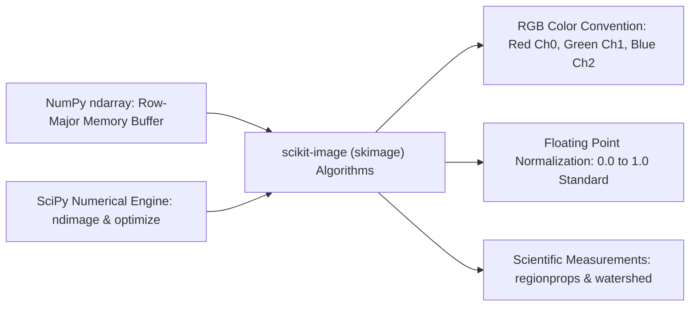
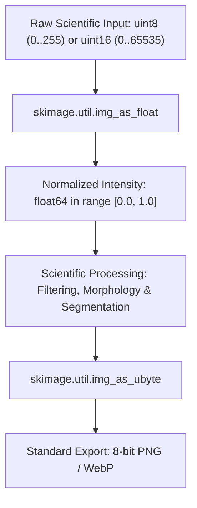
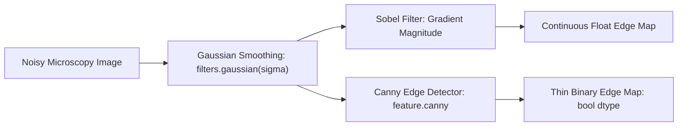
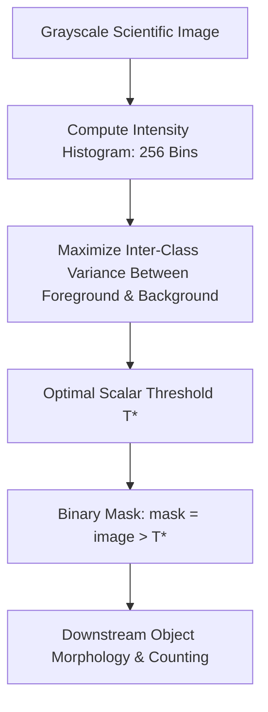
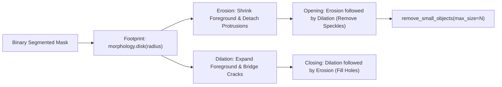
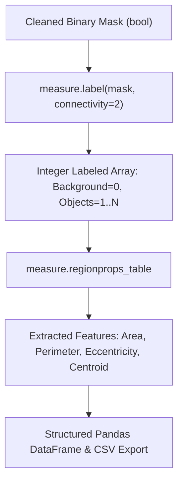
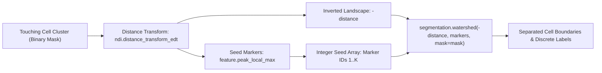
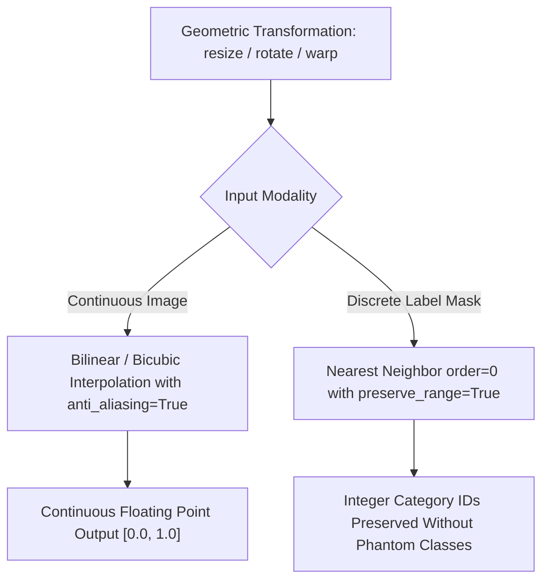
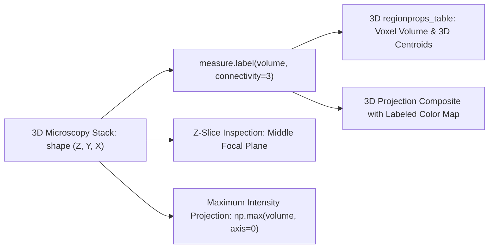
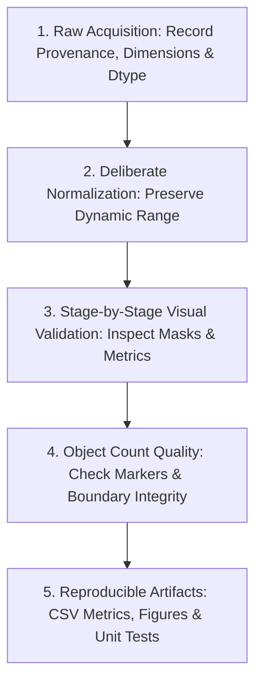

# scikit-image Complete Guide: Scientific Image Processing in Python

This self-contained text collects 10 lessons and five runnable lab descriptions. Install with `python -m pip install -r requirements.txt`, generate samples, then run the modules. All sample data is synthetic.

**Reference version:** 0.26.0, Python 3.11+ required by upstream. No real clinical datasets are included.

## Setup

```bash
python -m pip install -r requirements.txt
python -m data.generate_samples
python -m labs.lab01_image_basics
python -m pytest -q
```

---

## Lesson 01: What Is scikit-image? Python Scientific Image Analysis

**Quick answer:** scikit-image is a free, open-source toolkit for scientific image processing built on NumPy and SciPy. It provides algorithms for filtering, segmentation, image measurements, and geometric transformations. Import it as `skimage`.



## When to use it

- **Research:** measure cell areas, shapes, counts and boundaries.
- **Quality control:** identify connected defects and quantify their dimensions.
- **Microscopy:** segment touching objects, process image stacks and label 3D regions.
- **Education:** inspect each processing step as a NumPy array.

It is a complement, not a replacement, for OpenCV and Pillow. scikit-image typically uses **RGB** color order; OpenCV `cv2.imread` usually produces **BGR** color order. File input is not guaranteed to be RGB (a grayscale image is 2D, and RGBA has four channels). Always inspect `shape` and `dtype`.

## Install and check

```bash
python -m pip install 'scikit-image>=0.26,<0.27' numpy scipy matplotlib
```

```python
import skimage as ski
import numpy as np
print('scikit-image:', ski.__version__)
a = np.zeros((32, 48, 3), dtype=np.uint8)
assert a.shape == (32, 48, 3)
```

**Interpretation:** height × width × color channels. Pixel values can be integers (often 0–255) or floats (commonly 0–1), depending on the function. Don't assume all image arrays have the same range.

**Mini exercise:** Create an array with 64 rows, 96 columns and three channels; print its size in bytes (`a.nbytes`).

**Try next:** Run the relevant project from the [hands-on labs](#five-projects-run-commands-and-previews), or return to the [course home](README.md).

---

## Lesson 02: scikit-image Images: RGB, Grayscale and Pixel Data Types

## Understand pixel values

`uint8` images usually hold 0–255; many processing functions return floating-point arrays. `skimage.util.img_as_float` converts integer range values into floating-point image values. By contrast, merely calling `astype(float)` does **not** normalize intensities.



```python
import numpy as np
from skimage import color, img_as_float
rgb = np.array([[[255, 0, 0], [0, 255, 0]]], dtype=np.uint8)
gray = color.rgb2gray(rgb)
converted = img_as_float(rgb)
assert gray.shape == (1, 2)
assert converted.max() == 1.0
print(gray.round(3))
```

## Read and save real files

```python
from skimage import io
image = io.imread('data/scene-rgb.png')
print(image.shape, image.dtype)
```

To store float images in standard 8-bit formats, explicitly convert to the intended range with `skimage.util.img_as_ubyte` or another deliberate scaling strategy. Use `skimage.io.imsave`, or Pillow to save well-defined RGB/uint8 images.

## Correct color ordering

If input came from `cv2.imread`, use `cv2.cvtColor(bgr, cv2.COLOR_BGR2RGB)` before passing it to RGB-based tools. If input has an alpha channel, decide how to handle transparency before grayscale conversion.

**Pitfall:** blindly treating an arbitrary 16-bit microscopy image as an 8-bit photo can destroy measurement precision. Preserve the original dtype until the conversion requirement is understood.

**Try next:** Run the relevant project from the [hands-on labs](#five-projects-run-commands-and-previews), or return to the [course home](README.md).

---

## Lesson 03: scikit-image Filters: Gaussian, Sobel and Canny Edges

## Smooth before measuring edges

Image noise can create false boundaries. A Gaussian filter suppresses rapid local intensity changes, while a Sobel filter estimates image gradient magnitude. Canny produces a binary edge map after smoothing and nonmaximum suppression.



```python
import numpy as np
from skimage import filters, feature
image = np.zeros((64, 64), dtype=float)
image[15:49, 15:49] = 1.0
smoothed = filters.gaussian(image, sigma=1.2)
sobel = filters.sobel(smoothed)
canny = feature.canny(smoothed, sigma=1.0)
assert sobel.shape == image.shape and canny.dtype == bool
print(int(canny.sum()))
```

## Quantify improvements

When a ground-truth reference exists, use `skimage.metrics.peak_signal_noise_ratio` (PSNR) and `structural_similarity` (SSIM). For float inputs, pass an explicit `data_range`, such as `data_range=1.0` for normalized images. Neither metric alone proves biological or scientific validity.

## Run the lab

```bash
python -m labs.lab02_denoise_edges
```

The included example evaluates denoising on a reproducible synthetic scene, then exports a six-panel comparison.

**Pitfall:** a blurry output can achieve a pleasing numerical metric while erasing scientifically important small structures. Choose sigma based on object scale.

**Try next:** Run the relevant project from the [hands-on labs](#five-projects-run-commands-and-previews), or return to the [course home](README.md).

---

## Lesson 04: Otsu Thresholding in scikit-image: Binary Segmentation

## Binary segmentation with one threshold

Otsu's method chooses a threshold that separates intensity classes by their histogram. It works best when the foreground and background form distinguishable intensity populations.



```python
import numpy as np
from skimage.filters import threshold_otsu
image = np.array([[10, 11, 8, 14], [190, 200, 180, 210]], dtype=np.uint8)
t = threshold_otsu(image)
mask = image > t
assert mask.dtype == bool and mask.sum() == 4
print('threshold:', t)
```

## Global or local?

`threshold_otsu(image)` uses a global threshold. Under strongly uneven lighting, inspect `skimage.filters.threshold_local` or background correction before segmentation.

## Interpret masks

A binary mask answers **which pixels are in the foreground**. It does not yet distinguish individual overlapping objects. Connected component labeling and watershed solve different next steps.

## Run the lab

```bash
python -m labs.lab03_threshold_measure
```

This project applies Otsu thresholding, cleans the mask, counts objects and writes a CSV with shape measurements.

**Try next:** Run the relevant project from the [hands-on labs](#five-projects-run-commands-and-previews), or return to the [course home](README.md).

---

## Lesson 05: scikit-image Morphology: Erosion, Dilation, Opening and Closing

## What does mathematical morphology do?

- **Erosion** shrinks foreground regions; **dilation** grows them.
- **Opening** removes thin protrusions and isolated noise.
- **Closing** can bridge small gaps and fill narrow cracks.
- **Remove small objects** deletes connected components below a chosen pixel count.



```python
import numpy as np
from skimage import morphology
mask = np.zeros((40, 40), dtype=bool)
mask[8:24, 8:24] = True
mask[2, 2] = True
opened = morphology.opening(mask, footprint=morphology.disk(1))
cleaned = morphology.remove_small_objects(opened, max_size=20)
assert cleaned.sum() > 200 and not cleaned[2, 2]
```

## Important scikit-image 0.26 change

Use `remove_small_objects(mask, max_size=N)` for objects of **N pixels or fewer**. Older examples use `min_size`, now deprecated in 0.26 (old behavior removed objects strictly smaller than `min_size`). For binary hole filling use `remove_small_holes(mask, max_size=N)`.

The historical `binary_erosion` / `binary_dilation` / `binary_opening` / `binary_closing` helpers are deprecated in 0.26. Prefer `erosion`, `dilation`, `opening` and `closing` with a `footprint`.

**Pitfall:** choosing a structuring element larger than real objects can destroy valid regions. Always compare original and cleaned masks.

**Try next:** Run the relevant project from the [hands-on labs](#five-projects-run-commands-and-previews), or return to the [course home](README.md).

---

## Lesson 06: Connected Components and regionprops: Measure Object Size and Shape

## From binary pixels to measurable objects

`skimage.measure.label` assigns distinct integer IDs to connected regions. `regionprops_table` returns numeric columns suitable for a DataFrame or CSV.



```python
import numpy as np
from skimage import measure
mask = np.zeros((40, 60), dtype=bool)
mask[2:10, 2:12] = True
mask[20:35, 30:42] = True
labels = measure.label(mask, connectivity=2)
props = measure.regionprops_table(labels, properties=('label', 'area', 'centroid', 'eccentricity'))
assert len(props['label']) == 2
assert sorted(props['area'].tolist()) == [80.0, 180.0]
print(props['centroid-0'])
```

## Useful properties

`area` counts pixels (2D) or voxels (3D) by default. `centroid-0` is a row (y) coordinate; `centroid-1` is a column (x) coordinate. `eccentricity` characterizes how elongated a 2D region is. `perimeter` is pixel-grid dependent, especially for small objects.

To convert into physical units, establish a calibration such as micrometers per pixel. With anisotropic data, use physically meaningful spacing and carefully examine supported properties before interpreting numerical outputs.

## Project

```bash
python -m labs.lab03_threshold_measure
```

The included lab measures **eight** known synthetic cells and writes `outputs/03-region-measurements.csv`.

**Try next:** Run the relevant project from the [hands-on labs](#five-projects-run-commands-and-previews), or return to the [course home](README.md).

---

## Lesson 07: Watershed Segmentation: Separate Touching Cells in Python

## Why thresholding is not enough

Two touching cells often form one connected binary object. Watershed can split them by treating the negative distance transform as a landscape. Each trusted seed becomes a separate region.



```python
import numpy as np
from scipy import ndimage as ndi
from skimage import segmentation
mask = np.zeros((45, 70), dtype=bool)
mask[8:37, 6:33] = True
mask[8:37, 30:57] = True
markers = np.zeros(mask.shape, dtype=np.int32)
markers[20, 18] = 1
markers[20, 45] = 2
distance = ndi.distance_transform_edt(mask)
labels = segmentation.watershed(-distance, markers, mask=mask)
assert set(np.unique(labels)) == {0, 1, 2}
```

In real data, you must find marker centers robustly. The project uses `skimage.feature.peak_local_max` to propose seeds automatically, then `watershed` to assign pixels.

## Verify segmentation quality

Always inspect both the marker count and the segmented object boundaries. Too many peaks cause oversegmentation; too few merge neighboring objects. For research workflows, compare to manually annotated masks and report IoU/Dice where possible.

```bash
python -m labs.lab04_watershed
```

This lab separates **eight** synthetic touching cells and renders the distance transform alongside the final labels.

**Try next:** Run the relevant project from the [hands-on labs](#five-projects-run-commands-and-previews), or return to the [course home](README.md).

---

## Lesson 08: scikit-image Transform: Resize, Rotate and Image Registration Basics

## Geometric transforms

`skimage.transform.resize` changes image dimensions and usually returns floating-point output. Use anti-aliasing for downsampled continuous-tone images. **Do not interpolate class IDs as if they were grayscale intensities.**



```python
import numpy as np
from skimage.transform import resize, rotate
image = np.linspace(0, 1, 64).reshape(8, 8)
smaller = resize(image, (4, 4), anti_aliasing=True)
rotated = rotate(image, 12, resize=False, preserve_range=True)
assert smaller.shape == (4, 4) and rotated.shape == image.shape
```

## Correct way to resize a label mask

```python
import numpy as np
from skimage.transform import resize
labels = np.array([[0, 1], [2, 0]], dtype=np.uint8)
labels_big = resize(labels, (6, 6), order=0, preserve_range=True, anti_aliasing=False).astype(np.uint8)
assert set(np.unique(labels_big)).issubset({0, 1, 2})
```

## Registration in one sentence

Registration aligns images acquired at different times or positions. scikit-image includes cross-correlation and geometric transform utilities; choose an approach according to the expected motion and image modality.

**Pitfall:** resizing changes the physical pixel/voxel spacing. If objects must be measured in physical units, update calibration metadata accordingly.

**Try next:** Run the relevant project from the [hands-on labs](#five-projects-run-commands-and-previews), or return to the [course home](README.md).

---

## Lesson 09: 3D Image Segmentation and Morphometry with scikit-image

## Analyze a stack, not just a photograph

Volumetric microscopy often arrives as `(z, y, x)` or `(z, y, x, channels)`. An `ndarray` can hold the whole stack, but volume memory grows quickly. A connected 3D object may span many Z slices.



```python
import numpy as np
from skimage.measure import label, regionprops_table
volume = np.zeros((12, 32, 32), dtype=bool)
volume[2:7, 4:12, 4:12] = True
volume[6:11, 20:28, 20:28] = True
labels = label(volume, connectivity=3)
props = regionprops_table(labels, properties=('label', 'area', 'centroid'))
assert len(props['label']) == 2
assert sorted(props['area'].tolist()) == [320.0, 320.0]
```

## Interpreting morphometry

Here `area` is a **voxel count**, not yet cubic micrometers. To calculate a physical volume, multiply by voxel spacing along Z × Y × X. If Z spacing differs from X/Y spacing, shape-based comparisons need special care.

## Run the 3D lab

```bash
python -m labs.lab05_3d_morphometry
```

It generates three synthetic spherical objects, segments them, saves a `regionprops_table` CSV and plots a middle slice plus maximum-intensity projection.

**Pitfall:** a 3D image that looks clean in a single slice may contain merged or disconnected regions elsewhere. Always inspect across Z.

**Try next:** Run the relevant project from the [hands-on labs](#five-projects-run-commands-and-previews), or return to the [course home](README.md).

---

## Lesson 10: Five scikit-image Projects: Reproducible Segmentation and Measurement

## A repeatable scientific workflow

1. Keep a raw input image unchanged and record its data type, shape and provenance.
2. Normalize deliberately; never discard intensity or metadata without a reason.
3. Visualize each stage of filtering, thresholding and morphology.
4. Inspect labels and object-count quality before interpreting statistics.
5. Store parameters, pixel-spacing assumptions, generated figures and test results.




## Run all five labs

```bash
python -m data.generate_samples
python -m labs.lab01_image_basics
python -m labs.lab02_denoise_edges
python -m labs.lab03_threshold_measure
python -m labs.lab04_watershed
python -m labs.lab05_3d_morphometry
python -m pytest -q
```

Outputs include chart PNGs in `previews/` and measurement CSV files in `outputs/`. All samples are **synthetic** and are not clinically validated microscopy images.

## Small reproducibility check

```python
import numpy as np
from skimage import measure
sample = np.zeros((25, 25), dtype=bool)
sample[3:9, 3:9] = True
sample[15:20, 15:20] = True
assert measure.label(sample).max() == 2
```

## Choosing your tool

| Tool | Best fit |
|---|---|
| **scikit-image** | Scientific segmentation, image measurements, labeled regions and image transforms |
| **OpenCV** | Broad real-time computer vision, video I/O, camera pipelines and optimized vision primitives |
| **Pillow** | Image formats, resizing, compositing, text and general image-editing workflows |
| **NumPy/SciPy** | Array operations, numerical algorithms and custom image analysis |

## Production considerations

Check input dimensions, image decompression/memory budgets, file formats, and output directories when accepting third-party image files. For large microscopy volumes, measure actual memory usage and consider tiled or chunked processing. Visual validation and domain-specific ground truth remain essential.

**Next step:** Build a custom segmentation dataset with trusted annotations, then compare predictions using boundary or overlap metrics and error analysis.

---

## Five projects: run commands and previews

### Lab 01: RGB, Grayscale and Contrast

Read RGB images, convert to grayscale, apply adaptive histogram equalization and visualize pixel histograms.

```bash
python -m labs.lab01_image_basics
```


### Lab 02: Gaussian Denoising, Sobel and Canny

Denoise synthetic microscopy images, compare PSNR and SSIM against a known reference and detect edges.

```bash
python -m labs.lab02_denoise_edges
```


### Lab 03: Otsu, Morphology and Region Measurements

Threshold, clean and label eight synthetic objects; export area, perimeter, eccentricity and centroids.

```bash
python -m labs.lab03_threshold_measure
```


### Lab 04: Separate Touching Cells with Watershed

Compute the Euclidean distance transform, generate markers and separate eight touching objects.

```bash
python -m labs.lab04_watershed
```


### Lab 05: 3D Volume Segmentation and Morphometry

Segment three synthetic 3D regions, count voxels and export a region measurements CSV.

```bash
python -m labs.lab05_3d_morphometry
```


---

## Quick reference

# scikit-image Cheat Sheet

| Task | Function | Tip |
|---|---|---|
| Read image | `skimage.io.imread(path)` | Check shape and dtype before processing |
| RGB → grayscale | `skimage.color.rgb2gray(rgb)` | Expects RGB, not BGR |
| Convert dtype | `skimage.img_as_float(image)` | Integer image values are scaled appropriately |
| Adaptive contrast | `skimage.exposure.equalize_adapthist(image)` | Inspect amplified noise |
| Smooth | `skimage.filters.gaussian(image, sigma=1)` | For color images specify `channel_axis` as needed |
| Edge magnitude | `skimage.filters.sobel(gray)` | Returns float gradient magnitude |
| Canny edges | `skimage.feature.canny(gray)` | Binary edge map |
| Global threshold | `skimage.filters.threshold_otsu(gray)` | Generates a scalar threshold |
| Morphology opening | `skimage.morphology.opening(mask, footprint=disk(2))` | Removes small protrusions |
| Remove small regions | `skimage.morphology.remove_small_objects(mask, max_size=64)` | New 0.26 API; removes size ≤ 64 |
| Remove small holes | `skimage.morphology.remove_small_holes(mask, max_size=64)` | Fill holes up to 64 pixels |
| Label regions | `skimage.measure.label(mask)` | Labels: background=0 |
| Quantify regions | `skimage.measure.regionprops_table(labels)` | Export to pandas/CSV |
| Touching objects | `skimage.segmentation.watershed(...)` | Requires reliable markers |
| Resize continuous image | `skimage.transform.resize(image, shape, anti_aliasing=True)` | Check pixel spacing |
| Resize labels | `resize(labels, shape, order=0, anti_aliasing=False, preserve_range=True)` | Preserves label IDs |
| 3D regions | `measure.label(volume, connectivity=3)` | Region size measured in voxels |

## Common mistakes

Do not switch BGR and RGB; do not use `astype(float)` when normalization is intended; do not assume 2D pixel counts are physical areas; do not resize label maps with linear interpolation; do not use deprecated `min_size` in new scikit-image 0.26 code.

---

# Frequently Asked Questions

### What is scikit-image in Python?

It is an open-source scientific image-processing library providing segmentation, filtering, morphometry and transforms on NumPy arrays.

### Is scikit-image RGB or BGR?

Color images commonly follow RGB order. OpenCV's usual `cv2.imread` color output is BGR; convert it before passing to RGB-oriented functions.

### What is the difference between scikit-image and OpenCV?

scikit-image emphasizes scientific image analysis and NumPy-centric measurement. OpenCV has broad computer-vision, camera and video-processing APIs. Many research systems use both.

### How does Otsu thresholding work?

It chooses a global threshold based on the pixel histogram by maximizing between-class variance. It may fail under uneven lighting or overlapping intensity distributions.

### What is regionprops?

`skimage.measure.regionprops` and `regionprops_table` compute properties for connected labeled regions: area, centroids, bounding boxes, eccentricity, and more.

### What is watershed segmentation?

A segmentation technique that assigns pixels to seed markers according to a supplied landscape, often an inverted Euclidean distance transform for separating touching objects.

### Why do my image intensities change?

Image functions may convert data type or rescale intensity. Examine dtype and numerical range at each processing step.

### Does scikit-image support 3D images?

Yes. Many algorithms work on 3D stacks `(z, y, x)`. Check that each specific function supports the intended dimensions, connectivity and spacing.

### Is the data included offline?

Yes. The generator creates original synthetic PNG images and NumPy volumes; all five labs run without external datasets.

### Which release should I install?

This course targets stable 0.26.0. The 0.27.0rc1 release is a prerelease and is not required for the examples.

---

## Official reference

- [scikit-image stable user guide](https://scikit-image.org/docs/stable/user_guide/)
- [scikit-image release notes](https://scikit-image.org/docs/stable/release_notes/)
