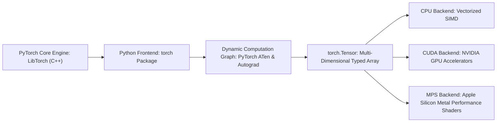
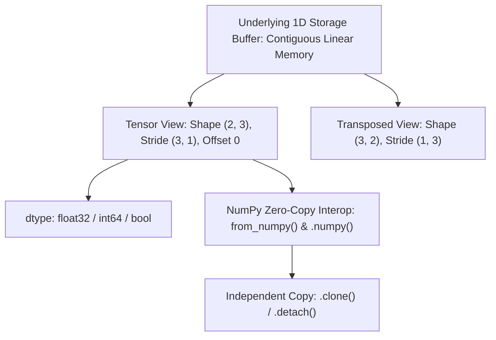
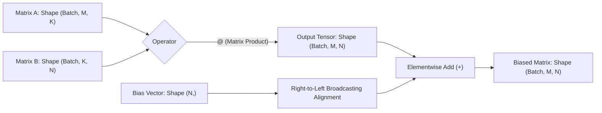
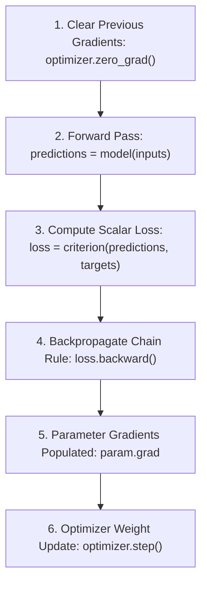
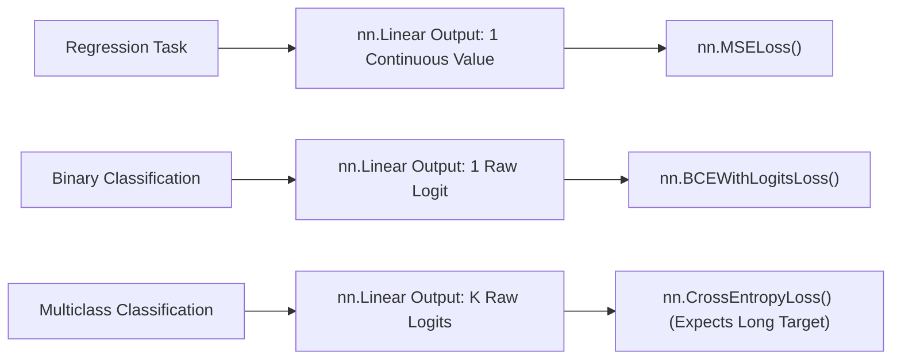
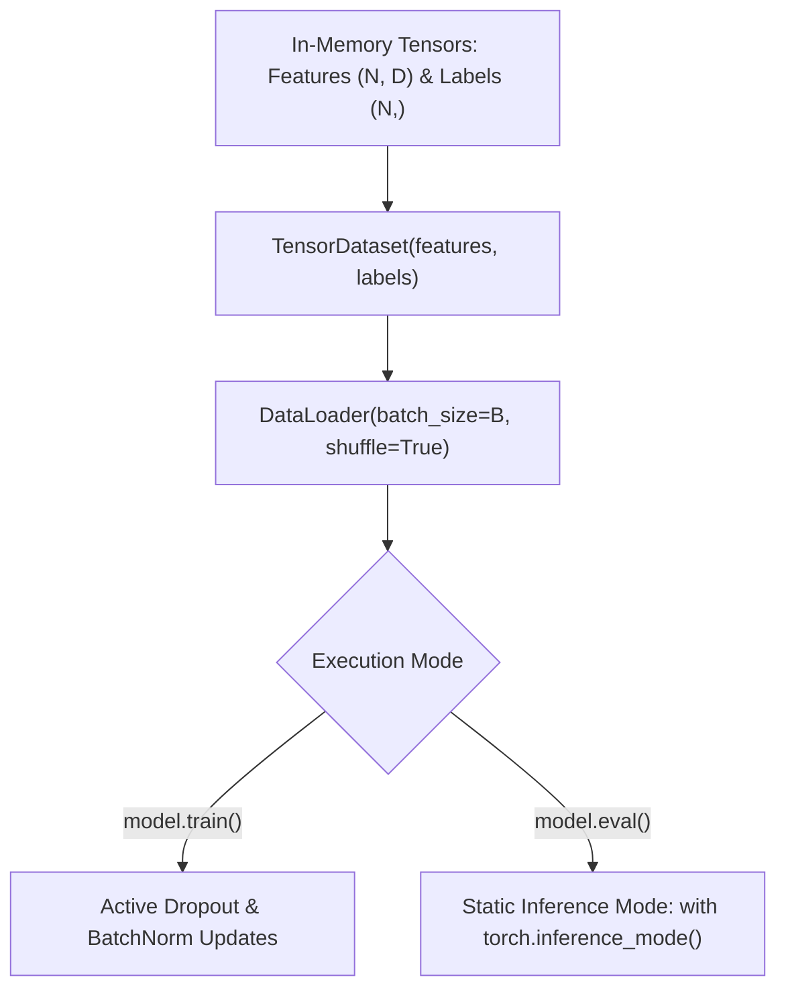
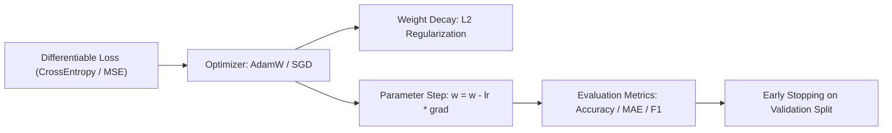
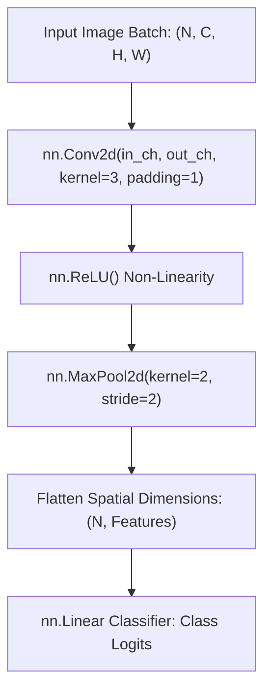
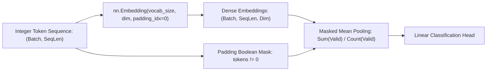
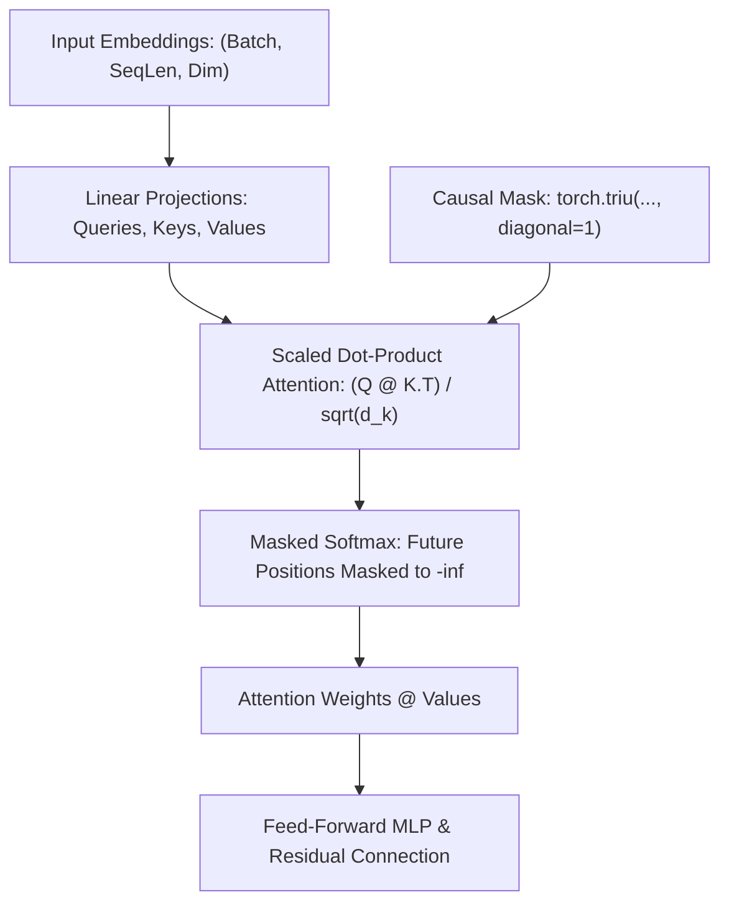

# PyTorch Complete Guide — Tensors, Autograd, Neural Networks & Transformer Basics

A self-contained Markdown tutorial with 10 lessons, five labs and a practical cheat sheet. All labs use local generated data; start in the [repository README](README.md).

## Setup

```bash
python -m pip install -r requirements.txt
python -m data.generate_samples
python -m labs.lab01_tensors_autograd
python -m pytest -q
```

---

## Lesson 01: Install PyTorch and choose a device

Start with a predictable, CPU-first environment, then opt into CUDA or Apple Silicon MPS when it is available.



## Install and check PyTorch

PyTorch is a tensor library and automatic differentiation framework. You import its main package as `torch` and create values using `torch.tensor`. The lab projects require only **Python 3.11+**, PyTorch, NumPy, and Matplotlib; no online data is downloaded when you run them.

```bash
python -m venv .venv
source .venv/bin/activate  # Windows PowerShell: .venv\Scripts\Activate.ps1
python -m pip install -r requirements.txt
python -m pytest -q
```

Choose a PyTorch build for your actual operating system and accelerator from the [official installation selector](https://pytorch.org/get-started/locally/); the requirements file is a straightforward starting point, not a universal CUDA installation command.

```python
import torch
print(torch.__version__)
print(torch.tensor([1.0, 2.0, 3.0]).sum().item())
```

## CUDA, MPS or CPU?

CUDA is commonly used on supported NVIDIA GPUs. `mps` supports many Apple Silicon Macs. Not every operator or datatype is supported equally on every backend, so the teaching labs run on CPU by default.

```python
import torch
if torch.cuda.is_available():
    device = torch.device('cuda')
elif hasattr(torch.backends, 'mps') and torch.backends.mps.is_available():
    device = torch.device('mps')
else:
    device = torch.device('cpu')
print('Device:', device)
```

Put the model **and** its input tensors on the same device. Changing the model device without moving the data is a common error.

**Try it:** Print `torch.__version__`, the chosen device, and the shape of `torch.zeros(2, 3)`.

**Common pitfall:** A faster GPU is not guaranteed for a tiny dataset; transfer overhead can dominate.

---

## Lesson 02: Tensors, shapes, dtypes and NumPy

Treat a tensor as a typed, multi-dimensional array: shape, dtype and device matter on every operation.



## From Python lists to tensors

`torch.Tensor` is PyTorch’s central data object. A shape such as `(4, 3)` describes four rows with three values each. `dtype` controls storage and numeric precision; `device` tells you where the data lives.

```python
import torch
x = torch.tensor([[1., 2., 3.], [4., 5., 6.]])
print(x.shape, x.ndim, x.dtype)
print(x[:, 1])             # second column
print(x.mean(dim=0))      # column means
```

## NumPy interoperability

CPU tensors and NumPy arrays can **share memory**. A tensor converted by `.numpy()` may be backed by the same storage, so in-place changes can affect both objects. Use `.clone()` or `.copy()` when you need independent data.

```python
import numpy as np
import torch
array = np.array([1.0, 2.0, 3.0], dtype=np.float32)
t = torch.from_numpy(array)
t[0] = 9
assert array[0] == 9
```

Learn the difference between an ordinary floating-point tensor and integer token IDs (`torch.long`), especially before using embedding layers.

**Try it:** Create a float32 tensor of shape `(2, 3, 4)` and calculate its mean over `dim=2`.

**Common pitfall:** `.numpy()` does not directly work on a CUDA tensor or a tensor that requires gradients. Move to CPU and detach first when appropriate: `x.detach().cpu().numpy()`.

---

## Lesson 03: Broadcasting, matrix multiplication and reduction

Learn which dimensions align, when `@` performs a matrix product, and why shapes are the first debugging tool.



## Arithmetic and broadcasting

Broadcasting lets PyTorch operate on compatible shapes without copying an entire array. Dimensions are compared **from the right**; they must be equal or one must be `1`.

```python
import torch
scores = torch.tensor([[1., 2., 3.], [4., 5., 6.]])
bias = torch.tensor([.1, .2, .3])
print((scores + bias).shape)    # (2, 3)
print(scores.sum(dim=1))      # sums across columns
```

## Matrix multiplication

`*` is elementwise multiplication. `@` is matrix multiplication. A model layer with 4 input features and 2 output features can use a `(4, 2)` weight matrix.

```python
import torch
x = torch.ones(5, 4)
w = torch.arange(8, dtype=torch.float32).reshape(4, 2)
y = x @ w
assert y.shape == (5, 2)
```

The first axis often represents a batch. For image data, a common shape is `(batch, channels, height, width)`, not `(batch, height, width, channels)`.

**Try it:** Multiply a `(10, 8)` batch by an `(8, 3)` weight matrix, then add a `(3,)` bias.

**Common pitfall:** `tensor.view()` needs compatible storage layout. `reshape()` is more flexible and **may** return a copy; don't assume either always shares storage.

---

## Lesson 04: Autograd, gradients and backpropagation

Understand the chain rule by learning a line with one weight and one bias before using neural networks.



## Dynamic computation graphs

Autograd records differentiable tensor operations when `requires_grad=True`. Calling `.backward()` on a scalar loss populates `.grad` on leaf parameters. Optimizers then use those gradients to update parameters.

```python
import torch
weight = torch.tensor(2.0, requires_grad=True)
x = torch.tensor(3.0)
loss = (weight * x - 7.0) ** 2
loss.backward()
print(weight.grad.item())  # -6, derivative of (3w-7)^2 at w=2
```

Gradient buffers **accumulate** unless reset. Use `optimizer.zero_grad()` before each training step, then `loss.backward()` and `optimizer.step()`. This order appears in all training labs.

```python
import torch
w = torch.nn.Parameter(torch.tensor(0.0))
opt = torch.optim.SGD([w], lr=0.1)
for _ in range(15):
    opt.zero_grad()
    loss = (w - 3.0).square()
    loss.backward()
    opt.step()
assert 2.0 < w.item() < 3.1
```

Use `torch.no_grad()` for operations without gradient tracking and `torch.inference_mode()` for inference where autograd interaction is unnecessary.

**Try it:** Replace the target `3.0` with `-2.0` and watch the learned value change.

**Common pitfall:** Calling `.item()`, `.detach()`, or moving tensors into NumPy inside a differentiable computation breaks its gradient path.

**Practice lab:** [Lab 01 — Autograd regression](#lab-01-autograd-regression).

---

## Lesson 05: Build neural networks with nn.Module

Compose neural network layers, choose a loss function, and understand model inputs and outputs.



## The `nn.Module` pattern

A model subclass uses `__init__` to declare layers and `forward` to define a forward pass. `torch.nn.Linear`, `ReLU`, and `Sequential` are common building blocks.

```python
import torch
from torch import nn
model = nn.Sequential(nn.Linear(4, 8), nn.ReLU(), nn.Linear(8, 3))
logits = model(torch.randn(5, 4))
assert logits.shape == (5, 3)
```

Use the correct pairing between **task**, **model output**, and **loss**: regression often uses `MSELoss`; multiclass classification uses `CrossEntropyLoss` with raw logits; binary classification commonly uses `BCEWithLogitsLoss` with one raw logit. Do not apply `softmax` before `CrossEntropyLoss` or `sigmoid` before `BCEWithLogitsLoss`.

```python
import torch
from torch import nn
logits = torch.tensor([[1.2, .1, -0.3], [.2, 2.0, .0]])
labels = torch.tensor([0, 1], dtype=torch.long)
print(nn.CrossEntropyLoss()(logits, labels).item())
```

**Try it:** Replace an 8-unit hidden layer with 16 units and compare parameter counts using `sum(p.numel() for p in model.parameters())`.

**Common pitfall:** `CrossEntropyLoss` expects class indices of dtype `long` for the usual class-index target form, not a float `(batch, 1)` label vector.

---

## Lesson 06: Datasets, DataLoader and evaluation

Build correct train/test workflows and make model training reproducible without data leakage.



## Mini-batch training

`TensorDataset` stores matched features and labels, while `DataLoader` iterates in mini-batches. Training runs under `model.train()`; evaluation uses `model.eval()` and `torch.inference_mode()`.

```python
import torch
from torch import nn
from torch.utils.data import TensorDataset, DataLoader
features = torch.randn(32, 2)
labels = (features[:, 0] > 0).long()
loader = DataLoader(TensorDataset(features, labels), batch_size=8, shuffle=True)
model = nn.Linear(2, 2)
optimizer = torch.optim.Adam(model.parameters(), lr=0.05)
model.train()
for x, y in loader:
    optimizer.zero_grad()
    loss = nn.functional.cross_entropy(model(x), y)
    loss.backward()
    optimizer.step()
model.eval()
with torch.inference_mode():
    prediction = model(features[:2]).argmax(-1)
print(prediction.shape)
```

Split data **before** learning any preprocessing statistics or selecting hyperparameters; only fit those choices on the training portion. Use a validation set for tuning and a separate test set for a final estimate.

**Try it:** Compare mini-batch sizes of 4 and 16.

**Common pitfall:** `model.eval()` changes modules such as dropout and batch normalization; it does not by itself disable gradient tracking.

**Practice lab:** [Lab 02 — MLP classification](#lab-02-mlp-decision-boundaries).

---

## Lesson 07: Optimizers, losses, metrics and overfitting

Track useful metrics, tune learning rates and recognize when training quality differs from generalization.



## Optimizers are not metrics

An optimizer such as `AdamW` updates weights; loss functions guide those updates; **metrics** such as accuracy or mean absolute error report the outcomes you care about. Small training loss does not imply strong test performance.

```python
import torch
from torch import nn
predicted = torch.tensor([1.8, 2.2, 3.1])
actual = torch.tensor([2.0, 2.0, 3.0])
mae = nn.functional.l1_loss(predicted, actual)
rmse = torch.sqrt(nn.functional.mse_loss(predicted, actual))
print(round(mae.item(), 4), round(rmse.item(), 4))
```

For classification, report the correct metric for the task: accuracy can hide minority-class mistakes. Compare precision, recall and class-specific results when relevant. Use held-out data and explain uncertainty when results come from a small synthetic sample.

Dropout, weight decay and early stopping can help with overfitting, but do not replace a proper validation split. Never choose the final model by repeatedly checking the held-out test data.

**Try it:** Add `nn.Dropout(0.2)` to the MLP and compare validation accuracy over several seeds.

**Common pitfall:** Treating a score on the training examples as a production benchmark.

---

## Lesson 08: Convolutional neural networks for images

Learn image tensor layouts, kernels, feature maps and a small classifier before attempting real image datasets.



## Image tensors in PyTorch

PyTorch's `Conv2d` expects `(N, C, H, W)` input: batch size, channels, height and width. An RGB image usually has `C=3`; a grayscale image has `C=1`.

```python
import torch
from torch import nn
batch = torch.randn(4, 1, 16, 16)
conv = nn.Conv2d(in_channels=1, out_channels=8, kernel_size=3, padding=1)
features = conv(batch)
assert features.shape == (4, 8, 16, 16)
```

In the CNN lab we generate horizontal and vertical line images on a 16×16 canvas. The model learns a pattern discriminator, not general-purpose object recognition. Always state the dataset and limitations alongside example accuracy.

**Try it:** Change `kernel_size=3` to `5` with `padding=2`, keeping the spatial shape unchanged.

**Common pitfall:** Display code often uses `(H, W, C)` while a PyTorch CNN expects `(N, C, H, W)`; convert with `permute` deliberately.

**Practice lab:** [Lab 03 — Image CNN](#lab-03-cnn-image-classification).

---

## Lesson 09: Token IDs, embeddings and text classification

Understand how integer token IDs become learned vectors and why padding must be handled carefully.



## Tokens are not strings inside a model

Real NLP systems use a tokenizer to map text to integer IDs. An `nn.Embedding` maps those IDs to trainable vectors. This lab uses an intentionally tiny **fixed vocabulary**; it is not a modern production tokenizer.

```python
import torch
from torch import nn
embedding = nn.Embedding(num_embeddings=12, embedding_dim=6, padding_idx=0)
ids = torch.tensor([[1, 3, 0], [2, 5, 7]], dtype=torch.long)
vectors = embedding(ids)
assert vectors.shape == (2, 3, 6)
```

When averaging token embeddings, mask padding positions so they do not dilute the result. Real text classifiers should also account for label noise, sampling bias, tokenization choices and distribution shifts.

**Try it:** Compare an average including padding against a masked mean. The values will differ for shorter sequences.

**Common pitfall:** A neat toy accuracy is not evidence that the model understands language or sentiment beyond its generated vocabulary.

**Practice lab:** [Lab 04 — Token embeddings](#lab-04-token-embeddings-for-toy-text).

---

## Lesson 10: Causal attention, transformer basics and checkpoints

Build intuition for decoder-style causal attention, export state dictionaries, and avoid unsafe model loading patterns.




## Why attention needs a mask

Self-attention uses queries, keys and values. A **causal mask** prevents a position from attending to later positions, which is necessary for autoregressive next-token prediction. The tutorial model uses `nn.MultiheadAttention` and a small feed-forward block; it is deliberately not a general-purpose LLM.

```python
import torch
from torch import nn
attention = nn.MultiheadAttention(embed_dim=8, num_heads=2, batch_first=True)
x = torch.randn(2, 4, 8)
# True positions are masked (future tokens cannot be read)
mask = torch.triu(torch.ones(4, 4, dtype=torch.bool), diagonal=1)
out, weights = attention(x, x, x, attn_mask=mask)
assert out.shape == (2, 4, 8)
```

## Save model parameters, not executable Python objects

Prefer `torch.save(model.state_dict(), 'model.pt')`. When restoring, construct the same model class in trusted code and load its state with `torch.load(path, weights_only=True, map_location='cpu')`. This reduces pickle attack exposure but is **not** a guarantee that arbitrary untrusted model files are safe. Validate provenance, file size, expected keys and deployment environment.

```python
import io
import torch
from torch import nn
original = nn.Linear(2, 1)
stream = io.BytesIO()
torch.save(original.state_dict(), stream)
stream.seek(0)
loaded = nn.Linear(2, 1)
loaded.load_state_dict(torch.load(stream, weights_only=True, map_location='cpu'))
assert torch.allclose(original.weight, loaded.weight)
```

**Try it:** Modify only the final input token and check whether earlier logits remain identical under a correct causal mask.

**Common pitfall:** A tiny next-token sequence model trained on arithmetic patterns is not an LLM, and successful training on its examples is not a security or performance evaluation.

**Practice lab:** [Lab 05 — Causal attention](#lab-05-tiny-causal-transformer).

---

## Five projects: run commands and previews

### Lab 01: Autograd Regression

Fit a linear equation with dynamic autograd and inspect gradient norm decay.

```bash
python -m labs.lab01_tensors_autograd
```


### Lab 02: MLP Decision Boundaries

Train an MLP on non-linear synthetic points and visualize continuous decision surfaces.

```bash
python -m labs.lab02_mlp_classification
```


### Lab 03: CNN Image Classification

Train a 2D convolutional network to classify horizontal versus vertical synthetic line textures.

```bash
python -m labs.lab03_cnn_images
```


### Lab 04: Token Embeddings for Toy Text

Train word embeddings with masked mean pooling on a compact sentiment vocabulary.

```bash
python -m labs.lab04_embeddings_nlp
```


### Lab 05: Tiny Causal Transformer

Train an autoregressive multihead attention block with a causal mask and verify safe checkpoint reloading.

```bash
python -m labs.lab05_tiny_transformer
```


---

# PyTorch cheat sheet

| Task | Python code | Note |
|---|---|---|
| Create tensor | `torch.tensor([1., 2.])` | Float data |
| Matrix multiply | `x @ weight` | Different from `*` |
| Inspect shape | `x.shape` | First debugging step |
| Change dtype | `x.to(torch.float32)` | Check loss inputs |
| Move to GPU | `x.to(device)` | Move model too |
| Compute gradient | `loss.backward()` | Accumulates into `.grad` |
| Clear gradients | `optimizer.zero_grad()` | Usually every step |
| Update parameters | `optimizer.step()` | After `.backward()` |
| Mini-batches | `DataLoader(dataset, batch_size=32)` | Optional shuffle |
| Evaluation | `model.eval()` | Adjusts dropout / batchnorm |
| Inference | `with torch.inference_mode():` | Avoid autograd overhead |
| Save weights | `torch.save(model.state_dict(), path)` | Prefer state dict |
| Load weights | `torch.load(path, weights_only=True, map_location='cpu')` | Use trusted files |
| Embeddings | `nn.Embedding(vocab_size, dim)` | IDs must be integer |
| CNN image shape | `(N, C, H, W)` | Channel-first |
| Attention mask | `torch.triu(torch.ones(T,T,dtype=torch.bool),1)` | Future positions blocked |

## Common tensor shapes

| Use case | Shape |
|---|---|
| Tabular batch | `(batch, features)` |
| Grayscale images | `(batch, 1, height, width)` |
| RGB images | `(batch, 3, height, width)` |
| Integer token IDs | `(batch, sequence_length)` |
| Token embeddings | `(batch, sequence_length, embedding_dim)` |
| Next-token logits | `(batch, sequence_length, vocabulary_size)` |

**Remember:** this is a learning aid, not a substitute for documenting dataset provenance, model risk and deployment assumptions.

---

# PyTorch frequently asked questions

## What is PyTorch?

PyTorch is an open-source tensor computation and deep-learning framework with automatic differentiation, neural-network modules, dataset loaders and CPU/GPU support.

## Is `torch` the same as PyTorch?

PyTorch is the project; `torch` is its main Python import. `torch.Tensor` is its core array-like data type.

## Do I need an NVIDIA GPU?

No. All five labs are designed to run on CPU. Optional CUDA or Apple Silicon MPS can accelerate suitable larger workloads.

## What is autograd?

It automatically computes gradients through supported differentiable tensor operations. Models use those gradients to update learnable parameters.

## What is `nn.Module`?

A base class used to define trainable layers and models; parameters registered on modules are discoverable by optimizers.

## What is the difference between training and evaluation?

Training updates parameters. `model.eval()` changes how certain layers behave; wrapping predictions in `torch.inference_mode()` disables autograd bookkeeping.

## Is the transformer lab a language model?

It is a small next-token neural network trained on synthetic cyclic sequences. It illustrates causal attention, but does not understand or generate realistic natural-language text.

## Is PyTorch used by more than 90% of researchers?

PyTorch is widely used in modern deep-learning research and engineering, but we do **not** present an unsourced '90%+' figure as fact. Adoption depends on the surveyed field, year and methodology.

## Can I use PyTorch for computer vision?

Yes. CNNs are one option; the tutorial uses a tiny CNN that learns to distinguish generated line patterns.

## Is `torch.load` safe for unknown checkpoints?

Do not assume so. Use trusted files and `weights_only=True` for supported weight checkpoints, and follow your organization's model provenance and artifact validation policies.

## Should I choose PyTorch or TensorFlow/JAX?

The best choice depends on your project, team and deployment stack. PyTorch excels at flexible model development and has a broad ecosystem; different teams may prefer alternatives.

---

# PyTorch glossary

| Term | Meaning |
|---|---|
| Tensor | Typed multi-dimensional numeric array |
| Shape | Size of every axis of a tensor |
| Dtype | Element data type, such as float32 or int64 |
| Device | Where a tensor lives: CPU or accelerator |
| Batch | Group of samples processed together |
| Broadcasting | Operating on compatible shapes without manually repeating values |
| Autograd | Automatic differentiation engine |
| Gradient | Derivative of loss with respect to a parameter |
| Parameter | Tensor registered for model optimization |
| Forward pass | Compute predictions from inputs |
| Backpropagation | Propagate loss gradients backward |
| Optimizer | Algorithm that updates model parameters |
| Loss | Differentiable training objective |
| Logits | Raw scores, not yet converted to probabilities |
| Epoch | One pass through a training dataset |
| DataLoader | Iterator supplying dataset batches |
| Validation | Data used for model selection and hyperparameters |
| Test set | Separate data for final quality estimation |
| CNN | Convolution-based neural network |
| Embedding | Learned numeric representation of a token or ID |
| Token | Unit mapped to an integer ID |
| Self-attention | Learns weighted interactions among sequence positions |
| Causal mask | Prevents an output from reading future inputs |
| State dict | Mapping of model parameters and persistent buffers |
| Checkpoint | Saved state used to restore training or inference |

---

## Sources and usage

API references: [Official PyTorch documentation](https://docs.pytorch.org/docs/stable/), [PyTorch tutorials](https://docs.pytorch.org/tutorials/), [Install selector](https://pytorch.org/get-started/locally/). The project was tested against locally available PyTorch 2.13.0+cpu. Newer releases and accelerator backends may differ.
