# TorchVision Complete Guide — 10 Lessons and 5 Hands-on Labs

> A practical beginner-friendly guide to TorchVision datasets, image preprocessing, model building, pretrained weights, and geometry-aware transforms. All five default projects run fully offline using original synthetic data.

**Tested:** Python 3.13.5 • torch 2.13.0 • torchvision 0.28.0 (compatible with 0.25.0+cpu). Latest PyPI release seen as of 2026-11-02: torchvision 0.29.2. For supported pairings, see the official compatibility table.

**One-command dataset creation:** `python -m data.generate_samples`

**Package structure:** This guide is self-contained for reading; the executable Python lab modules are supplied separately under `labs/`.

## Setup

```bash
python -m pip install -r requirements.txt
python -m data.generate_samples
python -m labs.lab01_imagefolder_grid
python -m pytest -q
```

---

## Lesson 1 — Getting Started with TorchVision

TorchVision adds image datasets, transforms, pretrained model definitions, image utilities, and structured vision tensors to PyTorch. It is not a separate deep-learning engine: **PyTorch** handles tensors, autograd, and training; **TorchVision** supplies vision-specific tools.

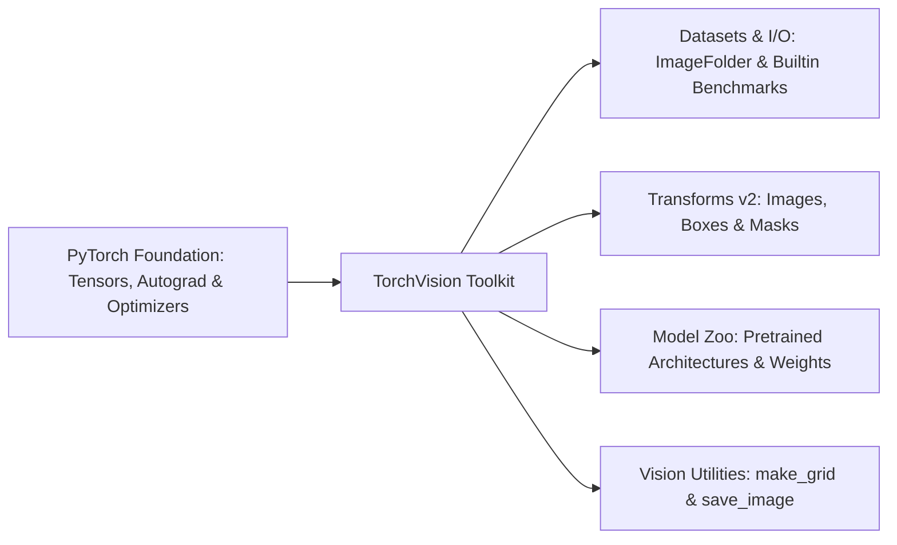

## What you will learn

- How to install compatible PyTorch and TorchVision versions.
- Why a CPU-only workflow is useful for reproducible learning.
- How to verify imports before running a project.

**Tested environment:** Python 3.13.5, PyTorch 2.13.0, TorchVision 0.28.0. TorchVision 0.29.2 was the current PyPI release when this guide was prepared; compatibility has **not** been tested against it. Do not assume the newest `torchvision` pairs with an older `torch`.

## Installation

Use the [official PyTorch installation selector](https://pytorch.org/get-started/locally/) if you need CUDA or Apple Silicon support. For the **tested version pair**, run the commands in the root README. On CPU, install both packages from the same appropriate wheel channel; mixing a CPU build with incompatible CUDA builds can cause missing-operator errors.

## Runnable example

```python
import torch
import torchvision
print('torch', torch.__version__)
print('torchvision', torchvision.__version__)
assert hasattr(torchvision, 'datasets')
```

## Common pitfalls

- Installing TorchVision independently and silently upgrading/downgrading `torch`.
- Assuming `torchvision` provides video capture; use a video reader or decoder for that task.
- Calling `torchvision.models.resnet18(weights=None)` and expecting ImageNet predictions.

**Try it:** Open a Python shell and print the two versions.

---

## Lesson 2 — Images as Tensors: RGB, CHW, and Dtypes

A PIL RGB image usually has pixels ordered as `(height, width, channels)`. TorchVision tensor images typically use `(channels, height, width)` or `(batch, channels, height, width)`. Unlike OpenCV’s common BGR layout, a PIL RGB image has **red, green, blue** channel order.

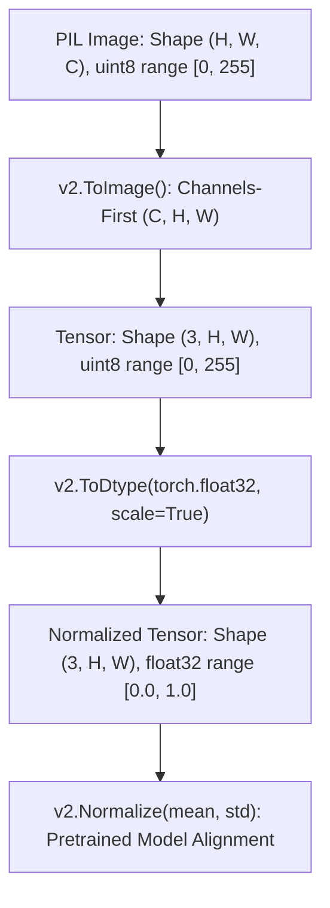

Use `v2.ToImage()` to convert PIL input into a tensor-like `tv_tensors.Image`. That conversion does **not** automatically scale uint8 values into `[0, 1]`; `v2.ToDtype(torch.float32, scale=True)` performs the conversion and scaling. Normalization for specific pretrained weights is a *separate* operation.

## Runnable example

```python
import torch
from PIL import Image
from torchvision.transforms import v2
image = Image.new('RGB', (48, 32), color=(220, 50, 20))
x = v2.Compose([v2.ToImage(), v2.ToDtype(torch.float32, scale=True)])(image)
print(x.shape, x.dtype, x.min().item(), x.max().item())
assert x.shape == (3, 32, 48)
assert 0 <= float(x.min()) <= float(x.max()) <= 1
```

### Quick reference

| Source | Common shape | Numeric range |
|---|---|---|
| PIL RGB image | `H × W × 3` conceptually | integer 0–255 |
| Tensor from `v2.ToImage()` | `3 × H × W` | uint8 0–255 |
| `v2.ToDtype(float32, scale=True)` | `3 × H × W` | float 0–1 |
| Model input batch | `N × 3 × H × W` | according to model preprocessing |

**Try it:** Make an 8×8 RGB image, convert it, and inspect the first channel. For OpenCV BGR arrays, convert channel order explicitly.

---

## Lesson 3 — ImageFolder Datasets and DataLoader

`torchvision.datasets.ImageFolder` expects class-labelled directories, and assigns integer class IDs in sorted class-name order. For example, our generated dataset has `diagonal/`, `horizontal/`, and `vertical/` subdirectories within *each* split.

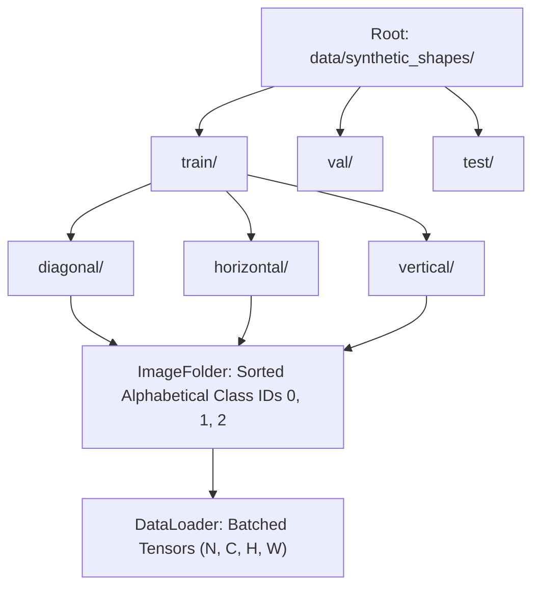

```text
synthetic_shapes/
  train/diagonal/*.png
  train/horizontal/*.png
  train/vertical/*.png
  val/...
  test/...
```

Use **separate train, validation and test directories** and preserve the same class mapping in each. A `DataLoader` creates image mini-batches. The example below uses `num_workers=0` so it also runs in basic notebooks and operating systems without multiprocessing configuration.

## Runnable example

```python
from torch.utils.data import DataLoader
from labs.common import load_split
train = load_split('train')
loader = DataLoader(train, batch_size=6, shuffle=False, num_workers=0)
images, labels = next(iter(loader))
print(train.classes, images.shape, labels.shape)
assert images.shape == (6, 3, 64, 64)
```

### When not to use ImageFolder

For multiple labels per image, bounding boxes, or masks, write a custom `torch.utils.data.Dataset` (or adapt an existing dataset). `ImageFolder` stores a **single class label** per image.

**Try it:** Change `batch_size` to 4. Check `train.class_to_idx` instead of assuming the IDs based on directory creation order.

---

## Lesson 4 — Transforms v2: Resize, Convert, and Normalize

TorchVision recommends **`torchvision.transforms.v2`** for new projects. v2 transforms work with images and, when used correctly, can process structured vision annotations such as masks and bounding boxes.

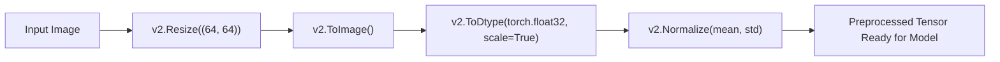

A practical preprocessing sequence is: **resize → convert to image tensor → convert and scale dtype → normalize (when required)**. The transform order matters. For ordinary custom toy classification we use `[0,1]` tensors; for a downloaded pretrained model, use its *own* documented preprocessing recipe.

## Runnable example

```python
import torch
from PIL import Image
from torchvision.transforms import v2
preprocess = v2.Compose([
    v2.Resize((64, 64)),
    v2.ToImage(),
    v2.ToDtype(torch.float32, scale=True),
])
out = preprocess(Image.new('RGB', (120, 70), 'navy'))
assert tuple(out.shape) == (3, 64, 64)
assert out.dtype == torch.float32
```

### `Normalize` is not the same as scaling

`v2.Normalize(mean=[...], std=[...])` subtracts channel means and divides by standard deviations. It should be applied to correctly scaled float tensors using the statistics required by your particular pretrained weights or training pipeline.

**Try it:** Replace `(64, 64)` with `(128, 128)` and inspect the output shape. Visit Lab 02 for a visual before/after comparison.

---

## Lesson 5 — Data Augmentation Without Label Leakage

Augmentation improves training diversity by changing pixels while keeping the **correct ground-truth label**. It is not always label preserving: horizontal flips can reverse written letters, flip road signs, or turn a slash into a different diagonal class. Think about the task before using every transform.

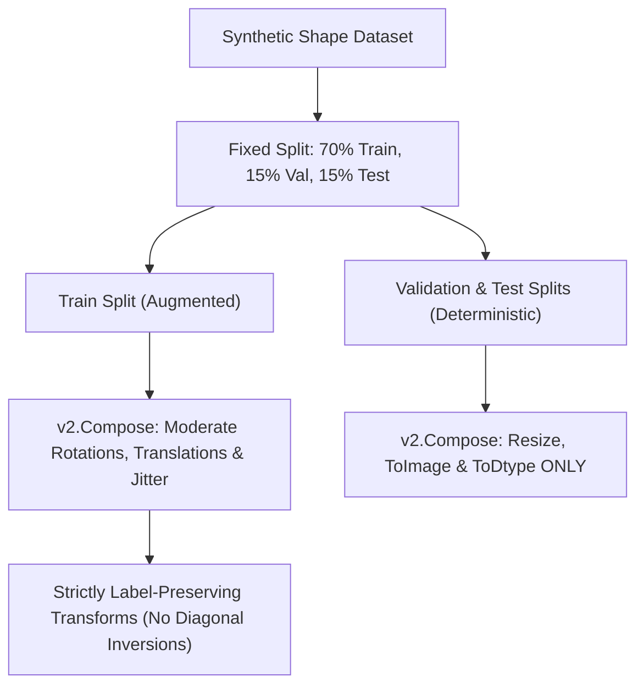

- **Train:** modest color jitter, rotation, and translation, if semantics permit.
- **Validation/test:** deterministic conversions only; never randomly augment the held-out evaluation.
- **Leakage prevention:** split samples before augmentation; do not transform near-duplicates and scatter them across all splits.

## Runnable example

```python
import torch
from torchvision.transforms import v2
x = torch.zeros(3, 12, 16)
x[:, :, :4] = 1
flip = v2.RandomHorizontalFlip(p=1.0)
y = flip(x)
assert torch.equal(y[:, :, -4:], torch.ones(3, 12, 4))
```

This forced flip makes the pixel effect easy to inspect, but we intentionally **do not** use it for the directional toy classifier because a mirrored diagonal could change the task label.

**Try it:** Compare `load_split('train', augment=True)` against `load_split('val', augment=False)`. Run the same validation image twice and confirm its pixels are identical.

---

## Lesson 6 — Image Grids and Visual Debugging

A training pipeline should never be a black box. Display examples **with their labels**, watch for incorrect color channels, check shapes, and inspect annotations *after* transformations.

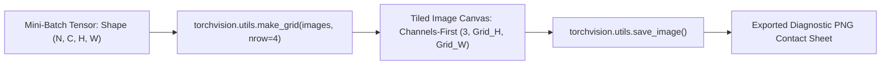

`torchvision.utils.make_grid()` arranges tensors into a tiled image, and `save_image()` writes the result to disk. To avoid unintentionally visualizing normalized or out-of-range tensors incorrectly, work with image tensors in `[0,1]` when making these previews.

## Runnable example

```python
from pathlib import Path
import torch
from torchvision.utils import make_grid, save_image
out = Path('previews/lesson06-grid.png')
out.parent.mkdir(parents=True, exist_ok=True)
images = torch.rand(6, 3, 24, 24)
grid = make_grid(images, nrow=3)
save_image(grid, out)
assert out.is_file()
```

### Debug checklist

Check that: `images.ndim == 4`, channel count is expected, label IDs match `dataset.classes`, and the same image is not accidentally present in both training and test data.

**Try it:** Run Lab 01 and compare the generated contact sheet with the individual image files.

---

## Lesson 7 — Train a Tiny CNN with ImageFolder

TorchVision supplies the **data pipeline**; PyTorch supplies `nn.Module`, gradient computation, and the optimizer. The Lab 03 model learns to classify three types of synthetic directional lines. It is deliberately tiny so it trains on a CPU with no downloads.

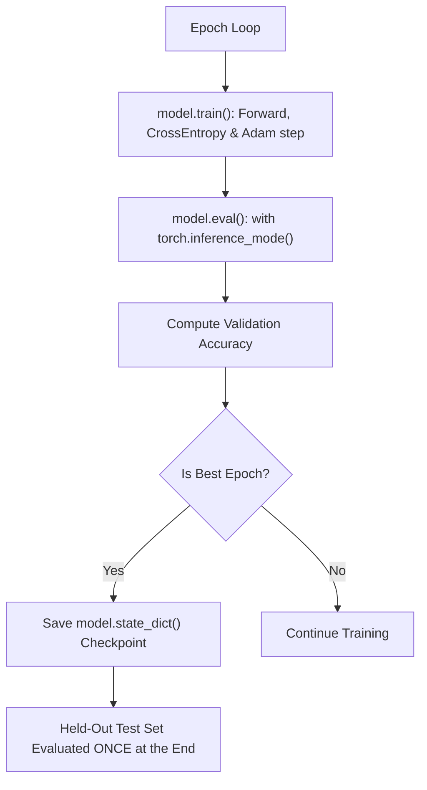

A safe supervised-learning workflow is: **training → validation for selecting the best epoch → held-out testing once**. Training loss measures fit to training data; held-out accuracy measures generalization only to that particular split.

## Runnable example

```python
import torch
from labs.lab03_train_classifier import TinyVisionCNN
model = TinyVisionCNN(num_classes=3)
batch = torch.rand(5, 3, 64, 64)
logits = model(batch)
loss = torch.nn.CrossEntropyLoss()(logits, torch.tensor([0,1,2,0,1]))
loss.backward()
assert logits.shape == (5, 3)
```

### Why the result is not a benchmark

The dataset consists of simple, procedurally generated lines with distinct orientations. Even 100% held-out accuracy on this example does **not** imply that the model can understand real-world photographs. The lab is about data handling and training mechanics, not state-of-the-art recognition.

**Try it:** Run `python -m labs.lab03_train_classifier` and inspect `artifacts/tinyvision-metadata.json`. Never use the final test split to choose a learning rate or select epochs.

---

## Lesson 8 — Evaluate, Predict, and Save Weights Safely

Use `model.eval()` to switch dropout/batch normalization to evaluation behavior and `torch.inference_mode()` to disable gradient tracking during evaluation. These two operations do different jobs.

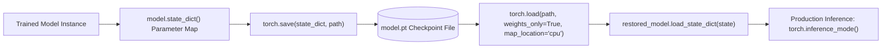

Save a **`state_dict`** rather than pickling the entire model object. When loading locally saved tensor weights, use `torch.load(..., weights_only=True)`; avoid opening checkpoint files from unknown or untrusted origins. Preserve the class order and preprocessing configuration alongside model weights.

## Runnable example

```python
import torch
from labs.lab03_train_classifier import TinyVisionCNN
model = TinyVisionCNN().eval()
with torch.inference_mode():
    logits = model(torch.rand(1, 3, 64, 64))
    probs = logits.softmax(dim=1)
assert abs(probs.sum().item() - 1.0) < 1e-5
```

## Accuracy is only one metric

For real projects, also consider per-class precision/recall, class imbalance, confusion matrices, calibration, latency, and performance on data collected after deployment. Our toy dataset is balanced, so accuracy is easy to interpret.

**Try it:** After Lab 03 completes, inspect the saved `state_dict` and recreate the model using `TinyVisionCNN(num_classes=3)`.

---

## Lesson 9 — Model Zoo and Pretrained Weights

TorchVision includes model definitions for classification and other visual tasks. **`weights=None`** creates a randomly initialized architecture; its numerical outputs are **not meaningful class predictions**. Explicitly selecting an official `Weights` enum requests pretrained weights, which may require an internet download and disk space.

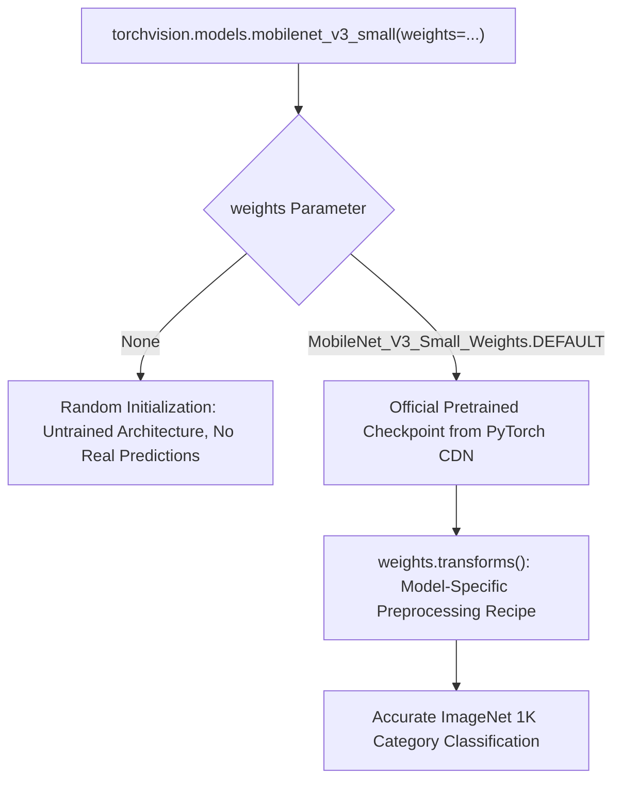

Each weight enum specifies its own preprocessing. Do **not** assume that every pretrained model uses the same resize, crop, or normalization recipe. The stable `DEFAULT` alias may change as more weights are released; select a specific weight member for maximum reproducibility.

## Runnable example (completely offline)

```python
import torch
from torchvision.models import mobilenet_v3_small, MobileNet_V3_Small_Weights
architecture = mobilenet_v3_small(weights=None, num_classes=3).eval()
with torch.inference_mode():
    logits = architecture(torch.zeros(1, 3, 64, 64))
recipe = MobileNet_V3_Small_Weights.IMAGENET1K_V1.transforms()
print('untrained output shape:', logits.shape, 'preprocessing:', type(recipe).__name__)
assert logits.shape == (1, 3)
```

## Optional pretrained demo (requires internet on first run)

`python -m labs.lab04_model_zoo --pretrained --image path/to/image.jpg`

This explicitly downloads the official MobileNetV3 Small ImageNet weights if not cached and applies their matching preprocessing. Results on synthetic shapes are out-of-distribution and need not be meaningful.

**Try it:** First run Lab 04 without arguments and compare parameter counts for MobileNetV3 Small and ResNet-18.

---

## Lesson 10 — Detection, Masks, and TVTensors

Classification labels describe a whole image. Object detection requires bounding boxes; segmentation additionally describes which pixels belong to objects. If you flip or resize the image without transforming its boxes/masks, the annotations become **incorrect**.

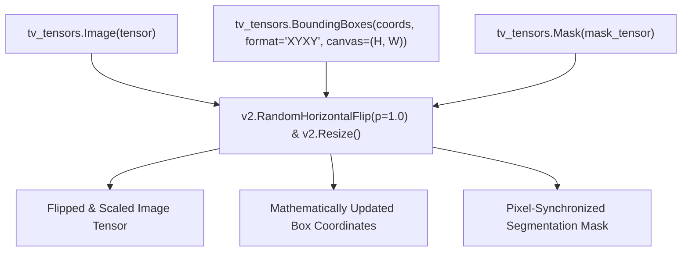

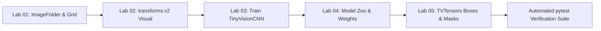

`torchvision.tv_tensors.BoundingBoxes` stores both coordinates and the canvas size. `Mask` records segmentation pixels. When passed together through compatible `transforms.v2`, geometric transforms apply consistently.

## Runnable example

```python
import torch
from torchvision import tv_tensors
from torchvision.transforms import v2
img = tv_tensors.Image(torch.zeros(3, 40, 80, dtype=torch.uint8))
boxes = tv_tensors.BoundingBoxes(torch.tensor([[5., 10., 25., 30.]]),
                                format='XYXY', canvas_size=(40, 80))
flipped_image, flipped_boxes = v2.RandomHorizontalFlip(p=1)(img, boxes)
assert flipped_image.shape == img.shape
assert torch.allclose(flipped_boxes, torch.tensor([[55., 10., 75., 30.]]))
```

### Coordinates in `XYXY`

A box is `[left, top, right, bottom]` in image-pixel coordinates. Its canvas size is `(height, width)`. Keep track of your coordinate convention when converting to formats such as `XYWH`.

**Try it:** Run Lab 05 and compare the source, mirrored, and resized annotated images.

---

# Hands-on Projects

## Lab 01 — ImageFolder & Contact Sheet

Organize RGB PNG files into `class_name/` folders, load batches with `ImageFolder` and `DataLoader`, and export a contact sheet with `torchvision.utils.make_grid`.

Run from the project root:

```bash
python -m labs.lab01_imagefolder_grid
```

What to verify: Check `classes` / `class_to_idx`, batch dimensions, pixel ranges, and class balance.


---

## Lab 02 — Visualize transforms.v2

Apply image conversion, a deterministic flip, rotation, and resizing to a single sample. Inspect how height/width and pixel values change.

Run from the project root:

```bash
python -m labs.lab02_transforms_v2
```

What to verify: Remember that flipping is not always label preserving for directional symbols or readable text.


---

## Lab 03 — Train and Evaluate a Toy Image Classifier

Train a small PyTorch CNN using TorchVision `ImageFolder` loaders, validation-based checkpoint selection, and one final test evaluation.

Run from the project root:

```bash
python -m labs.lab03_train_classifier
```

What to verify: The easy synthetic dataset can reach 100%; this is a pipeline demonstration, **not** an image-recognition benchmark.


---

## Lab 04 — Model Zoo and Optional Pretrained Demo

Compare parameter counts of randomly initialized MobileNetV3 Small and ResNet-18; optionally download official ImageNet weights for true inference.

Run from the project root:

```bash
python -m labs.lab04_model_zoo
```

What to verify: Default mode is offline and reports **no meaningful predictions**. `--pretrained` explicitly requests the download.


---

## Lab 05 — Bounding Boxes and Masks

Use `tv_tensors.Image`, `BoundingBoxes`, and `Mask` to apply the same horizontal flip and resize to every part of an annotated scene.

Run from the project root:

```bash
python -m labs.lab05_boxes_masks
```

What to verify: Verify that transformed box coordinates and mask pixels still match the objects.


---

# Cheat Sheet

| Task | API | Remember |
|---|---|---|
| Class folder dataset | `torchvision.datasets.ImageFolder(root, transform=...)` | Sorted alphabetical class indices |
| Batch loader | `torch.utils.data.DataLoader(dataset, batch_size=...)` | Returns `N,C,H,W` tensors |
| PIL → image tensor | `v2.ToImage()` | Does not scale uint8 values |
| Convert and scale | `v2.ToDtype(torch.float32, scale=True)` | Converts 0–255 to 0–1 |
| Resize | `v2.Resize((H, W))` | Height first |
| Flip | `v2.RandomHorizontalFlip(p=0.5)` | Ensure labels remain correct |
| Normalize | `v2.Normalize(mean=..., std=...)` | Use correct model statistics |
| Image grid | `torchvision.utils.make_grid(images)` | For batched tensors |
| Save a grid | `torchvision.utils.save_image(images, path)` | Supports float 0–1 tensors |
| Model without weights | `resnet18(weights=None)` | **Random**, not pretrained |
| Model with weights | `resnet18(weights=ResNet18_Weights.IMAGENET1K_V1)` | Download may occur |
| Correct preprocessing | `weights.transforms()` | Weight-specific normalization |
| Image coordinates | `tv_tensors.BoundingBoxes(..., canvas_size=(H,W))` | Keep annotations aligned |
| Segmentation | `tv_tensors.Mask(mask_tensor)` | v2 transforms act on masks |
| Safe tensor weight read | `torch.load(path, weights_only=True)` | Only trusted local sources |

**Core principles:** use train-only augmentation, keep test data untouched until final evaluation, preserve class order, prefer `state_dict` over whole-object serialization, and select matching PyTorch/TorchVision builds.

---

# FAQ

### What is the difference between PyTorch and TorchVision?

PyTorch is the deep learning framework. TorchVision provides computer-vision-specific datasets, transforms, model definitions, and utilities built on PyTorch.

### Is TorchVision the same as OpenCV?

No. OpenCV focuses on general image/video processing and classical computer-vision algorithms. TorchVision focuses on datasets, neural-network model architectures, transformations, and integration with PyTorch.

### Why is my image tensor `3×224×224` instead of `224×224×3`?

TorchVision generally represents images as channel-first tensors (`C,H,W`); PIL and common NumPy RGB arrays are usually height-width-channel (`H,W,C`).

### What does `weights=None` mean?

It means no pretrained weights are loaded. The model has random parameters and will not produce reliable class labels until properly trained.

### Why use transforms v2?

The official documentation recommends the v2 API for new projects. It supports images plus structured inputs such as masks and bounding boxes, allowing synchronized transforms.

### How do I load a pretrained model offline?

First download or cache the official weights through a trusted channel, then use a compatible checkpoint and matching transform recipe. The optional Lab 04 demo needs network access the first time unless weights are already cached.

### Are the 100% test results real-world performance?

No. Synthetic lines are much simpler than real images, and a small held-out test split is not an external benchmark.

### Does this course require CUDA or a webcam?

No. Every mandatory lab works on CPU, uses offline synthetic image files, and requires no camera.

### How do I publish the documentation?

Publishing is handled through the integrated static documentation site; all guides are rendered directly into static pages via Mix export.

### Which versions should I install?

Check the official PyTorch selector and TorchVision compatibility table. This package was tested with torch 2.13.0 and torchvision 0.28.0; newer releases need a new verification pass.

---

# Glossary

**Augmentation:** Training-time modification that should retain the correct label.

**Bounding box:** Rectangle locating an object, often represented by `(x1,y1,x2,y2)`.

**CHW:** Channels-height-width tensor layout, common for single images in TorchVision.

**CNN:** Convolutional neural network for processing grid-like data such as images.

**DataLoader:** PyTorch iterator that groups dataset samples into batches.

**Dataset:** Object returning `(input, target)` samples, indexed by item.

**Fine-tuning:** Adapting a pretrained model using labelled data for a new task.

**ImageFolder:** Dataset that derives one class label from the parent directory.

**Inference:** Applying trained model parameters to new inputs.

**Model weights:** Learned parameter tensors, or a specific pretrained parameter set.

**Normalization:** Affine channel transform, usually `(x - mean) / std`.

**Pool:** Not a TorchVision primary data container; detection uses image tensors and annotations.

**RGB:** Red-green-blue pixel channel order.

**Segmentation mask:** Per-pixel indicator of an object or semantic class.

**State dict:** Mapping of model parameter/buffer names to tensors.

**TVTensors:** TorchVision tensor subclasses that retain semantic context such as canvas size and bounding-box format.

**Validation set:** Split used to tune hyperparameters and select a checkpoint.

**Test set:** Held-out split for unbiased final evaluation *after* model selection.

---

# Official Sources

- [TorchVision stable documentation](https://docs.pytorch.org/vision/stable/index.html)
- [TorchVision transforms v2](https://docs.pytorch.org/vision/stable/transforms.html)
- [TorchVision datasets](https://docs.pytorch.org/vision/stable/datasets.html)
- [TorchVision ImageFolder](https://docs.pytorch.org/vision/stable/generated/torchvision.datasets.ImageFolder.html)
- [Models and pretrained weights](https://docs.pytorch.org/vision/stable/models.html)
- [MobileNetV3 Small weight information](https://docs.pytorch.org/vision/stable/models/generated/torchvision.models.mobilenet_v3_small.html)
- [PyTorch install selector](https://pytorch.org/get-started/locally/)
- [TorchVision PyPI release listing](https://pypi.org/project/torchvision/)
- [PyTorch computer vision tutorials](https://pytorch.org/tutorials/beginner/blitz/cifar10_tutorial.html)

**Version statement (2026-11-02):** All runnable examples in this package were tested on TorchVision 0.28.0 with PyTorch 2.13.0 CPU wheels.

---

## Final checklist

- [ ] Dataset class mapping is correct and stable across splits.
- [ ] Image channel layout, dtype, and pixel range match the model pipeline.
- [ ] Training-only augmentation does not change the ground-truth labels.
- [ ] Validation is used for model selection, then final test once.
- [ ] Downloaded weights use the exact matching model preprocessing recipe.
- [ ] Model files are from trusted origins and are loaded safely.
- [ ] Bounding boxes and masks stay aligned after every geometric transform.
- [ ] Synthetic toy accuracy is not presented as a real-world benchmark.
