# TensorFlow Complete Guide — Beginner to Deployment

> 10 lessons + 5 hands-on labs + Quick Reference + FAQ + Serving & Edge Deployment + Framework Comparison + Glossary + Safety.

Master deep learning systems with **TensorFlow 2.x** and **Keras 3**: static vs dynamic computational graphs, `tf.Tensor` memory layouts and NHWC format, `tf.GradientTape` automatic differentiation, Keras Sequential and Functional architectures, high-performance `tf.data` ETL pipelines (`shuffle`, `batch`, `prefetch`), early stopping without data leakage, 2D Convolutional Neural Networks on synthetic vision fixtures, production SavedModel serialization with serving signatures, and LiteRT (TFLite) edge quantization.

**Environment baseline:** Python 3.11–3.14 • TensorFlow 2.16+ / 2.22+ • Keras 3.x. All 5 labs run completely offline using reproducible synthetic fixtures.

## Setup

```bash
python -m pip install -r requirements-dev.txt
python -m data.generate_samples
python -m labs.lab01_tf_autograd
python -m pytest -q
```

---

## Lesson 01 — Install TensorFlow and Inspect Accelerators

TensorFlow is an end-to-end open-source machine learning platform developed by Google. At its foundation, TensorFlow provides multi-dimensional array operations (`tf.Tensor`), automatic differentiation (`tf.GradientTape`), an optimizing graph compiler (XLA), and deep hardware support across CPUs (AVX-512/AMX), GPUs (NVIDIA CUDA/cuDNN, ROCm), Apple Silicon (Metal Performance Shaders / MPS), and Google Cloud TPUs.

In TensorFlow 2.x and Keras 3, eager execution is enabled by default: tensor operations evaluate immediately and return Python-accessible values without explicit session initialization.

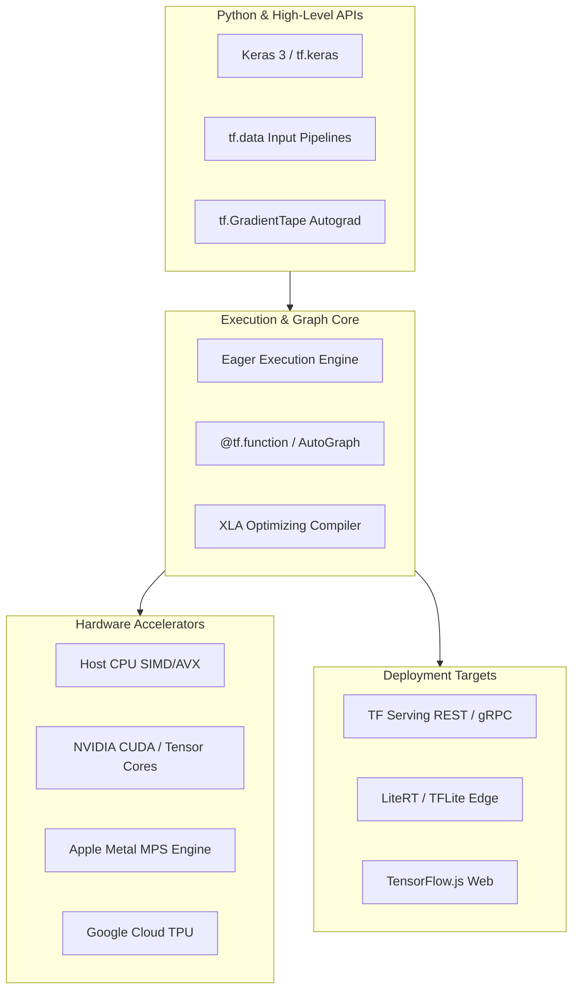

### Verification & Hardware Detection

```python
import tensorflow as tf

print(f"TensorFlow version: {tf.__version__}")

# Inspect available physical hardware devices
devices = tf.config.list_physical_devices()
print("Physical devices detected:")
for dev in devices:
    print(f" - {dev.device_type}: {dev.name}")

# Check GPU visibility and memory growth configuration
gpus = tf.config.list_physical_devices("GPU")
if gpus:
    print(f"Found {len(gpus)} GPU(s). Enabling dynamic VRAM allocation...")
    for gpu in gpus:
        tf.config.experimental.set_memory_growth(gpu, True)
else:
    print("No physical GPU found. Running in optimized CPU mode.")
```

### Common Pitfalls

- **Static VRAM pre-allocation:** By default on CUDA, TensorFlow allocates almost all available GPU VRAM at process launch. Always call `tf.config.experimental.set_memory_growth(gpu, True)` before initializing tensors to allow multi-process concurrency.
- **Python version incompatibility:** Heavy binary packages require specific CPython versions. Always verify wheel compatibility before upgrading base environments.

---

## Lesson 02 — Tensor Memory, Ranks, NHWC Layout & Broadcasting

A `tf.Tensor` represents an immutable, multidimensional array of elements of a uniform data type (`dtype`). Unlike mutable Python variables, tensor values cannot be modified in-place; mutations produce new tensor references. For mutable state (such as model weights and optimizer accumulators), TensorFlow provides `tf.Variable`.

### Tensor Ranks & Memory Hierarchy

Tensor rank corresponds to the number of dimensional axes:
- **Rank 0 (Scalar):** Shape `()` — e.g. `tf.constant(42.0)`
- **Rank 1 (Vector):** Shape `(D,)` — e.g. `tf.constant([1.0, 2.0, 3.0])`
- **Rank 2 (Matrix):** Shape `(Rows, Cols)` — tabular samples or linear transformations
- **Rank 3 (Sequence):** Shape `(Batch, Time, Features)` — NLP tokens or time-series sensor streams
- **Rank 4 (Image Batch):** Shape `(Batch, Height, Width, Channels)` in TensorFlow default format

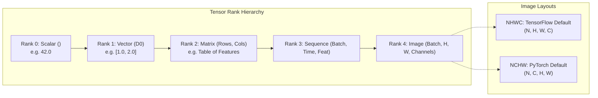

### NHWC vs NCHW Channel Ordering

A critical architectural distinction between deep learning frameworks is image memory layout:
- **TensorFlow defaults to NHWC (`channels_last`):** Dimensions are ordered `[Batch, Height, Width, Channels]`. Adjacent memory addresses hold neighboring color channels for the same spatial pixel. This format is heavily optimized for modern CPU SIMD engines, mobile DSPs, and Edge TPUs.
- **PyTorch defaults to NCHW (`channels_first`):** Dimensions are ordered `[Batch, Channels, Height, Width]`. Adjacent memory addresses hold entire spatial planes of a single color channel.

### Tensor Operations & Broadcasting

```python
import tensorflow as tf

# Construct constants and variables
a = tf.constant([[1.0, 2.0], [3.0, 4.0]], dtype=tf.float32)
b = tf.constant([10.0, 20.0], dtype=tf.float32)

# Broadcasting: (2, 2) + (2,) -> (2, 2)
c = a + b
print("Broadcasting result:\n", c.numpy())

# Matrix multiplication: (2, 2) @ (2, 1)
v = tf.constant([[2.0], [1.0]], dtype=tf.float32)
mv = tf.matmul(a, v)
print("Matmul shape:", mv.shape)

# Type casting: TensorFlow enforces strict typing without silent promotion
x_int = tf.constant([1, 2, 3], dtype=tf.int32)
x_flt = tf.cast(x_int, tf.float32)
```

---

## Lesson 03 — Accelerating Execution with `@tf.function` & AutoGraph

While eager execution simplifies interactive experimentation and debugging, executing Python interpreters per operation introduces substantial CPU call overhead and prevents global graph optimizations.

The `@tf.function` decorator compiles Python functions into portable, high-performance TensorFlow **computation graphs**. Under the hood, **AutoGraph** parses the function's Python Abstract Syntax Tree (AST), translates standard control-flow constructs (`if`, `for`, `while`) into equivalent TensorFlow graph primitives (`tf.cond`, `tf.while_loop`), and submits the unified graph to the XLA (Accelerated Linear Algebra) optimizing compiler.

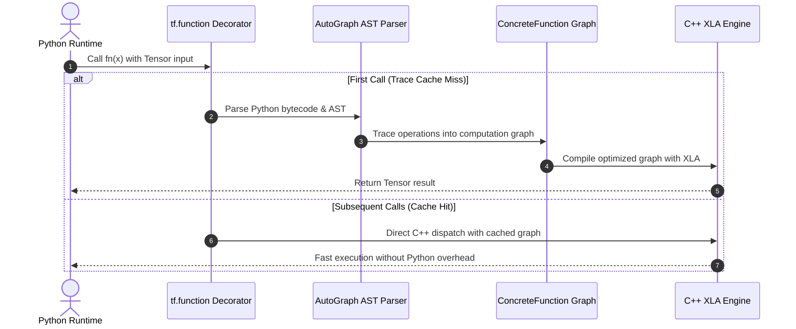

### Tracing, Polymorphic Dispatch & Side-Effect Pitfall

When a decorated function is invoked, TensorFlow determines whether a compiled graph matching the input arguments' tensor `dtype` and `shape` already exists in its trace cache:
1. **Trace Cache Miss:** TensorFlow executes the Python function body in symbolic tracing mode to record operations into a `ConcreteFunction` graph. Python side effects (such as `print()`, list appends, or random number generation via standard library `random`) **execute only once during tracing**.
2. **Trace Cache Hit:** Subsequent invocations bypass Python code entirely, executing the cached C++ graph directly at native machine speed.

```python
import tensorflow as tf

@tf.function
def scaled_matrix_mult(x, weight, bias):
    # This print statement executes ONLY during tracing
    print(">> [TRACE COMPILATION] Building computation graph...")
    # TensorFlow operations execute every time on accelerator
    return tf.matmul(x, weight) + bias

w = tf.constant([[2.0], [-1.0]], dtype=tf.float32)
b = tf.constant([0.5], dtype=tf.float32)

x1 = tf.constant([[1.0, 2.0]], dtype=tf.float32)
res1 = scaled_matrix_mult(x1, w, b)  # Tracing triggered!

x2 = tf.constant([[3.0, 4.0]], dtype=tf.float32)
res2 = scaled_matrix_mult(x2, w, b)  # Cache hit: No Python trace print!
```

---

## Lesson 04 — Reverse-Mode Automatic Differentiation with `tf.GradientTape`

Modern deep learning optimization relies on gradient backpropagation. TensorFlow provides `tf.GradientTape` to compute the gradient of a computation with respect to its input variables.

Inside the `with tf.GradientTape() as tape:` context manager:
1. Operations executed on watched tensors or `tf.Variable` instances are recorded onto a tape.
2. When `tape.gradient(target, sources)` is called, TensorFlow traverses the recorded execution graph in reverse order, applying the calculus chain rule to calculate exact derivatives.

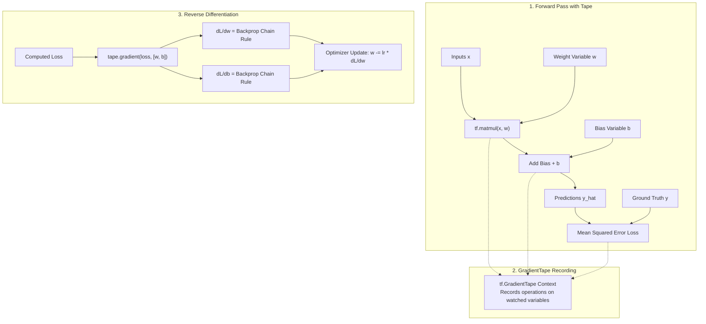

### Watched Tensors, Variables & Persistent Tapes

By default, `tf.GradientTape` automatically watches all trainable `tf.Variable` objects accessed within its block. Plain `tf.Tensor` constants are ignored unless explicitly registered with `tape.watch(tensor)`.

```python
import tensorflow as tf

x = tf.constant([3.0], dtype=tf.float32)
w = tf.Variable([2.0], dtype=tf.float32)
b = tf.Variable([1.0], dtype=tf.float32)

with tf.GradientTape() as tape:
    # tape.watch(x)  # Uncomment if gradients w.r.t x are needed
    y = w * x + b
    loss = tf.square(y - 10.0)

# Compute partial derivatives d(loss)/dw and d(loss)/db
grads = tape.gradient(loss, [w, b])
print(f"dL/dw: {grads[0].numpy()}, dL/db: {grads[1].numpy()}")
```

> [!NOTE]
> By default, the resources held by a `tf.GradientTape` are released immediately when `tape.gradient()` is called. To calculate multiple gradients from the same forward pass (e.g. for auxiliary losses or GAN discriminators), initialize `tf.GradientTape(persistent=True)` and explicitly `del tape` when finished.

---

## Lesson 05 — Build Neural Networks: Keras Sequential and Functional APIs

Keras is the high-level neural network API for TensorFlow. Keras 3 provides two primary paradigms for constructing architectures:
1. **Sequential API:** A linear stack of layers where each layer has exactly one input tensor and one output tensor. Best for feed-forward MLPs and standard sequential CNNs.
2. **Functional API:** Treats layers as callable functions operating on symbolic tensors. Essential for multi-input or multi-output models, residual skip connections (ResNet), and directed acyclic graphs (DAGs).

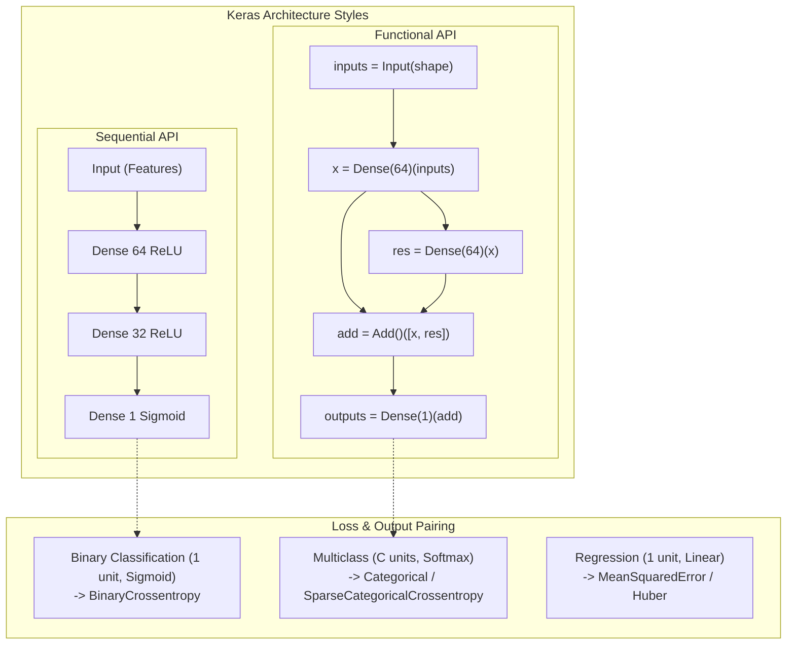

### Pairing Output Activations with Loss Functions

Matching the final layer's activation with the loss objective is essential to prevent numerical instability:

| Task Type | Output Units | Activation | Recommended Loss Function |
| :--- | :--- | :--- | :--- |
| **Binary Classification** | 1 | `sigmoid` | `BinaryCrossentropy()` |
| **Multiclass (One-Hot Targets)** | $C$ classes | `softmax` | `CategoricalCrossentropy()` |
| **Multiclass (Integer Labels)** | $C$ classes | `softmax` | `SparseCategoricalCrossentropy()` |
| **Continuous Regression** | 1 (or $K$) | `linear` (None) | `MeanSquaredError()` or `Huber()` |

```python
import tensorflow as tf

# Functional API with residual skip connection
inputs = tf.keras.layers.Input(shape=(32,), name="feature_input")
hidden = tf.keras.layers.Dense(64, activation="relu")(inputs)
residual = tf.keras.layers.Dense(64, activation="relu")(hidden)
merged = tf.keras.layers.Add()([hidden, residual])  # Skip connection
outputs = tf.keras.layers.Dense(3, activation="softmax", name="class_probabilities")(merged)

model = tf.keras.Model(inputs=inputs, outputs=outputs, name="residual_mlp")
model.compile(
    optimizer=tf.keras.optimizers.Adam(learning_rate=1e-3),
    loss="sparse_categorical_crossentropy",
    metrics=["accuracy"]
)
model.summary()
```

---

## Lesson 06 — High-Performance Data Pipelines with `tf.data`

Training state-of-the-art models on fast hardware accelerators frequently leads to **GPU starvation**: the GPU sits idle waiting for the host CPU to load, decode, augment, and collate batches of training samples.

The `tf.data` API builds streaming, multi-threaded Extract-Transform-Load (ETL) pipelines that overlap CPU preprocessing with GPU compute steps using asynchronous buffering.

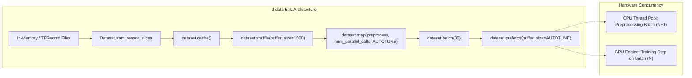

### The Gold-Standard `tf.data` Pipeline Recipe

To achieve maximum throughput without CPU bottlenecks:
1. `from_tensor_slices` or `TFRecordDataset`: Stream raw samples without loading full datasets into memory.
2. `cache()`: Cache processed tensors in memory or local NVMe scratch space after the first epoch.
3. `shuffle(buffer_size)`: Randomly permute samples using a rolling memory buffer.
4. `map(transform_fn, num_parallel_calls=tf.data.AUTOTUNE)`: Distribute preprocessing across all available host CPU cores.
5. `batch(batch_size, drop_remainder=False)`: Collate individual tensors into contiguous batch blocks.
6. `prefetch(tf.data.AUTOTUNE)`: Asynchronously decouple producer (CPU) from consumer (GPU), ensuring the next batch is already resident in host pinned memory before the accelerator completes the current training step.

```python
import tensorflow as tf
import numpy as np

# Synthetic features and labels
X = np.random.randn(1000, 20).astype(np.float32)
y = np.random.randint(0, 2, size=(1000, 1)).astype(np.int32)

# Build pipeline
dataset = (
    tf.data.Dataset.from_tensor_slices((X, y))
    .cache()
    .shuffle(buffer_size=500, seed=42)
    .batch(32)
    .prefetch(buffer_size=tf.data.AUTOTUNE)
)

for batch_x, batch_y in dataset.take(1):
    print("Batch X shape:", batch_x.shape)
    print("Batch y shape:", batch_y.shape)
```

---

## Lesson 07 — Train Without Overfitting: Validation & EarlyStopping

Overfitting occurs when a neural network memorizes noise, idiosyncrasies, and specific sample artifacts in the training split rather than generalizing to unseen distributions.

Effective mitigation requires:
1. **Validation Splits:** Evaluating loss and metrics on a holdout split at every epoch boundary.
2. **EarlyStopping Callback:** Halting optimization when validation loss stops improving for a specified `patience` window.
3. **Restoring Best Weights:** Automatically resetting network weights to the exact epoch checkpoint that achieved the minimal validation error, discarding sub-optimal overfitted iterations.

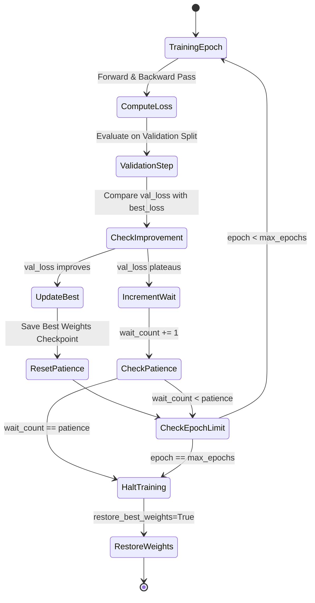

### Implementing Callbacks in Keras

```python
import tensorflow as tf

callbacks = [
    tf.keras.callbacks.EarlyStopping(
        monitor="val_loss",
        patience=5,
        min_delta=1e-3,
        restore_best_weights=True,
        verbose=1
    ),
    tf.keras.callbacks.ReduceLROnPlateau(
        monitor="val_loss",
        factor=0.5,
        patience=3,
        min_lr=1e-6,
        verbose=1
    )
]

# model.fit(train_ds, validation_data=val_ds, epochs=100, callbacks=callbacks)
```

---

## Lesson 08 — Image Classification with 2D Convolutional Networks

Standard multi-layer perceptrons (MLPs) flatten spatial matrices into 1D vectors, losing spatial proximity and incurring parameter explosion ($H \times W \times D$). In contrast, **2D Convolutional Neural Networks (CNNs)** employ parameter sharing and translation equivariance.

### Feature Hierarchy & Tensor Shapes

In TensorFlow's NHWC layout, a 2D image batch passes through localized stages:
- **`Conv2D(filters, kernel_size, activation="relu", padding="same")`**: Slides small learnable spatial filters ($3 \times 3$) over the input tensor, computing dot products to detect low-level edges, ridges, and color transitions.
- **`MaxPooling2D(pool_size=(2, 2))`**: Halves spatial height and width by selecting the maximum value in each window, conferring translation invariance and reducing compute footprint.
- **`Flatten()` / `GlobalAveragePooling2D()`**: Transitions spatial feature maps into a dense classification representation.
- **`Dropout(rate)`**: Randomly zeros activations during training steps to prevent co-adaptation of neurons.

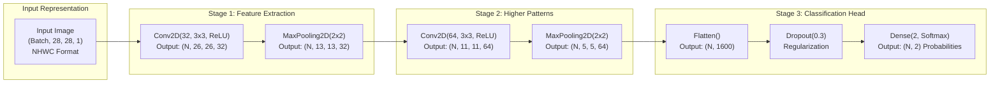

---

## Lesson 09 — SavedModel Serialization & TensorFlow Serving REST Protocol

In enterprise production environments, models must be served independently of Python runtimes. The **SavedModel** format is TensorFlow's universal serialization standard. It packages:
1. `saved_model.pb`: The complete computation graph, operations, and metadata.
2. `variables/`: Checkpointed weight tensors split into index and binary shards.
3. `assets/` and `fingerprint.pb`: Auxiliary vocabulary files and deterministic graph hash signatures.

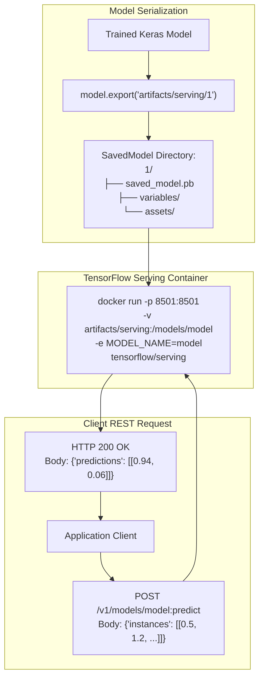

### Modern Export: `model.export()` vs Legacy `model.save()`

In Keras 3 and modern TensorFlow:
- `model.save("model.keras")`: Saves the complete model definition for continuing training in Python.
- `model.export("artifacts/serving/1")`: Strips Python training baggage, attaches standard `serving_default` C++ signatures, and generates a clean, deployable SavedModel directory tree.

```python
import tensorflow as tf

# In Keras 3:
# model.export("artifacts/serving/1")

# Client REST request payload contract:
# POST http://localhost:8501/v1/models/classifier/versions/1:predict
# {
#   "signature_name": "serving_default",
#   "instances": [
#     [0.45, -0.65],
#     [-0.85, 0.60]
#   ]
# }
```

---

## Lesson 10 — LiteRT (TFLite) & Dynamic-Range Quantization

Deploying deep models to resource-constrained edge hardware—smartphones, microcontrollers, embedded robotics, and Edge TPUs—imposes stringent constraints on latency, thermal dissipation, memory bandwidth, and power consumption.

**LiteRT** (formerly TensorFlow Lite / TFLite) is Google's runtime for on-device inference. Models are compiled into zero-copy **FlatBuffers** (`.tflite`).

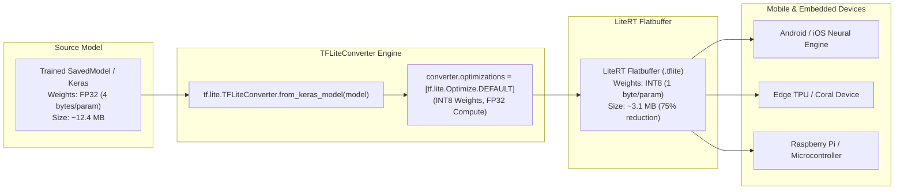

### Dynamic-Range vs Full Integer Quantization

- **Dynamic-Range Quantization (`tf.lite.Optimize.DEFAULT`):** Converts model weights from 32-bit floating point (`float32`, 4 bytes) to 8-bit integers (`int8`, 1 byte). At runtime, weights are dynamically dequantized for floating-point calculation. **Achieves ~75% file size reduction with virtually zero accuracy loss and requires no representative dataset.**
- **Full Integer Quantization:** Quantizes both weights and runtime activation tensors to INT8. Requires a representative calibration dataset; enables deployment on microcontrollers lacking hardware floating-point units.

```python
import tensorflow as tf

# Convert model with dynamic range quantization
# converter = tf.lite.TFLiteConverter.from_keras_model(model)
# converter.optimizations = [tf.lite.Optimize.DEFAULT]
# tflite_quant_model = converter.convert()
# with open("model.tflite", "wb") as f:
#     f.write(tflite_quant_model)
```

---

## Five Hands-on Labs & Execution Workflow Map

All 5 labs run deterministically and generate diagnostic artifacts in `artifacts/`, `outputs/`, and `previews/`.

```mermaid
graph TD
    subgraph Lab01 ["Lab 01: Low-Level Autograd"]
        L1["labs/lab01_tf_autograd.py<br>Pure tf.GradientTape linear regression<br>Fit w=3.0, b=-12.0 from scratch"]
        L1_Out["artifacts/01-autograd-regression.json<br>outputs/01-autograd-regression.png"]
        L1 --> L1_Out
    end
    subgraph Lab02 ["Lab 02: Keras MLP Classifier"]
        L2["labs/lab02_keras_classification.py<br>Keras Sequential non-linear decision boundary<br>Accuracy > 90% on synthetic moons"]
        L2_Out["artifacts/02-keras-classification.json<br>outputs/02-keras-classification.png"]
        L2 --> L2_Out
    end
    subgraph Lab03 ["Lab 03: tf.data Pipeline & CNN"]
        L3["labs/lab03_tfdata_cnn.py<br>from_tensor_slices + batch + prefetch<br>2D CNN on 28x28 shapes"]
        L3_Out["artifacts/03-tfdata-cnn.json<br>outputs/03-tfdata-cnn.png"]
        L3 --> L3_Out
    end
    subgraph Lab04 ["Lab 04: SavedModel & Serving"]
        L4["labs/lab04_savedmodel_serving.py<br>model.export('artifacts/serving/1')<br>Verify TF Serving REST schema & parity"]
        L4_Out["artifacts/04-savedmodel-serving.json<br>artifacts/04-serving-request.json"]
        L4 --> L4_Out
    end
    subgraph Lab05 ["Lab 05: LiteRT Quantization"]
        L5["labs/lab05_litert_export.py<br>TFLiteConverter dynamic-range quantization<br>Verify 4x size reduction & flatbuffer parity"]
        L5_Out["artifacts/05-litert-export.json<br>artifacts/model.tflite"]
        L5 --> L5_Out
    end
```

### Lab 01 — Low-Level Automatic Differentiation with `tf.GradientTape`

- **Script:** `labs/lab01_tf_autograd.py`
- **Objective:** Train a linear regression model $w \cdot x + b$ from scratch using low-level tensor variables and reverse-mode automatic differentiation.
- **Ground Truth Parameters:** $w = 3.0, b = -12.0$.
- **Outputs:** `artifacts/01-autograd-regression.json`, `artifacts/01-autograd-regression.png`.

### Lab 02 — Non-Linear Classification with Keras Sequential API

- **Script:** `labs/lab02_keras_classification.py`
- **Objective:** Train a multi-layer perceptron with ReLU hidden layers and Adam optimization on synthetic non-linear 2D moon coordinates.
- **Evaluation:** Evaluates test accuracy (> 85%), plots decision boundary contours and training loss curves.
- **Outputs:** `artifacts/02-keras-classification.json`, `artifacts/02-keras-classification.png`.

### Lab 03 — High-Performance `tf.data` Pipeline & 2D CNN

- **Script:** `labs/lab03_tfdata_cnn.py`
- **Objective:** Build an optimized ETL input pipeline (`from_tensor_slices`, `shuffle`, `batch`, `prefetch`) feeding synthetic 28×28 grayscale shapes (circles vs squares) in NHWC format to a 2D convolutional network.
- **Evaluation:** Evaluates test accuracy (> 85%), renders a $3 \times 3$ visual sample grid with predicted vs ground-truth labels.
- **Outputs:** `artifacts/03-tfdata-cnn.json`, `artifacts/03-tfdata-cnn.png`.

### Lab 04 — SavedModel Serialization & TF Serving REST Contract

- **Script:** `labs/lab04_savedmodel_serving.py`
- **Objective:** Export a trained neural network into standard SavedModel directory format (`model.export("artifacts/serving/1")`), structure client REST payloads, and verify numerical output parity.
- **Outputs:** `artifacts/04-savedmodel-serving.json`, `artifacts/04-serving-request.json`, `artifacts/serving/1/saved_model.pb`.

### Lab 05 — LiteRT (TFLite) FlatBuffer Quantization

- **Script:** `labs/lab05_litert_export.py`
- **Objective:** Convert a deep model into LiteRT FlatBuffer format with dynamic-range weight quantization (`tf.lite.Optimize.DEFAULT`), quantifying memory compression (~70% reduction) and validating output parity.
- **Outputs:** `artifacts/05-litert-export.json`, `artifacts/05-litert-export.png`, `artifacts/model.tflite`.

---

## Quick Reference & Cheat Sheet

### Tensor Operations & Variables

```python
import tensorflow as tf

x = tf.constant([[1.0, 2.0], [3.0, 4.0]], dtype=tf.float32)
v = tf.Variable([0.0, 0.0], dtype=tf.float32)
v.assign_add([1.0, 2.0])  # In-place variable mutation
casted = tf.cast(x, tf.int32)
flattened = tf.reshape(x, [-1])
```

### Autograd & Functions

```python
with tf.GradientTape() as tape:
    y = v * 2.0
    loss = tf.reduce_sum(y)
grad = tape.gradient(loss, v)

@tf.function
def fast_step(x):
    return tf.nn.relu(x)
```

### Keras Model Building

```python
model = tf.keras.Sequential([
    tf.keras.layers.Input(shape=(28, 28, 1)),
    tf.keras.layers.Conv2D(32, (3, 3), activation="relu", padding="same"),
    tf.keras.layers.MaxPooling2D((2, 2)),
    tf.keras.layers.Flatten(),
    tf.keras.layers.Dense(64, activation="relu"),
    tf.keras.layers.Dense(10, activation="softmax")
])
model.compile(optimizer="adam", loss="sparse_categorical_crossentropy", metrics=["accuracy"])
```

### tf.data ETL Pipeline

```python
ds = (
    tf.data.Dataset.from_tensor_slices((X, y))
    .cache()
    .shuffle(1000)
    .batch(32)
    .prefetch(tf.data.AUTOTUNE)
)
```

### Production Export & Quantization

```python
# Modern Keras 3 SavedModel export
model.export("artifacts/serving/1")

# LiteRT dynamic range quantization
converter = tf.lite.TFLiteConverter.from_keras_model(model)
converter.optimizations = [tf.lite.Optimize.DEFAULT]
tflite_model = converter.convert()
```

---

## Frequently Asked Questions

### 1. PyTorch vs TensorFlow vs JAX: When should you choose each in 2026?
- **Choose TensorFlow / Keras:** When building large-scale enterprise production pipelines requiring standardized C++ serving (`tensorflow/serving`), cross-platform mobile/embedded edge deployment (LiteRT / Android NNAPI), or multi-backend portability across PyTorch, JAX, and TensorFlow using Keras 3.
- **Choose PyTorch:** When doing bleeding-edge academic research, rapid generative AI prototyping, custom LLM fine-tuning, or utilizing HuggingFace transformers where Python flexibility is paramount.
- **Choose JAX:** When conducting mathematical physics research, massive TPU cluster pre-training, or when requiring functional pure transformations (`grad`, `jit`, `vmap`, `pmap`).

### 2. What is Keras 3 and how does it relate to TensorFlow?
Keras 3 is a multi-backend deep learning framework that allows developers to write models once and run them on **TensorFlow, PyTorch, or JAX**. When using TensorFlow, `tf.keras` is powered directly by Keras 3, providing high-level layer abstractions while maintaining access to low-level TensorFlow operations.

### 3. Why does TensorFlow default to NHWC while PyTorch defaults to NCHW?
TensorFlow was designed with CPU and mobile accelerator efficiency in mind. In NHWC layout, all color channels for a single pixel reside contiguously in memory. When performing $1 \times 1$ convolutions, depthwise convolutions, or vectorized color operations, memory access patterns achieve maximum cache locality on CPU SIMD units and Edge TPUs. PyTorch adopted NCHW because early CUDA cuDNN kernels performed fastest when entire spatial feature planes were contiguous.

### 4. Why should you avoid Python state mutations inside `@tf.function`?
Python code executes only during the initial trace phase when the symbolic graph is constructed. State mutations like `my_list.append(x)` or global counter increments will execute exactly once during graph compilation and will **not** execute during subsequent graph calls, causing subtle data corruption bugs. Always use `tf.TensorArray` or `tf.Variable` for mutable loop state.

### 5. How does `tf.data.AUTOTUNE` eliminate GPU starvation?
During training, data pipelines must load files from disk, decode formats, apply random augmentations, and collate batches. If executed synchronously on the main thread, the GPU remains idle while waiting for the next batch. `tf.data.AUTOTUNE` dynamically profiles hardware thread availability at runtime, automatically tuning the buffer sizes and thread counts for parallel mapping and prefetching to ensure the accelerator pipeline never stalls.

### 6. What is the difference between `model.save("model.keras")` and `model.export("serving/1")`?
- `model.save("model.keras")` produces a zip archive containing model architecture, weights, and optimizer training state intended for resuming training within Python.
- `model.export("serving/1")` serializes a clean C++ computation graph without optimizer weights, packages named serving signatures (`serving_default`), and formats directory structures required by TensorFlow Serving containers and C++ runtimes.

### 7. How does dynamic-range quantization differ from full integer quantization?
Dynamic-range quantization converts only model weights from FP32 to INT8, leaving activation tensors in floating point. It requires no calibration data and reduces model size by ~75%. Full integer quantization quantizes both weights and activations to INT8; it requires a representative calibration dataset to compute scaling factors, but enables execution on microcontrollers without hardware floating-point units.

### 8. How do you deploy TensorFlow models to Kubernetes with TF Serving?
Package your SavedModel into standard versioned folders (`1/`, `2/`). Launch the official `tensorflow/serving` container mounting the model directory. Expose port 8501 for HTTP REST queries and port 8500 for gRPC queries. Use Kubernetes Horizontal Pod Autoscaling (HPA) triggered by ingress request latency or Prometheus metrics.

---

## Production Serving & Edge Architecture

### TensorFlow Serving Docker Deployment

To launch high-throughput production serving for the exported model:

```bash
docker run -d --name tf_classifier \
  -p 8501:8501 \
  -p 8500:8500 \
  -v "$(pwd)/artifacts/serving:/models/classifier" \
  -e MODEL_NAME=classifier \
  tensorflow/serving:latest
```

### Querying the Serving Endpoint

```bash
curl -X POST http://localhost:8501/v1/models/classifier/versions/1:predict \
  -H "Content-Type: application/json" \
  -d @artifacts/04-serving-request.json
```

Expected Response:
```json
{
  "predictions": [
    [0.9124, 0.0876],
    [0.0521, 0.9479]
  ]
}
```

---

## Framework Comparison: Deep Learning Ecosystems

| Dimension | TensorFlow 2.x / Keras 3 | PyTorch 2.x | JAX |
| :--- | :--- | :--- | :--- |
| **Primary Execution Model** | Eager by default + `@tf.function` Graph | Eager by default + `torch.compile` | Pure functional transformations (`jit`, `grad`) |
| **Image Memory Layout** | **NHWC** (`channels_last`) | **NCHW** (`channels_first`) | Configurable / NCHW |
| **Autograd Engine** | `tf.GradientTape` (context manager) | `torch.autograd` (dynamic graph) | `jax.grad` / `jax.value_and_grad` (pure function) |
| **Input Pipeline** | `tf.data.Dataset` (C++ multi-threaded) | `torch.utils.data.DataLoader` (Python multiprocessing) | `grain` / `tf.data` |
| **Production Serving** | **TensorFlow Serving** (gRPC / REST C++) | TorchServe / Triton Inference Server | Triton / custom C++ runtime |
| **Mobile & Edge** | **LiteRT** (TFLite FlatBuffers) | ExecuTorch / PyTorch Mobile | Custom XLA compilation |
| **Web Browser** | **TensorFlow.js** (WebGL / WebGPU) | ONNX Runtime Web | WebAssembly / Pyodide |

---

## Glossary of Core Concepts

- **`tf.Tensor`**: An immutable, multidimensional array with uniform data type and fixed shape.
- **`tf.Variable`**: A mutable tensor whose value can be altered across optimization steps via `assign()` or `assign_add()`.
- **Eager Execution**: An imperative, define-by-run evaluation environment where operations return concrete values immediately.
- **AutoGraph**: A static AST transformation engine that converts idiomatic Python control flow (`if`, `for`, `while`) into equivalent TensorFlow computation graph primitives.
- **`ConcreteFunction`**: A compiled, specialized TensorFlow computation graph tied to specific input tensor shapes and dtypes.
- **`tf.GradientTape`**: A context manager that records tensor operations to perform reverse-mode automatic differentiation.
- **NHWC Format**: `[Batch, Height, Width, Channels]` tensor layout where adjacent color channels are stored contiguously in memory.
- **SavedModel**: TensorFlow's universal serialization format containing the computation graph, weights, and serving signatures.
- **LiteRT (TFLite)**: Google's lightweight runtime for on-device inference using flatbuffer models.
- **FlatBuffer**: A zero-copy serialization format that allows models to be executed directly from memory without parsing or unpacking overhead.
- **Dynamic-Range Quantization**: An optimization technique that stores weights as 8-bit integers while dynamically computing activations in 32-bit floating point.

---

## Safety & Defensive Engineering

1. **Avoid Python Random State in `@tf.function`:** Always use `tf.random.Generator` rather than Python's `random` or NumPy's `np.random` within compiled functions to ensure proper PRNG state progression across graph executions.
2. **Deterministic Reproducibility:** Call `tf.keras.utils.set_random_seed(seed)` and `tf.config.experimental.enable_op_determinism()` to ensure bit-level reproducibility across CPU and GPU kernels.
3. **Guard Against Memory Leaks with Tapes:** Always ensure non-persistent `tf.GradientTape` instances exit their context, or call `del tape` on persistent tapes to prevent lingering activation buffers from exhausting RAM.
4. **Defensive Model Loading:** Never load unauthenticated pickle or third-party legacy `.h5` files without signature verification. Use modern `.keras` archives or SavedModel directories with strict schema validation.
