# Keras 3 Complete Guide — From Python Tensors to Multi-Backend AI

> 10 short lessons · 5 real projects · TensorFlow / JAX / PyTorch architecture · CPU-first samples.

Master deep learning architecture with **Keras 3**: multi-backend execution across **PyTorch, JAX, and TensorFlow**, symbolic `KerasTensor` vs concrete eager execution, backend-agnostic mathematical operations with `keras.ops`, Sequential vs Functional model graphs, reliable 3-way dataset partitioning (train/val/test) with `EarlyStopping`, 2D Convolutional Neural Networks on channels-last synthetic vision fixtures, token embeddings and multi-head self-attention, backend-neutral custom layers with `@register_keras_serializable`, safe `.keras` model persistence, and deployment export pathways.

**Environment baseline:** Python 3.11–3.14 • Keras 3.15+ • PyTorch 2.x / JAX 0.4+ / TensorFlow 2.16+. All 5 labs run completely offline using reproducible synthetic fixtures.

## Setup

```bash
python -m pip install -r requirements-dev.txt
export KERAS_BACKEND=torch
python -m data.generate_samples
python -m labs.lab01_tensors_regression
python -m pytest -q
```

---

## Lesson 01 — Keras 3: What It Is and When to Use It

Keras is a high-level Python deep-learning API designed for human beings. Instead of manually allocating tensor buffers, hand-wiring differentiation chain rules, or maintaining separate boilerplate for each framework, you compose neural networks from modular layers and train them with standardized routines like `compile()`, `fit()`, and `evaluate()`.

**Keras 3** is a complete, modern rewrite of Keras as a **multi-backend framework**. While legacy Keras was tightly coupled to TensorFlow, Keras 3 can train and execute models seamlessly on **PyTorch**, **JAX**, or **TensorFlow**, as well as export models for lightweight CPU inference via **OpenVINO**.

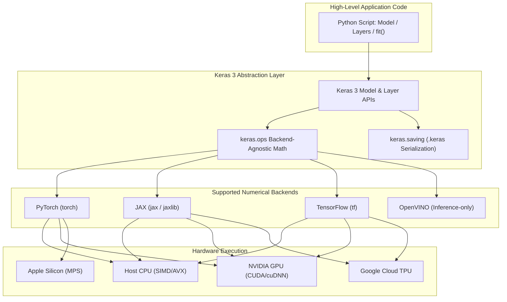

### Mental Model

- **NumPy:** Holds, slices, and cleans raw array data in host RAM.
- **Backend (PyTorch / JAX / TensorFlow):** Manages accelerator VRAM, device compilation, and reverse-mode automatic differentiation.
- **Keras 3:** Unifies layer abstractions, optimizers, loss objectives, metrics, and serialization across all backends.

### Configuring the Backend

The backend engine must be specified **before** importing `keras` in your Python process. This is typically configured via the `KERAS_BACKEND` environment variable or through `~/.keras/keras.json`:

```bash
# In shell:
export KERAS_BACKEND=torch
# Or in Python (must run before `import keras`):
import os
os.environ["KERAS_BACKEND"] = "torch"

import keras
print("Keras version :", keras.__version__)
print("Active backend:", keras.backend.backend())
```

> [!IMPORTANT]
> Modifying `os.environ["KERAS_BACKEND"]` *after* calling `import keras` has no effect. Keras initializes its backend singleton immediately upon the first module import.

---

## Lesson 02 — Tensors, Shapes and `keras.ops`

In Keras 3, data flows through two distinct tensor representations:
1. **Concrete Tensors:** Actual numerical arrays held in memory by the active backend (e.g., `torch.Tensor`, `jax.Array`, or `tf.Tensor`).
2. **Symbolic `KerasTensor`:** Metadata placeholders (holding only shape, data type, and history) created when building models via `keras.Input` or the Functional API.

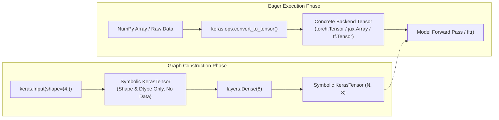

### The `keras.ops` Unified Mathematical Namespace

To ensure custom layers and transformations run unchanged on any backend, Keras 3 provides `keras.ops`. It mirrors the NumPy array API while dispatching to native GPU/TPU kernels on PyTorch, JAX, or TensorFlow:

```python
import keras
from keras import ops

# Backend-agnostic tensor conversion
x = ops.convert_to_tensor([[1.0, 2.0], [3.0, 4.0]])
print("Shape    :", ops.shape(x))                      # (2, 2)
print("Mean (NP):", ops.convert_to_numpy(ops.mean(x)))  # 2.5
print("Sum axis1:", ops.convert_to_numpy(ops.sum(x, axis=1)))  # [3., 7.]
```

### Shape Dimensionality Vocabulary

- **Batch Dimension (`batch`):** Number of independent samples processed together in a single step (e.g. `32`).
- **Features (`features`):** 1D row vector of tabular features, e.g. `(batch, 8)`.
- **Channels-Last Image (`(batch, H, W, C)`):** Default image format in Keras 3 across all backends, e.g. `(batch, 24, 24, 1)` for grayscale.
- **Sequence (`(batch, sequence_length)`):** Ordered token indices or sequential measurements.

---

## Lesson 03 — Build a Model with `Sequential`

Use `keras.Sequential` for a linear, unidirectional stack of layers where each layer has exactly one input tensor and one output tensor.

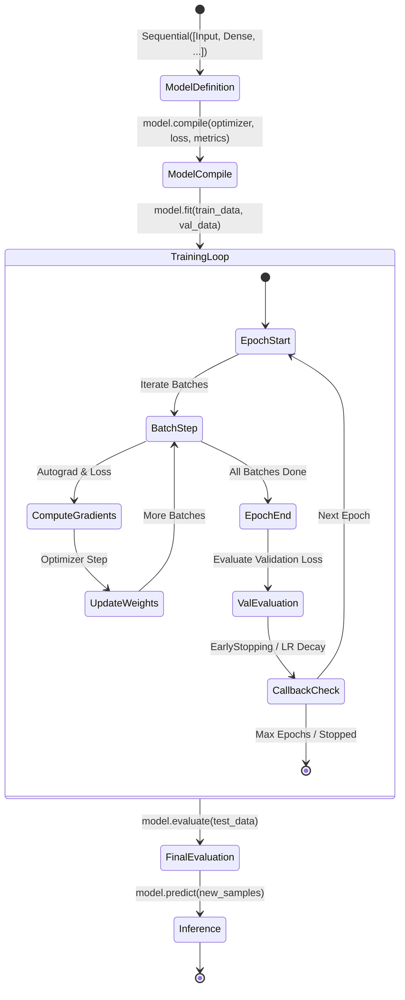

### Training Lifecycle: `compile`, `fit`, `evaluate`, `predict`

1. **`compile()`**: Binds an optimizer, loss function, and evaluation metrics to the model graph.
2. **`fit()`**: Runs the forward pass, computes loss, computes gradients via backend autograd, and updates weights over multiple epochs.
3. **`evaluate()`**: Runs inference on held-out test data without gradient tracking.
4. **`predict()`**: Generates raw model outputs for unseen samples.

```python
import keras
from keras import layers

# Linear regression with one hidden ReLU layer
model = keras.Sequential([
    keras.Input(shape=(1,), name="input_feature"),
    layers.Dense(12, activation="relu", name="hidden_layer"),
    layers.Dense(1, name="linear_output")
])

model.compile(
    optimizer=keras.optimizers.Adam(learning_rate=0.01),
    loss="mse",
    metrics=["mae"]
)
model.summary()
```

---

## Lesson 04 — Functional API and Multiple Inputs

While `Sequential` is concise for straight stacks, real-world deep architectures frequently require directed acyclic graphs (DAGs), multi-modal inputs (e.g. combining text embeddings with numerical tabular data), shared layers, and residual skip connections.

The Functional API treats layers as callable transformations on symbolic tensors. Every functional model starts with explicit `keras.Input` instances and terminates with `keras.Model(inputs=..., outputs=...)`.

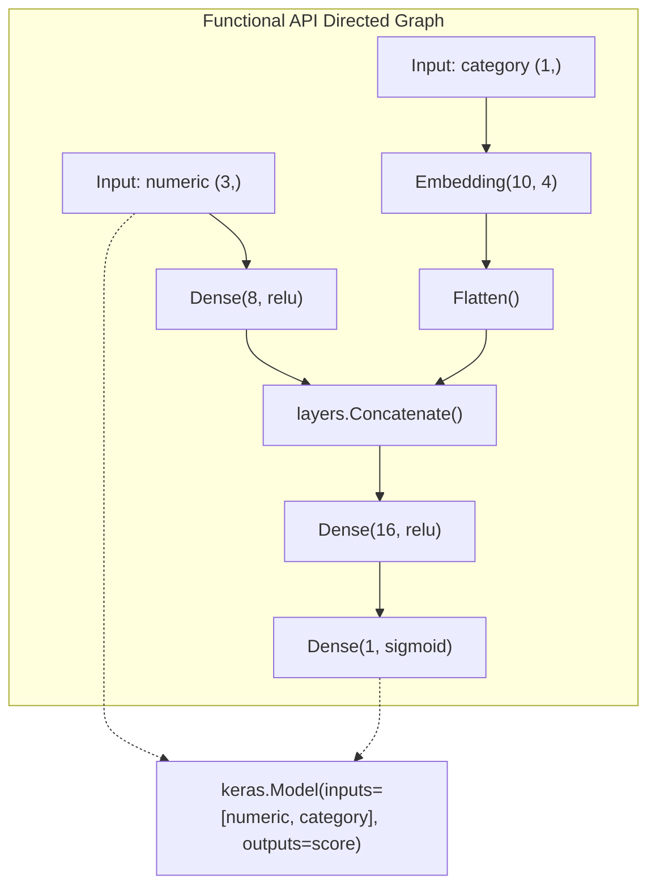

### Multi-Input Architecture Recipe

```python
import keras
from keras import layers

# Branch A: Continuous numerical features
num_input = keras.Input(shape=(3,), name="numeric_features")
num_encoded = layers.Dense(8, activation="relu")(num_input)

# Branch B: Categorical integer ID
cat_input = keras.Input(shape=(1,), dtype="int32", name="category_id")
cat_embedded = layers.Embedding(input_dim=10, output_dim=4)(cat_input)
cat_flat = layers.Flatten()(cat_embedded)

# Merge branches
merged = layers.Concatenate()([num_encoded, cat_flat])
hidden = layers.Dense(16, activation="relu")(merged)
output = layers.Dense(1, activation="sigmoid", name="churn_probability")(hidden)

multi_model = keras.Model(inputs=[num_input, cat_input], outputs=output)
multi_model.summary()
```

---

## Lesson 05 — Reliable Training, Validation and Callbacks

A disciplined machine learning pipeline enforces strict separation between **training**, **validation**, and **test** partitions:
- **Training Set (e.g. 70%):** Consumed by the optimizer to calculate gradients and adjust weight tensors.
- **Validation Set (e.g. 15%):** Evaluated at each epoch boundary to monitor generalization, guide learning rate decay, and trigger early stopping.
- **Test Set (e.g. 15%):** Locked away untouched until final model selection is complete to report unbiased error metrics.

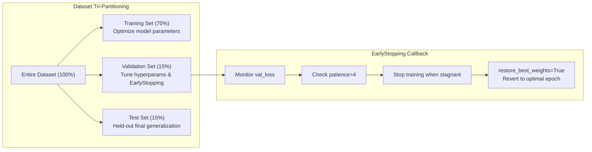

### EarlyStopping with Weight Restoration

```python
import keras

callbacks = [
    keras.callbacks.EarlyStopping(
        monitor="val_loss",
        patience=4,
        restore_best_weights=True,
        verbose=1
    ),
    keras.callbacks.ReduceLROnPlateau(
        monitor="val_loss",
        factor=0.5,
        patience=2,
        min_lr=1e-5
    )
]

# history = model.fit(
#     X_train, y_train,
#     validation_data=(X_val, y_val),
#     epochs=100,
#     callbacks=callbacks
# )
```

---

## Lesson 06 — Image Classification with Convolutional Layers

Convolutional neural networks (CNNs) preserve spatial 2D relationships using parameter sharing and translation equivariance. In Keras 3, the standard image convention across all backends is **channels-last**: `(batch, height, width, channels)`.

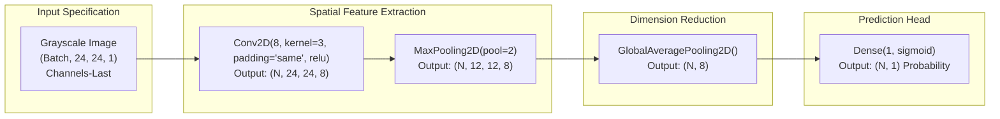

### Why GlobalAveragePooling2D?

Traditional CNN architectures flattened feature maps into massive dense layers, incurring parameter bloat. Modern vision architectures apply `layers.GlobalAveragePooling2D()`, which averages each spatial feature map down to a single scalar value. This drastically reduces parameter count and improves spatial invariance.

```python
import keras
from keras import layers

cnn = keras.Sequential([
    keras.Input(shape=(24, 24, 1)),
    layers.Conv2D(8, kernel_size=3, padding="same", activation="relu"),
    layers.MaxPooling2D(pool_size=2),
    layers.GlobalAveragePooling2D(),
    layers.Dense(1, activation="sigmoid")
])
cnn.summary()
```

---

## Lesson 07 — Token Embeddings and Attention

Deep networks cannot process raw strings or categorical words directly; tokenizers first convert text into discrete integer IDs.
1. **`Embedding(input_dim, output_dim)`:** Maps each discrete integer token into a continuous, learnable vector representation.
2. **`MultiHeadAttention(num_heads, key_dim)`:** Computes query-key compatibility scores, allowing each token position to contextualize itself using representations across the entire sequence.

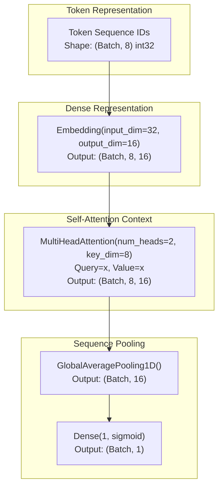

### Self-Attention Block Recipe

```python
import keras
from keras import layers

token_input = keras.Input(shape=(8,), dtype="int32", name="sequence_tokens")
embeddings = layers.Embedding(input_dim=32, output_dim=16)(token_input)
contextualized = layers.MultiHeadAttention(num_heads=2, key_dim=8)(embeddings, embeddings)
pooled = layers.GlobalAveragePooling1D()(contextualized)
classifier = layers.Dense(1, activation="sigmoid")(pooled)

attention_model = keras.Model(inputs=token_input, outputs=classifier)
attention_model.summary()
```

---

## Lesson 08 — Write Backend-Neutral Custom Layers

One of Keras 3's greatest superpowers is the ability to author custom layers that run identically on PyTorch, JAX, and TensorFlow without code duplication.

To ensure your custom layer is fully portable:
1. Use **`keras.ops`** for all mathematical calculations (never import `torch.*`, `jax.numpy.*`, or `tf.*` inside `call()`).
2. Decorate the class with **`@keras.saving.register_keras_serializable(package="...")`** so Keras can reconstruct the class definition when loading `.keras` archives.

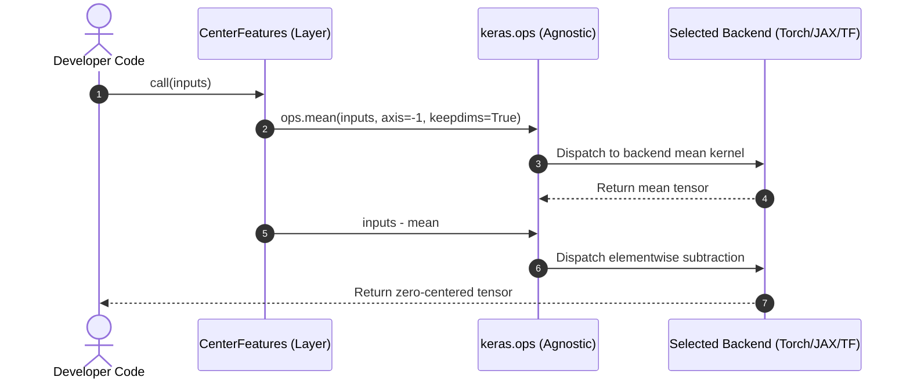

### Portable Layer Implementation

```python
import keras
from keras import layers, ops

@keras.saving.register_keras_serializable(package="LearningLab")
class CenterFeatures(layers.Layer):
    """Subtracts the mean across features, producing zero-centered representations."""
    def call(self, inputs):
        mean = ops.mean(inputs, axis=-1, keepdims=True)
        return inputs - mean

    def get_config(self):
        return super().get_config()
```

---

## Lesson 09 — Save Models, Export for Serving, Load Safely

Keras 3 establishes clean boundaries between complete training checkpoints and production inference artifacts:

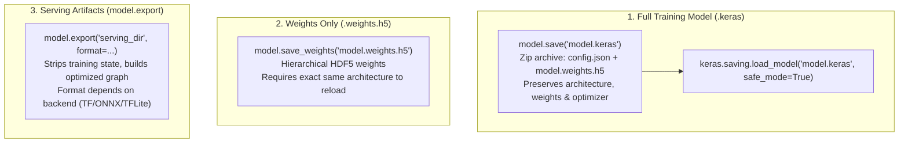

| Format | File Extension | What Is Preserved | Best Use Case |
| :--- | :--- | :--- | :--- |
| **Keras Archive** | `.keras` | Architecture JSON, weights, optimizer state, compile config | Re-opening models in Keras across backends |
| **Weights Only** | `.weights.h5` | Layer parameter tensors | Saving storage; checkpointing during training |
| **Inference Export** | Directory / FlatBuffer | Stripped computation graph with serving signature | Production deployment (TF Serving, ONNX Runtime) |

### Defensive Security: `safe_mode=True`

When deserializing untrusted `.keras` files, always enforce `safe_mode=True`. This prevents arbitrary code execution vulnerabilities by restricting deserialization to built-in Keras objects and explicitly registered serializable classes.

```python
# Save complete model
model.save("my_model.keras")

# Defensive load
loaded_model = keras.saving.load_model("my_model.keras", safe_mode=True)
```

---

## Lesson 10 — Keras vs PyTorch vs TensorFlow: Production Checklist

Keras 3 provides a unified developer surface, but deployment architectures still depend on target hardware, runtime latency, and infrastructure constraints:

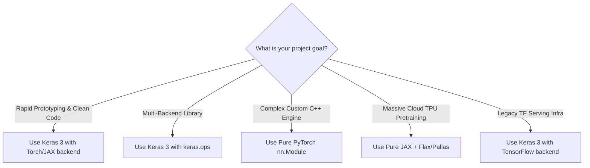

### Production Readiness Audit Checklist

- [ ] **Provenance Verification:** Training data origins, checksums, and license constraints documented.
- [ ] **Split Hygiene:** Training, validation, and final test sets strictly isolated with no shared samples.
- [ ] **Backend Lock:** `KERAS_BACKEND` explicitly declared in container entrypoints and environment scripts.
- [ ] **Safe Deserialization:** All `load_model()` invocations utilize `safe_mode=True`.
- [ ] **Parity Assertion:** Exported inference outputs validated against in-memory predictions within numerical tolerance ($< 10^{-5}$).
- [ ] **Hardware Verification:** Memory footprint, latency, and throughput profiled on actual target hardware (CPU, CUDA, MPS, or Edge).

---

## Five Hands-on Labs & Execution Workflow Map

All 5 labs run completely offline using reproducible synthetic datasets and output diagnostic artifacts to `artifacts/`, `outputs/`, and `previews/`.

```mermaid
graph TD
    subgraph Lab01 ["Lab 01: Tensors & Regression"]
        L1["labs/lab01_tensors_regression.py<br>Dense regression on y ≈ 2.5x - 0.8<br>Evaluate held-out RMSE"]
        L1_Out["artifacts/01-tensors-regression.json<br>previews/01-tensors-regression.png"]
        L1 --> L1_Out
    end
    subgraph Lab02 ["Lab 02: Early Stopping Classifier"]
        L2["labs/lab02_classification_early_stopping.py<br>Functional API on concentric circles<br>Patience=4 with restore_best_weights"]
        L2_Out["artifacts/02-classification-early-stopping.json<br>previews/02-classification-early-stopping.png"]
        L2 --> L2_Out
    end
    subgraph Lab03 ["Lab 03: Tiny CNN Classifier"]
        L3["labs/lab03_keras_cnn.py<br>Conv2D + GAP on 24x24 bar patterns<br>Channels-last grayscale"]
        L3_Out["artifacts/03-cnn-image-classifier.json<br>previews/03-cnn-image-classifier.png"]
        L3 --> L3_Out
    end
    subgraph Lab04 ["Lab 04: Embeddings & Attention"]
        L4["labs/lab04_embeddings_attention.py<br>Embedding + MultiHeadAttention<br>Token sequence classification"]
        L4_Out["artifacts/04-embeddings-attention.json<br>previews/04-embeddings-attention.png"]
        L4 --> L4_Out
    end
    subgraph Lab05 ["Lab 05: Backend Portability"]
        L5["labs/lab05_backend_portability.py<br>Custom keras.ops layer<br>.keras save/reload parity check"]
        L5_Out["artifacts/05-backend-portability.json<br>previews/05-backend-portability.png"]
        L5 --> L5_Out
    end
```

### Lab 01 — Tensors and Regression

- **Script:** `labs/lab01_tensors_regression.py`
- **Objective:** Train a `Sequential` MLP with `keras.Input(shape=(1,))`, `Dense(12, relu)`, and `Dense(1)` on synthetic linear regression data $y \approx 2.5x - 0.8$.
- **Outputs:** `artifacts/01-tensors-regression.json`, `artifacts/01-tensors-regression.png`, `previews/01-tensors-regression.png`.

### Lab 02 — Classification with Early Stopping

- **Script:** `labs/lab02_classification_early_stopping.py`
- **Objective:** Build a 2D concentric circles binary classifier via the Functional API with distinct train (280), validation (60), and test (60) splits. EarlyStopping with `restore_best_weights=True` prevents overfitting.
- **Outputs:** `artifacts/02-classification-early-stopping.json`, `artifacts/02-classification-early-stopping.png`, `previews/02-classification-early-stopping.png`.

### Lab 03 — Tiny CNN Image Classifier

- **Script:** `labs/lab03_keras_cnn.py` (alias: `labs/lab03_cnn_image_classifier.py`)
- **Objective:** Train a 2D convolutional network (`Conv2D(8, 3)` $\to$ `MaxPooling2D` $\to$ `GlobalAveragePooling2D` $\to$ `Dense(1, sigmoid)`) on 24×24 synthetic grayscale bar images in channels-last format.
- **Outputs:** `artifacts/03-cnn-image-classifier.json`, `artifacts/03-cnn-image-classifier.png`, `previews/03-cnn-image-classifier.png`.

### Lab 04 — Token Embeddings and Attention

- **Script:** `labs/lab04_embeddings_attention.py`
- **Objective:** Train an integer sequence classifier using `Embedding(vocab_size, 16)` and `MultiHeadAttention(num_heads=2, key_dim=8)` followed by `GlobalAveragePooling1D` to identify specific token IDs in sequences of length 8.
- **Outputs:** `artifacts/04-embeddings-attention.json`, `artifacts/04-embeddings-attention.png`, `previews/04-embeddings-attention.png`.

### Lab 05 — Cross-Backend Model Save and Reload

- **Script:** `labs/lab05_backend_portability.py`
- **Objective:** Author a custom `CenterFeatures` layer using `keras.ops`, register it with `@keras.saving.register_keras_serializable`, serialize to `portable_model.keras`, reload with `safe_mode=True`, and confirm prediction parity.
- **Outputs:** `artifacts/05-backend-portability.json`, `artifacts/05-backend-portability.png`, `previews/05-backend-portability.png`, `artifacts/portable_model.keras`.

---

## Keras 3 Quick Reference

| Task | API | Essential Detail |
| :--- | :--- | :--- |
| **Check version** | `keras.__version__` | Independent of underlying backend version |
| **Declare backend** | `export KERAS_BACKEND=torch` | Must be set **before** importing `keras` |
| **Check active backend** | `keras.backend.backend()` | Returns `"torch"`, `"jax"`, `"tensorflow"`, or `"openvino"` |
| **Tensor conversion** | `keras.ops.convert_to_tensor(x)` | Dispatches to backend native tensor |
| **NumPy conversion** | `keras.ops.convert_to_numpy(x)` | Handles device-to-host transfer (MPS/CUDA $\to$ CPU) |
| **Build linear model** | `keras.Sequential([...])` | Unidirectional layer pipelines |
| **Build complex graph** | `keras.Model(inputs, outputs)` | Multi-input, multi-output, and residual connections |
| **Compile model** | `model.compile(optimizer, loss, metrics)` | Configures gradient updates and evaluation metrics |
| **Train model** | `model.fit(X_tr, y_tr, validation_data=...)` | Multi-epoch optimization loop |
| **Evaluate model** | `model.evaluate(X_te, y_te)` | Held-out validation without gradient tracking |
| **Inference** | `model.predict(X)` | Batched prediction generation |
| **Early stopping** | `keras.callbacks.EarlyStopping(...)` | Monitors validation metric to halt and restore best epoch |
| **Backend-neutral math** | `keras.ops.*` | Portable operators across PyTorch, JAX, and TensorFlow |
| **Model persistence** | `model.save("m.keras")` / `load_model(...)` | Safe zip archive serialization with `safe_mode=True` |

---

## Frequently Asked Questions

### Is Keras the same as TensorFlow?
No. Keras 3 is an independent, high-level deep learning API that runs on top of multiple backends: PyTorch, JAX, and TensorFlow. TensorFlow is simply one possible execution runtime.

### Does Keras 3 automatically switch backends at runtime?
No. You select your execution backend prior to importing Keras. Once the backend engine is initialized in a Python process, it remains locked for the duration of that process. To execute against a different backend, launch a separate process.

### Why is PyTorch the default backend in these lessons?
PyTorch provides immediate, out-of-the-box CPU and Apple Silicon MPS execution without complex external dependency chains. Keras 3 models written using `keras.ops` and standard layers can be executed identically under JAX or TensorFlow by changing `KERAS_BACKEND`.

### Can I reload a `.keras` file across backends?
Yes. A `.keras` archive serializes architecture metadata as standard JSON and model weights as standardized HDF5 datasets. Built-in layers and properly registered `keras.ops` custom layers reload seamlessly across PyTorch, JAX, and TensorFlow.

### Is `KerasTensor` the same as a backend tensor?
No. A `KerasTensor` is a symbolic placeholder used to trace graph connectivity during model construction. Eager computation during training and inference uses concrete backend tensors (`torch.Tensor`, `jax.Array`, or `tf.Tensor`).

### Why do the models in these labs achieve high accuracy?
The labs utilize synthetic, controlled datasets designed to illustrate core architectural mechanics without external data downloads or hours of compute time. Educational scores should not be conflated with real-world computer vision or NLP benchmarks.

### Can I load arbitrary `.keras` models from the internet?
No. Always inspect model provenance and keep `safe_mode=True`. Custom layer objects execute Python code; only load checkpoints from trusted, verified sources.

---

## Glossary of Core Concepts

- **Backend:** The underlying tensor calculation and automatic differentiation engine (PyTorch, JAX, or TensorFlow).
- **`keras.ops`:** A unified, backend-agnostic mathematical library implementing NumPy-compatible operations for neural networks.
- **`KerasTensor`:** A symbolic representation of a tensor used during Functional API model construction.
- **Sequential API:** A linear layer stack where each layer feeds directly into the subsequent layer.
- **Functional API:** A flexible graph-based layer wiring paradigm supporting multiple inputs, branching, and residual connections.
- **Channels-Last (`(N, H, W, C)`):** Keras's default image memory layout where color channels are contiguous for each spatial pixel.
- **GlobalAveragePooling:** A pooling operation that computes the spatial mean across each feature map, replacing dense flatten layers.
- **MultiHeadAttention:** An attention mechanism that computes scaled dot-product compatibility across multiple representation subspaces.
- **`.keras`:** Keras's modern zip-based archive format packaging architecture JSON, layer configuration, and weights.
- **`safe_mode`:** A defensive deserialization mode in Keras that blocks unauthorized code execution during model loading.
