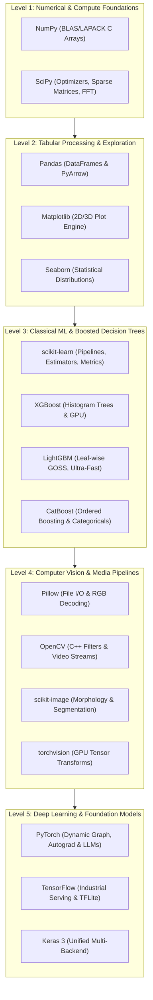
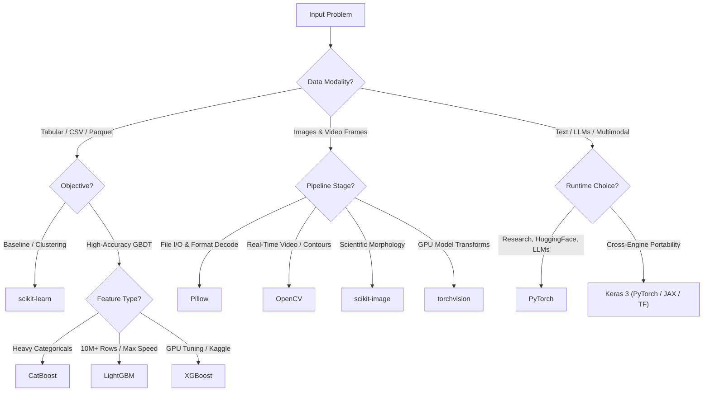

# Complete Guide to Data Science & ML Libraries: Architecture, Mental Models & 2026 Developer Trends

Welcome to the **Data Science & Machine Learning Ecosystem Guide** for the AI Data Foundation.

Whether you are preparing tabular data, engineering high-throughput computer vision pipelines, or training multi-billion parameter neural networks, every modern AI system rests on a layered foundation of open-source Python libraries.

---

## 1. Quickstart: Installation

### Modern Ultra-Fast Installation (Recommended)
Using [`uv`](https://github.com/astral-sh/uv) (resolves and installs in seconds with a global cache):
```bash
uv pip install numpy pandas matplotlib seaborn scipy scikit-learn \
  xgboost lightgbm catboost opencv-python scikit-image pillow \
  tensorflow keras torch torchvision
```

### Classic `pip` Installation
```bash
pip install numpy pandas matplotlib seaborn scipy scikit-learn \
  xgboost lightgbm catboost opencv-python scikit-image pillow \
  tensorflow keras torch torchvision
```

> [!NOTE]
> **Developer Trend Note on `mxnet`**:
> The user command included `mxnet`. Apache MXNet was officially retired and moved to the **Apache Attic in September 2023**. It does not support Python 3.11+, Apple Silicon (M-series), or modern CUDA 12+. In this guide, we document why MXNet was historically significant (AWS's early deep learning engine) and why modern teams migrated 100% to **PyTorch**, **JAX**, or **Keras 3**.

---

## 2. Architecture & Ecosystem Diagram (Pele / Mermaid)

The following diagram illustrates how these libraries stack from low-level memory and hardware acceleration up to specialized deep learning and computer vision applications:



---

## 3. Decision Matrix: "Which Tool When?"

When starting an ML task, use this decision flowchart to select the optimal toolchain:



---

## 4. Deep-Dive by Layer

### Layer 1: Numerical Foundations (`numpy`, `scipy`)

#### **NumPy (`numpy`)**
- **Mental Model**: The lingua franca of memory. A NumPy array (`ndarray`) is a contiguous block of C-ordered memory with a shape and stride tuple. It enables single-instruction multiple-data (SIMD) vectorization without Python `for`-loop overhead.
- **Code Snippet**:
  ```python
  import numpy as np

  # Vectorized dot product (runs in BLAS C runtime)
  x = np.random.randn(1000)
  weights = np.random.randn(1000)
  activation = np.dot(x, weights)
  ```
- **2026 Developer Trend**: **NumPy 2.0** released with a breaking C-API overhaul, enhanced typing, and native support for 64-bit platforms.

#### **SciPy (`scipy`)**
- **Mental Model**: The engineering and math toolkit built directly on top of NumPy. Where NumPy provides the raw arrays, SciPy provides the algorithms: numerical integration, differential equation solvers, sparse matrix data structures (`csr_matrix`), and fast Fourier transforms (`fft`).
- **Code Snippet**:
  ```python
  from scipy.optimize import minimize
  from scipy.sparse import csr_matrix

  # Sparse matrix holding 1 million zeroes with 2 non-zero elements
  sparse_data = csr_matrix(([1.0, 2.0], ([0, 2], [1, 3])), shape=(1000, 1000))
  ```
- **2026 Developer Trend**: Indispensable for scientific machine learning, sparse graph algorithms, and custom optimization loss functions.

---

### Layer 2: Data Manipulation & Exploration (`pandas`, `matplotlib`, `seaborn`)

#### **Pandas (`pandas`)**
- **Mental Model**: The programmatic spreadsheet. A two-dimensional labeled data structure (`DataFrame`) with heterogeneous column types, SQL-like group-by, join, and pivot operations.
- **Code Snippet**:
  ```python
  import pandas as pd

  df = pd.DataFrame({"category": ["A", "B", "A"], "revenue": [120, 250, 180]})
  summary = df.groupby("category")["revenue"].agg(["mean", "sum"])
  ```
- **2026 Developer Trend**: **Pandas 2.0+** introduced the **Apache Arrow backend** (`pd.options.mode.string_storage = "pyarrow"`), providing zero-copy string interoperability. High-throughput projects frequently complement it with **Polars** (Rust-based multi-threaded DataFrame engine).

#### **Matplotlib & Seaborn (`matplotlib`, `seaborn`)**
- **Mental Model**:
  - `matplotlib`: The low-level canvas engine. Exposes the Figure and Axes objects where every tick, spine, line, and label can be customized down to the pixel.
  - `seaborn`: The high-level statistical storytelling layer. Built on top of Matplotlib, it accepts DataFrames directly to produce statistical regression lines, heatmaps, and violin distributions.
- **Code Snippet**:
  ```python
  import seaborn as sns
  import matplotlib.pyplot as plt

  sns.set_theme(style="darkgrid")
  tips = sns.load_dataset("tips")
  ax = sns.boxplot(x="day", y="total_bill", hue="smoker", data=tips)
  plt.title("Bill Distribution by Day")
  plt.show()
  ```
- **2026 Developer Trend**: Static Matplotlib/Seaborn remains the gold standard for publication-ready PDF papers and reports; interactive tools like **Plotly** and **Altair** are favored for browser-based analytics dashboards.

---

### Layer 3: Classical Machine Learning & GBDTs (`scikit-learn`, `xgboost`, `lightgbm`, `catboost`)

#### **scikit-learn (`scikit-learn`)**
- **Mental Model**: The standard API contract for machine learning. Everything is either an:
  1. `Estimator`: Implements `.fit(X, y)`
  2. `Transformer`: Implements `.transform(X)` (e.g., `StandardScaler`, `OneHotEncoder`)
  3. `Predictor`: Implements `.predict(X)` and `.predict_proba(X)`
  Chained cleanly with `Pipeline`.
- **Code Snippet**:
  ```python
  from sklearn.pipeline import Pipeline
  from sklearn.preprocessing import StandardScaler
  from sklearn.linear_model import LogisticRegression

  pipe = Pipeline([
      ("scaler", StandardScaler()),
      ("classifier", LogisticRegression())
  ])
  pipe.fit(X_train, y_train)
  ```
- **2026 Developer Trend**: The unrivaled standard for data prep, evaluation metrics (ROC-AUC, F1, log-loss), and cross-validation across all ML teams.

#### **The Gradient Boosted Decision Tree (GBDT) Showdown**
On tabular data, GBDTs consistently outperform deep neural networks in training speed, sample efficiency, and interpretability.

| Feature | **XGBoost** (`xgboost`) | **LightGBM** (`lightgbm`) | **CatBoost** (`catboost`) |
| :--- | :--- | :--- | :--- |
| **Developer** | Distributed (Tianqi Chen / DMLC) | Microsoft Research | Yandex Research |
| **Splitting Strategy** | Level-wise (depth-first) | Leaf-wise (best-first) | Symmetric / Oblivious Trees |
| **Categorical Support** | One-hot or experimental partition | Native integer bins | **Best-in-class** native categorical handling |
| **Speed & Memory** | Fast (Hist/GPU mode) | **Fastest** (GOSS & EFB algorithms) | Moderate (slower training, ultra-fast inference) |
| **Overfitting Resistance** | Standard L1/L2 regularization | Requires tuning `max_depth` & `num_leaves` | **Highest** out-of-the-box (Ordered Boosting) |
| **Ideal Use Case** | Benchmark modeling, Kaggle, enterprise pipelines | Ultra-large datasets (10M+ rows), rapid iteration | Datasets with dozens of string/categorical columns |

- **Code Comparison**:
  ```python
  # LightGBM: Maximum training velocity
  import lightgbm as lgb
  model_lgb = lgb.LGBMClassifier(n_estimators=100, learning_rate=0.05)

  # CatBoost: Direct categorical support without manual one-hot encoding
  from catboost import CatBoostClassifier
  model_cat = CatBoostClassifier(iterations=100, cat_features=["city", "device"])
  ```

---

### Layer 4: Computer Vision (`pillow`, `opencv-python`, `scikit-image`, `torchvision`)


#### **Pillow (`PIL`)**
- **Mental Model**: Image file input/output. Python's default image loader (returns RGB channels). Used internally by Hugging Face Datasets and PyTorch `DataLoader`.

#### **OpenCV (`opencv-python` / `cv2`)**
- **Mental Model**: Real-time C++ computer vision powerhouse. Images are represented directly as NumPy arrays in **BGR format** (Blue-Green-Red). Best for video frame extraction, color space conversions, contour detection, and optical flow.
- **Crucial Gotcha**:
  ```python
  import cv2
  img_bgr = cv2.imread("sample.jpg") # BGR format!
  img_rgb = cv2.cvtColor(img_bgr, cv2.COLOR_BGR2RGB) # Must convert for matplotlib or PyTorch
  ```

#### **scikit-image (`skimage`)**
- **Mental Model**: The scientific image processing sister of scikit-learn. Focuses on peer-reviewed algorithms: medical imaging, watershed segmentation, Hough transforms, and feature extraction.

#### **torchvision (`torchvision`)**
- **Mental Model**: The bridge between raw images and PyTorch tensors. Includes GPU-accelerated transformations (`torchvision.transforms.v2`), standard datasets (ImageNet, COCO), and pretrained vision models (ResNet, ViT, ConvNeXt).

---

### Layer 5: Deep Learning Frameworks (`torch`, `tensorflow`, `keras`, `mxnet`)

#### **PyTorch (`torch`)**
- **Mental Model**: Python-native dynamic computation graph ("Define-by-Run"). Backpropagation is tracked in real-time by the `autograd` engine.
- **Why It Dominates Today**:
  - Over **90% of frontier AI papers** (Transformers, Diffusion models, LLMs like Llama, DeepSeek, Mistral) are written in PyTorch.
  - Native tooling: `torch.compile` (Inductor backend), FSDP (Fully Sharded Data Parallel), FlashAttention, and seamless Hugging Face integration.
- **Code Snippet**:
  ```python
  import torch
  import torch.nn as nn

  # Modern PyTorch dynamic forward pass
  device = "cuda" if torch.cuda.is_available() else ("mps" if torch.backends.mps.is_available() else "cpu")
  x = torch.randn(32, 512, device=device)
  layer = nn.Linear(512, 128).to(device)
  output = torch.relu(layer(x))
  ```

#### **TensorFlow & Keras 3 (`tensorflow`, `keras`)**
- **Mental Model**:
  - `TensorFlow`: Google's production-grade engine with static computation graphs, XLA compilation, and TFLite edge deployment.
  - `Keras 3`: **The multi-backend revolution**. In Keras 3, you write neural networks once in Keras, and they can run natively on **PyTorch**, **JAX**, or **TensorFlow** without code modifications.
- **Code Snippet**:
  ```python
  import os
  os.environ["KERAS_BACKEND"] = "torch" # Choose 'torch', 'jax', or 'tensorflow'
  import keras

  model = keras.Sequential([
      keras.layers.Dense(64, activation="relu"),
      keras.layers.Dense(10, activation="softmax")
  ])
  ```

#### **Apache MXNet (`mxnet`) — Historical Context & Modern Migration**
- **What it was**: Developed by Carnegie Mellon, University of Washington, and AWS in 2015. Notable for memory-efficient symbolic + imperative programming (Gluon API).
- **Current Status**:
  - **Officially retired to the Apache Attic in September 2023**.
  - No releases for modern Python versions (3.11/3.12/3.13) or contemporary GPU architectures.
- **Migration Recommendation**: All teams with legacy MXNet pipelines have migrated to **PyTorch** for model training and **ONNX Runtime** (LF AI & Data Foundation) for production cross-platform inference.

---

## 5. Summary Cheat Sheet

| Library | Primary Responsibility | Input / Output Format | 2026 Developer Trend Status |
| :--- | :--- | :--- | :--- |
| `numpy` | Vectorized math & array storage | `ndarray` | **Universal Standard** (NumPy 2.x) |
| `scipy` | Scientific math & sparse matrices | `csr_matrix`, ndarray | **Universal Standard** |
| `pandas` | Tabular data manipulation & SQL joins | `DataFrame` | **Dominant** (complemented by Polars) |
| `matplotlib` | Low-level figure generation | Canvas / Figure | **Core Standard** |
| `seaborn` | Statistical distributions & heatmaps | Matplotlib Axes | **Core Standard** |
| `scikit-learn` | Classical ML algorithms & pipelines | NumPy arrays, DataFrames | **Universal Standard** |
| `xgboost` | Exact / histogram GBDT | DMatrix, ndarray | **High Production Usage** |
| `lightgbm` | High-speed GBDT on massive data | Dataset, ndarray | **Top Choice for Large Tabular Data** |
| `catboost` | GBDT with categorical strings | Pool, DataFrames | **Best Out-of-the-Box Accuracy** |
| `pillow` | Image file decoding & basic transforms | PIL Image | **Universal Standard** |
| `opencv-python`| Video frames, filters & C++ CV ops | NumPy array (BGR) | **Universal Standard for Computer Vision** |
| `scikit-image`| Scientific morphometry & segmentation | NumPy array (RGB) | **Niche Scientific Standard** |
| `torch` | Deep learning, LLMs, Autograd | `torch.Tensor` | **#1 Dominant AI Framework (90%+ Research)** |
| `torchvision` | Vision datasets & tensor transforms | `torch.Tensor` | **Standard for PyTorch Vision** |
| `tensorflow` | Industrial production serving & TFLite | `tf.Tensor` | **Enterprise Production Legacy / Serving** |
| `keras` | Multi-backend high-level API | Keras Tensor | **Surging (Keras 3 Multi-Backend)** |
| `mxnet` | Legacy distributed DL engine | NDArray | **RETIRED (Apache Attic, Sept 2023)** |
