<USER_REQUEST>
# Matplotlib Complete Guide: Python Charts, Figures & Five Hands-On Labs

**A single-file companion to the Matplotlib Learning Lab.** Beginner → intermediate, with runnable plotting snippets and export tips.

**Version note:** APIs checked against official Matplotlib 3.11.2 documentation; runtime tests use Matplotlib 3.10.8, NumPy 2.3.5 and pandas 2.2.3.

**Data policy:** Every numeric dataset in the projects is synthetic. No plotted values represent real company analytics.

## Contents

1. [01 Getting Started](#lesson-1)
2. [02 Lines Scatter](#lesson-2)
3. [03 Bars Comparisons](#lesson-3)
4. [04 Histograms Distributions](#lesson-4)
5. [05 Subplots Layout](#lesson-5)
6. [06 Axes Ticks Scales](#lesson-6)
7. [07 Styling Annotations](#lesson-7)
8. [08 Heatmaps Images](#lesson-8)
9. [09 Save Export Performance](#lesson-9)
10. [10 Hands On Labs](#lesson-10)
11. [Cheat sheet](#cheat-sheet)
12. [FAQ](#frequently-asked-questions)
13. [Glossary](#glossary)
14. [Source references](#references)

## Setup

```bash
python -m venv .venv
source .venv/bin/activate  # Windows PowerShell: .venv\Scripts\Activate.ps1
python -m pip install matplotlib numpy pandas
```

<a id="lesson-1"></a>

## Lesson 1: Getting started: Figure, Axes, Canvas

**Goal:** Create a useful chart without memorizing the entire Matplotlib API. **Prerequisites:** basic Python, arrays or lists. **Time:** 10 minutes.

Matplotlib is a general-purpose Python plotting library. The most reusable entry point is its *explicit* interface: create `fig, ax`, call plotting methods on `ax`, and save or display `fig`. The popular `pyplot` interface is great for quick experimentation too.

### The anatomy of a plot

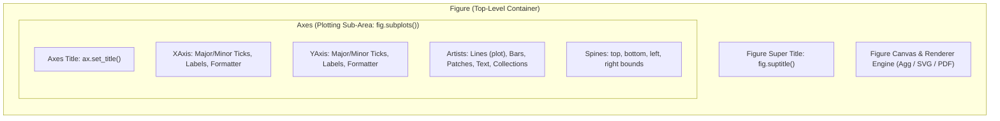

| Term | Plain-English meaning | Example |
| --- | --- | --- |
| `Figure` | Whole graphic: canvas-sized container | `fig` |
| `Axes` | One plotting area inside the Figure | `ax` |
| `Axis` | The x-axis or y-axis scale, ticks and labels | `ax.xaxis` |
| `Artist` | Anything drawn: lines, text, patches, images | `ax.lines` |
| `Canvas` | Renders the figure through a backend | `fig.canvas` |

> Think **Figure = page**, **Axes = chart on the page**, **Axis = measurement scale**, **Canvas = renderer**. In Matplotlib terminology `Axes` is not merely the plural of `Axis`.

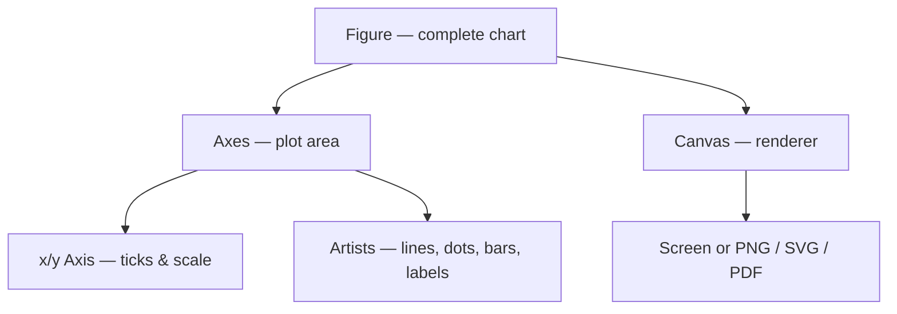

### First chart: copy and run

```python
import matplotlib.pyplot as plt

fig, ax = plt.subplots(figsize=(6, 3), layout="constrained")
ax.plot([1, 2, 3, 4], [2, 5, 4, 8], marker="o")
ax.set(title="My first chart", xlabel="Week", ylabel="Orders")
fig.savefig("first-chart.png", dpi=160)
plt.close(fig)
```

`figsize` is in **inches**. The saved image's approximate pixel dimensions are `figsize × dpi`, although tight bounding boxes can change output size. `layout="constrained"` adjusts spacing for axes labels and titles.

### When to call `plt.show()`

In a local desktop script, `plt.show()` opens an interactive window when an interactive backend is available. In Jupyter, display may happen automatically. On CI/headless machines, skip `show()` and save figures instead.

**Try it:** Change the line into a dashed line with `linestyle="--"`, then set the y-axis label to `Customers`. See [Lab 1](#lesson-10).

**Common mistake:** Calling `plt.plot()` repeatedly in a helper function without controlling which Figure receives the data. Prefer passing an `Axes` to plotting functions.

---

<a id="lesson-2"></a>

## Lesson 2: Line and scatter plots

**Goal:** Choose between lines (ordered sequence) and scatter (relationships) and explain the values clearly.

Use **line charts** for trends across continuous or ordered x-values. Use **scatter plots** when each point represents an observation such as price versus demand. Joining independent observations with a line can imply continuity that does not exist.

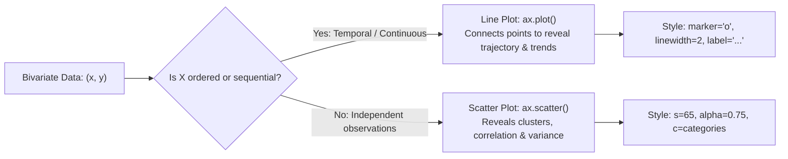

### Two series in one line chart

```python
import matplotlib.pyplot as plt

weeks = [1, 2, 3, 4]
visitors = [120, 155, 148, 192]
orders = [40, 50, 44, 66]
fig, ax = plt.subplots(layout="constrained")
ax.plot(weeks, visitors, marker="o", label="Visitors")
ax.plot(weeks, orders, marker="s", label="Orders")
ax.set(xlabel="Week", ylabel="Count", title="Weekly activity (synthetic)")
ax.legend()
ax.grid(axis="y", alpha=0.2)
plt.close(fig)
```

Markers distinguish series even when a reader cannot easily see color. If measurements have *very different scales*, consider separate panels or normalize to a shared index instead of defaulting to a confusing dual y-axis.

### Scatter: independent observations

```python
import matplotlib.pyplot as plt

cost = [100, 250, 300, 450, 500]
leads = [8, 17, 19, 28, 26]
fig, ax = plt.subplots(layout="constrained")
ax.scatter(cost, leads, s=65, alpha=0.75)
ax.set(xlabel="Campaign cost (USD)", ylabel="Leads", title="Cost vs leads")
plt.close(fig)
```

- `marker="o"` selects a marker; `s=65` is approximate *area* in points squared for scatter.
- `alpha` controls transparency; it can help with overlapping points.
- `label=` identifies a series; use `ax.legend()` to show it.

**Try it:** Show two lines with different markers. Ask whether your data represent a sequence or unrelated points. See [Lab 1](#lesson-10).

**Common mistake:** Drawing a line through unordered categorical records. Sort or choose another chart.

---

<a id="lesson-3"></a>

## Lesson 3: Bar charts for category comparisons

**Goal:** Compare categories without distorting differences.

Bar charts encode a quantity with bar **length**, so start the quantitative scale at zero when possible. Use horizontal bars (`barh`) for longer category names. Sort categories intentionally; don't imply that alphabetical order is a meaningful ranking.

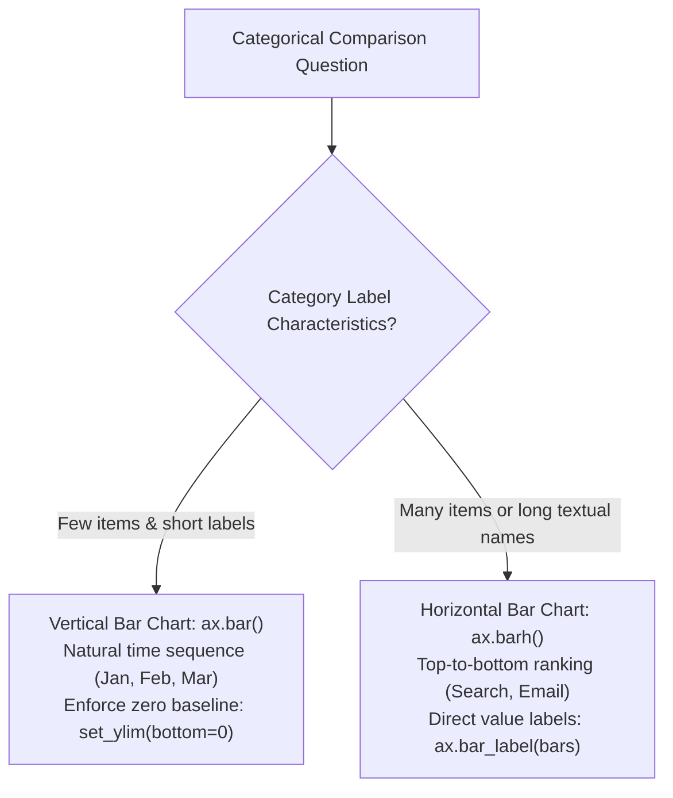

### Horizontal bar chart

```python
import matplotlib.pyplot as plt

names = ["Search", "Email", "Referral"]
counts = [248, 175, 145]
fig, ax = plt.subplots(layout="constrained")
bars = ax.barh(names, counts)
ax.bar_label(bars, padding=4)
ax.set(xlabel="Qualified leads", title="Lead sources (synthetic)")
ax.set_xlim(left=0)
plt.close(fig)
```

### Vertical bar chart

```python
import matplotlib.pyplot as plt

fig, ax = plt.subplots(layout="constrained")
ax.bar(["Jan", "Feb", "Mar"], [15, 19, 22])
ax.set(ylabel="Completed orders", title="Monthly orders")
ax.set_ylim(bottom=0)
plt.close(fig)
```

**When not to use a pie chart:** If precise comparison matters, a bar chart is typically easier to read. A pie chart may be acceptable for a small number of parts that sum to a whole, but label percentages and avoid dozens of slices.

| Question | Better starting choice |
| --- | --- |
| Which category is largest? | Sorted horizontal bar |
| How does a value change over time? | Line chart |
| How does one continuous variable spread? | Histogram |
| How do two numeric variables relate? | Scatter |

**Try it:** Change the bars' ordering while keeping labels matched to values. See [Lab 2](#lesson-10).

**Common mistake:** Cropping a bar axis at a large nonzero value, exaggerating small differences.

---

<a id="lesson-4"></a>

## Lesson 4: Histograms and distributions

**Goal:** Understand what bins show and how mean/median markers help explain a skewed distribution.

A histogram groups numerical observations into **bins**. The bar height normally represents the number of observations in each bin. Change `density=True` to make the total **area** equal 1, not the sum of heights.

```python
import numpy as np
import matplotlib.pyplot as plt

rng = np.random.default_rng(42)
wait_minutes = rng.lognormal(mean=1.1, sigma=0.5, size=500)
fig, ax = plt.subplots(layout="constrained")
ax.hist(wait_minutes, bins=20, edgecolor="white")
ax.axvline(wait_minutes.mean(), label="Mean", linestyle="--")
ax.axvline(np.median(wait_minutes), label="Median", linestyle=":")
ax.set(xlabel="Wait time (minutes)", ylabel="Observations", title="Simulated wait times")
ax.legend()
plt.close(fig)
```

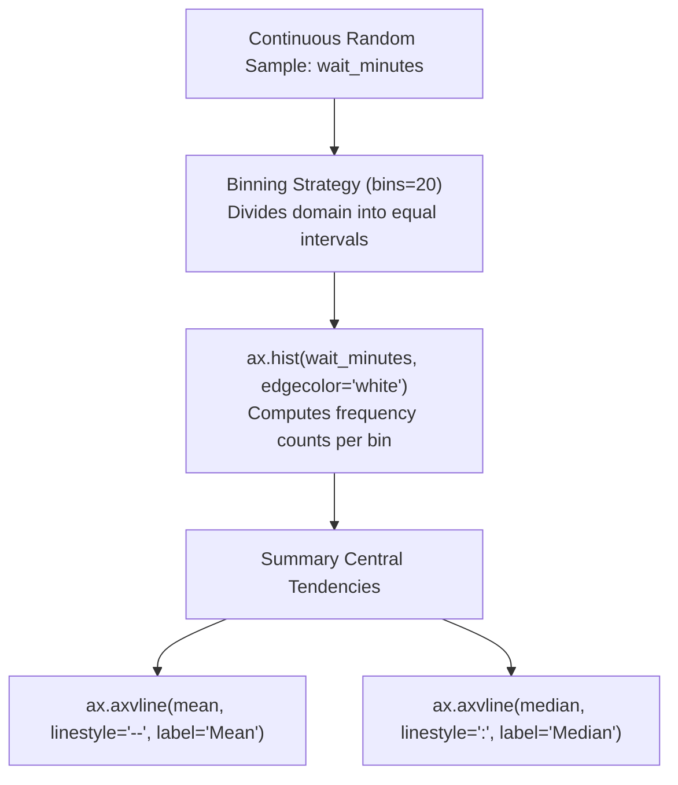

### What bin count should I choose?

Start with a sensible automatic rule (`bins="auto"`) or compare a few resolutions. Too few bins hide structure; too many add noise. Matplotlib's `hist` delegates bin edges to NumPy's histogram methods.

### Why use a fixed random seed?

`np.random.default_rng(42)` lets learners reproduce the same synthetic sample. A fixed seed is useful for examples and tests, but **not** proof that real-world results are reproducible without the original observations.

**Try it:** Switch between 10 and 40 bins. What features change? See [Lab 3](#lesson-10).

**Common mistake:** Showing `density=True` but calling the y-axis `Count`.

---

<a id="lesson-5"></a>

## Lesson 5: Multiple charts and layouts

**Goal:** Arrange related views so the reader can scan them without crowding.

`plt.subplots(rows, columns)` returns one Figure and an array of Axes for a grid. `plt.subplot_mosaic` returns a **dictionary of named Axes**, useful when panels have different roles.

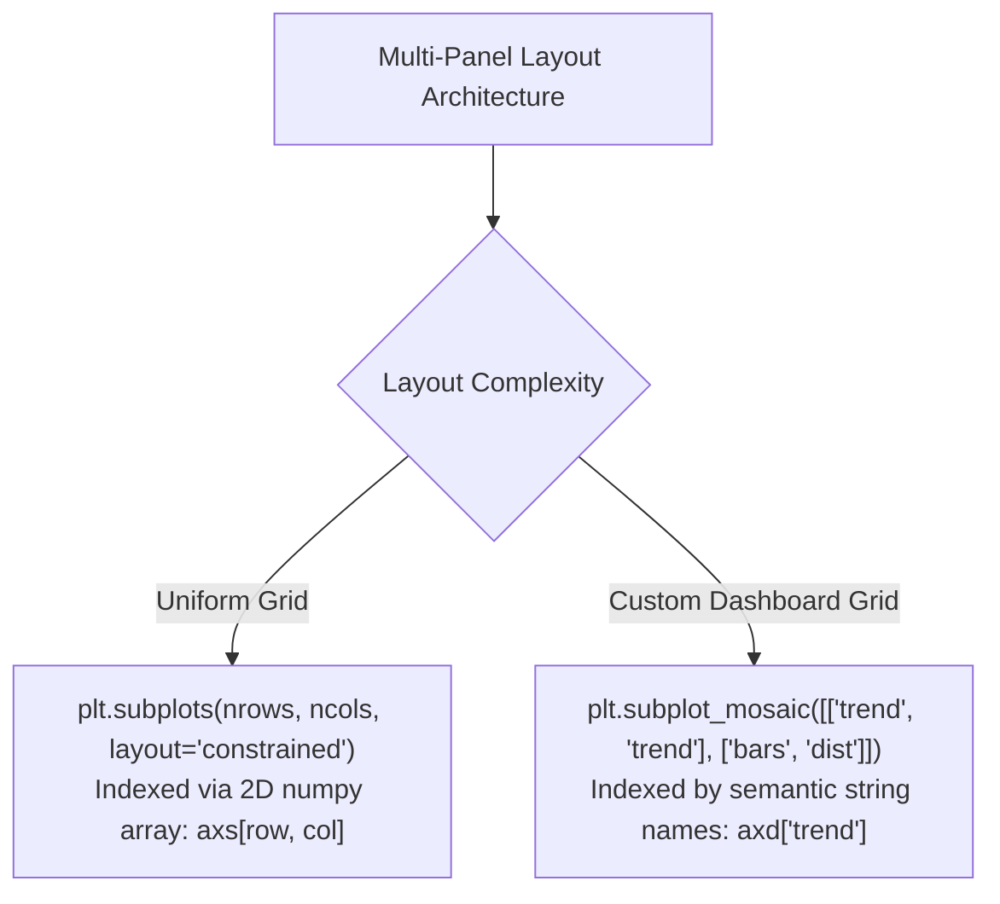

### Simple side-by-side panels

```python
import matplotlib.pyplot as plt

fig, axes = plt.subplots(1, 2, figsize=(8, 3), layout="constrained")
axes[0].plot([1, 2, 3], [2, 3, 5])
axes[0].set_title("Trend")
axes[1].bar(["A", "B", "C"], [4, 2, 6])
axes[1].set_title("Category totals")
plt.close(fig)
```

### Named layout with a wider panel

```python
import matplotlib.pyplot as plt

fig, axd = plt.subplot_mosaic(
    [["trend", "trend"], ["bars", "distribution"]],
    figsize=(9, 6), layout="constrained"
)
axd["trend"].plot([1, 2, 3], [7, 9, 12])
axd["bars"].bar(["A", "B"], [5, 7])
axd["distribution"].hist([1, 2, 2, 3, 3, 3], bins=3)
plt.close(fig)
```

### Layout rules

- Put the single most important takeaway in the largest or upper-left panel.
- Give every panel a useful label and units; consistent scales help comparison.
- Prefer `layout="constrained"` for many standard dashboards; it manages spacing around legends, colorbars and tick labels.
- Excessive tick text or very long titles still need human review; automatic layout is not magic.

**Try it:** Create a third panel and change panel names in `subplot_mosaic`. See [Lab 4](#lesson-10).

**Common mistake:** Comparing bar heights across panels that have different y limits without warning readers.

---

<a id="lesson-6"></a>

## Lesson 6: Axes, ticks, dates, and scales

**Goal:** Make axis values meaningful instead of showing raw numbers without context.

Axis labels describe the **metric and unit** (for example, `Revenue (USD)`), while tick locators and formatters control where ticks appear and how they read. An `Axes` has `xaxis` and `yaxis` objects for this purpose.

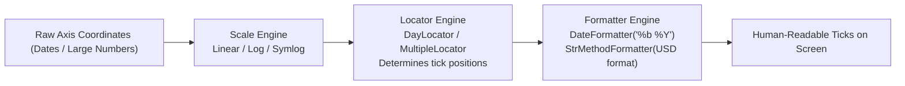

### Format large numbers

```python
import matplotlib.pyplot as plt
from matplotlib.ticker import StrMethodFormatter

fig, ax = plt.subplots(layout="constrained")
ax.plot([1, 2, 3], [1500, 2800, 4300])
ax.yaxis.set_major_formatter(StrMethodFormatter("${x:,.0f}"))
ax.set(xlabel="Week", ylabel="Revenue (USD)")
plt.close(fig)
```

### Dates with a dedicated formatter

```python
from datetime import date
import matplotlib.pyplot as plt
import matplotlib.dates as mdates

fig, ax = plt.subplots(layout="constrained")
ax.plot([date(2025, 1, 1), date(2025, 2, 1)], [10, 15])
ax.xaxis.set_major_formatter(mdates.DateFormatter("%b %Y"))
ax.set(ylabel="Orders")
plt.close(fig)
```

### Log scales: special case

`ax.set_yscale("log")` can help compare values across orders of magnitude. It requires positive values for conventional logarithmic display; zero and negative values cannot appear on the log scale as ordinary points. Label your scale clearly and explain what multiplicative differences mean.

**Try it:** Format your y-ticks as percentages by using `matplotlib.ticker.PercentFormatter(xmax=1)`. See [Lab 1](#lesson-10).

**Common mistake:** Formatting decimal values (0.2) as `20%` without adjusting `PercentFormatter`'s scale.

---

<a id="lesson-7"></a>

## Lesson 7: Styling, legends and annotations

**Goal:** Help a reader understand a chart before they examine every point.

Use a descriptive title, labeled axes, clear units, and a visual cue for the main takeaway. Keep decoration secondary. Color alone should not be the only way to tell series apart; markers, line styles, and direct labels can help.

```python
import matplotlib.pyplot as plt

months = [1, 2, 3, 4, 5]
orders = [25, 29, 27, 44, 51]
with plt.rc_context({"font.size": 11, "axes.spines.top": False,
                     "axes.spines.right": False}):
    fig, ax = plt.subplots(figsize=(7, 3.5), layout="constrained")
    ax.plot(months, orders, marker="o", linewidth=2, label="Orders")
    ax.annotate("Campaign launch", xy=(4, 44), xytext=(2.2, 49),
                arrowprops={"arrowstyle": "->"})
    ax.set(title="Orders rise after launch (synthetic)", xlabel="Month", ylabel="Orders")
    ax.grid(axis="y", alpha=0.2)
    ax.legend(frameon=False)
    plt.close(fig)
```

`plt.rc_context()` applies temporary style options, without accidentally changing global styling in a reusable library. For site-wide formatting, a `.mplstyle` file may be more maintainable.

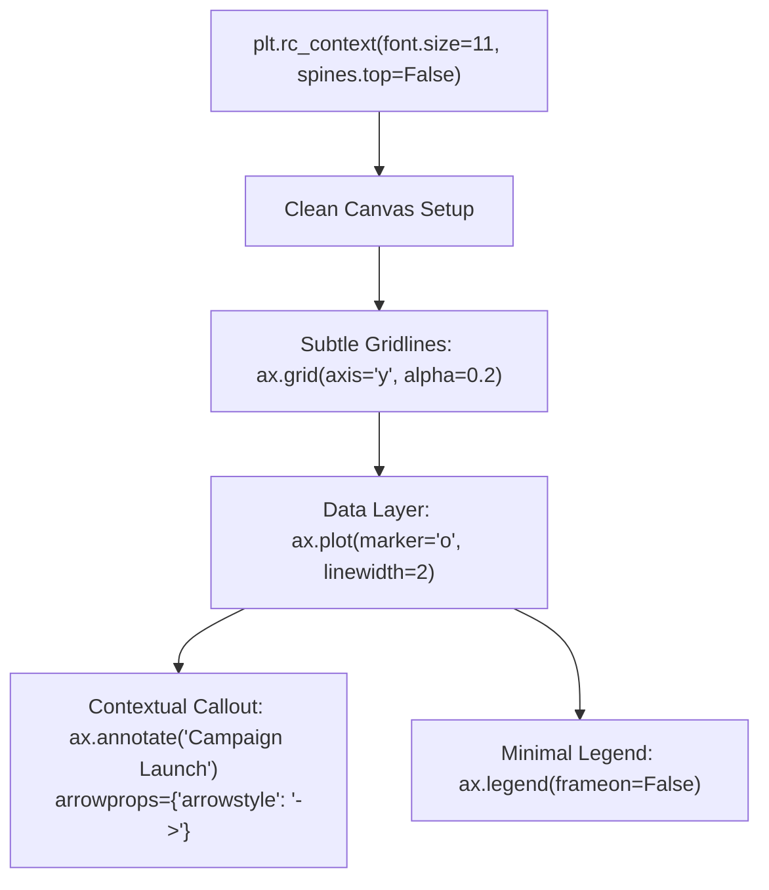

### Chart accessibility checklist

1. Write a takeaway-based title where evidence supports it.
2. Label values and units; avoid unlabeled icons or colors.
3. Ensure the meaning remains legible in grayscale and at small size.
4. Provide alt text or a textual summary when publishing charts on websites.
5. Avoid claiming causality merely because two lines rise together.

**Try it:** Label a point without an arrow; compare it with a long legend. See [Lab 1](#lesson-10).

**Common mistake:** Making labels so small that they are unreadable once exported to a slide or mobile screen.

---

<a id="lesson-8"></a>

## Lesson 8: Heatmaps and image plots

**Goal:** Display a two-dimensional matrix with a readable color scale and meaningful row/column labels.

`imshow` draws a 2D array as colored cells. A colorbar tells the reader what colors mean. For quantitative ordered values, a sequential color scale (for example, `Blues` or `viridis`) is a reasonable default.

```python
import numpy as np
import matplotlib.pyplot as plt

activity = np.array([[3, 5, 7], [2, 8, 6], [4, 6, 9]])
fig, ax = plt.subplots(layout="constrained")
image = ax.imshow(activity, cmap="Blues", vmin=0)
ax.set_xticks([0, 1, 2], ["AM", "Noon", "PM"])
ax.set_yticks([0, 1, 2], ["Mon", "Tue", "Wed"])
fig.colorbar(image, ax=ax, label="Activity count")
ax.set_title("Activity heatmap (synthetic)")
plt.close(fig)
```

**Why `vmin` and `vmax` matter:** Colormaps are normalized to a value range. When comparing multiple heatmaps, use the **same** scale so equal colors mean equal values. Diverging colormaps are useful for values centered on a meaningful midpoint such as deviation from zero.

**Text on cells:** Add values with `ax.text(col, row, str(value))`. For contrast, choose text color based on cell fill instead of using one color everywhere. See [Lab 5](#lesson-10).

**Try it:** Replace the data with a 4×4 matrix, then add row names.

**Common mistake:** Comparing colors on two charts with different colorbar ranges as though they represented the same numeric scale.

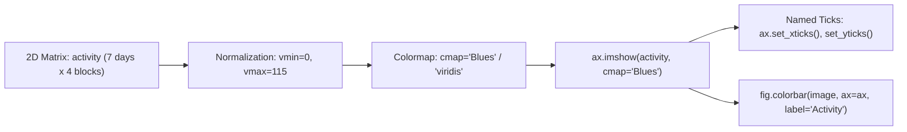

---

<a id="lesson-9"></a>

## Lesson 9: Save plots as PNG, SVG and PDF

**Goal:** Export clean visuals for README files, articles, slides and publications.

Use `fig.savefig(...)`, not `plt.savefig(...)`, when working with a named Figure. PNG is a raster image that is simple to share; SVG and PDF preserve vector geometry for many artists, which is useful for resizing without blurry lines. Raster image artists may still be embedded as pixels in a vector file.

```python
import matplotlib
matplotlib.use("Agg")  # Choose backend BEFORE importing pyplot in headless scripts.
import matplotlib.pyplot as plt

fig, ax = plt.subplots(figsize=(7, 4), layout="constrained")
ax.plot([1, 2, 3], [3, 5, 4], marker="o")
ax.set(xlabel="Week", ylabel="Orders")
fig.savefig("orders.png", dpi=160, bbox_inches="tight")
fig.savefig("orders.svg", bbox_inches="tight")
fig.savefig("orders.pdf", bbox_inches="tight")
plt.close(fig)
```

| Format | Typical use | Note |
| --- | --- | --- |
| PNG | README, web previews, screenshots | `dpi` controls raster detail |
| SVG | Editable-style vector web graphics | Watch file size for very complex drawings |
| PDF | Reports and print-oriented workflows | Fonts and embedded raster content may vary |

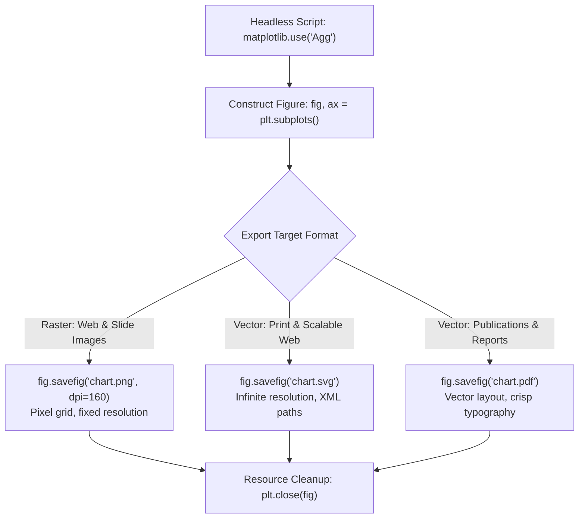

### Important habits

- Call `savefig()` **before** `plt.close(fig)`; saving after closing can produce surprising results.
- Use a noninteractive backend (`Agg`) on headless CI or batch servers.
- Close figures after exporting to avoid memory growth in loops.
- Use `layout="constrained"` and inspect the resulting image; automated layout cannot guarantee perfect design.
- For very large scatter plots, consider `rasterized=True` for that Artist when saving SVG/PDF, or sample carefully and document the sampling.

**Try it:** Save the same figure at 80 and 200 DPI, then compare PNG dimensions and file sizes. See [Lab 5](#lesson-10).

**Common mistake:** Assuming that a higher DPI makes SVG lines sharper; vectors remain resolution-independent until rasterized.

---

<a id="lesson-10"></a>

## Lesson 10: Five hands-on plotting labs

**Goal:** Build reproducible charts instead of copying disconnected snippets. The CSV data in `data/` are entirely **synthetic** for education, not real performance figures.

### Run the lab sequence

From the repository root:

```bash
python -m pip install -r requirements.txt
python -m labs.lab01_line_chart
python -m labs.lab02_bar_chart
python -m labs.lab03_histogram
python -m labs.lab04_dashboard
python -m labs.lab05_heatmap_export
```

Charts appear in `outputs/` as PNG and SVG. Lab 5 also exports PDF. Files are intentionally regenerated on each run.

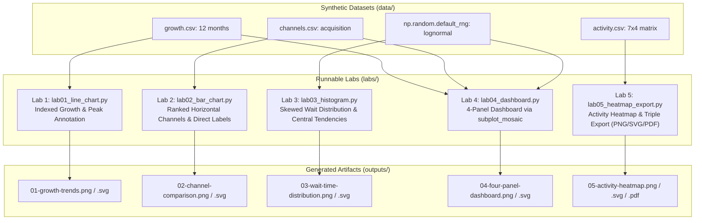

### Lab 1: growth lines

**Inputs:** `data/growth.csv` (12 months). **Question:** Are visitors and orders growing at similar rates? **Method:** index both metrics to 100 in January, plot two lines, annotate peak orders. **Output:** `01-growth-trends.png` and `.svg`. **Learn:** date formatting, labels and the benefit of a comparable scale.

### Lab 2: channel bars

**Inputs:** `data/channels.csv`. **Question:** Which acquisition channel generates the most leads? **Method:** sort channel counts, use horizontal bars and direct labels. **Output:** `02-channel-comparison.png` and `.svg`. **Learn:** zero baseline, numeric labels, category ordering.

### Lab 3: distribution

**Inputs:** synthetic lognormal sample generated with `np.random.default_rng(42)`. **Question:** How skewed are waiting times? **Method:** histogram plus mean and median reference lines. **Output:** `03-wait-time-distribution.png` and `.svg`. **Learn:** bins, summary statistics, deterministic examples.

### Lab 4: 4-panel dashboard

**Inputs:** growth and channel CSVs, plus a deterministic simulated order-size sample. **Question:** Can you summarize time trend, category totals, relationship and distribution in one figure? **Method:** `subplot_mosaic`. **Output:** `04-four-panel-dashboard.png` and `.svg`. **Learn:** multi-panel layout, visual hierarchy, mixed chart types.

### Lab 5: heatmap and publishing

**Inputs:** `data/activity.csv` (7 days × 4 time blocks). **Question:** When is activity concentrated? **Method:** `imshow`, cell annotations, a colorbar, PNG/SVG/PDF export. **Output:** `05-activity-heatmap.png`, `.svg`, `.pdf`. **Learn:** image artists, color scales and publishing formats.

### Tests and review

```bash
python -m pip install -r requirements-dev.txt
python -m pytest -q
```

Automated tests check chart structure, data shapes, deterministic samples, labels, colorbars and PNG/SVG/PDF export headers. They do **not** assess whether a chart tells an honest or visually clear story: review previews yourself.

### Next step challenge

Extend the dashboard with a sixth dataset, or replace synthetic data with your own. Before publishing, write a one-sentence chart takeaway and provide the data source. Open [the cheat sheet](#cheat-sheet) for API reminders.

---

# Matplotlib cheat sheet

Use the explicit `fig, ax = plt.subplots()` API for scripts and reusable functions.

| Task | Recommended pattern |
| --- | --- |
| Create figure | `fig, ax = plt.subplots(layout="constrained")` |
| Line | `ax.plot(x, y, marker="o")` |
| Scatter | `ax.scatter(x, y, alpha=0.7)` |
| Vertical bars | `ax.bar(categories, values)` |
| Horizontal bars | `ax.barh(categories, values)` |
| Histogram | `ax.hist(values, bins=20)` |
| Heatmap | `img = ax.imshow(matrix, cmap="viridis")` |
| Colorbar | `fig.colorbar(img, ax=ax)` |
| Titles/labels | `ax.set(title="...", xlabel="...", ylabel="...")` |
| Legend | `ax.legend()` after specifying `label=` |
| Grid | `ax.grid(axis="y", alpha=0.2)` |
| Add note | `ax.annotate("peak", xy=(x, y), xytext=(...))` |
| Horizontal reference | `ax.axhline(target, linestyle="--")` |
| Y-axis log scale | `ax.set_yscale("log")` |
| Side-by-side axes | `fig, axs = plt.subplots(1, 2)` |
| Named dashboard layout | `fig, axs = plt.subplot_mosaic([["a", "b"]])` |
| Export PNG | `fig.savefig("plot.png", dpi=160)` |
| Export SVG | `fig.savefig("plot.svg")` |
| Export PDF | `fig.savefig("plot.pdf")` |
| Release resources | `plt.close(fig)` |

## Chart selection flow

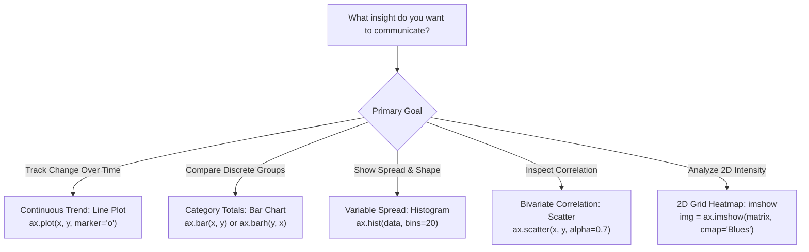

**Important distinction:** `Figure` is a graphics container; `Axes` is a plot area; `Axis` handles ticks and scale; the `Canvas` draws the result. See [Lesson 1](#lesson-1).

---

# Matplotlib frequently asked questions

## What is Matplotlib used for?

To make graphs and scientific/business visualizations in Python. It provides fine-grained control over lines, bars, histograms, image plots, annotations, ticks and export formats.

## What is the difference between Matplotlib and pyplot?

Matplotlib is the full library; `matplotlib.pyplot` is a convenient stateful interface for creating and controlling figures. For reusable scripts, a `Figure` + `Axes` approach is easier to reason about. Read [Lesson 1](#lesson-1).

## What is the difference between Figure, Axes and Axis?

The `Figure` contains the graphic, an `Axes` contains a plotting area, and `Axis` objects control the scales and ticks inside that area. `Canvas` is the rendering bridge used by backends.

## Why does `plt.show()` not open a window?

You may be on a noninteractive backend, remote server or notebook. For batch tasks, save with `fig.savefig()` instead. For desktop interactions use an available interactive backend. See [Lesson 9](#lesson-9).

## Why did I save an empty PNG?

A common cause is saving the wrong current figure or saving after closing/clearing it. Keep your own `fig` reference, call `fig.savefig(...)`, and close it *afterward*.

## How do I add labels to a bar chart?

Get the bars from `bars = ax.bar(...)` and call `ax.bar_label(bars)`. See [Lesson 3](#lesson-3).

## Should I use `tight_layout()` or constrained layout?

For many new figures, `plt.subplots(layout="constrained")` handles spacing with a layout engine. Both approaches have trade-offs. Avoid mixing layout methods without understanding their interactions. See [Lesson 5](#lesson-5).

## Can Matplotlib make interactive visualizations?

Yes, with appropriate interactive backends and GUI/notebook integration. This package focuses on reproducible **static** visuals, because they're easy to publish and test.

## When should I use a histogram rather than a bar chart?

Use a histogram for a continuous variable divided into numeric ranges; use a bar chart to compare discrete categories. See [Lessons 3](#lesson-3) and [4](#lesson-4).

## Which file format should I save?

PNG for most web previews; SVG for scalable vector web visuals; PDF for print/report workflows. Vector formats can embed raster elements. See [Lesson 9](#lesson-9).

## Does Matplotlib require NumPy or pandas?

Matplotlib depends on NumPy internally and accepts a variety of array-like inputs. pandas is optional for many workflows, but this lab uses pandas to read realistic CSV examples.

## Matplotlib vs Seaborn vs Plotly?

Matplotlib gives fine-grained figure control, Seaborn provides statistical plot defaults built on Matplotlib, and Plotly specializes in interactive web-based plotting. Choose based on the required output rather than asserting one is always best.

## What version is this course written for?

The course uses modern Matplotlib APIs and was checked against official Matplotlib **3.11.2** documentation. Code/tests were run locally under Matplotlib **3.10.8**. It is not a claim that every environment and future version have been tested.

---

# Matplotlib glossary

| Term | Beginner-friendly explanation |
| --- | --- |
| `Figure` | The complete graphic containing one or more plots |
| `Axes` | A plotting panel, often containing x and y axes |
| `Axis` | The scale, tick location and tick label machinery |
| `Canvas` | An object that renders the figure with a backend |
| `Artist` | Visual object such as a line, title, patch or image |
| `pyplot` | Convenience interface for figure creation and quick plotting |
| Object-oriented API | Writing operations as `ax.plot`, `ax.set`, `fig.savefig` |
| `subplots` | A regular grid of plotting areas |
| `subplot_mosaic` | A named layout of plotting panels |
| Marker | The symbol placed at data coordinates along a line or scatter plot |
| Legend | Key explaining symbols/series shown on a chart |
| Annotation | Text or arrow tied to a specific observation |
| Bin | Numeric interval used to count observations in a histogram |
| Colormap | Mapping from values to displayed colors |
| Colorbar | Legend mapping colors to numeric magnitudes |
| `vmin`/`vmax` | Lower and upper bounds of image color normalization |
| Backend | Mechanism for drawing to screen, file or notebook |
| `Agg` | Noninteractive raster-rendering backend |
| DPI | Dots per inch; affects pixel count in raster exports |
| SVG | Scalable vector graphics file format |
| PDF | Portable document format, often used for vector graphics |
| Synthetic dataset | Invented/sample data used for demonstration, not real measurements |

See [the first lesson](#lesson-1) and the [quick reference](#cheat-sheet).

---

## References

- [Matplotlib 3.11.2 quick start](https://matplotlib.org/stable/users/explain/quick_start.html)
- [Figures and layout](https://matplotlib.org/stable/users/explain/figure/index.html)
- [Figure.savefig reference](https://matplotlib.org/stable/api/_as_gen/matplotlib.figure.Figure.savefig.html)
- [Official examples gallery](https://matplotlib.org/stable/gallery/index.html)
- [Google SEO Starter Guide](https://developers.google.com/search/docs/fundamentals/seo-starter-guide)

## Run the complete projects

The full lab source code ships separately in `labs/` and is indexed in [the README](README.md). Run with `python -m labs.lab01_line_chart` through `lab05_heatmap_export`. Tests: `python -m pytest -q`.

</USER_REQUEST>
<ADDITIONAL_METADATA>
The current local time is: 2026-11-02T05:54:03+05:30.
</ADDITIONAL_METADATA>